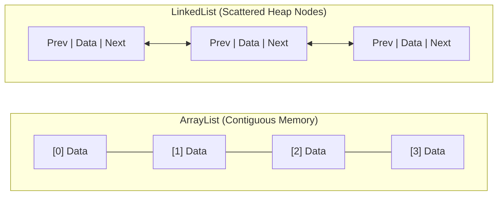
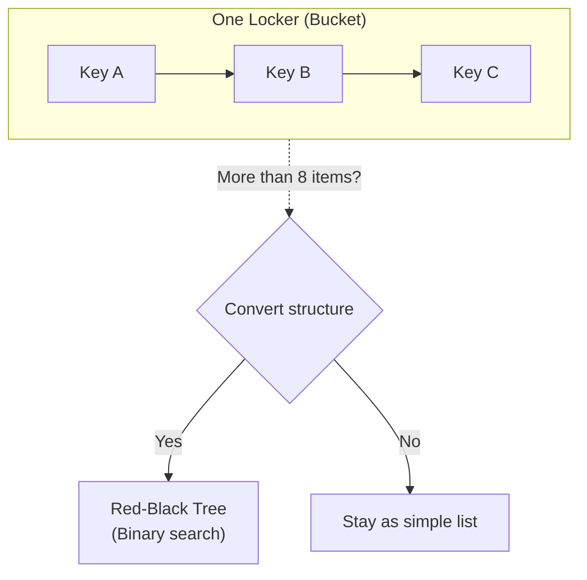
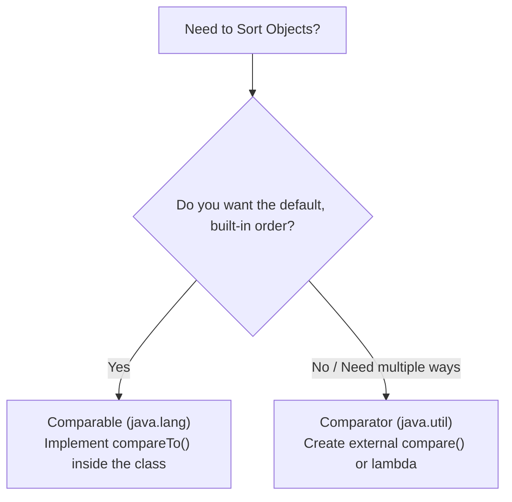
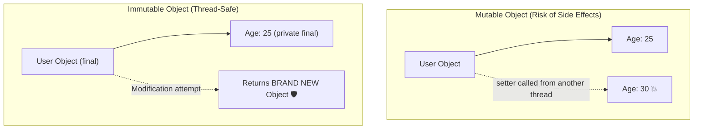
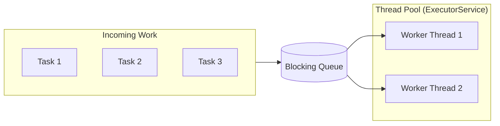
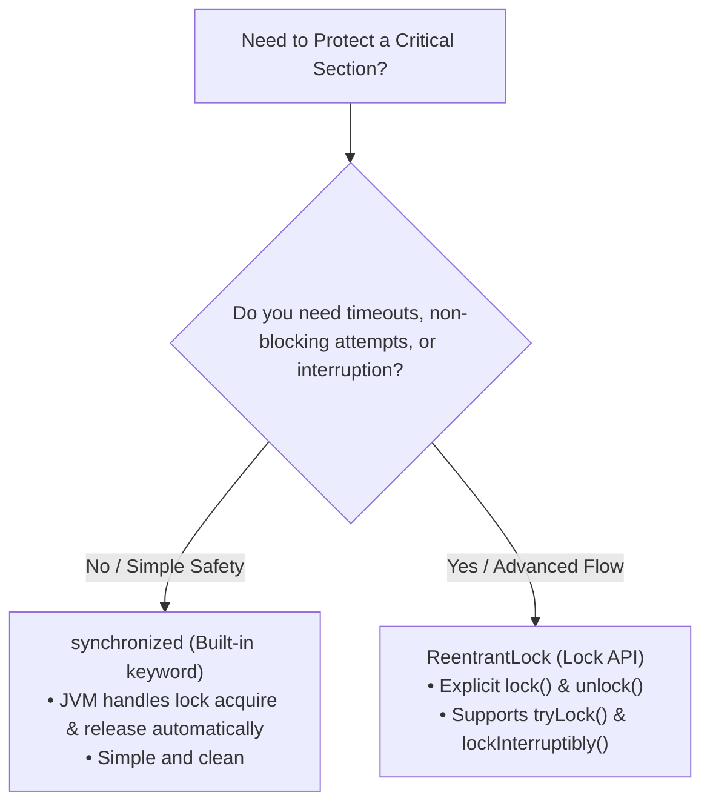
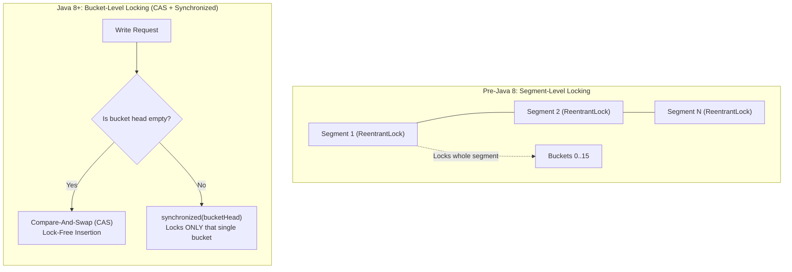
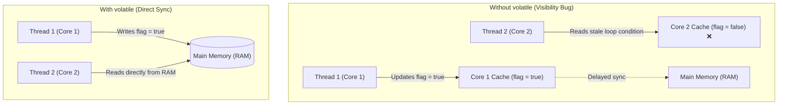

I wrote this series as a running study log covering core Java mechanics, Spring Boot runtime behavior, and JPA/Hibernate internals. Writing them down in my own words helps bridge the gap between theoretical knowledge and production intuition—making sure I can articulate the trade-offs clearly when it counts in technical rounds.

## Core Java

### 1. `ArrayList` vs `LinkedList` — Internal Working



- **ArrayList (Dynamic Array):**
  - **Memory:** Elements sit side-by-side in one contiguous memory block.
  - **Read $O(1)$:** Instant access by index using simple pointer math (`base_address + index * size`).
  - **Insert/Delete $O(n)$:** Adding or removing anywhere except the tail forces all subsequent elements to shift in memory.
- **LinkedList (Doubly Linked List):**
  - **Memory:** Independent node objects scattered across the heap, wired together via `prev` and `next` pointers.
  - **Insert/Delete $O(1)$:** Re-linking pointers takes constant time once you already hold the target node reference.
  - **Read $O(n)$:** Must walk node-by-node from the head or tail to reach an index.
- **The Production Reality:**
  - In textbook theory, `LinkedList` wins for write-heavy cases.
  - In modern architectures, `ArrayList` almost always wins due to **CPU cache locality** (reading contiguous memory is orders of magnitude faster than chasing pointer references across random heap locations). Use `ArrayList` by default unless you have an explicit queue/deque need.

### 2. How `HashMap` Handles Collisions & Treeification

Think of a `HashMap` like a row of numbered lockers (called **buckets**).

When you store a key-value pair, Java calculates a locker number using the key's hash code:

$$\text{Locker Index} = \text{hash}(\text{key}) \pmod{\text{capacity}}$$

A **collision** happens when two completely different keys calculate the exact same locker number.



#### What happens during a collision?

- **Before Java 8:**
  - The locker acted like a single line (a **LinkedList**).
  - New collisions were simply tacked onto the end.
  - If 10 items landed in the same locker, finding your key meant checking each item one-by-one from the front to the back.
  - Search speed in a crowded bucket: $O(n)$ (linear time).
- **Java 8 and Newer (Treeification):**
  - When a single bucket gets crowded (more than **8 items**) and the total map capacity is at least **64**, Java reorganizes that locker into a balanced **Red-Black Tree**.
  - Instead of scanning one-by-one, Java can divide and conquer using binary search.
  - Search speed inside the bucket improves from $O(n)$ to $O(\log n)$.
  - If items are removed and the bucket drops down to **6 items or fewer**, Java turns it back into a simple list to save memory.

#### The Quick Takeaway

| Situation                   | Data Structure Inside Bucket       | Search Speed                                       |
| --------------------------- | ---------------------------------- | -------------------------------------------------- |
| **Normal / Low Collisions** | LinkedList (simple chain)          | $O(1)$ on average, $O(n)$ worst-case inside bucket |
| **Crowded (> 8 items)**     | Red-Black Tree (balanced branches) | $O(\log n)$                                        |

**Why this matters in real life:** It prevents an app from freezing up if thousands of keys accidentally (or maliciously) crowd into the same locker.

### 3. `Comparable` vs `Comparator`

When you want to sort a list of objects in Java, the JVM needs to know: **"Which one comes first?"**

Java gives you two interfaces to answer this question:

- **`Comparable`**: The object decides how to sort _itself_ (default order).
- **`Comparator`**: An external helper decides how to sort two objects (custom order).



---

#### Quick Comparison Table

| Feature                    | `Comparable`                        | `Comparator`                                     |
| -------------------------- | ----------------------------------- | ------------------------------------------------ |
| **Package**                | `java.lang` (no import needed)      | `java.util` (requires import)                    |
| **Method**                 | `compareTo(Object other)`           | `compare(Object o1, Object o2)`                  |
| **Philosophy**             | **"I know my natural order"**       | **"Someone else decides how to sort us"**        |
| **Modify Original Class?** | **Yes** (you must edit source code) | **No** (can pass as external logic/lambda)       |
| **Sorting Strategies**     | Exactly **one** natural order       | **Multiple** (sort by name, sort by price, etc.) |

---

#### 1. `Comparable`: Internal / Natural Order

Use `Comparable` when your class has an obvious, universal way to be sorted (like numbers in ascending order or people by ID).

```java
// Modifies the class directly
public class Product implements Comparable<Product> {
    private int id;
    private String name;

    public Product(int id, String name) {
        this.id = id;
        this.name = name;
    }

    @Override
    public int compareTo(Product other) {
        // Natural sort by ID ascending
        return Integer.compare(this.id, other.id);
    }
}

// Usage:
Collections.sort(productList); // Automatically uses compareTo()
```

---

#### 2. `Comparator`: External / Flexible Order

Use `Comparator` when you need alternative ways to sort, or when you cannot modify the original class (e.g., third-party library classes).

```java
// No changes needed to the Product class!

// Option A: Sort by Name ascending (modern lambda style)
Comparator<Product> byName = (p1, p2) -> p1.getName().compareTo(p2.getName());

// Option B: Sort by Name using Comparator builder methods
Comparator<Product> byNameClean = Comparator.comparing(Product::getName);

// Usage:
productList.sort(byNameClean);
```

---

#### Mental Model to Remember

- If a class should have a single **default identity order**, implement **`Comparable`** (`this.compareTo(that)`).
- If you want **different views** (e.g., sort by price low-to-high, high-to-low, or by date), write a **`Comparator`** (`compare(a, b)`).

### 4. Immutability in Java

An **immutable object** is an object whose internal state cannot change once it has been constructed. Once created, it is completely read-only for its entire lifetime.



---

#### The 5 Rules to Build an Immutable Class

To make a class truly immutable, lock down every way data can be modified:

1. **Make the class `final`:** Prevents other classes from extending it and overriding methods to introduce mutable behavior.
2. **Make all fields `private` and `final`:** `private` blocks direct external access, and `final` guarantees each field is assigned only once.
3. **Do not provide setters:** Remove all `setX()` mutator methods.
4. **Initialize everything via the constructor:** Assign all values during instantiation. If fields are mutable objects (like `List` or `Date`), make **defensive copies** inside the constructor.
5. **Return defensive copies in getters:** Never return the direct reference to an internal mutable field. Return a clone or an unmodifiable copy so callers cannot modify your internal state from the outside.

---

#### Code Example: Before & After

```java
// ❌ MUTABLE: Dangerous because callers can modify the internal list
public class MutableUser {
    private String name;
    private List<String> roles;

    public MutableUser(String name, List<String> roles) {
        this.name = name;
        this.roles = roles; // Leaks external reference!
    }

    public List<String> getRoles() {
        return roles; // Callers can do: user.getRoles().add("ADMIN");
    }
}
```

```java
// ✅ IMMUTABLE: Completely locked down and thread-safe
public final class ImmutableUser {
    private final String name;
    private final List<String> roles;

    public ImmutableUser(String name, List<String> roles) {
        this.name = name;
        // Defensive copy on constructor input
        this.roles = (roles != null) ? List.copyOf(roles) : List.of();
    }

    public String getName() {
        return name;
    }

    public List<String> getRoles() {
        // Returns an unmodifiable list (or deep copy)
        return roles;
    }
}
```

> **Modern Java Shortcut:** From Java 14 onwards, you can often use `record` (`public record ImmutableUser(String name, List<String> roles) {}`) to get immutability mechanics out of the box (just make sure mutable references like lists are wrapped defensively).

---

#### Why Do We Care? (The Big Win)

- **Thread Safety for Free:** Because state cannot change, multiple threads can read the object simultaneously without locks or synchronization issues.
- **Safe as Map Keys:** Immutable objects (like `String` or `Integer`) never change their hash code after creation, preventing lost-key bugs in `HashMap`.
- **Predictable Architecture:** Functions cannot produce unexpected side effects by secretly altering passed arguments.

### 5. `ExecutorService` & Thread Pools

Creating a new thread in Java (`new Thread()`) is expensive: each thread allocates its own stack memory (typically ~1MB) and demands OS-level context switching.

Instead of creating threads by hand and destroying them after each task, a **Thread Pool** keeps a pool of reusable worker threads alive, while `ExecutorService` manages their lifecycle and schedules your tasks.



---

#### Why Use a Thread Pool?

- **Eliminates Thread Creation Overhead:** Reuses idle threads instead of allocating new OS threads from scratch.
- **Resource & Crash Control:** Caps the maximum number of concurrent threads to prevent exhausting system memory and causing an `OutOfMemoryError`.
- **Separates Work from Execution:** You submit tasks (`Runnable` / `Callable`), while the framework handles queueing, execution, and worker lifecycles.

---

#### 4 Common Types of Thread Pools

Java provides pre-configured thread pools via the `Executors` factory class:

| Pool Type                    | How It Behaves                                                                          | Best Use Case                                                               |
| ---------------------------- | --------------------------------------------------------------------------------------- | --------------------------------------------------------------------------- |
| **`FixedThreadPool(n)`**     | Has a fixed number of threads. Excess tasks wait in an unbounded queue.                 | Predictable, CPU-bound workloads where you want strict resource limits.     |
| **`CachedThreadPool()`**     | Dynamically grows thread count on demand. Tears down threads that idle past 60 seconds. | Many short-lived, bursty asynchronous tasks.                                |
| **`SingleThreadExecutor()`** | Exactly **one** worker thread processing tasks strictly one after another.              | Tasks that must run in guaranteed sequential order without race conditions. |
| **`ScheduledThreadPool(n)`** | Executes tasks with an initial delay or repeatedly at a fixed rate.                     | Background maintenance tasks, cache cleanups, and heartbeats.               |

---

#### Practical Code Pattern

```java
import java.util.concurrent.ExecutorService;
import java.util.concurrent.Executors;
import java.util.concurrent.TimeUnit;

public class ThreadPoolExample {
    public static void main(String[] args) {
        // 1. Create a pool with 3 reusable threads
        ExecutorService executor = Executors.newFixedThreadPool(3);

        // 2. Submit tasks to the pool
        for (int i = 1; i <= 5; i++) {
            final int taskId = i;
            executor.submit(() -> {
                System.out.println("Processing task " + taskId + " on " + Thread.currentThread().getName());
            });
        }

        // 3. Graceful shutdown: stop accepting new tasks, finish pending ones
        executor.shutdown();
        try {
            if (!executor.awaitTermination(5, TimeUnit.SECONDS)) {
                executor.shutdownNow(); // Force stop if tasks hang
            }
        } catch (InterruptedException e) {
            executor.shutdownNow();
            Thread.currentThread().interrupt();
        }
    }
}

```

---

#### Production Reality Check

Avoid raw `Executors.newFixedThreadPool()` or `Executors.newCachedThreadPool()` in high-throughput enterprise systems:

- `FixedThreadPool` uses an **unbounded queue** (`LinkedBlockingQueue`), which can grow infinitely and crash the application with an `OutOfMemoryError` if producers outpace consumers.
- `CachedThreadPool` uses **unbounded thread creation**, which can spawn thousands of threads under load and exhaust OS thread limits.

**Best Practice:** Build your pool explicitly using `new ThreadPoolExecutor(...)` where you define a bounded queue, core and max pool sizes, and a clear rejection policy (like discarding or running on the caller's thread).

### 6. `synchronized` vs `Lock` API

When multiple threads try to update the same shared resource at the same time, you risk data corruption (race conditions). Java gives you two ways to lock the door so only one thread enters at a time:

- **`synchronized`**: Built directly into the Java language and JVM.
- **`Lock` API (`java.util.concurrent.locks`)**: A flexible, code-level toolset introduced in Java 5.



---

#### Feature Comparison

| Feature                     | `synchronized`                                                | `Lock` API (`ReentrantLock`)                              |
| --------------------------- | ------------------------------------------------------------- | --------------------------------------------------------- |
| **Level**                   | **JVM-level** keyword                                         | **Java API-level** class                                  |
| **Flexibility**             | **Low** (block-scoped or method-scoped)                       | **High** (can lock in one method and unlock in another)   |
| **Try Lock (Non-blocking)** | **No** (thread blocks indefinitely until lock is free)        | **Yes** (`tryLock()` attempts to acquire without waiting) |
| **Timeouts**                | **No** (will wait forever)                                    | **Yes** (`tryLock(timeout, timeUnit)`)                    |
| **Interruptible**           | **No** (cannot abort a thread waiting for the lock)           | **Yes** (`lockInterruptibly()`)                           |
| **Fairness Policy**         | **No** (cannot guarantee first-come, first-served)            | **Yes** (supports fair lock ordering)                     |
| **Unlock Mechanism**        | **Automatic** (released when block exits, even on exceptions) | **Manual** (must be placed inside a `finally` block)      |

---

#### 1. `synchronized`: Clean & Automatic

Best for simple use cases where you just want to guard a critical block without extra configuration.

```java
public class Counter {
    private int count = 0;

    // Automatic acquire on entry, automatic release on exit
    public synchronized void increment() {
        count++;
    }
}

```

---

#### 2. `Lock` API (`ReentrantLock`): Advanced Control

Best when you need to avoid deadlocks with timeouts or bail out if a lock is currently unavailable.

```java
import java.util.concurrent.locks.Lock;
import java.util.concurrent.locks.ReentrantLock;
import java.util.concurrent.TimeUnit;

public class InventoryService {
    private final Lock lock = new ReentrantLock();

    public void updateStock() {
        // ALWAYS use try-finally so locks are never left abandoned!
        lock.lock();
        try {
            // Critical section
            System.out.println("Stock updated safely");
        } finally {
            lock.unlock(); // Guaranteed release even if an exception occurs
        }
    }

    public boolean tryUpdateStockWithTimeout() throws InterruptedException {
        // Tries to get the lock for up to 2 seconds, moves on if unavailable
        if (lock.tryLock(2, TimeUnit.SECONDS)) {
            try {
                // Critical section
                return true;
            } finally {
                lock.unlock();
            }
        }
        // Fallback logic if the lock was busy
        System.out.println("Could not acquire lock, proceeding with fallback");
        return false;
    }
}
```

---

#### Rule of Thumb

- **Default to `synchronized`** when standard mutual exclusion is all you need—it's simpler, less prone to developer error (no risk of forgetting`unlock()`), and heavily optimized by the JVM.
- **Reach for `ReentrantLock`** when you specifically need non-blocking attempts (`tryLock()`), timeouts to prevent deadlocks, or thread interruption.

### 7. `ConcurrentHashMap` Thread-Safety

Standard `HashMap` is not thread-safe: concurrent writes can lead to infinite loops or corrupted state. `Collections.synchronizedMap()` fixes this, but it locks the **entire** map on every single read or write, choking throughput.

`ConcurrentHashMap` solves this by offering high performance and thread safety simultaneously—allowing completely non-blocking concurrent reads alongside safe partial writes.



---

#### How Thread-Safety Evolved

| Mechanism               | Pre-Java 8 (Segment-Based)                                  | Java 8+ (Bucket-Level Fine Grained)    |
| ----------------------- | ----------------------------------------------------------- | -------------------------------------- |
| **Locking Unit**        | Whole **Segment** (array of sub-maps)                       | Individual **Bucket Head Node**        |
| **Default Concurrency** | Up to 16 threads writing concurrently (default 16 segments) | Scalable to the number of buckets      |
| **Internal Tool**       | `ReentrantLock` per segment                                 | **CAS** + narrow `synchronized` blocks |

---

#### Under the Hood: Java 8+ Mechanics

1. **Lock-Free Reads ($O(1)$):**
   - Reads (`get()`) never acquire a lock.
   - Internal table node values and `next` pointers are declared `volatile`, guaranteeing immediate visibility across thread caches without synchronization overhead.
2. **Empty Bucket Insertion via CAS:**
   - When inserting into a bucket that is currently empty, it does **not** lock.
   - It uses low-level **Compare-And-Swap (CAS)**: if no other thread slipped in during that CPU cycle, the node is inserted completely lock-free.
3. **Collided Bucket Insertion via `synchronized`:**
   - If the bucket already has items (a collision), it locks **only the first node of that specific bucket** (`synchronized (f)`).
   - Threads targeting different buckets write simultaneously with zero contention.

---

#### Quick Code Example

```java
import java.util.concurrent.ConcurrentHashMap;

public class CacheService {
    // Thread-safe map for high-concurrency read/write workloads
    private final ConcurrentHashMap<String, Integer> pageViews = new ConcurrentHashMap<>();

    public void recordView(String path) {
        // Atomic compute: thread-safe without manual locks
        pageViews.compute(path, (key, count) -> (count == null) ? 1 : count + 1);
    }

    public int getViewCount(String path) {
        // Fully non-blocking read
        return pageViews.getOrDefault(path, 0);
    }
}
```

---

#### Key Takeaway

- Use `ConcurrentHashMap` whenever multiple threads read and write to the same map concurrently.
- **Never use compound operations blindly:** Calling `if (!map.containsKey(k)) map.put(k, v)` is two separate operations and creates a race condition. Always rely on atomic methods like `putIfAbsent()`, `computeIfAbsent()`, or `merge()`.

### 8. The `volatile` Keyword

In modern CPUs, each core maintains its own high-speed hardware cache (L1/L2/L3). When a thread reads a variable, it often copies it into its local CPU cache rather than fetching from main memory (RAM) every time.

The `volatile` keyword tells the JVM: **"Never cache this variable in a CPU register. Always read from and write directly to main memory."**



---

#### Core Characteristics

- **Guarantees Visibility:** Any update written by one thread is immediately visible to any other thread reading that field.
- **Does NOT Guarantee Atomicity:** It prevents stale reads, but it **does not** protect compound operations (e.g., read-modify-write actions like `count++`) from race conditions.
- **Prevents Instruction Reordering:** Establishes a _happens-before_ memory barrier, ensuring the compiler or CPU does not rearrange read/write instructions around the `volatile` access.

---

#### Visibility vs. Atomicity: The Classic Trap

```java
// ❌ ATOMICITY TRAP: volatile is NOT enough here!
private volatile int counter = 0;

public void increment() {
    counter++;
    // Under the hood, counter++ is 3 distinct CPU steps:
    // 1. Read counter
    // 2. Increment by 1
    // 3. Write counter back
    // Two threads executing this concurrently will still overwrite each other!
}

// ✅ FIX FOR ATOMICITY:
// Use AtomicInteger (uses hardware CAS under the hood)
private final AtomicInteger counter = new AtomicInteger(0);

public void increment() {
    counter.incrementAndGet();
}
```

---

#### Best Use Case: State & Termination Flags

Because `volatile` guarantees instant visibility without the locking overhead of `synchronized`, it is ideal for simple status flags and shutdown triggers.

```java
public class BackgroundWorker implements Runnable {
    // Thread-safe termination flag
    private volatile boolean running = true; //[cite: 1]

    public void stopWorker() {
        this.running = false; // Writes straight to RAM[cite: 1]
    }

    @Override
    public void run() {
        while (running) { // Always reads current state from RAM[cite: 1]
            // Process queue items...
        }
        System.out.println("Worker shut down safely.");
    }
}
```

---

#### Quick Mental Model

- Need **instant cross-thread visibility** for a single read/write? $\rightarrow$ **`volatile`**
- Need **atomic compound operations** (like counters or accumulators)? $\rightarrow$ **`AtomicInteger` / `AtomicReference`**
- Need **complex multi-variable synchronization**? $\rightarrow$ **`synchronized` or `ReentrantLock`**
