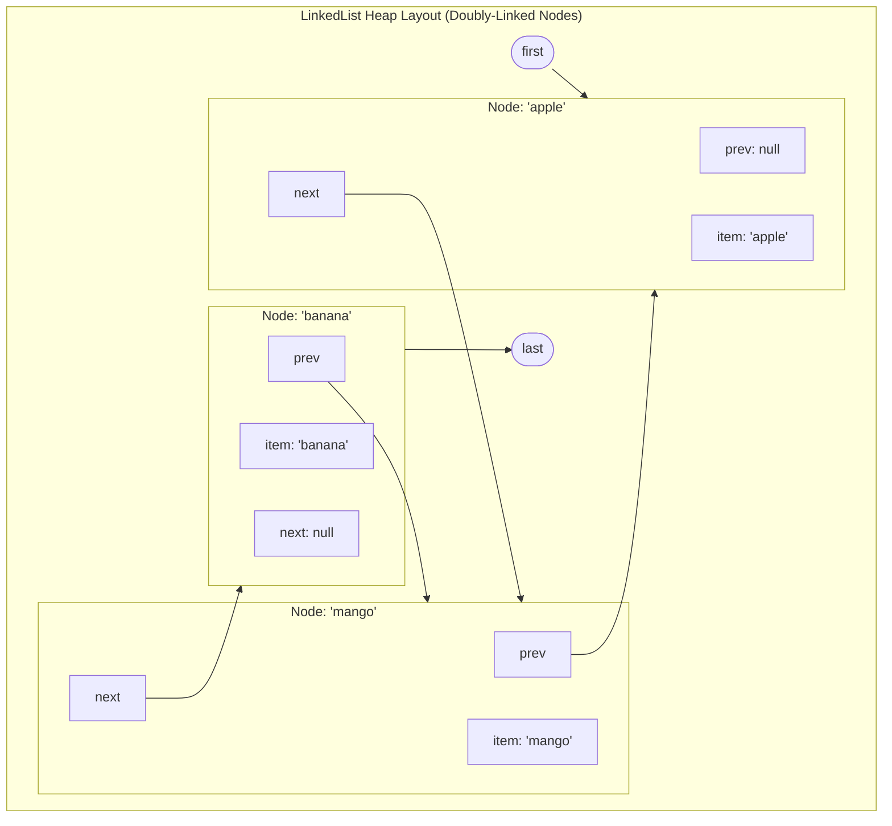

# The `LinkedList` Architecture: Doubly-Linked Nodes, Head/Tail Deque Operations & Thread Synchronization

---

## Key Takeaways

`java.util.LinkedList` is a doubly-linked list implementation of the `List`, `Deque`, and `Queue` interfaces within the Java Collections Framework. Unlike `ArrayList`, which uses a contiguous, dynamically resized backing array, `LinkedList` stores elements in discrete `Node` objects on the heap, where each node maintains explicit reference pointers to both its successor (`next`) and predecessor (`prev`). This architecture provides $\mathcal{O}(1)$ constant-time insertions and removals at the extremities using methods like `addFirst()`, `addLast()`, `removeFirst()`, and `removeLast()`. However, positional lookups (`get(index)`) require sequential link traversal ($\mathcal{O}(N)$), making `LinkedList` slower than `ArrayList` for random-access workloads. Furthermore, `LinkedList` is not thread-safe by default; multithreaded environments must synchronize access explicitly (e.g., via `Collections.synchronizedList`).



- **Doubly-Linked Architecture**: Each node wraps an element along with two reference pointers (`prev` and `next`), maintaining strict insertion order.
- **Extremity Efficiency**: Inserting or removing items at the head or tail runs in $\mathcal{O}(1)$ time without resizing or memory shifting.
- **Random-Access Traversal Cost**: Accessing elements by index requires traversing links from the nearest end (head or tail), resulting in $\mathcal{O}(N)$ access time.
- **Deque & Sequenced Interface Support**: Implements `Deque<E>` and `SequencedCollection<E>`, providing methods like `addFirst()`, `addLast()`, `removeFirst()`, and `removeLast()`.
- **Thread Safety**: `LinkedList` is unsynchronized. Concurrently modifying a list from multiple threads leads to race conditions and corrupt pointer links unless wrapped using `Collections.synchronizedList()`.

---

## Main Discussion

### Idiomatic Java Code Snippets

#### 1. Basic Operations, Index Insertion & Extremity Mutators (`LinkedListBasicsDemo.java`)

Managing elements, inserting at specific indices, and using `Deque` methods:

```java
package collections_linkedlist;

import java.util.LinkedList;

public class LinkedListBasicsDemo {

    public static void main(String[] args) {
        // 1. Instantiating a generic LinkedList
        LinkedList<String> shoppingList = new LinkedList<>();

        // Append operations: add() appends to the tail (addLast)
        shoppingList.add("apple");
        shoppingList.add("banana");
        shoppingList.add("pear");

        System.out.println("Initial List (Preserves insertion order): " + shoppingList);
        // Output: [apple, banana, pear]

        // 2. Positional Insertion: add(index, element)
        // Inserts "mango" at index 1 (between "apple" and "banana")
        // Traverses to index 1 and re-links adjacent node pointers
        shoppingList.add(1, "mango");

        System.out.println("After inserting at index 1: " + shoppingList);
        // Output: [apple, mango, banana, pear]

        // 3. Extremity Operations (Deque / SequencedCollection API)
        // O(1) removal of the head element
        String removedItem = shoppingList.removeFirst();
        System.out.println("Removed head item: " + removedItem); // apple

        // O(1) insertion at the head
        shoppingList.addFirst("grapes");

        // O(1) removal of the tail element
        String removedTail = shoppingList.removeLast();
        System.out.println("Removed tail item: " + removedTail); // pear

        System.out.println("Final State: " + shoppingList);
        // Output: [grapes, mango, banana]
    }
}
```

#### 2. Thread Synchronization Wrapper (`SynchronizedLinkedListDemo.java`)

Wrapping an unsynchronized `LinkedList` to guard concurrent access:

```java
package collections_linkedlist;

import java.util.Collections;
import java.util.LinkedList;
import java.util.List;

public class SynchronizedLinkedListDemo {

    public static void main(String[] args) {
        LinkedList<String> shoppingList = new LinkedList<>();
        shoppingList.add("milk");
        shoppingList.add("bread");
        shoppingList.add("eggs");

        // Collections.synchronizedList returns a thread-safe wrapper backed by the original list
        List<String> synchronizedList = Collections.synchronizedList(shoppingList);

        System.out.println("Synchronized Wrapper: " + synchronizedList);

        // NOTE: Iterating over a synchronized list requires manual synchronization on the wrapper
        // to prevent ConcurrentModificationException from concurrent threads
        synchronized (synchronizedList) {
            for (String item : synchronizedList) {
                System.out.println("Safe traversal item: " + item);
            }
        }
    }
}
```

### Under the Hood / JVM Mechanics

```
   LINKEDLIST OBJECT (Heap: 0x00A1)                NODE INSTANCES (Heap)
+------------------------------------+        +------------------------------------+
| size: 3                            |        | Node (0x011A)                      |
| first: ref -> Node 0x011A          |------->| - item: "apple"                    |
| last:  ref -> Node 0x033C          |---\    | - prev: null, next: ref -> 0x022B  |
+------------------------------------+   |    +------------------------------------+
                                         |                      |
                                         |                      v
                                         |    +------------------------------------+
                                         |    | Node (0x022B)                      |
                                         |    | - item: "mango"                    |
                                         |    | - prev: 0x011A, next: ref -> 0x033C|
                                         |    +------------------------------------+
                                         |                      |
                                         |                      v
                                         |    +------------------------------------+
                                         \--->| Node (0x033C)                      |
                                              | - item: "banana"                   |
                                              | - prev: 0x022B, next: null         |
                                              +------------------------------------+

```

1. **Internal Node Allocation:**
   Every element in a LinkedList is wrapped in a private static class:
   `Node<E> { E item; Node<E> next; Node<E> prev; }`.
   On a 64-bit JVM with Compressed OOPs enabled, each node requires 24 bytes (12-byte header + 4-byte padding/alignment + three 4-byte reference pointers) in addition to the actual element object payload.
2. **Extremity Linking (linkFirst / linkLast):**
   When calling addFirst(e), a new Node is instantiated whose next pointer points to the current first node, and its prev pointer is set to null. The first pointer in the `LinkedList` header is then redirected to this new node. This runs in $\mathcal{O}(1)$ time with zero array shifting.
3. **Bi-Directional Index Traversal Optimization:**
   When calling get(int index), the JVM executes node(index). It checks if the target index is in the first or second half of the list:
   if (index < (size >> 1)).
   If closer to the front, it iterates forward from first; if closer to the back, it iterates backward from last. While this halves the traversal iterations on average ($\frac{N}{2}$ steps), it remains $\mathcal{O}(N)$ linear time.
4. **Memory Fragmentation and Cache Misses:**
   Because nodes are instantiated individually across the heap over time, they are rarely placed in contiguous memory. Iterating through a `LinkedList` forces the CPU to chase pointers across fragmented memory addresses, causing frequent L1/L2 cache misses compared to the cache-friendly contiguous layout of an `ArrayList`.

### Structural Comparisons

#### `ArrayList` vs. `LinkedList`

| Metric / Dimension                | `ArrayList<E>`                                          | `LinkedList<E>`                                                     |
| --------------------------------- | ------------------------------------------------------- | ------------------------------------------------------------------- |
| **Backing Storage**               | Contiguous dynamic array (`Object[]`)                   | Disjoint heap nodes (`Node<E>`)                                     |
| **Positional Read (`get(i)`)**    | **$\mathcal{O}(1)$** (Direct memory address math)       | **$\mathcal{O}(N)$** (Link traversal from nearest end)              |
| **Append (`add(e)`)**             | **Amortized $\mathcal{O}(1)$** (Occasional resize copy) | **$\mathcal{O}(1)$** (Always links directly to `last`)              |
| **Insert at Index (`add(i, e)`)** | $\mathcal{O}(N)$ (Array elements shifted right)         | $\mathcal{O}(N)$ to traverse to index + $\mathcal{O}(1)$ to re-link |
| **Head Insertion / Removal**      | $\mathcal{O}(N)$ (Entire array shifted)                 | **$\mathcal{O}(1)$** (`addFirst()` / `removeFirst()`)               |
| **Memory Overhead**               | Low (some unused capacity in array buffer)              | **High** (24 bytes of node metadata per element)                    |
| **Hardware Cache Locality**       | **Excellent** (Loads adjacent slots into CPU cache)     | **Poor** (Chases pointer addresses across heap)                     |
| **Interface Implemented**         | `List`, `RandomAccess`                                  | `List`, `Deque`, `Queue`                                            |

### Common Anti-Patterns & Edge Cases

- **Indexed Traversal Over a `LinkedList`**:

  ```java
  // PERFORMANCE DISASTER: O(N^2) Total Time!
  for (int i = 0; i < linkedList.size(); i++) {
      System.out.println(linkedList.get(i)); // Each get(i) traverses the list from scratch
  }
  ```

  Always iterate through a `LinkedList` using an enhanced `for-each` loop, an explicit `Iterator`, or a `ListIterator`, which traverses links sequentially in $\mathcal{O}(N)$ total time.

- **Assuming `Collections.synchronizedList()` Makes Iteration Thread-Safe**:
  `Collections.synchronizedList` synchronizes individual method calls (`add`, `get`, `remove`). It does **not** protect against concurrent structural modifications during an iteration loop. The loop must be wrapped in an explicit `synchronized(syncList)` block.
- **Calling `removeFirst()` or `removeLast()` on an Empty List**:
  Calling `removeFirst()` on an empty `LinkedList` throws a `NoSuchElementException`. If null-safe retrieval is preferred, use `pollFirst()` or `pollLast()`, which return `null` instead of throwing an exception.

---

## 3. Knowledge Check & JetBrains-Style Coding Challenges

### Exam / Theory Tips

- **Internal Node Model**: `LinkedList` is doubly linked; each node holds three fields: `item`, `next`, and `prev`.
- **Marker Interface Absence**: Unlike `ArrayList`, `LinkedList` does **not** implement the `RandomAccess` marker interface, signaling that index-based access is not constant time.
- **Dual Roles**: `LinkedList` implements both `List` and `Deque`, allowing it to serve as a standard list, a FIFO queue (`offer`/`poll`), or a LIFO stack (`push`/`pop`).

### Question 1: Conceptual / Code Analysis

Consider the following two algorithms iterating over a list of $100,000$ elements:

```java
// Method 1
public static void printViaIndices(List<Integer> list) {
    for (int i = 0; i < list.size(); i++) {
        process(list.get(i));
    }
}

// Method 2
public static void printViaIterator(List<Integer> list) {
    for (Integer val : list) {
        process(val);
    }
}
```

What is the time complexity of running `printViaIndices` versus `printViaIterator` when passed a `LinkedList<Integer>`?

- [ ] **A.** Both methods execute in $\mathcal{O}(N)$ linear time.
- [ ] **B.** `printViaIndices` runs in $\mathcal{O}(N^2)$ time, whereas `printViaIterator` runs in $\mathcal{O}(N)$ time.
- [ ] **C.** `printViaIndices` runs in $\mathcal{O}(N)$ time, whereas `printViaIterator` runs in $\mathcal{O}(N \log N)$ time.
- [ ] **D.** Both methods throw `UnsupportedOperationException`.

<details>
<summary>Correct Answer</summary>

**Correct Answer**: **B**

**Technical Breakdown**:

- **B is correct**:
- In `printViaIndices`, `list.get(i)` is called on every iteration. Because `LinkedList` lacks direct random access, retrieving an element at index $i$ requires walking links from the head or tail, costing on average $\frac{i}{2}$ pointer steps. Summing this across $N$ iterations yields:

$$\sum_{i=0}^{N-1} \mathcal{O}(i) = \mathcal{O}\left(\frac{N(N-1)}{2}\right) = \mathcal{O}(N^2)$$

- In `printViaIterator`, the enhanced `for-each` loop desugars into an `Iterator`. The iterator holds a direct reference to the current `Node` and advances by following `node.next` in $\mathcal{O}(1)$ time per step, completing the entire traversal in $\mathcal{O}(N)$ linear time.

- **A, C, and D are incorrect**: Index lookups on `LinkedList` are linear, making repeated calls quadratic.

</details>

---

### Question 2: Mini Coding Problem / Implementation Challenge

**Task**: Implement an undo-redo buffer named `BrowserHistoryBuffer` inside package `collections_linkedlist`:

1. Use `LinkedList<String>` as the internal storage structure for browsed URLs.
2. Constructor `public BrowserHistoryBuffer(int maxCapacity)`:
   - Sets a maximum capacity limit. Throws `IllegalArgumentException` if `maxCapacity <= 0`.
3. Method `public void visitPage(String url)`:
   - Rejects null or blank strings (throws `IllegalArgumentException`).
   - Appends the new page to the tail of the list using `addLast(url)`.
   - If the list size exceeds `maxCapacity`, removes the oldest page from the head in $\mathcal{O}(1)$ time using `removeFirst()`.
4. Method `public String getCurrentPage()`:
   - Returns the most recently visited page (the tail element) without removing it. Returns `null` if the buffer is empty.
5. Method `public String popLastVisited()`:
   - Removes and returns the most recently visited page from the tail using `removeLast()`. Returns `null` if the buffer is empty.
6. Method `public List<String> getHistorySnapshot()`:
   - Returns a synchronized, unmodifiable snapshot view of the current history list in chronological order.

**Test Assertions**:

- `BrowserHistoryBuffer buffer = new BrowserHistoryBuffer(3);`
- `buffer.visitPage("site1.com");`
- `buffer.visitPage("site2.com");`
- `buffer.visitPage("site3.com");`
- `buffer.visitPage("site4.com");` $\rightarrow$ Evicts `"site1.com"`; buffer contains `["site2.com", "site3.com", "site4.com"]`
- `buffer.getCurrentPage()` $\rightarrow$ Returns `"site4.com"`
- `buffer.popLastVisited()` $\rightarrow$ Returns `"site4.com"`; buffer contains `["site2.com", "site3.com"]`

<details>
<summary>Solution</summary>

```java
package collections_linkedlist;

import java.util.Collections;
import java.util.LinkedList;
import java.util.List;

public class BrowserHistoryBuffer {

    private final int maxCapacity;
    private final LinkedList<String> historyList;

    public BrowserHistoryBuffer(int maxCapacity) {
        if (maxCapacity <= 0) {
            throw new IllegalArgumentException("Capacity must be positive.");
        }
        this.maxCapacity = maxCapacity;
        this.historyList = new LinkedList<>();
    }

    public synchronized void visitPage(String url) {
        if (url == null || url.isBlank()) {
            throw new IllegalArgumentException("URL cannot be null or blank.");
        }

        // Add to tail in O(1) time
        historyList.addLast(url);

        // Evict oldest from head in O(1) time if capacity is exceeded
        if (historyList.size() > maxCapacity) {
            historyList.removeFirst();
        }
    }

    public synchronized String getCurrentPage() {
        if (historyList.isEmpty()) {
            return null;
        }
        return historyList.getLast();
    }

    public synchronized String popLastVisited() {
        if (historyList.isEmpty()) {
            return null;
        }
        return historyList.removeLast();
    }

    public synchronized List<String> getHistorySnapshot() {
        // Return an unmodifiable view wrapped for synchronization
        return Collections.unmodifiableList(new LinkedList<>(historyList));
    }
}
```

**Complexity Analysis**:

- **Time Complexity**:
  - `visitPage`: $\mathcal{O}(1)$ constant-time execution (`addLast` and conditional `removeFirst` are both pointer reassignments).
  - `getCurrentPage` / `popLastVisited`: $\mathcal{O}(1)$ direct operations on the `last` pointer node.
  - `getHistorySnapshot`: $\mathcal{O}(K)$ where $K \le \text{maxCapacity}$ to copy nodes into a snapshot list.
- **Space Complexity**: $\mathcal{O}(K)$ heap memory bounded by `maxCapacity`, with each entry storing an internal `Node` instance.

</details>

---
