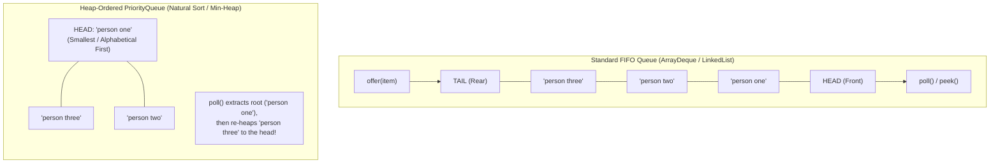

# The Queue Interface: FIFO Semantics, Concrete Implementations & Heap-Ordered PriorityQueues

---

## Key Takeaways

A **Queue** is a collection designed for holding elements prior to processing, typically structured around **First-In, First-Out (FIFO)** order—mirroring a physical line of people where the first to arrive is the first to be served. In the Java Collections Framework, declaring references with the generalized **`Queue<E>`** interface insulates code from underlying concrete architectures while restricting operations strictly to queue-safe methods. Java provides multiple concrete implementations with distinct trade-offs: **`ArrayDeque<E>`** delivers high-performance, cache-friendly circular array buffering; **`LinkedList<E>`** offers pointer-linked node allocation; and **`PriorityQueue<E>`** departs from FIFO arrival order entirely to order elements by **natural order** (or a custom `Comparator`) backed by a binary min-heap.



- **FIFO Access Discipline**: Standard queues insert elements at the tail (rear) and extract elements from the head (front).
- **The `Queue<E>` Contract**:
  - **`offer(E e)`**: Inserts an element at the tail of the queue. Returns `true` if successful, or `false` if bounded capacity is reached (unlike `add()`, which throws an exception).
  - **`peek()`**: Inspects the head element without removing it; returns `null` if the queue is empty.
  - **`poll()`**: Retrieves and removes the head element; returns `null` if the queue is empty.
- **Why Program to `Queue<E>` on the Left**: Prevents callers from invoking non-queue methods (like `get(index)` or `removeLast()`), making it simple to swap implementations (`ArrayDeque` $\leftrightarrow$ `LinkedList` $\leftrightarrow$ `PriorityQueue`) without refactoring caller logic.
- **`ArrayDeque` vs. `LinkedList`**: `ArrayDeque`is generally faster and uses less memory due to cache locality, while`LinkedList` is useful if removing the current node during active list iterator traversal.
- **`PriorityQueue` Mechanics**: Elements are ordered by priority rather than arrival time. For numbers, the lowest value is extracted first; for strings, elements are extracted in alphabetical order (`"person one"`, `"person three"`, `"person two"`).

---

## Main Discussion

### Idiomatic Java Code Snippets

#### 1. FIFO Processing via `Queue` & `ArrayDeque` (`FifoQueueDemo.java`)

Operating on an arrival queue using the standard `Queue` contract:

```java
package collections_queue;

import java.util.ArrayDeque;
import java.util.Queue;

public class FifoQueueDemo {

    public static void main(String[] args) {
        // IDIOMATIC: Declare reference type as Queue interface
        Queue<String> serviceQueue = new ArrayDeque<>();

        // 1. offer(): Enqueue elements to the tail (rear)
        serviceQueue.offer("person one");
        serviceQueue.offer("person two");
        serviceQueue.offer("person three");

        System.out.println("Initial Queue (Head to Tail): " + serviceQueue);
        // Output: [person one, person two, person three]

        // 2. peek(): Inspect the front of the line without dequeuing
        String currentCustomer = serviceQueue.peek();
        System.out.println("First in line (peek): " + currentCustomer); // person one

        // 3. poll(): Dequeue and service the front of the line
        String servedCustomer = serviceQueue.poll();
        System.out.println("Served customer (poll): " + servedCustomer); // person one
        System.out.println("State after poll: " + serviceQueue);
        // Output: [person two, person three]

        // 4. Safe Empty Polling: Returns null, avoiding exceptions
        serviceQueue.clear();
        String emptyPoll = serviceQueue.poll();
        System.out.println("Polling empty queue returns: " + emptyPoll); // null
    }
}
```

#### 2. Swapping Implementations: `PriorityQueue` & Natural Ordering (`PriorityQueueDemo.java`)

Demonstrating how changing the concrete class to `PriorityQueue` changes retrieval order based on a binary min-heap:

```java
package collections_queue;

import java.util.PriorityQueue;
import java.util.Queue;

public class PriorityQueueDemo {

    public static void main(String[] args) {
        // Concrete class swapped to PriorityQueue; public contract remains Queue<String>
        Queue<String> priorityQueue = new PriorityQueue<>();

        priorityQueue.offer("person one");
        priorityQueue.offer("person two");
        priorityQueue.offer("person three");

        // Peek inspects the natural head (alphabetically lowest: "person one")
        System.out.println("Priority Head (peek): " + priorityQueue.peek()); // person one

        // Polling removes "person one"
        priorityQueue.poll();

        // Alphabetical comparison: "person three".compareTo("person two") < 0
        // 't' comes before 't'? 'h' in three vs 'w' in two -> 'h' < 'w'
        // Therefore, "person three" is promoted to the head!
        System.out.println("State after polling 'person one': " + priorityQueue);
        // Output: [person three, person two]

        System.out.println("Next polled: " + priorityQueue.poll()); // person three
        System.out.println("Final polled: " + priorityQueue.poll()); // person two

        // Numeric Priority Queue demonstration:
        Queue<Integer> numberQueue = new PriorityQueue<>();
        numberQueue.offer(45);
        numberQueue.offer(10);
        numberQueue.offer(30);

        System.out.println("\nNumeric min-heap polling:");
        while (!numberQueue.isEmpty()) {
            System.out.print(numberQueue.poll() + " "); // Output: 10 30 45
        }
        System.out.println();
    }
}
```

### Under the Hood / JVM Mechanics

```
   ARRAYDEQUE (Circular Buffer)                     PRIORITYQUEUE (Binary Min-Heap Array)
+------------------------------------+           +------------------------------------+
| elements: Object[16]               |           | queue: Object[11]                  |
| head: 0, tail: 3                   |           | size: 3                            |
| [p1, p2, p3, null, null, ...]      |           | Slot 0: "person one"   (Root/Min)  |
+------------------------------------+           | Slot 1: "person three" (Left)      |
                                                 | Slot 2: "person two"   (Right)     |
                                                 +------------------------------------+

```

1. **ArrayDeque FIFO Head/Tail Pointer Advancements:**
   In ArrayDeque, calling offer(e) places the element at elements[tail] and advances the tail: tail = (tail + 1) & (elements.length - 1). Calling poll() reads elements[head], sets the slot to null (preventing memory leaks), and increments head. Both execute in constant $\mathcal{O}(1)$ time.
2. **PriorityQueue Sift-Up on Insertion:**
   When calling offer(e) on a PriorityQueue, the element is placed at the end of the backing array (queue[size]) and the algorithm runs siftUp(). It compares the child to its parent at index (k - 1) >>> 1 using Comparable.compareTo(), swapping elements upward until heap invariants are satisfied in $\mathcal{O}(\log N)$ time.
3. **PriorityQueue Sift-Down on Polling:**
   Calling poll() removes the minimum element at queue[0]. The last element in the array is moved to index 0, and siftDown() runs, swapping the element downward with its smallest child (indices 2k + 1 and 2k + 2) to restore min-heap properties in $\mathcal{O}(\log N)$ time.
4. **toString() Heap Array Layout vs. Poll Order:**
   PriorityQueue.toString() iterates through its internal backing array directly. Because a binary heap guarantees only parent-child relationships rather than a fully sorted array, printing the queue displays elements in heap-tree order, whereas sequential poll() calls retrieve elements in strict sorted priority order.

### Structural Comparisons

#### Queue Implementations: `ArrayDeque` vs. `LinkedList` vs. `PriorityQueue`

| Metric / Feature        | `ArrayDeque<E>`                | `LinkedList<E>`                   | `PriorityQueue<E>`                       |
| ----------------------- | ------------------------------ | --------------------------------- | ---------------------------------------- |
| **Backing Structure**   | Contiguous circular array      | Doubly-linked nodes               | Binary min-heap array                    |
| **Ordering Model**      | Strict FIFO                    | Strict FIFO                       | **Natural sort / Comparator**            |
| **Insertion (`offer`)** | Amortized $\mathcal{O}(1)$     | $\mathcal{O}(1)$                  | $\mathcal{O}(\log N)$                    |
| **Retrieval (`poll`)**  | $\mathcal{O}(1)$               | $\mathcal{O}(1)$                  | $\mathcal{O}(\log N)$                    |
| **Inspection (`peek`)** | $\mathcal{O}(1)$               | $\mathcal{O}(1)$                  | $\mathcal{O}(1)$ (Root node at index 0)  |
| **Null Elements**       | **Forbidden** (throws `NPE`)   | Permitted                         | **Forbidden** (throws `NPE`)             |
| **Cache Locality**      | **High**                       | Poor (scattered heap nodes)       | High (contiguous heap array)             |
| **Best Used For**       | General high-speed FIFO queues | Queue iteration with node removal | Priority task scheduling / Min-max heaps |

#### Queue API Method Pairs (Exception-Throwing vs. Special Value)

| Operation Type     | Throws Exception on Failure                            | Returns Special Value (`false` / `null`) |
| ------------------ | ------------------------------------------------------ | ---------------------------------------- |
| **Insert (Tail)**  | `add(e)` (throws `IllegalStateException` if full)      | **`offer(e)`** (returns `false` if full) |
| **Remove (Head)**  | `remove()` (throws `NoSuchElementException` if empty)  | **`poll()`** (returns `null` if empty)   |
| **Examine (Head)** | `element()` (throws `NoSuchElementException` if empty) | **`peek()`** (returns `null` if empty)   |

### Common Anti-Patterns & Edge Cases

- **Declaring Variables as Concrete Implementations**:

  ```java
  ArrayDeque<String> queue = new ArrayDeque<>(); // Suboptimal: tightly couples callers to ArrayDeque
  ```

  Declare variables as `Queue<String> queue = new ArrayDeque<>();`. This prevents accidental access to non-queue methods (such as `removeLast()` or `push()`) and allows swapping implementations freely.

- **Assuming `PriorityQueue.toString()` Displays Fully Sorted Output**:
  Printing a `PriorityQueue` directly prints its internal binary heap array representation, not a sorted list. To process elements in true priority order, retrieve them iteratively using `poll()`.
- **Storing Non-Comparable Elements in a `PriorityQueue`**:
  Adding custom objects to a `PriorityQueue`without implementing`Comparable<T>`or providing an explicit`Comparator<T>`throws a runtime`ClassCastException` on insertion.
- **Inserting `null` into `ArrayDeque` or `PriorityQueue`**:
  Both implementations reject `null`elements immediately with a`NullPointerException`because`null`is used as the sentinel return value for`poll()`and`peek()`.

---

## Knowledge Check & JetBrains-Style Coding Challenges

### Theory Tips

- **FIFO Principle**: Queues process elements in **First-In, First-Out** order (`offer` at the back, `poll` from the front).
- **Safe API Standard**: Use `offer()`, `poll()`, and `peek()` instead of `add()`, `remove()`, and `element()` to handle full or empty collections gracefully without exceptions.
- **PriorityQueue Ordering**: `PriorityQueue` processes elements in natural ascending order or custom `Comparator` order, not insertion order.

### Question 1: Conceptual / Code Analysis

Consider the following Java snippet:

```java
import java.util.PriorityQueue;
import java.util.Queue;

public class QueueOrderTest {
    public static void main(String[] args) {
        Queue<String> queue = new PriorityQueue<>();
        queue.offer("charlie");
        queue.offer("alpha");
        queue.offer("bravo");

        System.out.print(queue.poll() + " ");
        System.out.print(queue.peek() + " ");
        System.out.print(queue.poll());
    }
}
```

What is printed to the console?

- [ ] **A.** `charlie alpha bravo`
- [ ] **B.** `alpha bravo bravo`
- [ ] **C.** `alpha bravo charlie`
- [ ] **D.** `charlie bravo alpha`

<details>
<summary>Correct Answer</summary>

**Correct Answer**: **B**

**Technical Breakdown**:

- **B is correct**:

1. `queue` is a `PriorityQueue`, which orders `String` elements alphabetically using `String.compareTo()`.
2. The natural order of the elements is `"alpha"` $<$ `"bravo"` $<$ `"charlie"`.
3. The first call `queue.poll()` removes and returns the lowest element: `"alpha"`. The remaining elements are `"bravo"` and `"charlie"`.
4. The call `queue.peek()` inspects the current head without removing it. The lowest remaining element is `"bravo"`. The queue size remains 2.
5. The second call `queue.poll()` removes and returns the head element: `"bravo"`.
6. The printed sequence is `"alpha "` + `"bravo "` + `"bravo"`, yielding `alpha bravo bravo`.

- **A is incorrect**: `PriorityQueue` does not use FIFO insertion order.
- **C is incorrect**: The second call was `peek()`, not `poll()`, so `"bravo"` was examined without being removed.
- **D is incorrect**: Elements are ordered ascending, not descending.

</details>

---

### Question 2: Mini Coding Problem / Implementation Challenge

**Task**: Implement a priority-based background task processor named `TaskDispatchService` inside package `collections_queue`:

1. Class `TaskItem`:
   - Implements `Comparable<TaskItem>`.
   - Private fields: `taskName` (`String`), `priorityLevel` (`int` where lower numbers indicate higher priority, e.g., 1 is urgent, 5 is low).
   - Constructor initializing both fields.
   - Public getters.
   - Implement `compareTo(TaskItem other)`: orders items by `priorityLevel` in ascending order.
2. Class `TaskDispatchService`:
   - Internal queue: `Queue<TaskItem>` instantiated as a `PriorityQueue<TaskItem>`.
   - Method `public void enqueueTask(String taskName, int priorityLevel)`:
     - Validates input: throws `IllegalArgumentException` if `taskName` is null or blank.
     - Enqueues a new `TaskItem` using `offer()`.
   - Method `public String processNextTask()`:
     - Dequeues the highest priority task using `poll()`.
     - Returns `"[PROCESSED] " + task.getTaskName() + " (Priority: " + task.getPriorityLevel() + ")"`.
     - Returns `"IDLE: NO_TASKS"` if the queue is empty.
   - Method `public int pendingTaskCount()`: returns current queue size.

**Test Assertions**:

- `TaskDispatchService service = new TaskDispatchService();`
- `service.processNextTask()` $\rightarrow$ Returns `"IDLE: NO_TASKS"`
- `service.enqueueTask("Database Backup", 3);`
- `service.enqueueTask("Security Patch", 1);`
- `service.enqueueTask("Cache Refresh", 2);`
- `service.pendingTaskCount()` $\rightarrow$ Evaluates to `3`
- `service.processNextTask()` $\rightarrow$ Returns `"[PROCESSED] Security Patch (Priority: 1)"`
- `service.processNextTask()` $\rightarrow$ Returns `"[PROCESSED] Cache Refresh (Priority: 2)"`
- `service.processNextTask()` $\rightarrow$ Returns `"[PROCESSED] Database Backup (Priority: 3)"`

<details>
<summary>Solution</summary>

```java
package collections_queue;

import java.util.Objects;
import java.util.PriorityQueue;
import java.util.Queue;

public class TaskDispatchService {

    public static class TaskItem implements Comparable<TaskItem> {
        private final String taskName;
        private final int priorityLevel;

        public TaskItem(String taskName, int priorityLevel) {
            this.taskName = Objects.requireNonNull(taskName, "Task name cannot be null.");
            this.priorityLevel = priorityLevel;
        }

        public String getTaskName() {
            return taskName;
        }

        public int getPriorityLevel() {
            return priorityLevel;
        }

        @Override
        public int compareTo(TaskItem other) {
            // Natural ascending order: lower integer = higher execution priority
            return Integer.compare(this.priorityLevel, other.priorityLevel);
        }
    }

    private final Queue<TaskItem> taskQueue;

    public TaskDispatchService() {
        this.taskQueue = new PriorityQueue<>();
    }

    public void enqueueTask(String taskName, int priorityLevel) {
        if (taskName == null || taskName.isBlank()) {
            throw new IllegalArgumentException("Task name cannot be null or blank.");
        }
        taskQueue.offer(new TaskItem(taskName.trim(), priorityLevel));
    }

    public String processNextTask() {
        TaskItem nextTask = taskQueue.poll();
        if (nextTask == null) {
            return "IDLE: NO_TASKS";
        }
        return "[PROCESSED] " + nextTask.getTaskName() + " (Priority: " + nextTask.getPriorityLevel() + ")";
    }

    public int pendingTaskCount() {
        return taskQueue.size();
    }
}
```

**Complexity Analysis**:

- **Time Complexity**:
  - `enqueueTask`: $\mathcal{O}(\log N)$ binary min-heap sift-up insertion.
  - `processNextTask`: $\mathcal{O}(\log N)$ binary min-heap sift-down extraction.
  - `pendingTaskCount`: $\mathcal{O}(1)$ direct size query.
- **Space Complexity**: $\mathcal{O}(N)$ memory allocated for the `PriorityQueue` backing array storing task item references.

</details>

---
