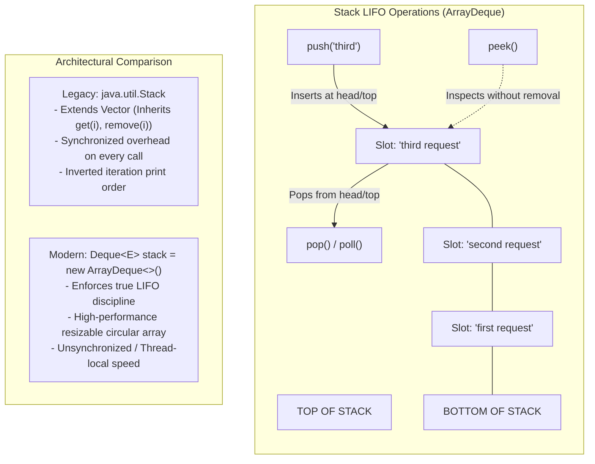

# The Stack Data Structure: LIFO Semantics, Legacy `java.util.Stack` Pitfalls & Modern `Deque` / `ArrayDeque` Mechanics

---

## Key Takeaways

A **Stack** is a linear data structure governed by the **Last-In, First-Out (LIFO)** access discipline—analogous to a physical stack of plates where elements are placed on top and removed from the top. While Java provides a legacy `java.util.Stack` class dating back to JDK 1.0, its use is widely discouraged in modern Java engineering due to architectural flaws: it extends `Vector`, allowing arbitrary index-based element removal, and incurs synchronized locking overhead on every operation. The idiomatic approach in modern Java is to program against the **`Deque<E>`** (Double-Ended Queue) interface backed by the **`ArrayDeque<E>`** concrete class. Standard stack operations include **`push()`** (insert to top), **`peek()`** (inspect top without removing), and **`pop()`** / **`poll()`** (remove top element).



- **LIFO Access Model**: The most recently pushed element resides at the top and is always the first candidate retrieved.
- **Legacy `java.util.Stack` Anti-Pattern**: Because `Stack extends Vector`, it inherits vector index methods like `remove(index)` and `insertElementAt()`, breaking the encapsulation of a true stack. It is also synchronized, imposing performance penalties in single-threaded contexts.
- **Idiomatic Implementation (`Deque<E>` / `ArrayDeque<E>`)**: Recommended by the official JDK documentation as the standard replacement for `Stack`. It uses a dynamic circular array buffer without locking overhead.
- **Core API Operations**:
  - `push(E e)`: Places an element onto the top of the stack (prepends to the head).
  - `peek()`: Returns the top element without removing it; returns `null` if empty.
  - `pop()`: Removes and returns the top element; throws `NoSuchElementException` if empty.
  - `poll()`: Alternative removal method; removes and returns top element, returning `null` if empty instead of throwing an exception.
- **Thread Safety**: `ArrayDeque` is unsynchronized. For concurrent environments, access must be coordinated via explicit locking or concurrent equivalents like `ConcurrentLinkedDeque`.

---

## Main Discussion

### Idiomatic Java Code Snippets

#### 1. Modern LIFO Implementation via `Deque` & `ArrayDeque` (`DequeStackDemo.java`)

Managing request lifecycles using idiomatic `Deque` stack semantics:

```java
package collections_stack;

import java.util.ArrayDeque;
import java.util.Deque;

public class DequeStackDemo {

    public static void main(String[] args) {
        // IDIOMATIC: Program to the Deque interface backed by ArrayDeque
        Deque<String> requestStack = new ArrayDeque<>();

        // 1. push(): Adds elements to the top of the stack (head of the deque)
        requestStack.push("first request");
        requestStack.push("second request");
        requestStack.push("third request");

        // toString() on ArrayDeque displays elements from top (head) to bottom (tail)
        System.out.println("Current Stack State (Top to Bottom): " + requestStack);
        // Output: [third request, second request, first request]

        // 2. peek(): Inspects the top element without removal
        String topItem = requestStack.peek();
        System.out.println("Top item (peek): " + topItem); // Output: third request

        // 3. pop(): Removes and returns the top element (throws NoSuchElementException if empty)
        String poppedItem = requestStack.pop();
        System.out.println("Removed via pop(): " + poppedItem); // Output: third request
        System.out.println("State after pop: " + requestStack); // Output: [second request, first request]

        // 4. poll(): Alternative removal returning null on an empty stack
        String polledItem = requestStack.poll();
        System.out.println("Removed via poll(): " + polledItem); // Output: second request
        System.out.println("Final Stack State: " + requestStack); // Output: [first request]
    }
}
```

#### 2. Architectural Comparison: `ArrayDeque` vs. Legacy `java.util.Stack` (`LegacyStackComparison.java`)

Contrasting print order, index leakage, and empty retrieval mechanics:

```java
package collections_stack;

import java.util.ArrayDeque;
import java.util.Deque;
import java.util.NoSuchElementException;
import java.util.Stack;

public class LegacyStackComparison {

    public static void main(String[] args) {
        // --- LEGACY STACK ---
        Stack<String> legacyStack = new Stack<>();
        legacyStack.push("alpha");
        legacyStack.push("beta");

        // Flaw 1: toString() prints Vector bottom-to-top, opposite of natural stack order
        System.out.println("Legacy Stack print: " + legacyStack); // [alpha, beta]

        // Flaw 2: Violates LIFO encapsulation via inherited Vector methods
        legacyStack.remove(0); // Removes from the bottom of the stack!
        System.out.println("Legacy Stack after breaking LIFO: " + legacyStack); // [beta]

        // --- MODERN ARRAYDEQUE ---
        Deque<String> modernStack = new ArrayDeque<>();
        modernStack.push("alpha");
        modernStack.push("beta");

        // Prints from Top to Bottom
        System.out.println("Modern Deque print: " + modernStack); // [beta, alpha]

        // --- EMPTY HANDLING DIFFERENCE: pop() vs poll() ---
        modernStack.clear();

        // poll() returns null cleanly
        String safeItem = modernStack.poll();
        System.out.println("Poll on empty: " + safeItem); // null

        // pop() throws NoSuchElementException
        try {
            modernStack.pop();
        } catch (NoSuchElementException e) {
            System.out.println("pop() on empty correctly threw NoSuchElementException");
        }
    }
}
```

### Under the Hood / JVM Mechanics

```
   ARRAYDEQUE CIRCULAR BUFFER (Dynamic Array: elements = Object[])
+----------------------------------------------------------------------------------+
| Slot 0: "second" | Slot 1: null | ... | Slot 14: null | Slot 15: "first request" |
+----------------------------------------------------------------------------------+
         ^                                                      ^
         | head = 0                                             | tail = 15

```

1. **Circular Array Indexing & Head Decrement:**
   When stack.push(item) is executed on an ArrayDeque, the underlying algorithm adds to the head:
   head = (head - 1) & (elements.length - 1).
   The backing array acts as a circular ring buffer. Inserting at the head wraps around to the end of the array when head hits 0, executing in $\mathcal{O}(1)$ time with zero memory shifting.
2. **Power-of-Two Buffer Resizing:**
   The backing array capacity of an ArrayDeque is always maintained as a power of two (initial default 16). When head == tail, the buffer is full. It doubles in size (e.g., $16 \rightarrow 32$), copying the circular chunks contiguously into the new array via System.arraycopy.
3. **Null Rejection Contract:**
   Unlike LinkedList or Vector, ArrayDeque strictly rejects null elements. Calling push(null) throws an immediate NullPointerException. This guarantee allows methods like peek() and poll() to use null as a sentinel value signaling that the collection is empty.
4. **Lock-Free Single-Threaded Execution vs Monitorenter:**
   Every method call on legacy java.util.Stack (e.g., push, pop, peek) inherits the synchronized modifier from Vector, triggering JVM monitorenter and monitorexit bytecode instructions. ArrayDeque contains no synchronization locks, allowing JIT compilers to optimize operations without thread locking overhead.

### Structural Comparisons

#### `ArrayDeque` vs. `java.util.Stack` vs. `LinkedList` (as a Stack)

| Dimension              | `ArrayDeque<E>` (Recommended)        | `java.util.Stack<E>` (Legacy)                   | `LinkedList<E>` (Alternative)      |
| ---------------------- | ------------------------------------ | ----------------------------------------------- | ---------------------------------- |
| **Structural Type**    | Resizable circular array             | Vector-backed array                             | Doubly-linked nodes                |
| **Interface**          | `Deque<E>`, `Queue<E>`               | Extends `Vector<E>`                             | `List<E>`, `Deque<E>`, `Queue<E>`  |
| **Encapsulation**      | **Strict LIFO/FIFO**                 | Leaky (inherits random-access `Vector` methods) | Leaky when referenced as `List`    |
| **Thread Safety**      | Unsynchronized (fast)                | **Synchronized** (heavy lock contention)        | Unsynchronized                     |
| **Null Elements**      | **Forbidden** (throws `NPE`)         | Permitted                                       | Permitted                          |
| **Memory Footprint**   | Low (contiguous array buffer)        | Low (contiguous array buffer)                   | High (24 bytes per node overhead)  |
| **CPU Cache Locality** | **High** (contiguous array elements) | **High**                                        | Poor (nodes scattered across heap) |

#### Removal Mechanics on an Empty Stack

| Method       | Behavior on Empty Collection    | Typical Use Case                                                                                |
| ------------ | ------------------------------- | ----------------------------------------------------------------------------------------------- |
| **`pop()`**  | Throws `NoSuchElementException` | Strict algorithms where an empty stack represents an invalid state (e.g., unbalanced brackets). |
| **`poll()`** | Returns `null` without throwing | Graceful event polling where an empty queue/stack is an expected status.                        |
| **`peek()`** | Returns `null` without throwing | Inspecting the current top candidate before deciding to consume it.                             |

### Common Anti-Patterns & Edge Cases

- **Instantiating the Interface**:

  ```java
  Deque<String> stack = new Deque<>(); // COMPILATION ERROR: Deque is abstract; cannot be instantiated
  ```

  `Deque` is an interface; it must be instantiated via a concrete class like `new ArrayDeque<>()`.

- **Passing `null` to `ArrayDeque.push()`**:

  ```java
  Deque<String> stack = new ArrayDeque<>();
  stack.push(null); // THROWS NullPointerException immediately
  ```

- **Using `add()` Instead of `push()` When Modeling Stacks**:
  Calling `stack.add(item)` on a `Deque` appends to the **tail** (FIFO queue behavior), whereas `stack.push(item)` inserts at the **head** (LIFO stack behavior). Mixing `add()` with `pop()` breaks LIFO ordering. Always use `push()` alongside `pop()` and `peek()`.
- **Using Legacy `java.util.Stack` in Performance-Critical Paths**:
  Relying on `Stack` introduces unnecessary locking overhead due to synchronized `Vector` inheritance, degrading throughput in single-threaded or modern concurrent pipelines.

---

## Knowledge Check & JetBrains-Style Coding Challenges

### Theory Tips

- **LIFO Rule**: Stacks operate on **Last-In, First-Out**. The most recently added element is always the first one removed.
- **Modern Replacement**: Never use `java.util.Stack` in new Java code; use `Deque<E> stack = new ArrayDeque<>()`.
- **Exception vs Sentinel**: Calling `pop()` on an empty `Deque` throws a `NoSuchElementException`, while `poll()` returns `null`.

### Question 1: Conceptual / Code Analysis

Consider the following method designed to evaluate balanced syntax tokens:

```java
import java.util.ArrayDeque;
import java.util.Deque;

public class BracketChecker {
    public static boolean checkTokens() {
        Deque<Character> stack = new ArrayDeque<>();
        stack.push('(');
        stack.push('{');

        char top = stack.peek();
        char removed = stack.poll();

        return (top == removed) && (stack.size() == 1);
    }

    public static void main(String[] args) {
        System.out.println(BracketChecker.checkTokens());
    }
}
```

What is printed to the console when `main` executes?

- [ ] **A.** `false`
- [ ] **B.** `true`
- [ ] **C.** A compilation error occurs because `ArrayDeque` does not support `Character`.
- [ ] **D.** A runtime `NoSuchElementException` is thrown.

<details>
<summary>Correct Answer</summary>

**Correct Answer**: **B**

**Technical Breakdown**:

- **B is correct**:

1. `stack.push('(')` adds `'('` to the head.
2. `stack.push('{')` adds `'{'` to the head. The stack order from top to bottom is `['{', '(']`.
3. `stack.peek()` inspects the head without modifying the stack, returning `'{'`. The stack remains size 2.
4. `stack.poll()` removes and returns the head element, which is `'{'`. The remaining stack contains `['(']`, with a size of 1.
5. The condition `(top == removed)` evaluates `'{' == '{'`, which is `true`.
6. The condition `(stack.size() == 1)` evaluates `1 == 1`, which is `true`.
7. `true && true` yields `true`.

- **A is incorrect**: Both boolean clauses evaluate to `true`.
- **C is incorrect**: `ArrayDeque` supports any boxed object type via autoboxing.
- **D is incorrect**: `peek()` and `poll()` operate safely on populated collections without exceptions.

</details>

---

### Question 2: Mini Coding Problem / Implementation Challenge

**Task**: Implement an undoable text command buffer named `TextActionTracker` inside package `collections_stack`:

1. Use `Deque<String>` backed by `ArrayDeque<String>` to track text editing action descriptions.
2. Constructor `public TextActionTracker()`: initializes the internal deque.
3. Method `public void recordAction(String actionDescription)`:
   - Validates input: throws `IllegalArgumentException` if `actionDescription` is null or blank.
   - Pushes the action onto the top of the stack.
4. Method `public String peekLatestAction()`:
   - Returns the description of the most recent action without removing it. Returns `"NO_ACTIONS"` if the stack is empty.
5. Method `public String undoLatestAction()`:
   - Uses `poll()` to remove and return the most recent action. Returns `"NOTHING_TO_UNDO"` if the stack is empty.
6. Method `public int getActionCount()`:
   - Returns the count of tracked actions currently in the stack.

**Test Assertions**:

- `TextActionTracker tracker = new TextActionTracker();`
- `tracker.peekLatestAction()` $\rightarrow$ Returns `"NO_ACTIONS"`
- `tracker.undoLatestAction()` $\rightarrow$ Returns `"NOTHING_TO_UNDO"`
- `tracker.recordAction("Type 'Hello'");`
- `tracker.recordAction("Format Bold");`
- `tracker.getActionCount()` $\rightarrow$ Evaluates to `2`
- `tracker.peekLatestAction()` $\rightarrow$ Returns `"Format Bold"`
- `tracker.undoLatestAction()` $\rightarrow$ Returns `"Format Bold"`; `tracker.getActionCount()` becomes `1`
- `tracker.undoLatestAction()` $\rightarrow$ Returns `"Type 'Hello'"`; `tracker.getActionCount()` becomes `0`

<details>
<summary>Solution</summary>

```java
package collections_stack;

import java.util.ArrayDeque;
import java.util.Deque;

public class TextActionTracker {

    private final Deque<String> actionStack;

    public TextActionTracker() {
        this.actionStack = new ArrayDeque<>();
    }

    public void recordAction(String actionDescription) {
        if (actionDescription == null || actionDescription.isBlank()) {
            throw new IllegalArgumentException("Action description cannot be null or blank.");
        }
        // Push onto head (LIFO top of stack)
        actionStack.push(actionDescription);
    }

    public String peekLatestAction() {
        String top = actionStack.peek();
        return (top != null) ? top : "NO_ACTIONS";
    }

    public String undoLatestAction() {
        String popped = actionStack.poll();
        return (popped != null) ? popped : "NOTHING_TO_UNDO";
    }

    public int getActionCount() {
        return actionStack.size();
    }
}
```

**Complexity Analysis**:

- **Time Complexity**:
  - `recordAction`: Amortized $\mathcal{O}(1)$ insertion into the head of the circular buffer.
  - `peekLatestAction`: $\mathcal{O}(1)$ direct reference access.
  - `undoLatestAction`: $\mathcal{O}(1)$ pointer/index update without array element shifting.
  - `getActionCount`: $\mathcal{O}(1)$ size retrieval.
- **Space Complexity**: $\mathcal{O}(N)$ contiguous heap allocation bounded by the number of actions tracked in the `ArrayDeque`.

</details>

---
