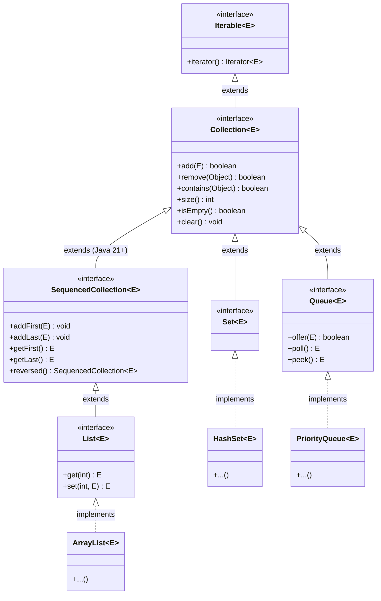

# The Java Collections Framework: The `Collection` Interface, Polymorphic Uniformity & Modern Sequenced Collections

---

## Key Takeaways

The **Java Collections Framework (JCF)** provides an architecture for representing and manipulating collections uniformly, independent of their implementation details. At the very root of the hierarchy sits **`Iterable<E>`**, granting all collections the ability to be iterated over (including via the enhanced `for-each` loop). Directly beneath it is the **`Collection<E>`** interface, which defines the standard operations shared across concrete data structures—such as `add()`, `remove()`, `contains()`, `isEmpty()`, `size()`, and `clear()`. Sub-interfaces like `List<E>`, `Set<E>`, and `Queue<E>` specialize this contract. Starting in Java 21, **`SequencedCollection<E>`** bridges ordered collections by introducing a standardized interface for accessing and mutating the first and last elements (`getFirst()`, `getLast()`, `addFirst()`, `addLast()`, `reversed()`). Unlike primitive fixed-size arrays, JCF collections dynamically adjust their capacity and store exclusively reference types (relying on autoboxing for primitives).



- **Root Contract (`Iterable<E>`)**: Every collection in the framework implements `Iterable<E>`, returning an `Iterator<E>` that enables for-each loop traversal.
- **Unified API Design**: Common methods like `add()`, `remove()`, `contains()`, `size()`, and `clear()` share identical semantics across diverse structures (`ArrayList`, `HashSet`, `PriorityQueue`).
- **Java 21 `SequencedCollection<E>`**: Introduced via JEP 431 to solve long-standing inconsistencies in retrieving first/last elements and viewing collections in reverse order across lists, deques, and ordered sets.
- **Dynamic Sizing**: Collections expand and shrink dynamically during runtime without requiring manual array allocation or copying.
- **Reference Type Constraint**: Collections cannot store primitives directly (e.g., `Collection<int>` fails compilation); Java uses boxed wrapper types (e.g., `Integer`, `Double`) via autoboxing.

---

## Main Discussion

### Idiomatic Java Code Snippets

#### 1. Polymorphic Collection Processing (`CollectionUniformityDemo.java`)

Writing universal algorithms against the `Collection<E>` interface that operate uniformly over lists, sets, and queues:

```java
package collections_framework;

import java.util.ArrayDeque;
import java.util.ArrayList;
import java.util.Collection;
import java.util.HashSet;
import java.util.List;
import java.util.PriorityQueue;

public class CollectionUniformityDemo {

    // Universal client method programmed to the Collection<E> interface
    public static <T> void inspectAndPopulate(Collection<T> collection, List<T> elements) {
        // Universal mutation and inquiry methods
        collection.addAll(elements);

        System.out.println("Collection Type: " + collection.getClass().getSimpleName());
        System.out.println("Size: " + collection.size() + ", isEmpty: " + collection.isEmpty());

        T sample = elements.get(0);
        System.out.println("Contains sample ('" + sample + "'): " + collection.contains(sample));

        // Uniform for-each traversal enabled by Iterable<T>
        System.out.print("Elements: ");
        for (T item : collection) {
            System.out.print(item + " ");
        }
        System.out.println("\n-------------------------------------------");
    }

    public static void main(String[] args) {
        List<String> rawData = List.of("Java", "Kotlin", "Java", "Scala");

        // 1. List: Preserves insertion order and duplicates
        inspectAndPopulate(new ArrayList<>(), rawData);

        // 2. Set: Eliminates duplicate "Java" automatically
        inspectAndPopulate(new HashSet<>(), rawData);

        // 3. Queue: Managed under PriorityQueue natural ordering
        inspectAndPopulate(new PriorityQueue<>(), rawData);
    }
}
```

#### 2. Modern Sequenced Collections in Java 21+ (`SequencedDemo.java`)

Using `SequencedCollection` to standardize boundary access and reverse views across ordered types:

```java
package collections_framework;

import java.util.ArrayList;
import java.util.LinkedHashSet;
import java.util.List;
import java.util.SequencedCollection;

public class SequencedDemo {

    public static void main(String[] args) {
        // SequencedCollection interface implemented by List, Deque, and LinkedHashSet
        SequencedCollection<String> pipeline = new ArrayList<>();

        // Unified endpoint mutations
        pipeline.addLast("Processing");
        pipeline.addFirst("Initialization");
        pipeline.addLast("Teardown");

        System.out.println("Full Sequence: " + pipeline);
        // Output: [Initialization, Processing, Teardown]

        // Uniform first/last queries without index gymnastics or NoSuchElementException risks
        System.out.println("Head Element: " + pipeline.getFirst()); // Initialization
        System.out.println("Tail Element: " + pipeline.getLast());  // Teardown

        // Uniform reversed view (returns a live reversed view of the collection)
        SequencedCollection<String> reversedPipeline = pipeline.reversed();
        System.out.println("Reversed View: " + reversedPipeline);
        // Output: [Teardown, Processing, Initialization]

        // Demonstrating the same interface on an ordered Set (LinkedHashSet)
        SequencedCollection<Integer> orderedSet = new LinkedHashSet<>(List.of(10, 20, 30));
        orderedSet.addFirst(5);
        System.out.println("Ordered Set First: " + orderedSet.getFirst()); // 5
    }
}
```

### Under the Hood / JVM Mechanics

```
   ITERATOR INVOCATION (Enhanced For Loop)         HEAP ALLOCATION & ITERATOR STATE
+------------------------------------------+    +------------------------------------------+
| Collection<T> col = new ArrayList<>()   |    | ArrayList Instance (0x00A1)              |
| Iterator<T> it = col.iterator()          |--->| - elementData: Object[]                  |
+------------------------------------------+    | - size: 3                                |
                     |                          +------------------------------------------+
                     v                                              |
+------------------------------------------+                        v
| while (it.hasNext()) {                   |    +------------------------------------------+
|     T element = it.next();               |    | Itr Instance (0x00B2 - Inner Class)      |
| }                                        |    | - cursor: 0                              |
+------------------------------------------+    | - lastRet: -1                            |
                                                | - expectedModCount: modCount             |
                                                +------------------------------------------+

```

1. **Iterable Bytecode Desugaring:**
   When the compiler encounters an enhanced for-each loop targeting any subtype of Iterable (such as Collection), it replaces the loop with bytecode instructions calling col.iterator() via invokeinterface, followed by an iterative hasNext() and next() evaluation loop.
2. **Fail-Fast Modification Tracking (modCount):**
   Most core collection implementations (e.g., ArrayList, HashSet) maintain an internal protected transient int modCount. When an iterator is created, it copies this counter into its private expectedModCount. If the collection's structure is modified concurrently (adding or removing elements outside the iterator's own remove()), modCount increments. The subsequent call to it.next() detects the mismatch and immediately throws a ConcurrentModificationException.
3. **Autoboxing & Object Identity Overhead:**
   Because generic collections compile using type erasure down to Object, primitive values cannot reside in collection slots directly. Calling col.add(10) causes javac to emit an invokestatic instruction to Integer.valueOf(10). This wraps the 4-byte primitive into a 16-byte heap object (12-byte header + 4-byte payload), causing higher memory consumption than primitive arrays.
4. **Sequenced Collection Reversed View Mechanics:**
   In Java 21+, calling collection.reversed() does not allocate an inverted duplicate array. Instead, it instantiates a lightweight wrapper view class (e.g., ArrayList.SubList or ReverseOrderListView) that maps index lookups internally to (size - 1 - index), providing $\mathcal{O}(1)$ time and memory overhead.

### Structural Comparisons

#### Primitive Arrays (`T[]`) vs. Collections (`Collection<E>`)

| Feature                | Primitive Array (`int[]` / `String[]`)              | Java Collection (`Collection<E>`)                          |
| ---------------------- | --------------------------------------------------- | ---------------------------------------------------------- |
| **Sizing Boundary**    | **Fixed** upon instantiation; immutable capacity    | **Dynamic**; grows and shrinks automatically               |
| **Data Types Allowed** | Primitives and Objects                              | **Reference types only** (requires autoboxing)             |
| **API Uniformity**     | Basic language constructs (`length`, `[]`)          | Rich polymorphic standard library (`size()`, `contains()`) |
| **Type Safety**        | Reified type check at runtime (ArrayStoreException) | Checked at compile time; erased to `Object` at runtime     |
| **Memory Footprint**   | Extremely compact; contiguous raw bytes             | Higher; incorporates object headers and references         |
| **Boundary Utilities** | Requires `java.util.Arrays` helper class            | Built directly into collection methods                     |

#### Primary Child Interfaces of `Collection<E>`

| Sub-Interface                | Distinct Characteristics                                                 | Key Implementations                   |
| ---------------------------- | ------------------------------------------------------------------------ | ------------------------------------- |
| **`List<E>`**                | Ordered sequence; permits duplicates; positional index access (`get(i)`) | `ArrayList`, `LinkedList`             |
| **`Set<E>`**                 | Unique elements only; forbids duplicates; models mathematical set        | `HashSet`, `LinkedHashSet`, `TreeSet` |
| **`Queue<E>`**               | Designed for holding elements prior to processing; FIFO or priority      | `ArrayDeque`, `PriorityQueue`         |
| **`SequencedCollection<E>`** | Ordered elements with explicit, uniform first and last access points     | `List`, `ArrayDeque`, `LinkedHashSet` |

### Common Anti-Patterns & Edge Cases

- **Attempting to Instantiate Interfaces Directly**:
  Calling `new Collection<String>()` or `new List<Integer>()` triggers a compilation error because interfaces cannot be instantiated. A concrete class (e.g., `new ArrayList<>()`) must be provided.
- **Primitive Type Generic Arguments**:
  Attempting `Collection<double> numbers = new ArrayList<>();` fails compilation (`unexpected type: found double, required reference`). You must specify boxed wrappers: `Collection<Double>`.
- **Modifying a Collection While Iterating**:
  Invoking `collection.remove(item)` directly inside an enhanced for-each loop invalidates the iterator's internal `modCount`, causing an immediate `ConcurrentModificationException`. To remove items safely during traversal, use `Iterator.remove()` or Java 8's `Collection.removeIf()`.
- **Assuming All Collections Support `add()`**:
  Calling `.add()`on collections produced by methods like`List.of()`or`Arrays.asList()`throws an`UnsupportedOperationException` at runtime because these return unmodifiable or fixed-size collection wrappers.

---

## Knowledge Check & JetBrains-Style Coding Challenges

### Exam / Theory Tips

- **Hierarchy Root**: `Iterable<E>` is the root interface of the entire collection hierarchy, sitting above `Collection<E>`.
- **Collections vs. Maps**: `Map<K, V>` does **not** inherit from `Collection<E>` or `Iterable<E>`. It forms its own independent branch within the Java Collections Framework.
- **Polymorphic Coding Standard**: Declare variable and parameter types using the most general interface that meets the requirements (e.g., `Collection<T>` or `List<T>`) rather than concrete classes like `ArrayList<T>`.

### Question 1: Conceptual / Code Analysis

Consider the following method designed to operate on user data:

```java
import java.util.*;

public class CollectionInspector {
    public static void process(Collection<Integer> items) {
        items.add(100);
        System.out.print(items.size() + " ");
        items.remove(100);
        System.out.print(items.size());
    }

    public static void main(String[] args) {
        Set<Integer> uniqueData = new HashSet<>();
        uniqueData.add(100);
        process(uniqueData);
    }
}
```

What is printed to the console when `main` executes?

- [ ] **A.** `2 1`
- [ ] **B.** `1 0`
- [ ] **C.** A compilation error occurs because `Set<Integer>` cannot be passed to a `Collection<Integer>` parameter.
- [ ] **D.** A runtime `ConcurrentModificationException` occurs during `items.remove(100)`.

<details>
<summary>Correct Answer</summary>

**Correct Answer**: **B**

**Technical Breakdown**:

- **B is correct**:

1. `Set<E>` extends `Collection<E>`, so passing `uniqueData` to `process(Collection<Integer>)` is valid polymorphic upcasting.
2. Before the call, `uniqueData` contains `[100]`, with a size of 1.
3. Inside `process`, `items.add(100)` runs. Because the underlying runtime instance in the heap is a `HashSet`, set uniqueness constraints apply: adding an already existing element returns `false` and does not duplicate the element. The size remains `1`. The code prints `1 `.
4. `items.remove(100)` successfully removes the element from the set. The set is now empty, with a size of `0`. The code prints `0`.
5. Total console output is `1 0`.

- **A is incorrect**: A `Set` does not permit duplicate entries; `100` cannot exist twice.
- **C is incorrect**: `Set` is a sub-interface of `Collection`; upcasting is fully legal.
- **D is incorrect**: `remove()` is invoked directly on the collection reference outside of an active Iterator traversal, so no `ConcurrentModificationException` is raised.

</details>

---

### Question 2: Mini Coding Problem / Implementation Challenge

**Task**: Implement an agnostic collection sanitizer and boundary extractor utility named `CollectionToolbox` inside package `collections_framework`:

1. Method `public static <T> int transferAndCountMatches(Collection<T> source, Collection<T> destination, T target)`:
   - Returns `0` if either collection is `null`.
   - Iterates through `source` and adds all non-null elements to `destination`.
   - Counts and returns the total occurrences of elements matching `target` (using `Objects.equals`) found during the transfer.
2. Method `public static <E> List<E> extractBoundaries(SequencedCollection<E> sequencedCollection)`:
   - Checks if `sequencedCollection` is null or empty (`isEmpty()`).
   - If empty or null, returns an empty `List.of()`.
   - Retrieves the first and last elements using the Java 21 `SequencedCollection` API (`getFirst()`, `getLast()`).
   - Returns a new `List<E>` containing exactly two elements: `[first, last]`.

**Test Assertions**:

- `List<String> src = List.of("A", "B", "A", "C");`
- `Set<String> dest = new HashSet<>();`
- `transferAndCountMatches(src, dest, "A")` $\rightarrow$ Returns: `2` (count of matches in source)
  - `dest.size()` evaluates to `3` (deduplicated: `["A", "B", "C"]`)
- `SequencedCollection<Integer> seq = new ArrayList<>(List.of(42, 88, 99));`
- `extractBoundaries(seq)` $\rightarrow$ Returns: `[42, 99]`
- `extractBoundaries(new ArrayList<>())` $\rightarrow$ Returns: `[]`

<details>
<summary>Solution</summary>

```java
package collections_framework;

import java.util.Collection;
import java.util.List;
import java.util.Objects;
import java.util.SequencedCollection;

public class CollectionToolbox {

    // Universal transfer routine operating polymorphically across any Collection types
    public static <T> int transferAndCountMatches(Collection<T> source, Collection<T> destination, T target) {
        if (source == null || destination == null) {
            return 0;
        }

        int matchCount = 0;
        for (T item : source) {
            if (item != null) {
                destination.add(item); // Polymorphic insertion based on destination's runtime type
                if (Objects.equals(item, target)) {
                    matchCount++;
                }
            }
        }

        return matchCount;
    }

    // Modern boundary extraction using Java 21 SequencedCollection contracts
    public static <E> List<E> extractBoundaries(SequencedCollection<E> sequencedCollection) {
        if (sequencedCollection == null || sequencedCollection.isEmpty()) {
            return List.of();
        }

        // Direct SequencedCollection contract methods: getFirst() and getLast()
        E first = sequencedCollection.getFirst();
        E last = sequencedCollection.getLast();

        return List.of(first, last);
    }
}
```

**Complexity Analysis**:

- **Time Complexity**:
  - `transferAndCountMatches`: $\mathcal{O}(N)$ linear scan over `source`. Destination insertion performance depends on its runtime type ($\mathcal{O}(1)$ amortized for `ArrayList` or `HashSet`).
  - `extractBoundaries`: $\mathcal{O}(1)$ constant-time extraction via `getFirst()` and `getLast()` on sequenced collections.
- **Space Complexity**:
  - `transferAndCountMatches`: $\mathcal{O}(1)$ auxiliary space beyond the storage capacity allocated by the `destination` collection.
  - `extractBoundaries`: $\mathcal{O}(1)$ space allocating an immutable 2-element list.

</details>

---
