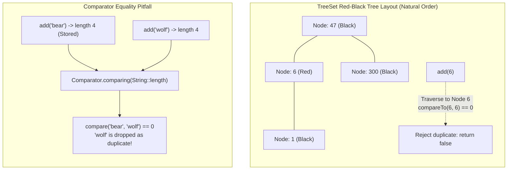

# The `TreeSet` Architecture: Red-Black Trees, Strict Uniqueness & Comparator Equality Mechanics

---

## Key Takeaways

`java.util.TreeSet` is a concrete implementation of the `NavigableSet` and `SortedSet` interfaces within the Java Collections Framework, backed by a self-balancing binary search tree (specifically, a **Red-Black Tree** via an underlying `TreeMap`). It enforces two invariants: **strict uniqueness** (no duplicate elements) and **total ordering** (elements are stored and iterated in sorted, ascending order). By default, elements are ordered according to their **natural ordering** via `Comparable<T>` (numeric ascending for numbers, lexicographic for strings). A custom sorting policy can be supplied via a `Comparator<T>`.

A critical architectural distinction of `TreeSet` is that element uniqueness is determined **solely by the comparator or `compareTo()` returning `0`**, rather than `.equals()`or`.hashCode()`. If a custom comparator compares strings purely by length, two distinct words with identical lengths (such as `"bear"`and`"wolf"`) evaluate to `compare(a, b) == 0` and are treated as identical duplicates, silently rejecting the second element.



- **Self-Balancing Tree Storage**: Backed by a Red-Black Tree, guaranteeing $\mathcal{O}(\log N)$ time complexity for `add()`, `remove()`, and `contains()`.
- **Ascending Total Ordering**: Numbers sort lowest to highest; strings sort alphabetically by default.
- **Equality via Comparator (`compareTo == 0`)**: `TreeSet` does not consult `equals()` or `hashCode()` to detect duplicates. If `compare(e1, e2) == 0`, the elements are considered identical.
- **Ties in Custom Comparators**: To sort by a property without dropping distinct elements that share that property, comparators must include a secondary tie-breaker (e.g., `.thenComparing(Comparator.naturalOrder())`).
- **Null Rejection**: Natural-ordering `TreeSet` rejects `null` elements immediately with a `NullPointerException` because calling `null.compareTo(...)` is impossible.

---

## Main Discussion

### Idiomatic Java Code Snippets

#### 1. Natural Ordering & Duplicate Elimination (`TreeSetNaturalOrderDemo.java`)

Using `Set<E>` on the left-hand side while verifying automatic sorting and duplicate rejection:

```java
package collections_set;

import java.util.Set;
import java.util.TreeSet;

public class TreeSetNaturalOrderDemo {

    public static void main(String[] args) {
        // IDIOMATIC: Program to the interface on the left
        Set<Integer> numberSet = new TreeSet<>();

        // 1. Elements inserted in arbitrary order
        numberSet.add(1);
        numberSet.add(300);
        numberSet.add(47);
        numberSet.add(6);

        // Natural sort order applied automatically: ascending
        System.out.println("TreeSet Numbers (Sorted): " + numberSet);
        // Output: [1, 6, 47, 300]

        // 2. Duplicate rejection: add() returns false, element is ignored
        boolean addedDuplicate = numberSet.add(6);
        System.out.println("Was duplicate 6 added? " + addedDuplicate); // false
        System.out.println("After duplicate attempt: " + numberSet);
        // Output: [1, 6, 47, 300]

        // 3. Natural String ordering (Lexicographical / Alphabetical)
        Set<String> animalSet = new TreeSet<>();
        animalSet.add("tiger");
        animalSet.add("giraffe");
        animalSet.add("bear");

        System.out.println("Alphabetical Animals: " + animalSet);
        // Output: [bear, giraffe, tiger]
    }
}
```

#### 2. The Custom Comparator Collision Pitfall & Resolution (`TreeSetComparatorDemo.java`)

Demonstrating why comparing only by length drops words, and how to fix it with a secondary tie-breaker:

```java
package collections_set;

import java.util.Comparator;
import java.util.Set;
import java.util.TreeSet;

public class TreeSetComparatorDemo {

    public static void main(String[] args) {
        // --- SCENARIO A: The Duplicate Dropping Bug ---
        // Sorting purely by length:
        Set<String> lengthOnlySet = new TreeSet<>(Comparator.comparing(String::length));
        lengthOnlySet.add("bear");    // length = 4
        lengthOnlySet.add("giraffe"); // length = 7
        lengthOnlySet.add("tiger");   // length = 5

        System.out.println("Length-sorted set: " + lengthOnlySet);
        // Output: [bear, tiger, giraffe]

        // Attempting to add "wolf" (length = 4)
        boolean wolfAdded = lengthOnlySet.add("wolf");
        System.out.println("Was 'wolf' added? " + wolfAdded); // false!
        System.out.println("Set contents after adding 'wolf': " + lengthOnlySet);
        // Output: [bear, tiger, giraffe] ("wolf" was dropped because compare(bear, wolf) == 0)

        // --- SCENARIO B: The Idiomatic Tie-Breaker Fix ---
        // Sort by length first; break ties alphabetically
        Comparator<String> lengthThenAlpha = Comparator
                .comparing(String::length)
                .thenComparing(Comparator.naturalOrder());

        Set<String> robustSet = new TreeSet<>(lengthThenAlpha);
        robustSet.add("bear");
        robustSet.add("giraffe");
        robustSet.add("tiger");
        robustSet.add("wolf"); // Now successfully inserted!

        System.out.println("\nRobust Set (Length + Alphabetical Tie-Breaker): " + robustSet);
        // Output: [bear, wolf, tiger, giraffe] (bear and wolf both preserved; ordered alphabetically)

        // Removing elements
        robustSet.remove("giraffe");
        System.out.println("After removing giraffe: " + robustSet);
        // Output: [bear, wolf, tiger]
    }
}
```

### Under the Hood / JVM Mechanics

```
   TREESET OBJECT (Heap: 0x00A1)                   TREEMAP BACKING STRUCTURE
+------------------------------------+        +----------------------------------------+
| m: ref -> TreeMap (0x00B2)         |------->| root: ref -> Entry 0x011A (Key: 47)    |
+------------------------------------+        | comparator: null (Natural Order)       |
                                              | size: 4                                |
                                              +----------------------------------------+
                                                                   |
                                                                   v
                                              +----------------------------------------+
                                              | Entry<K, Object> (Red-Black Node)      |
                                              | - key: 47                              |
                                              | - value: PRESENT (Shared dummy Object) |
                                              | - left: ref -> Entry (Key: 6)          |
                                              | - right: ref -> Entry (Key: 300)       |
                                              | - color: BLACK                         |
                                              +----------------------------------------+

```

1. **Delegation to Backing TreeMap:**
   TreeSet contains no native tree-balancing logic of its own. It holds a private final field:
   `private final NavigableMap<E,Object> m;`.
   When you call treeSet.add(e), it delegates internally to:
   m.put(e, PRESENT) == null, where PRESENT is a shared dummy Object reference.
2. **Red-Black Tree Traversal & Comparison:**
   When inserting an element, TreeMap.put() walks down from the root node. At each step, it executes:
   cmp = k.compareTo(t.key) (or uses the supplied Comparator.compare()).
   If cmp < 0, it branches left; if cmp > 0, it branches right.
3. **Duplicate Collision Detection via cmp == 0:**
   If cmp == 0 at any visited node, the tree considers the key already present. It updates the value slot (re-assigning PRESENT) and returns the previous value, causing TreeSet.add() to return false. equals() is never invoked during this lookup.
4. **Rebalancing & Color Rotations:**
   If a new node is inserted (branching reaches a null leaf), the entry is attached as a RED leaf. The JVM then runs fixAfterInsertion(), executing tree rotations (left/right rotate) and color recoloring (red to black) to maintain Red-Black Tree balance invariants in $\mathcal{O}(\log N)$ time.

### Structural Comparisons

#### `TreeSet` vs. `HashSet` vs. `LinkedHashSet`

| Metric / Feature            | `TreeSet<E>`                                       | `HashSet<E>`                  | `LinkedHashSet<E>`                               |
| --------------------------- | -------------------------------------------------- | ----------------------------- | ------------------------------------------------ |
| **Backing Structure**       | Red-Black Tree (`TreeMap`)                         | Hash table (`HashMap`)        | Hash table + Doubly-linked list                  |
| **Ordering Model**          | **Sorted** (Natural or Comparator)                 | Unordered / Non-deterministic | **Insertion order**                              |
| **Add / Remove / Contains** | $\mathcal{O}(\log N)$                              | $\mathcal{O}(1)$ average      | $\mathcal{O}(1)$ average                         |
| **Duplicate Determination** | `compareTo() == 0` or `compare() == 0`             | `equals()` and `hashCode()`   | `equals()` and `hashCode()`                      |
| **Null Elements**           | **Forbidden** (throws NPE with natural order)      | Permitted (single null)       | Permitted (single null)                          |
| **Navigation Operations**   | `first()`, `last()`, `higher()`, `lower()`         | None                          | Sequenced boundaries (`getFirst()`, `getLast()`) |
| **Performance Profile**     | Predictable $\mathcal{O}(\log N)$; higher overhead | Fastest general-purpose Set   | Fast with consistent iteration order             |

#### `Comparable` vs. `Comparator`

| Characteristic           | `Comparable<T>` (Natural Order)                          | `Comparator<T>` (Custom Strategy)                    |
| ------------------------ | -------------------------------------------------------- | ---------------------------------------------------- |
| **Interface Package**    | `java.lang.Comparable`                                   | `java.util.Comparator`                               |
| **Method Defined**       | `int compareTo(T o)`                                     | `int compare(T o1, T o2)`                            |
| **Implementation Point** | Implemented **inside** the domain class itself           | Implemented in a **separate** lambda or class        |
| **Flexibility**          | Defines a single, default sort order                     | Allows infinite arbitrary sorting variations         |
| **TreeSet Usage**        | Used when no-arg constructor `new TreeSet<>()` is called | Passed into constructor: `new TreeSet<>(comparator)` |

### Common Anti-Patterns & Edge Cases

- **Inconsistent `equals` and `compareTo` (The "Disappearing Element" Bug)**:
  Java's `SortedSet` contract states that a comparator should be _consistent with equals_ (meaning `c.compare(e1, e2) == 0` if and only if `e1.equals(e2)`). If a comparator matches elements on only one field (like `String::length`), distinct elements that share that property collide and are silently dropped.
- **Mutating Elements After Insertion**:
  If a mutable object is added to a `TreeSet` and an external thread mutates a field that affects its `compareTo()` value, the tree does not rebalance automatically. The object becomes "lost" inside the tree: `contains()` may return `false`, and the set's ordering invariants are broken. Always store immutable objects in a `TreeSet`.
- **Adding Non-Comparable Elements Without a Comparator**:
  Instantiating `new TreeSet<>()` and adding objects that do not implement `Comparable` throws a runtime `ClassCastException` on the first `add()` call.
- **Attempting to Add `null**`:
Calling `set.add(null)`on a`TreeSet`using natural order throws a`NullPointerException` immediately.

---

## Knowledge Check & JetBrains-Style Coding Challenges

### Theory Tips

- **Core Invariants**: `TreeSet` guarantees elements are **unique** and **sorted** in ascending order.
- **Uniqueness Rule**: `TreeSet` uses `compare()` / `compareTo() == 0` to identify duplicates, **not** `equals()`.
- **Time Complexity**: Standard operations (`add`, `remove`, `contains`) run in guaranteed $\mathcal{O}(\log N)$ time thanks to the underlying Red-Black Tree.

### Question 1: Conceptual / Code Analysis

Consider the following domain class and execution snippet:

```java
import java.util.*;

class Item {
    int id;
    String name;

    Item(int id, String name) {
        this.id = id;
        this.name = name;
    }

    @Override
    public boolean equals(Object o) {
        if (this == o) return true;
        if (!(o instanceof Item item)) return false;
        return id == item.id && Objects.equals(name, item.name);
    }

    @Override
    public int hashCode() {
        return Objects.hash(id, name);
    }
}

public class TreeSetQuestion {
    public static void main(String[] args) {
        Set<Item> set = new TreeSet<>(Comparator.comparingInt(item -> item.id));
        set.add(new Item(10, "Widget"));
        set.add(new Item(10, "Gadget"));

        System.out.println(set.size());
    }
}
```

What is printed to the console?

- [ ] **A.** `2`
- [ ] **B.** `1`
- [ ] **C.** A compilation error occurs because `Item` does not implement `Comparable`.
- [ ] **D.** A runtime `ClassCastException` is thrown.

<details>
<summary>Correct Answer</summary>

**Correct Answer**: **B**

**Technical Breakdown**:

- **B is correct**:

1. The `TreeSet` is constructed with an explicit `Comparator` comparing `item.id`: `Comparator.comparingInt(item -> item.id)`.
2. The first item (`id: 10, name: "Widget"`) is added at the root.
3. When inserting the second item (`id: 10, name: "Gadget"`), the tree evaluates `comparator.compare(first, second)`. Because both items have `id == 10`, `compare()` returns `0`.
4. Even though `equals()` would evaluate to `false` (since their names differ), `TreeSet` determines uniqueness strictly through the comparator. Seeing `0`, it considers the second item a duplicate and rejects it.
5. The set size remains `1`.

- **A is incorrect**: The comparator treats identical `id` values as duplicates.
- **C & D are incorrect**: Supplying an explicit `Comparator` avoids the need for `Item` to implement `Comparable`, so no `ClassCastException` or compilation error occurs.

</details>

---

### Question 2: Mini Coding Problem / Implementation Challenge

**Task**: Implement a sorted registry for player scores named `LeaderboardRegistry` inside package `collections_set`:

1. Class `PlayerScore`:
   - Private fields: `username` (`String`), `score` (`int`).
   - Constructor initializing both fields.
   - Public getters.
   - Implement `toString()`: returns `username + ":" + score`.
2. Class `LeaderboardRegistry`:
   - Stores a `Set<PlayerScore>` using a `TreeSet`.
   - **Ordering Specification**:
     - Highest score first (descending numeric order).
     - If two players have the exact same score, break the tie by sorting their `username` alphabetically (ascending lexicographical order).
     - If both score and username are identical, reject as duplicate.
   - Method `public boolean registerScore(String username, int score)`:
     - Validates input: throws `IllegalArgumentException` if `username` is null or blank.
     - Adds the `PlayerScore` to the set and returns the boolean result of `add()`.
   - Method `public List<String> getLeaderboardEntries()`:
     - Returns a `List<String>` of formatted entries (`username:score`) in sorted order.

**Test Assertions**:

- `LeaderboardRegistry lb = new LeaderboardRegistry();`
- `lb.registerScore("Alice", 500);` $\rightarrow$ Returns `true`
- `lb.registerScore("Bob", 800);` $\rightarrow$ Returns `true`
- `lb.registerScore("Charlie", 500);` $\rightarrow$ Returns `true` (Tied with Alice on score, preserved via tie-breaker)
- `lb.registerScore("Alice", 500);` $\rightarrow$ Returns `false` (Identical score and name rejected as duplicate)
- `lb.getLeaderboardEntries()` $\rightarrow$ Returns: `["Bob:800", "Alice:500", "Charlie:500"]`
- Bob is first with 800.
- Alice and Charlie are tied at 500; Alice precedes Charlie alphabetically (`"Alice".compareTo("Charlie") < 0`).

<details>
<summary>Solution</summary>

```java
package collections_set;

import java.util.ArrayList;
import java.util.Comparator;
import java.util.List;
import java.util.Objects;
import java.util.Set;
import java.util.TreeSet;

public class LeaderboardRegistry {

    public static class PlayerScore {
        private final String username;
        private final int score;

        public PlayerScore(String username, int score) {
            this.username = Objects.requireNonNull(username, "Username cannot be null.");
            this.score = score;
        }

        public String getUsername() {
            return username;
        }

        public int getScore() {
            return score;
        }

        @Override
        public String toString() {
            return username + ":" + score;
        }
    }

    private final Set<PlayerScore> leaderboard;

    public LeaderboardRegistry() {
        // High score first (reversed), broken by username alphabetically
        Comparator<PlayerScore> leaderboardComparator = Comparator
                .comparingInt(PlayerScore::getScore)
                .reversed()
                .thenComparing(PlayerScore::getUsername);

        this.leaderboard = new TreeSet<>(leaderboardComparator);
    }

    public boolean registerScore(String username, int score) {
        if (username == null || username.isBlank()) {
            throw new IllegalArgumentException("Username cannot be null or blank.");
        }
        return leaderboard.add(new PlayerScore(username.trim(), score));
    }

    public List<String> getLeaderboardEntries() {
        List<String> entries = new ArrayList<>();
        for (PlayerScore entry : leaderboard) {
            entries.add(entry.toString());
        }
        return entries;
    }
}
```

**Complexity Analysis**:

- **Time Complexity**:
  - `registerScore`: $\mathcal{O}(\log N)$ insertion and self-balancing re-color/rotation in the underlying Red-Black Tree.
  - `getLeaderboardEntries`: $\mathcal{O}(N)$ in-order tree traversal visiting nodes in sorted sequence.
- **Space Complexity**: $\mathcal{O}(N)$ heap memory storing `TreeMap.Entry` nodes, each holding tree pointers (`left`, `right`, `parent`), color bits, and element references.

</details>

---
