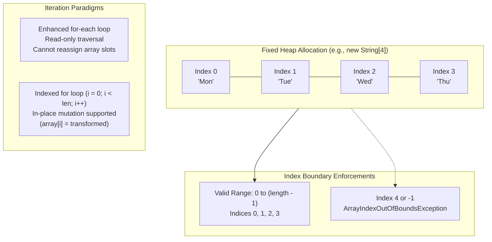

# Array Fundamentals: Contiguous Allocation, Index Mechanics, Iteration Models & Utility Routines

---

## Key Takeaways

An **array** is a foundational, fixed-length data structure in Java that holds elements of a single, uniform type in contiguous memory locations. Arrays can store either primitive data types (`int`, `double`, `boolean`) or reference types (`String`, custom objects), but types cannot be intermixed. The array's capacity is immutable and fixed at allocation; expanding its capacity requires allocating an entirely new array and migrating the data. Elements are zero-indexed, meaning valid indices range from `0` to `array.length - 1`. Attempting to access an index outside this range throws an `ArrayIndexOutOfBoundsException`. Printing an array directly yields its raw type descriptor and identity hash code (e.g., `[Ljava.lang.String;@...`); human-readable representations require the utility method `java.util.Arrays.toString()`.



- **Fixed Capacity & Homogeneity**: The size of an array is declared at instantiation and cannot change during its lifetime. All elements must share the exact declared type.
- **Default Values**: Uninitialized array slots are populated with Java's default values: `0` for numeric primitives, `0.0` for floating points, `false` for booleans, and `null` for all object references.
- **Zero-Based Indexing**: The first element resides at index `0`, and the last element resides at `length - 1`.
- **Direct Printing Pitfall**: Calling `System.out.println(array)` calls `Object.toString()`, printing the internal type descriptor and identity hash. Use `Arrays.toString(array)` for diagnostic output.
- **Traversal Paradigms**:
  - **Enhanced `for-each` loop**: Ideal for read-only element access; assigning to the iteration variable does not modify the underlying array element.
  - **Indexed `for` loop (`int i = 0; i < array.length; i++`)**: Required when index positions are needed or when updating array elements in place.

---

## Main Discussion

### Idiomatic Java Code Snippets

#### 1. Array Instantiation, Defaults & Mutation (`ArrayBasicsDemo.java`)

Contrasting sizing allocation with inline array literal initialization:

```java
package array_foundations;

import java.util.Arrays;

public class ArrayBasicsDemo {

    public static void main(String[] args) {
        // 1. Instantiation by Size: 7 slots allocated, initialized to null
        String[] weekdays = new String[7];

        // Direct print shows raw type descriptor and identity hash code
        System.out.println("Raw print: " + weekdays);
        // Example output: [Ljava.lang.String;@58372a00

        // Readable print via utility class
        System.out.println("Initial defaults: " + Arrays.toString(weekdays));
        // Output: [null, null, null, null, null, null, null]

        // 2. Setting values via index assignment
        weekdays[0] = "Monday";
        weekdays[1] = "Tuesday";
        System.out.println("Partially populated: " + Arrays.toString(weekdays));
        // Output: [Monday, Tuesday, null, null, null, null, null]

        // 3. Instantiation by Array Literal / Values:
        // Size is inferred from elements (length = 3)
        String[] shortWeekdays = new String[] { "Mon", "Tue", "Wed" };
        System.out.println("Literal array: " + Arrays.toString(shortWeekdays));
        // Output: [Mon, Tue, Wed]

        // Shorthand syntax allowed during direct declaration
        int[] primes = { 2, 3, 5, 7, 11 };
        System.out.println("Primes array: " + Arrays.toString(primes));
    }
}
```

#### 2. Traversal Models: Read-Only `for-each` vs. In-Place Mutation (`IterationDemo.java`)

Comparing the behavior of enhanced for loops against indexed loops:

```java
package array_foundations;

import java.util.Arrays;

public class IterationDemo {

    public static void main(String[] args) {
        String[] weekdays = { "Mon", "Tue", "Wed" };

        // 1. Enhanced for-each loop: Read-only access
        System.out.println("--- Enhanced For-Each (Read-Only) ---");
        for (String day : weekdays) {
            System.out.println("Weekday: " + day);
            // day = day.toUpperCase(); // Ineffective: only updates local variable 'day'
        }

        // 2. Indexed for loop: Modifying elements in place
        System.out.println("\n--- Indexed For Loop (In-Place Mutation) ---");
        for (int i = 0; i < weekdays.length; i++) {
            // Safe boundary: loop halts before i == weekdays.length
            weekdays[i] = weekdays[i].toUpperCase();
        }

        System.out.println("Mutated Array: " + Arrays.toString(weekdays));
        // Output: [MON, TUE, WED]
    }
}
```

### Under the Hood / JVM Mechanics

```
   CALL STACK (Frame: main)                     JVM HEAP MEMORY
+-----------------------------+       +---------------------------------------------+
| weekdays reference (0x00A1) |------>| String[] Object Header (16 bytes)           |
+-----------------------------+       | - Mark Word                                 |
| i = 0                       |       | - Klass Word -> [Ljava.lang.String;         |
+-----------------------------+       | - Array Length: 3 (4 bytes)                 |
                                      +---------------------------------------------+
                                      | Slot 0: Ref -> "Mon" (0x011B)               |
                                      | Slot 1: Ref -> "Tue" (0x012C)               |
                                      | Slot 2: Ref -> "Wed" (0x013D)               |
                                      +---------------------------------------------+

```

1. **Array Object Allocation via anewarray / newarray:**
   When allocating primitive arrays (e.g., new int[5]), the JVM emits the newarray bytecode instruction. For reference arrays (e.g., new String[7]), it emits anewarray, setting up an object header containing an immutable array length field and clearing all slots to default zeros or null references.
2. **Zero-Based Memory Address Arithmetic:**
   Array indexing operations (aload, aaload, aastore) compute element memory offsets directly in hardware:
   ElementAddress = BaseArrayAddress + HeaderOffset + (Index \* ReferenceSize).
   Because computing this offset is a single multiplication and addition, element retrieval is guaranteed $O(1)$ constant time.
3. **Bound-Checking Elimination (BCE):**
   Every array indexing instruction includes implicit boundary checks. If Index < 0 or Index >= Length, the JVM throws an ArrayIndexOutOfBoundsException. The JIT compiler optimizes standard idiomatic loops (for (int i = 0; i < array.length; i++)) via Bound-Checking Elimination (BCE), verifying bounds once upfront and eliminating per-iteration boundary check instructions.
4. **Enhanced for-each Bytecode Desugaring:**
   The enhanced for (String day : weekdays) loop carries no runtime magic. The javac compiler desugars it directly into a standard indexed loop with a hidden synthetic index variable and upper bound check.

### Structural Comparisons

#### Array Declaration & Initialization Approaches

| Syntax Form                     | Example                   | Evaluation Point   | Typical Usage                                                      |
| ------------------------------- | ------------------------- | ------------------ | ------------------------------------------------------------------ |
| **Size-Based Instantiation**    | `new int[10]`             | Runtime allocation | Size is known upfront, but values will be computed or loaded later |
| **Array Literal Instantiation** | `new String[]{"A", "B"}`  | Runtime allocation | Initial elements are known at declaration time                     |
| **Declaration Shorthand**       | `int[] nums = {1, 2, 3};` | Compile/runtime    | Clean inline initialization; valid only at variable declaration    |

#### Traversal Approaches: For-Each vs. Indexed For

| Feature                 | Enhanced For-Each (`for (T val : arr)`) | Indexed Loop (`for (int i = 0; i < len; i++)`)       |
| ----------------------- | --------------------------------------- | ---------------------------------------------------- |
| **Primary Use**         | Reading/inspecting element values       | Modifying elements in place; tracking index position |
| **In-Place Mutation**   | **Cannot** reassign array slots         | **Can** reassign (`arr[i] = newVal`)                 |
| **Index Access**        | No index variable available             | Explicit index (`i`) accessible                      |
| **Boundary Safety**     | Impossible to trigger index errors      | Off-by-one errors possible (`<= len`)                |
| **Traversal Direction** | Forward only                            | Forward, backward, or arbitrary step sizes           |

### Common Anti-Patterns & Edge Cases

- **Off-By-One Index Errors**:

  ```java
  int[] data = new int[5];
  // BUG: Using <= instead of < triggers ArrayIndexOutOfBoundsException on final pass
  for (int i = 0; i <= data.length; i++) {
      data[i] = i * 2;
  }
  ```

  Valid indices for an array of size $N$ are strictly $0$ to $N - 1$.

- **Attempting In-Place Reassignment in For-Each Loops**:

  ```java
  for (String s : weekdays) {
      s = s.toUpperCase(); // Ineffective: rebinds local variable 's'; array remains unchanged
  }
  ```

- **Assuming Arrays Auto-Expand**:
  Attempting to add an element past the allocated capacity by assigning to `array[array.length]` throws an exception. Expanding requires allocating a new, larger array and copying existing elements (e.g., via `Arrays.copyOf`).
- **Direct Printing of Arrays**:
  Passing an array directly to `System.out.println(myArray)` prints the type descriptor and identity hash code (e.g., `[I@15db9742`) instead of its elements. Always use `Arrays.toString(myArray)` for single-dimensional arrays, or `Arrays.deepToString(multiArray)` for nested arrays.

---

## Knowledge Check & JetBrains-Style Coding Challenges

### Theory Tips

- **Array Length Property**: `length` on an array is an immutable **field/property** (`arr.length`), not a method call (`arr.length()`).
- **Default Values**: Numeric types initialize to `0`/`0.0`, `boolean` initializes to `false`, and reference types initialize to `null`.
- **Out of Bounds Exception**: Accessing an index $< 0$ or $\ge \text{length}$ throws an `ArrayIndexOutOfBoundsException`.

### Question 1: Conceptual / Code Analysis

Consider the following Java method:

```java
public class ArrayTracer {
    public static void main(String[] args) {
        int[] numbers = new int[4];
        numbers[0] = 10;
        numbers[2] = 30;

        for (int num : numbers) {
            num = num * 2;
        }

        System.out.println(numbers[0] + " " + numbers[1] + " " + numbers[2] + " " + numbers[3]);
    }
}
```

What is printed to the console?

- [ ] **A.** `20 0 60 0`
- [ ] **B.** `10 null 30 null`
- [ ] **C.** `10 0 30 0`
- [ ] **D.** A runtime `NullPointerException` occurs during the loop.

<details>
<summary>Correct Answer</summary>

**Correct Answer**: **C**

**Technical Breakdown**:

- **C is correct**:

1. `int[] numbers = new int[4];` allocates an array of 4 integers. In Java, unassigned primitive `int` elements default to `0`. The initial state is `[0, 0, 0, 0]`.
2. `numbers[0] = 10;` and `numbers[2] = 30;` mutate indices 0 and 2. The array becomes `[10, 0, 30, 0]`.
3. The enhanced `for-each` loop copies each element value into the local loop variable `num`. Executing `num = num * 2;` mutates the local variable on the stack, having zero effect on the array stored on the heap.
4. The array contents remain `10 0 30 0`.

- **A is incorrect**: The enhanced for loop does not write values back to the array.
- **B is incorrect**: Primitive `int` arrays hold numbers, not `null` references; uninitialized slots default to `0`.
- **D is incorrect**: Primitive arrays do not contain object references, so no `NullPointerException` can occur.

</details>

---

### Question 2: Mini Coding Problem / Implementation Challenge

**Task**: Implement an array transformation and boundary utility named `ArrayManipulator` inside package `array_foundations`:

1. Method `public static String[] sanitizeAndCapitalize(String[] input)`:
   - Returns an empty array `new String[0]` if `input` is null.
   - Allocates a new array with the exact same length as `input`.
   - Copies each string from `input` into the new array, converting non-null strings to uppercase.
   - Replaces any `null` element with the string `"EMPTY"`.
2. Method `public static int[] appendElement(int[] source, int newElement)`:
   - Handles the fixed-size limitation of arrays by creating a new array of size `source.length + 1`.
   - Copies all elements from `source` into the new array.
   - Places `newElement` into the final index of the new array.
   - Returns the new array (returns `new int[]{ newElement }` if `source` is null).

**Test Assertions**:

- `sanitizeAndCapitalize(new String[]{ "mon", null, "wed" })` $\rightarrow$ Returns: `["MON", "EMPTY", "WED"]`
- `sanitizeAndCapitalize(new String[0])` $\rightarrow$ Returns: `[]`
- `sanitizeAndCapitalize(null)` $\rightarrow$ Returns: `[]`
- `appendElement(new int[]{ 10, 20, 30 }, 40)` $\rightarrow$ Returns: `[10, 20, 30, 40]`
- `appendElement(null, 5)` $\rightarrow$ Returns: `[5]`

<details>
<summary>Solution</summary>

```java
package array_foundations;

public class ArrayManipulator {

    // Transforms input elements, replacing nulls with "EMPTY" and uppercasing strings
    public static String[] sanitizeAndCapitalize(String[] input) {
        if (input == null) {
            return new String[0];
        }

        String[] result = new String[input.length];

        for (int i = 0; i < input.length; i++) {
            if (input[i] == null) {
                result[i] = "EMPTY";
            } else {
                result[i] = input[i].toUpperCase();
            }
        }

        return result;
    }

    // Demonstrates dynamic expansion pattern for fixed-size arrays
    public static int[] appendElement(int[] source, int newElement) {
        if (source == null) {
            return new int[] { newElement };
        }

        // Allocate a new array with an additional slot
        int[] expanded = new int[source.length + 1];

        // Copy elements from original array into the expanded array
        System.arraycopy(source, 0, expanded, 0, source.length);

        // Assign new element to the last slot (length - 1)
        expanded[expanded.length - 1] = newElement;

        return expanded;
    }
}
```

**Complexity Analysis**:

- **Time Complexity**:
  - `sanitizeAndCapitalize`: $\mathcal{O}(N)$ linear pass over the input array of length $N$.
  - `appendElement`: $\mathcal{O}(M)$ where $M$ is the length of `source`, due to copying elements via `System.arraycopy`.
- **Space Complexity**:
  - `sanitizeAndCapitalize`: $\mathcal{O}(N)$ auxiliary memory allocated for the new `String[]` array.
  - `appendElement`: $\mathcal{O}(M + 1)$ auxiliary memory allocated for the expanded `int[]` array.

</details>

---
