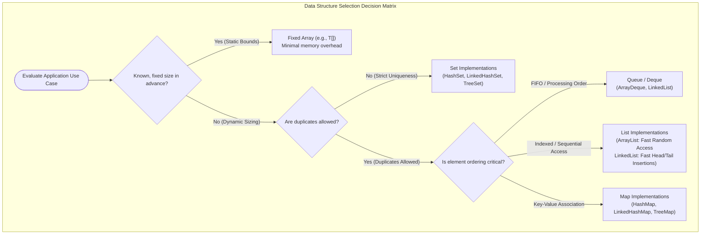

# Data Structures Foundations: Storage, Access Patterns & Architectural Selection Heuristics

---

## Key Takeaways

A **data structure** is an organized container format for grouping, storing, accessing, modifying, and relating collections of data. Rather than just being a passive holding area, every data structure enforces specific rules regarding element order, duplicate allowance, and navigational access patterns. Choosing the appropriate data structure involves evaluating explicit architectural trade-offs: known vs. dynamic sizing, uniqueness constraints, strict ordering requirements (such as FIFO queues vs. unordered sets), memory layout overhead, and time complexity profiles for read-heavy versus write-heavy workloads.



- **Core Definition**: A data structure organizes data elements, provides access and mutation operations, and defines the relationships among its elements.
- **Structural Characteristics**:
  - **Capacity Constraints**: Fixed capacity (arrays) versus dynamic resizing (lists, trees, hash buckets).
  - **Uniqueness Rules**: Duplicate-permissive (lists, queues) versus duplicate-rejecting (sets).
  - **Ordering Semantics**: Insertion-order, sorted/natural order, priority-based, or non-deterministic.
- **Access Patterns**: Slicing by index, sequential iteration, key-based lookup, or First-In-First-Out (FIFO) / Last-In-First-Out (LIFO) traversal.
- **Algorithmic Trade-offs**: There is no universal "best" data structure. A structure optimized for $O(1)$ random lookups (like an array) may suffer from costly $O(N)$ arbitrary insertions, whereas node-linked structures avoid array shifts at the expense of pointer memory overhead and cache misses.

---

## Main Discussion

### Idiomatic Java Code Snippets

#### 1. Modeling Custom Objects Inside Nested Data Structures

Storing domain entities inside composite collections (a list of lists / category groups):

```java
package data_structures_intro;

import java.util.ArrayList;
import java.util.List;
import java.util.Objects;

// Concrete domain class acting as the granular unit of data
public final class TodoItem {
    private final String description;
    private final boolean completed;

    public TodoItem(String description, boolean completed) {
        this.description = Objects.requireNonNull(description, "Description cannot be null");
        this.completed = completed;
    }

    public String getDescription() { return description; }
    public boolean isCompleted() { return completed; }

    @Override
    public String toString() {
        return "[" + (completed ? "X" : " ") + "] " + description;
    }
}
```

```java
package data_structures_intro;

import java.util.ArrayList;
import java.util.List;

public class NestedStructureDemo {

    public static void main(String[] args) {
        // Data Structure 1: Linear list of Work-related tasks
        List<TodoItem> workTasks = new ArrayList<>();
        workTasks.add(new TodoItem("Fix production bug in auth service", false));
        workTasks.add(new TodoItem("Review merge requests", true));

        // Data Structure 2: Linear list of Personal tasks
        List<TodoItem> personalTasks = new ArrayList<>();
        personalTasks.add(new TodoItem("Buy groceries (oat milk, coffee)", false));

        // Data Structure Composition: A List of Lists (Composite collection)
        List<List<TodoItem>> masterTodoList = new ArrayList<>();
        masterTodoList.add(workTasks);
        masterTodoList.add(personalTasks);

        System.out.println("--- Master Todo Categories ---");
        for (List<TodoItem> category : masterTodoList) {
            for (TodoItem item : category) {
                System.out.println(item);
            }
        }
    }
}
```

#### 2. Contrasting Behavioral Constraints: Lists, Sets & Queues

Demonstrating how different structures enforce ordering, uniqueness, and access semantics:

```java
package data_structures_intro;

import java.util.ArrayDeque;
import java.util.ArrayList;
import java.util.HashSet;
import java.util.List;
import java.util.Queue;
import java.util.Set;

public class StructureComparisonDemo {

    public static void main(String[] args) {
        // 1. List: Preserves insertion order, permits duplicates, allows indexed random access
        List<String> list = new ArrayList<>();
        list.add("Apple");
        list.add("Banana");
        list.add("Apple"); // Allowed
        System.out.println("List (Order preserved + Duplicates allowed): " + list);
        System.out.println("Random access at index 1: " + list.get(1));

        // 2. Set: Rejects duplicates, no index-based retrieval
        Set<String> set = new HashSet<>();
        set.add("Apple");
        set.add("Banana");
        boolean addedDuplicate = set.add("Apple"); // Rejected! returns false
        System.out.println("Set (Unique elements only, duplicate added=" + addedDuplicate + "): " + set);

        // 3. Queue: Strict FIFO (First-In, First-Out) ordering semantics
        Queue<String> checkoutQueue = new ArrayDeque<>();
        checkoutQueue.offer("Customer 1");
        checkoutQueue.offer("Customer 2");
        checkoutQueue.offer("Customer 3");

        System.out.println("Processing Queue (FIFO):");
        while (!checkoutQueue.isEmpty()) {
            // poll() retrieves and removes the head of the queue
            System.out.println("Serviced: " + checkoutQueue.poll());
        }
    }
}
```

### Under the Hood / JVM Mechanics

1. **Contiguous Arrays vs. Pointer-Linked Nodes in Memory:**
   Contiguous structures (like primitive arrays and ArrayList) allocate continuous blocks of heap memory. This allows $O(1)$ random lookups via pointer arithmetic: Address = BaseAddress + (Index \* ElementSize). Node-based structures (like LinkedList) allocate scattered heap objects linked via reference pointers, sacrificing index calculation speed for localized pointer reassignment during insertions.
2. **CPU Cache Locality & Spatial Prefetching:**
   Contiguous arrays exhibit strong spatial locality. When the CPU loads an array element into the L1/L2 data cache, the hardware prefetcher loads adjacent elements automatically. Scattered reference-linked structures incur cache misses on nearly every traversal step because node pointers refer to fragmented heap addresses.
3. **Amortized Resizing Overhead in Dynamic Structures:**
   Dynamic collections like ArrayList use a backing array with an initial capacity (default 10). When filled, adding an element triggers an expansion routine (typically $1.5\times$ growth via Arrays.copyOf and System.arraycopy), copying old references to a new contiguous array. This incurs occasional $O(N)$ reallocation overhead while keeping average insertions at amortized $O(1)$.
4. **Object Overhead & Memory Footprint:**
   Every heap object includes an object header (typically 12 to 16 bytes depending on Compressed OOPs). In a LinkedList, each element is wrapped in a Node instance containing the object header, the item pointer, and two reference pointers (next and prev), using significantly more memory per item than a contiguous array of references.

### Structural Comparisons

#### Decision Matrix for Choosing a Data Structure

| Criterion                     | Array (`T[]`)            | `ArrayList<E>`                     | `LinkedList<E>`             | `HashSet<E>`                          | `ArrayDeque<E>`              |
| ----------------------------- | ------------------------ | ---------------------------------- | --------------------------- | ------------------------------------- | ---------------------------- |
| **Size Boundary**             | Fixed at creation        | Dynamically grows                  | Dynamically grows           | Dynamically grows                     | Dynamically grows            |
| **Duplicate Elements**        | Permitted                | Permitted                          | Permitted                   | **Strictly Forbidden**                | Permitted                    |
| **Ordering Model**            | Fixed index positions    | Insertion order                    | Insertion order             | Unordered / Non-deterministic         | Strict FIFO / LIFO order     |
| **Random Access (`get(i)`)**  | $O(1)$ direct            | $O(1)$ direct                      | $O(N)$ sequential walk      | Not supported                         | Not supported                |
| **Middle Insertion/Deletion** | $O(N)$ manual copy       | $O(N)$ array shift                 | $O(1)$ once node is reached | $O(1)$ average add/remove             | Not supported (ends only)    |
| **Memory Efficiency**         | **Highest** (pure array) | High (minimal backing array slack) | Low (node pointer overhead) | Moderate (hash table backing buckets) | High (circular buffer array) |

#### Read-Heavy vs. Write-Heavy Workload Profiles

| Workload Characteristic             | Preferred Structure         | Primary Justification                                              |
| ----------------------------------- | --------------------------- | ------------------------------------------------------------------ |
| **Read-Heavy / Random Lookup**      | `ArrayList` / `HashMap`     | $O(1)$ random access, cache-friendly memory locality.              |
| **Frequent Head/Tail Insertion**    | `ArrayDeque` / `LinkedList` | $O(1)$ push/offer/poll without full array shifts.                  |
| **Strict Identity / Deduplication** | `HashSet` / `TreeSet`       | Built-in duplicate rejection based on `equals()` and `hashCode()`. |
| **Processing Lines / Buffers**      | `Queue` (`ArrayDeque`)      | Enforces First-In, First-Out access guarantees without index bugs. |

### Common Anti-Patterns & Edge Cases

- **Using `LinkedList` by Default for General Lists**: A frequent misconception is that `LinkedList` is always faster for additions. In practice, `ArrayList` generally outperforms `LinkedList` even with dynamic growth due to CPU cache locality and lower memory overhead, unless operations require frequent head insertions.
- **Relying on Set Ordering without Contract Verification**: Assuming that `HashSet` retains insertion order. If insertion order must be maintained without duplicates, use `LinkedHashSet` instead.
- **Premature Optimization vs. Scalability Blindness**: Choosing complex data structures for tiny collections ($N < 20$) where a standard array or `ArrayList` is faster and simpler. Conversely, using an $O(N)$ linear list lookup inside a hot loop processing millions of records instead of an $O(1)$ `HashSet` or `HashMap` will quickly degrade application performance.
- **Neglecting `hashCode()` and `equals()` in Custom Objects**: Inserting custom domain classes (like `TodoItem`) into hash-based structures (`HashSet`, `HashMap`) without implementing `equals()` and `hashCode()` prevents the data structure from identifying duplicates properly.

---

## Knowledge Check & JetBrains-Style Coding Challenges

### Theory Tips

- **Three Primary Decision Questions**:
  1. Is the collection size fixed in advance or dynamically expanding?
  2. Are duplicate elements allowed or must every entry be unique?
  3. Is ordering important (e.g., FIFO queue, insertion order, or natural sort)?
- **Access vs. Modification Trade-off**: Structures with fast random access ($O(1)$ by index) often have slower arbitrary insertions ($O(N)$ shifts), while node-linked structures can insert efficiently at the ends but require sequential traversal ($O(N)$) to reach middle elements.
- **Composition**: Data structures can be nested arbitrarily, such as a list of lists (`List<List<T>>`) or a map of sets (`Map<K, Set<V>>`).

### Question 1: Conceptual / Architectural Analysis

A systems engineer is designing an in-memory audit ledger for financial trades. The requirements are:

1. The total number of trades received during the day is unpredictable and can range from 1,000 to 2,000,000.
2. Every incoming trade contains a unique transaction UUID. If a trade with an existing UUID is received, it must be rejected immediately.
3. The system does not need to retrieve items by an index position, but must check if a trade UUID has already been processed with sub-millisecond latency.

Which Java standard library data structure is the most appropriate choice?

- [ ] **A.** `ArrayList<UUID>`
- [ ] **B.** `LinkedList<UUID>`
- [ ] **C.** `HashSet<UUID>`
- [ ] **D.** Fixed Array (`UUID[]`)

<details>
<summary>Correct Answer</summary>

**Correct Answer**: **C**

**Technical Breakdown**:

- **C is correct**: `HashSet<UUID>` matches every requirement:

1. It resizes dynamically to handle unpredictable scale from thousands to millions of entries.
2. It enforces strict uniqueness, rejecting duplicate entries via `add()` which returns `false` if the item already exists.
3. It provides $O(1)$ average time complexity for duplicate lookups and insertions via hashing, making it vastly superior to linear searches through lists as $N$ scales.

- **A & B are incorrect**: Both `ArrayList` and `LinkedList` permit duplicates by default. Checking whether a list already contains an element before adding requires an $O(N)$ linear scan, resulting in an unacceptable $O(N^2)$ overall ingestion complexity.
- **D is incorrect**: A standard array requires a fixed capacity upfront and cannot grow dynamically without manual reallocation.

</details>

---

### Question 2: Mini Coding Problem / Implementation Challenge

**Task**: Implement a structure selection utility named `DataCollectionSelector` inside package `data_structures_intro`:

1. Method `public static List<String> sanitizeAndDeduplicate(List<String> rawInputs)`:
   - Takes a list of strings that may contain duplicate values and nulls.
   - Strips out any null or blank strings.
   - Ensures that duplicate entries are removed while **strictly preserving original insertion order**.
   - Returns the result as a `List<String>`.
2. Method `public static Queue<String> createFifoBuffer(String[] items)`:
   - Accepts an array of items.
   - Populates and returns a `Queue<String>` using an appropriate FIFO collection (`ArrayDeque`).
   - Items must be pollable in the exact order they appeared in the input array.

**Test Assertions**:

- `sanitizeAndDeduplicate(List.of("Alpha", "Beta", "Alpha", "Gamma", "Beta"))` $\rightarrow$ Returns: `["Alpha", "Beta", "Gamma"]`
- `sanitizeAndDeduplicate(Arrays.asList("A", null, "   ", "B", "A"))` $\rightarrow$ Returns: `["A", "B"]`
- `Queue<String> q = createFifoBuffer(new String[]{"First", "Second", "Third"});`
- `q.poll()` $\rightarrow$ Returns `"First"`
- `q.poll()` $\rightarrow$ Returns `"Second"`
- `q.poll()` $\rightarrow$ Returns `"Third"`

<details>
<summary>Solution</summary>

```java
package data_structures_intro;

import java.util.ArrayDeque;
import java.util.ArrayList;
import java.util.LinkedHashSet;
import java.util.List;
import java.util.Queue;
import java.util.Set;

public class DataCollectionSelector {

    // Removes duplicates, ignores blank/null inputs, preserves original insertion order
    public static List<String> sanitizeAndDeduplicate(List<String> rawInputs) {
        if (rawInputs == null) {
            return List.of();
        }

        // LinkedHashSet combines Hash table speed with a doubly-linked list
        // to maintain insertion order while enforcing uniqueness
        Set<String> orderedUniqueSet = new LinkedHashSet<>();

        for (String item : rawInputs) {
            if (item != null && !item.trim().isEmpty()) {
                orderedUniqueSet.add(item.trim());
            }
        }

        return new ArrayList<>(orderedUniqueSet);
    }

    // Creates an ArrayDeque-backed FIFO queue
    public static Queue<String> createFifoBuffer(String[] items) {
        Queue<String> queue = new ArrayDeque<>();

        if (items != null) {
            for (String item : items) {
                if (item != null) {
                    queue.offer(item);
                }
            }
        }

        return queue;
    }
}
```

**Complexity Analysis**:

- **Time Complexity**:
  - `sanitizeAndDeduplicate`: $\mathcal{O}(N)$ linear pass over the input list. Adding to and checking a `LinkedHashSet` runs in $\mathcal{O}(1)$ average time.
  - `createFifoBuffer`: $\mathcal{O}(K)$ where $K$ is the length of `items`. ArrayDeque `offer()` executes in amortized $\mathcal{O}(1)$ time.
- **Space Complexity**:
  - `sanitizeAndDeduplicate`: $\mathcal{O}(U)$ auxiliary memory where $U \le N$ is the count of unique, non-blank strings stored in the `LinkedHashSet`.
  - `createFifoBuffer`: $\mathcal{O}(K)$ memory allocated for the internal array ring buffer of `ArrayDeque`.

</details>

---
