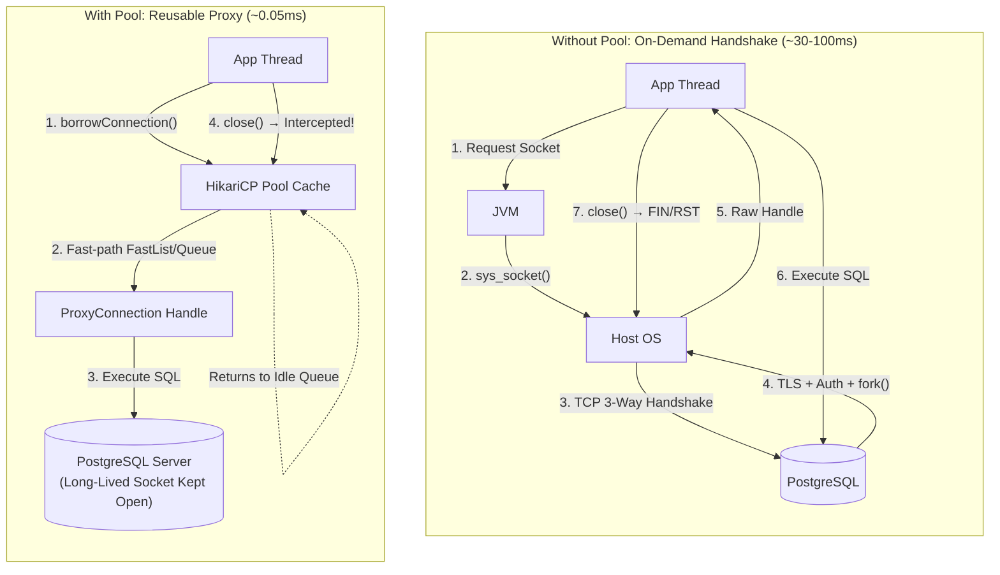

# Connection Pooling Architecture: Lifecycle Cost, Socket Handshakes & HikariCP Mechanics

---

## Key Takeaways

Acquiring a raw physical database connection via `DriverManager.getConnection()` is the single most expensive operation in a data access pipeline. Each on-demand connection requires a multi-step operating system and network negotiation: acquiring an OS file descriptor, completing a 3-way TCP handshake (SYN $\rightarrow$ SYN-ACK $\rightarrow$ ACK), optionally establishing TLS/SSL session encryption, performing database authentication, and allocating backend memory (`fork()` in PostgreSQL).

A **Connection Pool** acts as an in-memory cache of pre-warmed, long-lived physical database connections. Application threads borrow a connection proxy from the pool, execute their SQL statements, and call `connection.close()`. Instead of severing the underlying TCP socket, the pool intercepts `.close()` and returns the connection to the idle queue for reuse. In modern enterprise Java, **HikariCP** is the industry-standard pool (default in Spring Boot), favored for its zero-overhead bytecode engineering, lock-free concurrency primitives, and minimal latency compared to legacy pools like Apache Commons DBCP and C3P0.



- **Physical Handshake Overhead**: Creating raw connections incurs operating system socket creation, TCP handshakes, TLS session negotiation, and database backend worker allocation (`fork()` in PostgreSQL), adding tens to hundreds of milliseconds per request.
- **Pool Interception (`close()` Semantics)**: Pool libraries wrap physical socket connections in dynamic proxies. Invoking `connection.close()` does not close the TCP socket; it resets connection state (e.g., auto-commit, uncommitted transactions) and returns the physical handle to the idle pool.
- **Concurrency Protection**: A connection pool caps the maximum number of active concurrent sockets hitting the database engine, protecting database CPU and RAM from exhaustion under traffic spikes.
- **Ecosystem Landscape**:
  - **C3P0**: Mature, XML/property-driven, but relies heavily on synchronized wrappers and background threads.
  - **Apache Commons DBCP / DBCP2**: Classic enterprise pool, historically standard in Tomcat and early Spring.
  - **HikariCP**: The modern gold standard—bytecode-optimized, lock-free, and designed for minimal micro-benchmark overhead.

---

## Main Discussion

### Step-by-Step Breakdown: Handshake Latency

```
   CLIENT JVM                            POSTGRESQL SERVER (Port 5432)
       |                                              |
       |--------------- 1. SYN ---------------------->|  [OS Network Layer]
       |<------------ 2. SYN-ACK ---------------------|  TCP 3-Way Handshake
       |--------------- 3. ACK ---------------------->|
       |                                              |
       |------- 4. SSLRequest (Frontend v3) --------->|  [Security Negotiation]
       |<------------ 5. 'S' (SSL OK) ----------------|  TLS Key Exchange & Cipher Spec
       |                                              |
       |-------- 6. StartupMessage (user/db) -------->|  [PostgreSQL Protocol]
       |<------- 7. AuthenticationMD5Password --------|  Postmaster fork()s backend process
       |-------- 8. PasswordMessage (MD5/SCRAM) ----->|  Auth verified against pg_authid
       |<------- 9. AuthenticationOk -----------------|
       |<------- 10. ReadyForQuery ('Z') -------------|
       |                                              |  ==> Raw Connection Ready (~50ms)
```

1. **Transport Layer Initialization:**
   The application thread requests a connection. The JVM invokes the OS networking stack via sys_socket() and connect(), initiating the TCP 3-way handshake over network round-trips.
2. **TLS/SSL & Protocol Handshake:**
   Once the TCP socket connects, the PostgreSQL JDBC driver sends an SSLRequest packet. If TLS is enabled, client and server negotiate cipher suites and exchange certificates. The client then issues a StartupMessage containing the target catalog (localdb) and user role.
3. **Authentication & Backend Process Spawning:**
   PostgreSQL's postmaster listener reads the startup packet and invokes the fork() system call to create a dedicated OS worker process. The worker challenges the client (e.g., SCRAM-SHA-256 or MD5), checks credentials against pg_authid, initializes worker memory structures (work_mem), and returns ReadyForQuery.
4. **Pool Avoidance of Steps 1-3:**
   A connection pool performs steps 1 through 3 during startup to pre-warm an inventory of connections. Subsequent application requests bypass the network handshake entirely, acquiring an idle connection in microseconds.

---

### Integrating HikariCP into the Maven Project

#### 1. Adding Dependency (`pom.xml`)

Add the official HikariCP dependency alongside the PostgreSQL driver:

```xml
<dependencies>
    <!-- HikariCP High-Performance Connection Pool -->
    <dependency>
        <groupId>com.zaxxer</groupId>
        <artifactId>HikariCP</artifactId>
        <version>5.1.0</version>
    </dependency>

    <!-- PostgreSQL JDBC Driver -->
    <dependency>
        <groupId>org.postgresql</groupId>
        <artifactId>postgresql</artifactId>
        <version>42.7.4</version>
    </dependency>
</dependencies>

```

---

#### 2. Refactoring `DatabaseUtils.java` to use HikariCP (`DataSource`)

Replace the single static `Connection` field with a managed `HikariDataSource` pool:

```java
package com.rensaputra.lil.data.util;

import com.zaxxer.hikari.HikariConfig;
import com.zaxxer.hikari.HikariDataSource;

import javax.sql.DataSource;
import java.sql.Connection;
import java.sql.SQLException;
import java.util.logging.Logger;

public class DatabaseUtils {

    private static final Logger LOGGER = Logger.getLogger(DatabaseUtils.class.getName());
    private static final String EXCEPTION_FORMAT = "Exception in %s Message: %s, Code: %s";

    // Managed Connection Pool instance
    private static final HikariDataSource DATA_SOURCE;

    static {
        HikariConfig config = new HikariConfig();

        // Target PostgreSQL JDBC coordinates
        config.setJdbcUrl("jdbc:postgresql://localhost:5432/localdb");
        config.setUsername("localDBUser");
        config.setPassword("P@ssw0rd!");

        // Tuning pool dimensions and timeouts
        config.setMaximumPoolSize(10);          // Max concurrent physical connections
        config.setMinimumIdle(2);               // Kept alive for off-peak workloads
        config.setIdleTimeout(300_000);         // 5 minutes before reclaiming idle sockets
        config.setConnectionTimeout(30_000);     // 30 seconds max wait before throwing SQLException
        config.setPoolName("WisdomHikariPool");

        // Useful performance properties recommended by PostgreSQL & Hikari teams
        config.addDataSourceProperty("cachePrepStmts", "true");
        config.addDataSourceProperty("prepStmtCacheSize", "250");
        config.addDataSourceProperty("prepStmtCacheSqlLimit", "2048");

        DATA_SOURCE = new HikariDataSource(config);
    }

    private DatabaseUtils() {}

    /**
     * Borrows an active connection proxy from the underlying HikariCP pool.
     * Calling conn.close() on this connection returns it to the pool instead of closing the socket.
     */
    public static Connection getConnection() throws SQLException {
        return DATA_SOURCE.getConnection();
    }

    public static DataSource getDataSource() {
        return DATA_SOURCE;
    }

    public static void handleSQLException(String method, SQLException e, Logger log) {
        String formattedMessage = String.format(EXCEPTION_FORMAT, method, e.getMessage(), e.getErrorCode());
        log.warning(formattedMessage);
        throw new RuntimeException(formattedMessage, e);
    }
}
```

---

#### 3. Consuming Pooled Connections in DAOs (Try-with-Resources)

Because calling `close()` on a pooled connection returns it to the pool, DAO methods can now wrap `Connection` in a try-with-resources statement:

```java
package com.rensaputra.lil.data.dao;

import com.rensaputra.lil.data.entity.Service;
import com.rensaputra.lil.data.util.DatabaseUtils;

import java.sql.Connection;
import java.sql.PreparedStatement;
import java.sql.ResultSet;
import java.sql.SQLException;
import java.util.ArrayList;
import java.util.List;
import java.util.UUID;
import java.util.logging.Logger;

public class PooledServiceDao {

    private static final Logger LOGGER = Logger.getLogger(PooledServiceDao.class.getName());
    private static final String GET_ALL = "SELECT service_id, name, price FROM wisdom.services";

    public List<Service> getAll() {
        List<Service> services = new ArrayList<>();

        // Borrows a connection proxy from HikariCP; returns it upon block exit
        try (Connection conn = DatabaseUtils.getConnection();
             PreparedStatement stmt = conn.prepareStatement(GET_ALL);
             ResultSet rs = stmt.executeQuery()) {

            while (rs.next()) {
                Service s = new Service();
                s.setServiceId((UUID) rs.getObject("service_id"));
                s.setName(rs.getString("name"));
                s.setPrice(rs.getBigDecimal("price"));
                services.add(s);
            }

        } catch (SQLException e) {
            DatabaseUtils.handleSQLException("PooledServiceDao.getAll", e, LOGGER);
        }

        return services;
    }
}
```

---

### Under the Hood / Concurrency & Bytecode Mechanics

```
   HIKARICP FAST-PATH BORROW MECHANICS

   Calling Thread -> FastList / ThreadLocal Cache
                           |
            +--------------+--------------+
            | Cache Hit                   | Cache Miss
            v                             v
   [Use Cached Connection]       [ConcurrentBag.borrow()]
   • Zero sync locks             • Lock-free handoff (SynchronousQueue)
   • Direct array slot access    • AtomicInteger state toggles
```

1. **FastList: Bypassing ArrayList Range Checks:**
   Standard ArrayList validates indices and performs boundary checks on every access. HikariCP introduces FastList, an un-synchronized, custom list implementation that eliminates range-check bytecode instructions and removes items from the tail backward in $\mathcal{O}(1)$ time.
2. **ConcurrentBag: Lock-Free Coordination:**
   HikariCP manages connections via ConcurrentBag. Instead of relying on synchronized locks or heavy reentrant locks, it coordinates threads using thread-local references, lock-free AtomicInteger state machines (State: NOT_IN_USE, IN_USE, REMOVED, RESERVED), and handoff queues, avoiding thread contention under high concurrency.
3. **Bytecode Proxy Generation (Javassist):**
   HikariCP generates custom bytecode proxies for Connection, Statement, and ResultSet during build time using Javassist. When conn.close() is called, the proxy skips reflection overhead, resets transactional states, and invokes pool.recycle(this) directly.

---

### Structural Comparisons

#### Connection Pooling Libraries Matrix

| Feature / Metric         | HikariCP                            | Apache Commons DBCP2               | C3P0                                |
| ------------------------ | ----------------------------------- | ---------------------------------- | ----------------------------------- |
| **Concurrency Model**    | **Lock-free (`ConcurrentBag`)**     | ReentrantLocks / Synchronized      | Thread-per-request / Locking        |
| **Bytecode Generation**  | Pre-compiled Javassist stubs        | JDK Dynamic Proxies                | Dynamic Reflection Proxies          |
| **Microsecond Overhead** | $\sim 0.05\,\mu\text{s}$ per borrow | $\sim 1.2\,\mu\text{s}$ per borrow | $\sim 10.5\,\mu\text{s}$ per borrow |
| **Leak Detection**       | Built-in (`leakDetectionThreshold`) | Manual configuration               | Limited logging                     |
| **Industry Standard**    | Default in Spring Boot 2.x & 3.x    | Legacy Tomcat applications         | Legacy Hibernate applications       |

#### Sizing Heuristics: Why More Connections $\ne$ Higher Throughput

A common mistake in database engineering is setting `maximumPoolSize = 500` under the assumption that more connections equal higher performance. In practice, database engines are constrained by hardware:

$$\text{Optimal Pool Size} = T_n \times (\text{Core Count} \times 2) + \text{Effective Spindle Count}$$

For a server with 8 CPU cores and an SSD:

$$\text{Pool Size} \approx 8 \times 2 + 1 = 17 \text{ connections}$$

Opening hundreds of concurrent connections on PostgreSQL forces the kernel to context-switch across hundreds of forked `postgres` worker processes, thrashing CPU caches and degrading overall throughput. A smaller, well-tuned pool delivers higher query rates.

---

### Common Anti-Patterns & Edge Cases

- **Connection Leaking**:
  Borrowing a connection via `DatabaseUtils.getConnection()` without try-with-resources or an explicit `.close()` in a `finally` block leaves the connection marked as `IN_USE`. Once the pool's `maximumPoolSize` is exhausted, all future threads block indefinitely, causing application-wide deadlocks.
- **Over-Sized Pools**:
  Allocating 200 connections to a database running on a 4-core virtual machine causes CPU thrashing and disk contention, slowing down query response times.
- **Ignoring `connectionTimeout`**:
  Defaulting to infinite connection timeouts means that if the pool is exhausted, incoming HTTP threads freeze forever instead of failing fast and shedding load. Always set an explicit `connectionTimeout` (e.g., 30,000 ms).
- **Resetting Auto-Commit on Return**:
  Borrowing a connection, calling `conn.setAutoCommit(false)`, and returning it without an explicit commit, rollback, or resetting auto-commit can leak open transaction state to the next thread that borrows that connection. HikariCP automatically resets auto-commit on return to prevent this issue.

---

## Knowledge Check & JetBrains-Style Coding Challenges

### Theory Tips

- **`close()` Semantics**: Calling `close()` on a pooled connection does not terminate the underlying physical TCP socket; it recycles the connection handle back to the pool.
- **Standard Pool**: HikariCP is the default, production-grade connection pool in modern Java and Spring Boot ecosystems.
- **Sizing Principle**: Connection pools should be sized relative to the database server's available CPU cores and disk spindles, not the number of concurrent HTTP threads.

### Question 1: Conceptual / Code Analysis

Consider the following high-throughput API handler:

```java
public void handleWebRequest() {
    Connection conn = null;
    try {
        conn = DatabaseUtils.getConnection(); // Borrow from HikariCP
        PreparedStatement stmt = conn.prepareStatement("SELECT * FROM wisdom.services");
        ResultSet rs = stmt.executeQuery();
        // ... process data ...
    } catch (SQLException e) {
        throw new RuntimeException(e);
    }
    // Line 11: Developer omitted conn.close()
}
```

If the pool has `maximumPoolSize = 10` and `connectionTimeout = 5000` (5 seconds), what occurs after 11 consecutive web requests execute this method?.

- [ ] **A.** The 11th request closes the oldest connection automatically and proceeds normally.
- [ ] **B.** The 11th request blocks for 5 seconds waiting for an available connection, and then throws a `SQLTransientConnectionException: Connection is not available, request timed out after 5000ms`.
- [ ] **C.** PostgreSQL terminates the Java process due to an OS socket limit.
- [ ] **D.** The application automatically switches to using an in-memory `ArrayDeque` fallback.

<details>
<summary>Correct Answer</summary>

**Correct Answer**: **B**

**Technical Breakdown**:

- **B is correct**: Omitting `conn.close()` leaks borrowed connection proxies. Each request leaves its connection proxy marked as active/in-use in HikariCP's `ConcurrentBag`. Once 10 requests execute, all 10 pooled connections are held open. When the 11th request arrives, the pool has zero idle connections and waits for one to be returned. After 5,000 ms (`connectionTimeout`), HikariCP gives up and throws a `SQLTransientConnectionException`.
- **A is incorrect**: Connection pools never forcibly close in-use connections without explicit leak detection timeouts.
- **C is incorrect**: Sockets are bounded to 10; the issue is pool exhaustion, not operating system limits.
- **D is incorrect**: JDBC drivers and pools do not have in-memory collection fallbacks.

</details>

---

### Question 2: Implementation Challenge — HikariCP Health Monitor & Leak Detector

**Task**: Implement a resilient connection pool factory and diagnostics utility named `PoolDiagnosticsManager` inside package `com.rensaputra.lil.data.util`:

1. Class `PoolDiagnosticsManager`:

- Private static `HikariDataSource pool`.
- Method `public static synchronized void initializePool(String jdbcUrl, String user, String pass, int maxPoolSize)`:
  - Configures a `HikariConfig` instance.
  - Sets `maximumPoolSize`, `minimumIdle = 2`, `connectionTimeout = 2000` ms, and `leakDetectionThreshold = 5000` ms (logs warning if a thread holds a connection longer than 5 seconds).
  - Initializes `pool = new HikariDataSource(config)`.
- Method `public static Connection getConnection() throws SQLException`:
  - Returns `pool.getConnection()`.
- Method `public static PoolStats getStats()`:
  - Returns an immutable record `PoolStats(int total, int active, int idle, int threadsAwaitingConnection)` by inspecting HikariCP's MXBean (`pool.getHikariPoolMXBean()`).
- Method `public static synchronized void shutdown()`:
  - Closes the pool if open.

**Test Assertions**:

- `initializePool(url, user, pass, 5)` $\rightarrow$ Starts pool with 5 maximum connections.
- Borrowing 2 connections via try-with-resources and reading `getStats()` inside the block:
  - `active` reflects `2`, `idle` reflects remaining connections.
- Exiting the block returns connections to the pool, restoring `active` to `0`.

<details>
<summary>Solution</summary>

```java
package com.rensaputra.lil.data.util;

import com.zaxxer.hikari.HikariConfig;
import com.zaxxer.hikari.HikariDataSource;
import com.zaxxer.hikari.HikariPoolMXBean;

import java.sql.Connection;
import java.sql.SQLException;
import java.util.Objects;

public class PoolDiagnosticsManager {

    public record PoolStats(int totalConnections, int activeConnections, int idleConnections, int threadsAwaiting) {}

    private static HikariDataSource pool;

    private PoolDiagnosticsManager() {}

    public static synchronized void initializePool(String jdbcUrl, String user, String pass, int maxPoolSize) {
        if (pool != null && !pool.isClosed()) {
            return;
        }

        HikariConfig config = new HikariConfig();
        config.setJdbcUrl(Objects.requireNonNull(jdbcUrl, "JDBC URL cannot be null"));
        config.setUsername(user);
        config.setPassword(pass);
        config.setMaximumPoolSize(maxPoolSize);
        config.setMinimumIdle(Math.min(2, maxPoolSize));
        config.setConnectionTimeout(2000);         // 2 seconds wait limit
        config.setLeakDetectionThreshold(5000);    // Warn if connection held > 5s
        config.setPoolName("DiagnosticPool");

        pool = new HikariDataSource(config);
    }

    public static Connection getConnection() throws SQLException {
        if (pool == null || pool.isClosed()) {
            throw new SQLException("Connection pool is not initialized or has been closed.");
        }
        return pool.getConnection();
    }

    public static PoolStats getStats() {
        if (pool == null || pool.isClosed()) {
            return new PoolStats(0, 0, 0, 0);
        }

        HikariPoolMXBean mxBean = pool.getHikariPoolMXBean();
        return new PoolStats(
            mxBean.getTotalConnections(),
            mxBean.getActiveConnections(),
            mxBean.getIdleConnections(),
            mxBean.getThreadsAwaitingConnection()
        );
    }

    public static synchronized void shutdown() {
        if (pool != null && !pool.isClosed()) {
            pool.close();
            pool = null;
        }
    }
}
```

**Complexity Analysis**:

- **Time Complexity**: $\mathcal{O}(1)$ connection acquisition via HikariCP's lock-free `ConcurrentBag`. The OS-level TCP socket handshake occurs only during initial pool warming.
- **Space Complexity**: $\mathcal{O}(\text{maxPoolSize})$ memory allocated for holding physical TCP connection descriptors, socket buffers, and statement caches.

</details>

---
