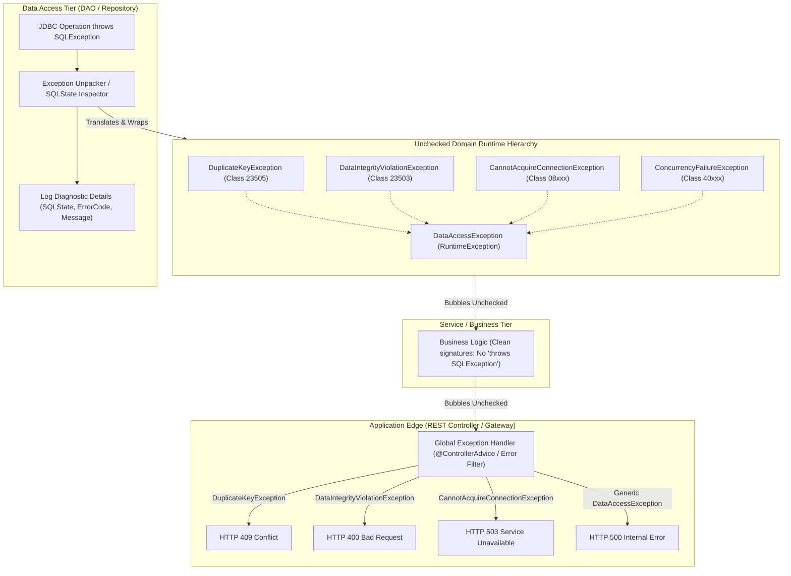

# Exception Handling Architecture in JDBC: `SQLException` Unpacking, SQLState Translation & Edge-Layer Exception Boundaries

---

## Key Takeaways

`java.sql.SQLException` is a monolithic, checked exception that wraps virtually every database failure mode—from lost TCP sockets to unique constraint collisions and syntax parse errors. Forcing callers to declare `throws SQLException` across data access, domain, and web layers violates the **Separation of Concerns (SoC)** principle and creates **leaky abstractions**. If the persistence store changes (e.g., swapping PostgreSQL for MongoDB or DynamoDB), every signature throughout the call stack breaks.

A clean exception architecture translates checked `SQLException` instances into an **unchecked domain-specific runtime hierarchy** (mirroring modern frameworks like Spring's `DataAccessException`). By inspecting standard **SQLState** codes (such as class `23` for integrity constraints or class `08` for connection dropouts) rather than brittle, vendor-specific `ErrorCode` integers, applications can catch and unpack errors at the data-access boundary, log the diagnostic details immediately, and bubble unchecked exceptions to application edge boundaries (such as REST controllers or API handlers) without cluttering intermediate business code.



- **The Leaky API Trap**: Declaring `throws SQLException` in service and web layers tightly couples the entire codebase to JDBC, making architectural refactoring or storage engine migration difficult.
- **SQLState vs. ErrorCode**:
  - Standardized **SQLState** strings (defined by ANSI SQL:2003 and X/Open standards) provide vendor-portable classification (e.g., class `23` always indicates integrity constraint violations).
  - Vendor-specific **ErrorCode** integers vary across engines (e.g., MySQL error `1062` vs. Oracle `ORA-00001` for unique collisions).
- **Early Logging Boundary**: Log database diagnostics (SQLState, vendor error code, query context) at the exact point of conversion inside the DAO. This captures volatile driver diagnostics while sending a sanitized, secure domain exception up the stack.
- **Selective Named Translation**: Build named subclasses only for common, actionable error conditions (duplicate keys, connection timeouts, constraint violations). Fall back to a generic `DataAccessException` for unexpected or low-frequency errors.
- **Edge-Layer Transformation**: Catch unchecked domain exceptions at the application's boundary (e.g., HTTP controllers) and map them to standard status codes (`409 Conflict`, `400 Bad Request`, `503 Service Unavailable`).

---

## Main Discussion

### The Structure of `SQLException` and the SQLState Standard

An instance of `SQLException` encapsulates three distinct diagnostic elements:

1. **`getMessage()`**: A human-readable diagnostic description produced by the driver or database engine.
2. **`getSQLState()`**: A 5-character alphanumeric string defined by X/Open and ISO/IEC 9075:
   - **Class (First 2 characters)**: Identifies the high-level category of failure.
   - **Subclass (Last 3 characters)**: Identifies the specific sub-condition.
3. **`getErrorCode()`**: An integer assigned by the database vendor engine (e.g., PostgreSQL internal codes, Oracle ORA numbers).

#### Standard SQLState Reference Table

| SQLState Class | Class Meaning                  | Common Subclass Examples                                                                        | Category / Mapping Target                                     |
| -------------- | ------------------------------ | ----------------------------------------------------------------------------------------------- | ------------------------------------------------------------- |
| **`08`**       | Connection Exception           | `08001` (Unable to connect)<br/>`08006` (Connection failure)                                    | `CannotAcquireConnectionException`                            |
| **`23`**       | Integrity Constraint Violation | `23505` (Unique violation)<br/>`23503` (Foreign key violation)<br/>`23502` (Not null violation) | `DuplicateKeyException`<br/>`DataIntegrityViolationException` |
| **`40`**       | Transaction Rollback           | `40001` (Serialization failure)<br/>`40P01` (Deadlock detected)                                 | `ConcurrencyFailureException`                                 |
| **`42`**       | Syntax / Access Rule Violation | `42P01` (Undefined table)<br/>`42703` (Undefined column)                                        | `BadSqlGrammarException`                                      |
| **`57`**       | Operator Intervention          | `57014` (Query canceled / Statement timeout)                                                    | `QueryTimeoutException`                                       |

---

### Designing an Unchecked Domain Exception Hierarchy

Define a structured, clean runtime exception tree:

```java
package com.rensaputra.lil.data.exception;

/**
 * Base unchecked exception for all persistence-tier failures.
 */
public class DataAccessException extends RuntimeException {
    public DataAccessException(String message) {
        super(message);
    }

    public DataAccessException(String message, Throwable cause) {
        super(message, cause);
    }
}
```

```java
package com.rensaputra.lil.data.exception;

/**
 * Thrown when an INSERT or UPDATE violates a unique constraint or primary key.
 */
public class DuplicateKeyException extends DataAccessException {
    public DuplicateKeyException(String message, Throwable cause) {
        super(message, cause);
    }
}
```

```java
package com.rensaputra.lil.data.exception;

/**
 * Thrown when a foreign key, check constraint, or NOT NULL constraint is violated.
 */
public class DataIntegrityViolationException extends DataAccessException {
    public DataIntegrityViolationException(String message, Throwable cause) {
        super(message, cause);
    }
}
```

```java
package com.rensaputra.lil.data.exception;

/**
 * Thrown when unable to establish a physical socket or checkout a pooled connection.
 */
public class CannotAcquireConnectionException extends DataAccessException {
    public CannotAcquireConnectionException(String message, Throwable cause) {
        super(message, cause);
    }
}
```

```java
package com.rensaputra.lil.data.exception;

/**
 * Thrown when transactions collide, such as deadlocks or serialization failures.
 */
public class ConcurrencyFailureException extends DataAccessException {
    public ConcurrencyFailureException(String message, Throwable cause) {
        super(message, cause);
    }
}
```

---

### Implementing the Centralized Exception Translator

Build an exception unpacker that inspects the `SQLState`, records the diagnostic log at the point of conversion, and returns the appropriate runtime exception:

```java
package com.rensaputra.lil.data.util;

import com.rensaputra.lil.data.exception.CannotAcquireConnectionException;
import com.rensaputra.lil.data.exception.ConcurrencyFailureException;
import com.rensaputra.lil.data.exception.DataAccessException;
import com.rensaputra.lil.data.exception.DataIntegrityViolationException;
import com.rensaputra.lil.data.exception.DuplicateKeyException;

import java.sql.SQLException;
import java.util.logging.Level;
import java.util.logging.Logger;

public final class SQLExceptionTranslator {

    private static final String LOG_TEMPLATE =
            "Database Exception in [%s] | SQLState: %s | Vendor Code: %d | Message: %s";

    private SQLExceptionTranslator() {}

    /**
     * Unpacks a SQLException, logs the diagnostic context, and translates it
     * into a specific unchecked DataAccessException.
     *
     * @param context Method or component name where the exception occurred
     * @param ex      The raw checked SQLException from JDBC
     * @param logger  The logger instance of the calling component
     * @return An unchecked DataAccessException subclass
     */
    public static DataAccessException translate(String context, SQLException ex, Logger logger) {
        String sqlState = ex.getSQLState() != null ? ex.getSQLState() : "UNKNOWN";
        int vendorCode = ex.getErrorCode();
        String message = ex.getMessage();

        // 1. Log immediately at the conversion boundary with full diagnostic metadata
        logger.log(Level.WARNING, String.format(LOG_TEMPLATE, context, sqlState, vendorCode, message), ex);

        // 2. Inspect SQLState for standard portable translation
        if (sqlState.startsWith("23")) {
            // Integrity Constraint Violation Class
            if ("23505".equals(sqlState)) {
                return new DuplicateKeyException("Record already exists with specified unique attributes.", ex);
            }
            return new DataIntegrityViolationException("Operation violated referential integrity constraints.", ex);
        }

        if (sqlState.startsWith("08")) {
            // Connection Exception Class
            return new CannotAcquireConnectionException("Unable to connect to relational database service.", ex);
        }

        if (sqlState.startsWith("40")) {
            // Transaction Rollback / Concurrency Class
            return new ConcurrencyFailureException("Transaction encountered concurrency conflict or deadlock.", ex);
        }

        // 3. Fallback to generic domain runtime exception for low-frequency or unmapped errors
        return new DataAccessException("Unexpected database execution error occurred.", ex);
    }
}
```

---

### Consuming Translated Exceptions in DAOs and Edge Boundaries

#### 1. DAO Layer (Translating & Throwing)

The DAO boundary handles the checked `SQLException`, runs the translator, and throws the runtime exception:

```java
public Customer createCustomer(Customer customer) {
    String sql = "INSERT INTO wisdom.customers (customer_id, first_name, last_name, email) VALUES (?, ?, ?, ?)";

    try (Connection conn = DatabaseUtils.getConnection();
         PreparedStatement stmt = conn.prepareStatement(sql)) {

        stmt.setObject(1, customer.getCustomerId());
        stmt.setString(2, customer.getFirstName());
        stmt.setString(3, customer.getLastName());
        stmt.setString(4, customer.getEmail());
        stmt.executeUpdate();

        return customer;

    } catch (SQLException e) {
        // Unpack, log, and throw unchecked domain exception
        throw SQLExceptionTranslator.translate("CustomerDao.createCustomer", e, LOGGER);
    }
}
```

#### 2. Service Tier (Clean Signatures)

The business tier contains zero JDBC imports and does not need `throws` declarations:

```java
public class CustomerRegistrationService {

    private final CustomerDao customerDao;

    public CustomerRegistrationService(CustomerDao customerDao) {
        this.customerDao = customerDao;
    }

    // Clean method signature without leaky SQL types
    public Customer registerNewCustomer(String firstName, String lastName, String email) {
        Customer customer = new Customer();
        customer.setCustomerId(UUID.randomUUID());
        customer.setFirstName(firstName);
        customer.setLastName(lastName);
        customer.setEmail(email);

        return customerDao.createCustomer(customer);
    }
}
```

#### 3. Edge Tier (Mapping to HTTP Status Codes)

At the outer web boundary, exceptions translate into user-safe HTTP status codes:

```java
public class CustomerApiController {

    private final CustomerRegistrationService registrationService;

    public CustomerApiController(CustomerRegistrationService registrationService) {
        this.registrationService = registrationService;
    }

    public record HttpResponse(int statusCode, String payload) {}

    public HttpResponse handleCreateCustomerRequest(String first, String last, String email) {
        try {
            Customer created = registrationService.registerNewCustomer(first, last, email);
            return new HttpResponse(201, "Created: " + created.getCustomerId());

        } catch (DuplicateKeyException ex) {
            // Translate duplicate key to HTTP 409 Conflict
            return new HttpResponse(409, "Error: Email address already registered.");

        } catch (DataIntegrityViolationException ex) {
            // Translate constraint violation to HTTP 400 Bad Request
            return new HttpResponse(400, "Error: Invalid customer details provided.");

        } catch (CannotAcquireConnectionException ex) {
            // Translate connection drop to HTTP 503 Service Unavailable
            return new HttpResponse(503, "Error: Database service temporarily unreachable.");

        } catch (DataAccessException ex) {
            // Generic persistence error translates to HTTP 500
            return new HttpResponse(500, "Error: Internal system error.");
        }
    }
}
```

---

### Under the Hood / JVM & Exception Flow

```
   CALL STACK TRACE & EXCEPTION BUBBLING

   [CustomerApiController.handleCreateCustomerRequest] <--- Catches DuplicateKeyException -> Returns 409
                            ^
                            |  Unchecked bubbling (No intermediate catch or throws declarations!)
   [CustomerRegistrationService.registerNewCustomer]
                            ^
                            |  Unchecked bubbling
   [CustomerDao.createCustomer]
                            |
   +------------------------+------------------------+
   | catch (SQLException e)                          |
   |   -> Reads e.getSQLState() == "23505"           |
   |   -> LOGGER.warning(...) logs diagnostic code   |
   |   -> throw new DuplicateKeyException(..., e)    |
   +-------------------------------------------------+
```

1. **Engine Error Generation (Protocol 3.0 ErrorResponse):**
   When a query fails on the database (e.g., duplicate unique key), PostgreSQL emits an ErrorResponse message (type 'E') containing field tokens:
2. **Client Driver Assembly (SQLException):**
   The org.postgresql.Driver decodes the message tokens, populates sqlState and errorCode, and instantiates an instance of PSQLException (extending SQLException).
3. **Translation & Chained Cause Attachment:**
   The DAO catches the checked exception. The translator constructs the appropriate DataAccessException subclass, passing the original SQLException into super(message, cause). This preserves the full native stack trace and chained exception causes for debugging while hiding JDBC implementation details from higher layers.
4. **Unchecked Stack Unwinding:**
   Because DataAccessException extends RuntimeException, the JVM unwinds the thread stack without requiring throws declarations on intervening methods. The exception bubbles directly to the edge boundary handler.

---

### Structural Comparisons

#### Checked `SQLException` vs. Unchecked Domain Exceptions

| Dimension              | Checked `SQLException` (Direct Propagation)                     | Unchecked Domain Hierarchy (`DataAccessException`)                       |
| ---------------------- | --------------------------------------------------------------- | ------------------------------------------------------------------------ |
| **Method Signatures**  | Every method must declare `throws SQLException`                 | Clean signatures; hides data plumbing from domain logic                  |
| **Layer Coupling**     | Leaks database concepts to web and business tiers               | **Decoupled**: Business code interacts only with domain concepts         |
| **Refactoring Impact** | High: Changing persistence engines breaks all caller signatures | Low: Persistence swap is contained within the DAO layer                  |
| **Error Granularity**  | Monolithic: Every issue is an identical `SQLException`          | **Fine-grained**: `DuplicateKeyException`, `ConcurrencyFailureException` |
| **Logging Quality**    | Often logged haphazardly across multiple layers                 | Standardized logging at the point of translation                         |

#### Translating via `SQLState` vs. `ErrorCode`

| Attribute                | Standardized `SQLState`                                               | Vendor `ErrorCode`                                               |
| ------------------------ | --------------------------------------------------------------------- | ---------------------------------------------------------------- |
| **Specification Basis**  | ANSI SQL:2003 / ISO & X/Open Standards                                | Proprietary to the database engine vendor                        |
| **Cross-DB Portability** | **High**: `23505` represents unique violation across Postgres and DB2 | **None**: MySQL returns `1062`, Oracle returns `1` (`ORA-00001`) |
| **Type Representation**  | 5-character string (`Class[2] + Subclass[3]`)                         | Integer primitive                                                |
| **Recommended Use**      | Primary criteria for domain exception translation                     | Fallback for diagnosing vendor-specific engine errors            |

---

### Common Anti-Patterns & Edge Cases

- **Catching `SQLException` and Silently Swallowing**:

  ```java
  try {
      stmt.executeUpdate();
  } catch (SQLException e) {
      // ANTI-PATTERN: Silent failure leaves caller unaware of write errors
  }
  ```

  Never leave catch blocks empty. If execution cannot proceed, log and rethrow an unchecked domain exception.

- **Over-Translating Every Database Error**:
  Attempting to write a custom exception class for every single database error code creates an unmaintainable exception hierarchy. Translate only actionable business scenarios (e.g., unique key conflicts, connection loss, deadlocks) and route the rest to a general `DataAccessException`.
- **Logging at Every Layer**:
  Catching, logging, and rethrowing the same exception at the DAO layer, service layer, and controller layer floods log streams with duplicate stack traces. Log once at the translation boundary, then handle cleanly at the edge layer.
- **Losing Root Cause Chains**:
  Instantiating a new runtime exception without passing the original exception (`new DataAccessException(msg)` instead of `new DataAccessException(msg, ex)`) discards the root cause stack trace, complicating post-mortem debugging.

---

## Knowledge Check & JetBrains-Style Coding Challenges

### Theory Tips

- **Leaky Abstraction**: Allowing low-level checked exceptions like `SQLException` to propagate across architectural layers leaks persistence details into business logic.
- **Standard SQLState Classes**:
  - `Class 23`: Integrity constraint violations (e.g., `23505` = unique constraint).
  - `Class 08`: Connection and communication failures.
  - `Class 40`: Transaction rollback and serialization failures.
- **Logging Boundary**: Log complete database diagnostics at the point of translation in the data layer; pass sanitized domain exceptions up to higher layers.

### Question 1: Conceptual / Architecture Analysis

A development team decides to add `throws SQLException` to their `OrderProcessingService` and `BillingController` classes rather than converting errors to runtime exceptions. A year later, they migrate a subset of tables to an Apache Cassandra NoSQL store.

What problem does the team immediately face due to their exception handling strategy?

- [ ] **A.** The JVM refuses to run bytecode containing `SQLException` alongside NoSQL dependencies.
- [ ] **B.** Every service and controller method signature across the application must be modified because Cassandra drivers throw `DriverException` instead of `SQLException`.
- [ ] **C.** PostgreSQL automatically closes all client connections due to cross-protocol leakage.
- [ ] **D.** The application's database transactions can no longer roll back.

<details>
<summary>Correct Answer</summary>

**Correct Answer**: **B**

**Technical Breakdown**:

- **B is correct**: Declaring `throws SQLException` across service and controller methods couples high-level business and web tiers directly to the JDBC API. When replacing JDBC with a non-relational database client (like Cassandra's driver, which throws `com.datastax.oss.driver.api.core.DriverException`), every method signature that declared `throws SQLException` must be manually updated to declare the new exception type, breaking caller contracts throughout the application. Translating data errors into an unchecked `DataAccessException` at the DAO boundary keeps service signatures clean and independent of the underlying storage engine.
- **A is incorrect**: The JVM can run multiple libraries alongside each other without bytecode conflicts.
- **C is incorrect**: Database servers have no visibility into client-side method signatures.
- **D is incorrect**: Transaction rollbacks are governed by the database engine, not Java method signatures.

</details>

---

### Question 2: Implementation Challenge — Resilient Customer Registration with Fine-Grained Exception Handling

**Task**: Implement a resilient registration method named `registerWithDiagnostics` inside `CustomerDao`:

1. Method signature:
   `public Customer registerWithDiagnostics(Customer customer)`
2. Requirements:
   - Query: `INSERT INTO wisdom.customers (customer_id, first_name, last_name, email, phone, address) VALUES (?, ?, ?, ?, ?, ?)`
   - Use try-with-resources to manage `Connection` and `PreparedStatement`.
   - Bind all attributes from `customer`.
   - Execute the statement.
   - If a `SQLException` is thrown:
   - Check `ex.getSQLState()`.
   - If `23505` (unique violation on `email`):
     - Throw a `DuplicateKeyException("Customer email already registered: " + customer.getEmail(), ex)`.
   - If `sqlState` starts with `23` (other constraint violations like NOT NULL):
     - Throw a `DataIntegrityViolationException("Customer validation failed against database constraints.", ex)`.
   - If `sqlState` starts with `08`:
     - Throw a `CannotAcquireConnectionException("Database connection unavailable during customer registration.", ex)`.
   - For all other error states:
     - Throw a general `DataAccessException("Customer registration failed unexpectedly.", ex)`.
   - On success, return the persisted `Customer`.

**Test Assertions**:

- Inserting a valid, unique customer $\rightarrow$ Returns the customer successfully.
- Inserting a customer whose email already exists in the table $\rightarrow$ Catches `23505` and throws `DuplicateKeyException`.
- Inserting a customer with a null `first_name` (violating `NOT NULL`) $\rightarrow$ Catches `23502` and throws `DataIntegrityViolationException`.

<details>
<summary>Solution</summary>

```java
package com.rensaputra.lil.data.dao;

import com.rensaputra.lil.data.entity.Customer;
import com.rensaputra.lil.data.exception.CannotAcquireConnectionException;
import com.rensaputra.lil.data.exception.DataAccessException;
import com.rensaputra.lil.data.exception.DataIntegrityViolationException;
import com.rensaputra.lil.data.exception.DuplicateKeyException;
import com.rensaputra.lil.data.util.DatabaseUtils;

import java.sql.Connection;
import java.sql.PreparedStatement;
import java.sql.SQLException;
import java.util.logging.Level;
import java.util.logging.Logger;

public class ResilientCustomerDao {

    private static final Logger LOGGER = Logger.getLogger(ResilientCustomerDao.class.getName());

    private static final String INSERT_CUSTOMER =
            "INSERT INTO wisdom.customers (customer_id, first_name, last_name, email, phone, address) " +
            "VALUES (?, ?, ?, ?, ?, ?)";

    public Customer registerWithDiagnostics(Customer customer) {
        try (Connection conn = DatabaseUtils.getConnection();
             PreparedStatement stmt = conn.prepareStatement(INSERT_CUSTOMER)) {

            stmt.setObject(1, customer.getCustomerId());
            stmt.setString(2, customer.getFirstName());
            stmt.setString(3, customer.getLastName());
            stmt.setString(4, customer.getEmail());
            stmt.setString(5, customer.getPhone());
            stmt.setString(6, customer.getAddress());

            stmt.executeUpdate();
            return customer;

        } catch (SQLException ex) {
            String sqlState = ex.getSQLState() != null ? ex.getSQLState() : "UNKNOWN";
            LOGGER.log(Level.WARNING, "Registration failure [SQLState: " + sqlState + ", Code: "
                    + ex.getErrorCode() + "]: " + ex.getMessage(), ex);

            if ("23505".equals(sqlState)) {
                throw new DuplicateKeyException("Customer email already registered: " + customer.getEmail(), ex);
            }

            if (sqlState.startsWith("23")) {
                throw new DataIntegrityViolationException("Customer validation failed against database constraints.", ex);
            }

            if (sqlState.startsWith("08")) {
                throw new CannotAcquireConnectionException("Database connection unavailable during customer registration.", ex);
            }

            throw new DataAccessException("Customer registration failed unexpectedly.", ex);
        }
    }
}
```

**Complexity Analysis**:

- **Time Complexity**: $\mathcal{O}(1)$ insertion + $\mathcal{O}(\log B)$ B+Tree updates for primary key and unique email indexes. Exception translation occurs in constant time ($\mathcal{O}(1)$) when errors arise.
- **Space Complexity**: $\mathcal{O}(1)$ auxiliary heap allocation for constructing the domain runtime exception and preserving the chained cause reference.

</details>

---
