# Result Set Pagination: Deterministic Ordering, Dynamic `LIMIT` Binding & SQL Injection Safety

---

## Key Takeaways

When querying large datasets in relational systems, streaming the entire relation into application heap memory causes high network latency, buffer bloat, and potential `OutOfMemoryError` conditions. Controlling result set volume requires coupling **deterministic ordering (`ORDER BY`)** with **result set truncation (`LIMIT`)**.

A query must always pair a `LIMIT` clause with an explicit, deterministic `ORDER BY` clause; omitting `ORDER BY` leaves tuple retrieval order non-deterministic (dependent on PostgreSQL's internal heap scans or parallel worker sequencing). In JDBC, numeric row limits are securely bound to `PreparedStatement` parameter markers (`?`) via `statement.setInt(1, limit)`. This pre-compiles the execution plan and prevents malicious SQL injections without string concatenation.

```mermaid
flowchart TD
    subgraph ClientExecution ["Client Execution: App.java"]
        Call["serviceDao.getAllLimit(2)"]
        Print["services.forEach(System.out::println)"]
        Call --> Print
    end

    subgraph DAOLayer ["DAO Layer: ServiceDao.getAllLimit(int limit)"]
        direction TB
        SQLConst["SQL: 'SELECT ... ORDER BY name LIMIT ?'"]
        Conn["Connection conn = DatabaseUtils.getConnection()"]
        Prep["PreparedStatement stmt = conn.prepareStatement(GET_ALL_LIMIT)"]
        Bind["stmt.setInt(1, limit) &rarr; Safe numeric binding"]
        Exec["ResultSet rs = stmt.executeQuery()"]
        Process["services = this.processResultSet(rs)"]
        CloseRS["rs.close()"]
        Return["return services"]

        SQLConst --> Conn --> Prep --> Bind --> Exec --> Process --> CloseRS --> Return
    end

    subgraph PostgresEngine ["PostgreSQL Execution Plan"]
        direction TB
        Scan["Index Scan on idx_services_name (or Sort Node)"]
        LimitNode["Limit (count = 2) &rarr; Early pipeline termination"]
        Scan --> LimitNode
    end

    Exec --> PostgresEngine
```



- **Deterministic Pagination**: A `LIMIT` clause without an `ORDER BY` clause yields unpredictable, nondeterministic subsets because relational databases treat un-ordered tables as unordered mathematical bags of tuples.
- **Dynamic Bound Limits**: Relational engines permit parameter placeholders (`?`) for `LIMIT` and `OFFSET` clauses, enabling dynamic query volume controls via `stmt.setInt(...)`.
- **Execution Plan Optimization**: PostgreSQL query planners leverage `Limit` plan nodes to short-circuit sequential or index scans as soon as the target row count is reached, discarding the remaining tuples before sending network packets.
- **Safe Numeric Type Mapping**: Using `setInt(1, limit)` enforces primitive integer verification at the JDBC driver boundary, preventing type confusion and SQL injection vectors.
- **Null-Safe Defaults**: Initializing an empty `ArrayList<Service>()` guarantees callers receive an empty collection rather than `null` if the limit is set to zero or an error is logged.

---

## Main Discussion

### Step 1: Updating `ServiceDao.java` with `getAllLimit(int limit)`

Open `src/main/java/com/rensaputra/lil/data/dao/ServiceDao.java`. Define the static `GET_ALL_LIMIT` SQL constant and implement the `getAllLimit(int limit)` method:

```java
package com.rensaputra.lil.data.dao;

import com.rensaputra.lil.data.entity.Service;
import com.rensaputra.lil.data.util.DatabaseUtils;

import java.math.BigDecimal;
import java.sql.Connection;
import java.sql.PreparedStatement;
import java.sql.ResultSet;
import java.sql.SQLException;
import java.sql.Statement;
import java.util.ArrayList;
import java.util.List;
import java.util.Optional;
import java.util.UUID;
import java.util.logging.Logger;

public class ServiceDao implements DAO<Service, UUID> {

    private static final Logger LOGGER = Logger.getLogger(ServiceDao.class.getName());

    // 1. Externalized SQL statements
    private static final String GET_ALL = "SELECT service_id, name, price FROM wisdom.services";
    private static final String GET_BY_ID = "SELECT service_id, name, price FROM wisdom.services WHERE service_id = ?";
    private static final String CREATE = "INSERT INTO wisdom.services (service_id, name, price) VALUES (?, ?, ?)";
    private static final String UPDATE = "UPDATE wisdom.services SET name = ?, price = ? WHERE service_id = ?";
    private static final String DELETE = "DELETE FROM wisdom.services WHERE service_id = ?";

    // Parameterized ordering and limiting SQL template
    private static final String GET_ALL_LIMIT =
            "SELECT service_id, name, price FROM wisdom.services ORDER BY name LIMIT ?";

    private List<Service> processResultSet(ResultSet rs) throws SQLException {
        List<Service> services = new ArrayList<>();
        while (rs.next()) {
            Service service = new Service();
            service.setServiceId((UUID) rs.getObject("service_id"));
            service.setName(rs.getString("name"));
            service.setPrice(rs.getBigDecimal("price"));
            services.add(service);
        }
        return services;
    }

    @Override
    public List<Service> getAll() {
        List<Service> services = new ArrayList<>();
        Connection connection = DatabaseUtils.getConnection();

        try (Statement statement = connection.createStatement();
             ResultSet resultSet = statement.executeQuery(GET_ALL)) {

            services = this.processResultSet(resultSet);

        } catch (SQLException e) {
            DatabaseUtils.handleSQLException("ServiceDao.getAll", e, LOGGER);
        }

        return services;
    }

    /**
     * Retrieves service records sorted alphabetically by name, capped by the limit argument.
     *
     * @param limit Maximum number of records to return
     * @return List of matching Service entities
     */
    public List<Service> getAllLimit(int limit) {
        List<Service> services = new ArrayList<>();
        Connection connection = DatabaseUtils.getConnection();

        try (PreparedStatement statement = connection.prepareStatement(GET_ALL_LIMIT)) {
            // 2. Bind parameter index 1 to the numeric limit integer
            statement.setInt(1, limit);

            // 3. Execute query, process tuples, and drain ResultSet
            ResultSet rs = statement.executeQuery();
            services = this.processResultSet(rs);
            rs.close();

        } catch (SQLException e) {
            DatabaseUtils.handleSQLException("ServiceDao.getAllLimit", e, LOGGER);
        }

        return services;
    }

    @Override
    public Optional<Service> getOne(UUID id) {
        try (PreparedStatement statement = DatabaseUtils.getConnection().prepareStatement(GET_BY_ID)) {
            statement.setObject(1, id);

            try (ResultSet resultSet = statement.executeQuery()) {
                List<Service> services = this.processResultSet(resultSet);
                if (services.isEmpty()) {
                    return Optional.empty();
                }
                return Optional.of(services.get(0));
            }

        } catch (SQLException e) {
            DatabaseUtils.handleSQLException("ServiceDao.getOne", e, LOGGER);
            return Optional.empty();
        }
    }

    @Override
    public Service create(Service entity) {
        UUID serviceId = UUID.randomUUID();
        Connection connection = DatabaseUtils.getConnection();

        try {
            connection.setAutoCommit(false);

            PreparedStatement statement = connection.prepareStatement(CREATE);
            statement.setObject(1, serviceId);
            statement.setString(2, entity.getName());
            statement.setBigDecimal(3, entity.getPrice());

            statement.execute();
            connection.commit();
            statement.close();

        } catch (SQLException e) {
            try {
                connection.rollback();
            } catch (SQLException ex) {
                DatabaseUtils.handleSQLException("ServiceDao.create.rollback", ex, LOGGER);
            }
            DatabaseUtils.handleSQLException("ServiceDao.create", e, LOGGER);
        }

        Optional<Service> service = this.getOne(serviceId);
        if (service.isEmpty()) {
            return null;
        }

        return service.get();
    }

    @Override
    public Service update(Service entity) {
        Connection connection = DatabaseUtils.getConnection();

        try {
            connection.setAutoCommit(false);

            PreparedStatement statement = connection.prepareStatement(UPDATE);
            statement.setString(1, entity.getName());
            statement.setBigDecimal(2, entity.getPrice());
            statement.setObject(3, entity.getServiceId());

            statement.execute();
            connection.commit();
            statement.close();

        } catch (SQLException e) {
            try {
                connection.rollback();
            } catch (SQLException ex) {
                DatabaseUtils.handleSQLException("ServiceDao.update.rollback", ex, LOGGER);
            }
            DatabaseUtils.handleSQLException("ServiceDao.update", e, LOGGER);
        }

        return this.getOne(entity.getServiceId()).get();
    }

    @Override
    public void delete(UUID id) {
        Connection connection = DatabaseUtils.getConnection();

        try {
            connection.setAutoCommit(false);

            PreparedStatement statement = connection.prepareStatement(DELETE);
            statement.setObject(1, id);

            statement.execute();
            connection.commit();
            statement.close();

        } catch (SQLException e) {
            try {
                connection.rollback();
            } catch (SQLException ex) {
                DatabaseUtils.handleSQLException("ServiceDao.delete.rollback", ex, LOGGER);
            }
            DatabaseUtils.handleSQLException("ServiceDao.delete", e, LOGGER);
        }
    }
}
```

---

### Step 2: Testing Pagination Limiting via `App.java`

Update `src/main/java/com/rensaputra/lil/App.java` to invoke `getAllLimit(2)` and iterate over the returned results:

```java
package com.rensaputra.lil;

import com.rensaputra.lil.data.dao.CustomerDao;
import com.rensaputra.lil.data.dao.ServiceDao;
import com.rensaputra.lil.data.entity.Customer;
import com.rensaputra.lil.data.entity.Service;

import java.math.BigDecimal;
import java.util.List;
import java.util.Optional;

public class App {

    public static void main(String[] args) {
        ServiceDao serviceDao = new ServiceDao();

        // 1. Initial full scan
        List<Service> services = serviceDao.getAll();
        System.out.println("**** SERVICES ****\n\n*** GET ALL ***");
        services.forEach(System.out::println);

        // 2. Query bounded subset using LIMIT
        System.out.println("\n\n*** LIMIT ***");
        List<Service> limitedServices = serviceDao.getAllLimit(2);
        limitedServices.forEach(System.out::println);
    }
}
```

---

### Step 3: Terminal Build & Verification

Compile and run the application from your terminal:

```bash
mvn compile exec:java -Dexec.mainClass="com.rensaputra.lil.App"
```

The output confirms that while `GET ALL` lists all records in the table, `LIMIT` truncates the stream to the first 2 records ordered alphabetically by name (`"Cloud Architecture Consulting"` followed by `"Database Tuning & Optimization"`):

```text
**** SERVICES ****

*** GET ALL ***
Service{serviceId=a1b2c3d4-e5f6-7a8b-9c0d-1e2f3a4b5c6d, name='Cloud Architecture Consulting', price=250.00}
Service{serviceId=b2c3d4e5-f6a7-8b9c-0d1e-2f3a4b5c6d7e, name='Database Tuning & Optimization', price=220.00}
Service{serviceId=c3d4e5f6-a7b8-9c0d-1e2f-3a4b5c6d7e8f, name='Full-Stack Java Modernization', price=195.00}

*** LIMIT ***
Service{serviceId=a1b2c3d4-e5f6-7a8b-9c0d-1e2f3a4b5c6d, name='Cloud Architecture Consulting', price=250.00}
Service{serviceId=b2c3d4e5-f6a7-8b9c-0d1e-2f3a4b5c6d7e, name='Database Tuning & Optimization', price=220.00}
```

---

### Under the Hood / Database Planner & Protocol Mechanics

```
   POSTGRESQL EXECUTION PLAN (EXPLAIN ANALYZE)
   Query: SELECT * FROM wisdom.services ORDER BY name LIMIT 2;

+------------------------------------------------------------------------------------+
| Limit  (cost=0.15..1.20 rows=2 width=72)                                           |
|   ->  Index Scan using idx_services_name on services  (cost=0.15..8.30 rows=15 ...) |
|       (Halts immediately after streaming 2 tuples across the socket!)              |
+------------------------------------------------------------------------------------+
```

1. **Short-Circuiting Execution (The Limit Node):**
   When PostgreSQL constructs the query execution tree, it injects a Limit execution node above the sort or scan node. As tuples stream up from the child plan node (e.g., an Index Scan on name), the Limit node increments an internal counter. When the counter reaches the bound parameter (2), it returns NULL to its parent executor, terminating evaluation early without reading subsequent table rows.
2. **Safe Parameter Binding vs AST Node Manipulation:**
   In SQL grammar, column identifiers and sort directions (ASC/DESC) cannot be represented as bind parameters because the query parser must know target columns to build the Abstract Syntax Tree (AST). However, literal row counts in LIMIT ? and OFFSET ? are valid parameter expressions, allowing secure parameterization via stmt.setInt(1, limit).
3. **Top-N Sort Buffer (Sort Optimization):**
   If no index exists on the ORDER BY column, PostgreSQL executes a bounded Top-N Heapsort in memory (governed by work_mem). Rather than sorting the entire table of $N$ rows using quicksort ($\mathcal{O}(N \log N)$), it maintains a bounded priority queue of size $K$ (where $K = 2$), processing rows in $\mathcal{O}(N \log K)$ time.

---

### Structural Comparisons

#### `LIMIT` / `OFFSET` vs. ANSI SQL:2008 `FETCH FIRST`

| Specification       | PostgreSQL / MySQL `LIMIT / OFFSET`                 | ANSI SQL:2008 Standard (`OFFSET ... FETCH`)                           |
| ------------------- | --------------------------------------------------- | --------------------------------------------------------------------- |
| **Syntax**          | `ORDER BY name LIMIT ? OFFSET ?`                    | `ORDER BY name OFFSET ? ROWS FETCH NEXT ? ROWS ONLY`                  |
| **Standardization** | Common vendor extension (PostgreSQL, SQLite, MySQL) | **ANSI / ISO SQL Standard** (Supported in Postgres 9.6+, Oracle 12c+) |
| **JDBC Binding**    | Supported via `PreparedStatement.setInt()`          | Supported via `PreparedStatement.setInt()`                            |
| **Portability**     | Fails on strict Oracle databases (< 12c)            | Portable across modern enterprise engines (Oracle, DB2, Postgres)     |

#### Parameterized `LIMIT ?` vs. Dynamic String Concatenation

| Dimension                 | Parameterized (`LIMIT ?`)                            | Dynamic Concatenation (`"LIMIT " + limit`)               |
| ------------------------- | ---------------------------------------------------- | -------------------------------------------------------- |
| **SQL Injection Defense** | **Complete**: Non-numeric injection is rejected      | **Vulnerable**: Malicious strings alter execution syntax |
| **Plan Caching**          | Cached execution plan reused across different limits | Engine re-parses and compiles query on every call        |
| **Driver Type Checks**    | Enforced at compile time and runtime (`int`)         | Bypasses type safety if using unchecked string variables |

---

### Common Anti-Patterns & Edge Cases

- **Paging Without `ORDER BY`**:

  ```sql
  -- ANTI-PATTERN: Nondeterministic Pagination
  SELECT * FROM wisdom.services LIMIT 2;
  ```

  Without `ORDER BY`, the database returns tuples based on physical disk layout or parallel thread availability. Successive queries may return duplicate or skipped records.

- **Negative or Unbounded Limits**:
  Passing negative integers to `stmt.setInt(1, -1)` causes PostgreSQL to throw a `SQLException: LIMIT must not be negative`. Always validate that `limit > 0` before executing queries.
- **High `OFFSET` Performance Degradation (Offset Pagination Trap)**:
  Executing `LIMIT 10 OFFSET 1000000` forces the database to read, sort, and discard 1,000,000 tuples before returning the 10 target rows. For high-volume pagination, prefer **Keyset Pagination (Seek Method)**:

  ```sql
  WHERE name > ? ORDER BY name ASC LIMIT ?
  ```

- **Attempting to Parameterize `ORDER BY` Column Names**:
  Attempting `ORDER BY ? LIMIT ?` and binding a column name string via `stmt.setString(1, "name")` does not work; the database sorts by the constant string literal `'name'`, resulting in an un-ordered sort. Column names must be validated against a whitelist in Java before building the query.

---

## Knowledge Check & JetBrains-Style Coding Challenges

### Theory Tips

- **Determinism Invariant**: A `LIMIT` clause requires an explicit `ORDER BY` clause to guarantee predictable, reproducible paging results.
- **Binding Numeric Boundaries**: The `LIMIT` clause parameter binds via standard integer setters (`stmt.setInt(...)`).
- **Keyset Alternative**: For paginating deep tables, keyset pagination (`WHERE id > last_seen_id ORDER BY id ASC LIMIT ?`) outperforms high-offset paging by leveraging B+Tree index lookups directly.

### Question 1: Conceptual / Code Analysis

Consider the following attempt to dynamically set the sort direction and limit via a `PreparedStatement`:

```java
String sql = "SELECT service_id, name, price FROM wisdom.services ORDER BY name ? LIMIT ?";
try (PreparedStatement stmt = conn.prepareStatement(sql)) {
    stmt.setString(1, "DESC"); // Line 3
    stmt.setInt(2, 5);          // Line 4
    ResultSet rs = stmt.executeQuery();
}
```

What occurs when this code executes?

- [ ] **A.** The query executes successfully and returns the top 5 services in descending order.
- [ ] **B.** A `SQLException` is thrown during statement preparation or execution because SQL grammar keywords like `ASC` or `DESC` cannot be bound via parameter placeholders (`?`).
- [ ] **C.** PostgreSQL defaults to `ASC` and ignores parameter 1.
- [ ] **D.** A `NullPointerException` occurs at Line 3.

<details>
<summary>Correct Answer</summary>

**Correct Answer**: **B**

**Technical Breakdown**:

- **B is correct**: The SQL parser requires structural elements—such as table names, column identifiers, and grammar keywords (`ASC`, `DESC`, `JOIN`)—to be resolved during compilation to build the execution plan AST. In JDBC, `?` parameter markers are permitted only where literal data values (strings, numbers, timestamps) are valid. Placing a `?` where a sort direction keyword belongs causes a syntax error when the statement is prepared or executed. To dynamically set sort directions, validate the input against an allowed whitelist in Java and append the keyword before preparing the statement.
- **A is incorrect**: Keywords cannot be bound via bind variables.
- **C is incorrect**: Relational engines do not silently ignore syntax errors.
- **D is incorrect**: `stmt` is non-null; the failure is a syntax-level `SQLException`.

</details>

---

### Question 2: Mini Coding Problem / Implementation Challenge

**Task**: Implement a keyset-based paginated search method named `getServicesPage` in `ServiceDao`:

1. Method signature:
   `public List<Service> getServicesPage(String lastSeenName, int pageSize)`
2. Requirements:

   - Externalize the SQL query constant:

   ```java
   private static final String GET_SERVICES_KEYSET =
       "SELECT service_id, name, price FROM wisdom.services WHERE name > ? ORDER BY name ASC LIMIT ?";
   ```
   - Input validation:
     - If `lastSeenName` is null, default to an empty string `""` (to fetch from the beginning of the table).
     - If `pageSize <= 0`, return an empty list immediately without hitting the database.
   - Acquire connection from `DatabaseUtils.getConnection()`.
   - Bind `lastSeenName` at index `1` via `stmt.setString(1, ...)`.
   - Bind `pageSize` at index `2` via `stmt.setInt(2, ...)`.
   - Execute query and hydrate using `this.processResultSet(rs)`.
   - Wrap execution in try-with-resources; route any `SQLException` through `DatabaseUtils.handleSQLException("ServiceDao.getServicesPage", e, LOGGER)`.
   - Return the populated list of entities.

**Test Assertions**:

- `getServicesPage(null, 2)` $\rightarrow$ Returns first 2 records ordered by name (`"Cloud Architecture Consulting"`, `"Database Tuning & Optimization"`).
- `getServicesPage("Cloud Architecture Consulting", 1)` $\rightarrow$ Returns next record (`"Database Tuning & Optimization"`).
- `getServicesPage("Zzz", 10)` $\rightarrow$ Returns an empty list (`[]`).
- `getServicesPage("A", -5)` $\rightarrow$ Returns an empty list immediately without throwing an exception.

<details>
<summary>Solution</summary>

```java
// Method implementation to add inside ServiceDao.java:

private static final String GET_SERVICES_KEYSET =
    "SELECT service_id, name, price FROM wisdom.services WHERE name > ? ORDER BY name ASC LIMIT ?";

public List<Service> getServicesPage(String lastSeenName, int pageSize) {
    if (pageSize <= 0) {
        return List.of();
    }

    String seekCursor = (lastSeenName != null) ? lastSeenName : "";
    List<Service> services = new ArrayList<>();
    Connection connection = DatabaseUtils.getConnection();

    try (PreparedStatement statement = connection.prepareStatement(GET_SERVICES_KEYSET)) {
        statement.setString(1, seekCursor);
        statement.setInt(2, pageSize);

        try (ResultSet rs = statement.executeQuery()) {
            services = this.processResultSet(rs);
        }

    } catch (SQLException e) {
        DatabaseUtils.handleSQLException("ServiceDao.getServicesPage", e, LOGGER);
    }

    return services;
}
```

**Complexity Analysis**:

- **Time Complexity**: $\mathcal{O}(K)$ where $K = \text{pageSize}$. With a B+Tree index on `name`, PostgreSQL locates the seek key in $\mathcal{O}(\log B)$ page reads and scans forward $K$ leaf entries, completely avoiding the $\mathcal{O}(M)$ penalty of large `OFFSET` scans.
- **Space Complexity**: $\mathcal{O}(K)$ memory allocated on the JVM heap for the list of returned `Service` instances.

</details>

---
