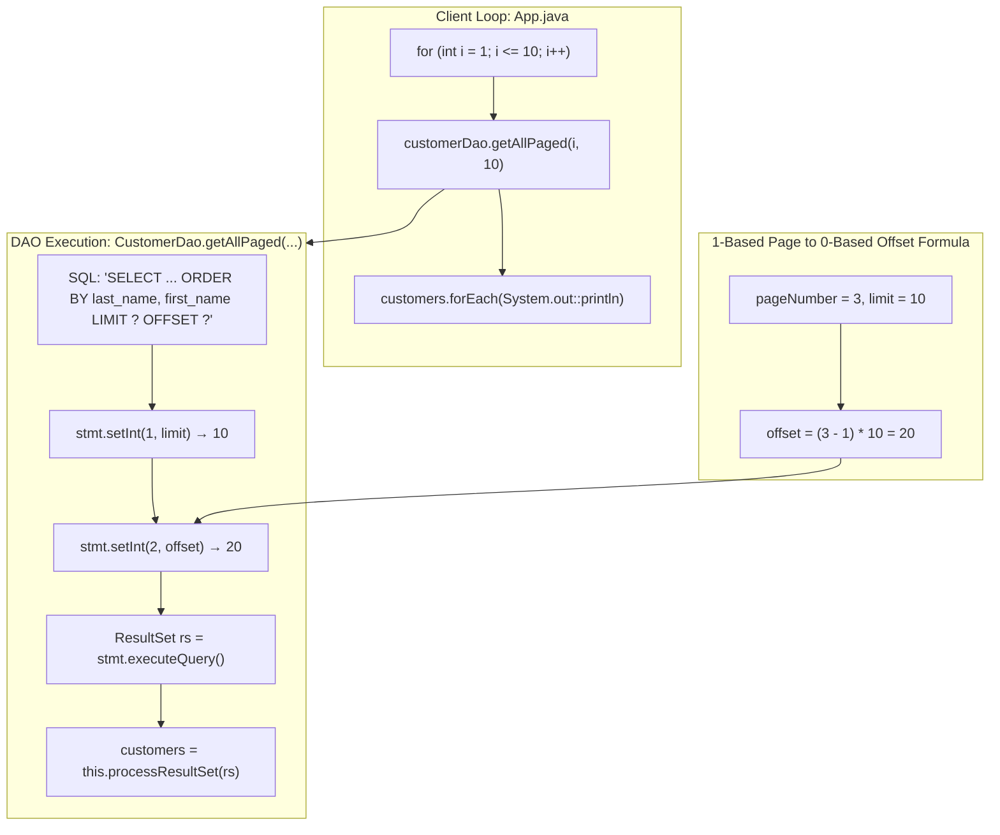

# Offset Pagination: `LIMIT` / `OFFSET` Math, Deterministic Sorting & Web UI Payload Chunking

---

## Key Takeaways

Paging (or pagination) splits massive relational datasets into manageable slices, preventing memory overflow in client applications and minimizing network transmission payloads for Web UIs. In PostgreSQL and compatible engines, this is achieved by pairing **`LIMIT`** (the page capacity or slice size) with **`OFFSET`** (the number of leading rows to skip).

A critical architectural invariant is that pagination **strictly requires an explicit, multi-column `ORDER BY` clause** (e.g., `ORDER BY last_name, first_name`). Without an explicit order, relational tables act as unordered bags of tuples, meaning rows can randomly shift between pages across subsequent queries. Because user interfaces typically operate on 1-based page numbers ($1, 2, 3, \dots$) while the database operates on a 0-based skipped row count, the mathematical conversion is:

$$\text{offset} = (\text{pageNumber} - 1) \times \text{limit}$$



- **Deterministic Invariant**: Always supply an explicit, tie-broken `ORDER BY` clause (`last_name, first_name`). Otherwise, engine scan order shifts nondeterministically across calls, causing skipped or duplicated records.
- **Offset Calculation Formula**: $\text{offset} = (\text{pageNumber} - 1) \times \text{limit}$. Page 1 has an offset of $0$, Page 2 skips $10$ rows, Page 3 skips $20$ rows, etc.
- **Parameter Binding Order**:
  - Index `1`: `limit` (max records to return)
  - Index `2`: `offset` (records to discard before beginning the return slice)
- **Web UI Optimization**: Paginating on the database avoids shipping megabytes of unneeded JSON across REST/GraphQL endpoints, protecting frontend render loops and backend heap buffers.

---

## Main Discussion

### Step 1: Adding `getAllPaged` to `CustomerDao.java`

Open `src/main/java/com/rensaputra/lil/data/dao/CustomerDao.java`. Define the static `GET_ALL_PAGED` SQL template and implement the `getAllPaged(int pageNumber, int limit)` method:

```java
package com.rensaputra.lil.data.dao;

import com.rensaputra.lil.data.entity.Customer;
import com.rensaputra.lil.data.util.DatabaseUtils;

import java.sql.Connection;
import java.sql.PreparedStatement;
import java.sql.ResultSet;
import java.sql.SQLException;
import java.sql.Statement;
import java.util.ArrayList;
import java.util.List;
import java.util.Optional;
import java.util.UUID;
import java.util.logging.Logger;

public class CustomerDao implements DAO<Customer, UUID> {

    private static final Logger LOGGER = Logger.getLogger(CustomerDao.class.getName());

    private static final String GET_ALL =
            "SELECT customer_id, first_name, last_name, email, phone, address FROM wisdom.customers";
    private static final String GET_ONE =
            "SELECT customer_id, first_name, last_name, email, phone, address FROM wisdom.customers WHERE customer_id = ?";
    private static final String CREATE =
            "INSERT INTO wisdom.customers (customer_id, first_name, last_name, email, phone, address) VALUES (?, ?, ?, ?, ?, ?)";
    private static final String UPDATE =
            "UPDATE wisdom.customers SET first_name = ?, last_name = ?, email = ?, phone = ?, address = ? WHERE customer_id = ?";
    private static final String DELETE =
            "DELETE FROM wisdom.customers WHERE customer_id = ?";

    // Deterministic ordering across two columns with LIMIT and OFFSET placeholders
    private static final String GET_ALL_PAGED =
            "SELECT customer_id, first_name, last_name, email, phone, address " +
            "FROM wisdom.customers " +
            "ORDER BY last_name, first_name " +
            "LIMIT ? OFFSET ?";

    private List<Customer> processResultSet(ResultSet rs) throws SQLException {
        List<Customer> customers = new ArrayList<>();
        while (rs.next()) {
            Customer customer = new Customer();
            customer.setCustomerId((UUID) rs.getObject("customer_id"));
            customer.setFirstName(rs.getString("first_name"));
            customer.setLastName(rs.getString("last_name"));
            customer.setEmail(rs.getString("email"));
            customer.setPhone(rs.getString("phone"));
            customer.setAddress(rs.getString("address"));
            customers.add(customer);
        }
        return customers;
    }

    /**
     * Retrieves a page of customer records sorted by last name, then first name.
     *
     * @param pageNumber 1-based page index (1, 2, 3...)
     * @param limit      Page size (maximum items per page)
     * @return List of Customer entities belonging to the requested page
     */
    public List<Customer> getAllPaged(int pageNumber, int limit) {
        List<Customer> customers = new ArrayList<>();
        Connection connection = DatabaseUtils.getConnection();

        // Convert 1-based page number to 0-based row skip count
        int offset = (pageNumber - 1) * limit;

        try (PreparedStatement statement = connection.prepareStatement(GET_ALL_PAGED)) {
            // Bind index 1 to LIMIT, index 2 to OFFSET
            statement.setInt(1, limit);
            statement.setInt(2, offset);

            ResultSet rs = statement.executeQuery();
            customers = this.processResultSet(rs);
            rs.close();

        } catch (SQLException e) {
            DatabaseUtils.handleSQLException("CustomerDao.getAllPaged", e, LOGGER);
        }

        return customers;
    }

    @Override
    public List<Customer> getAll() {
        List<Customer> customers = new ArrayList<>();
        Connection connection = DatabaseUtils.getConnection();

        try (Statement statement = connection.createStatement();
             ResultSet resultSet = statement.executeQuery(GET_ALL)) {

            customers = this.processResultSet(resultSet);

        } catch (SQLException e) {
            DatabaseUtils.handleSQLException("CustomerDao.getAll", e, LOGGER);
        }

        return customers;
    }

    @Override
    public Optional<Customer> getOne(UUID id) {
        try (PreparedStatement statement = DatabaseUtils.getConnection().prepareStatement(GET_ONE)) {
            statement.setObject(1, id);

            try (ResultSet resultSet = statement.executeQuery()) {
                List<Customer> customers = this.processResultSet(resultSet);
                if (customers.isEmpty()) {
                    return Optional.empty();
                }
                return Optional.of(customers.get(0));
            }

        } catch (SQLException e) {
            DatabaseUtils.handleSQLException("CustomerDao.getOne", e, LOGGER);
            return Optional.empty();
        }
    }

    @Override
    public Customer create(Customer entity) {
        UUID customerId = UUID.randomUUID();
        Connection connection = DatabaseUtils.getConnection();

        try {
            connection.setAutoCommit(false);

            PreparedStatement statement = connection.prepareStatement(CREATE);
            statement.setObject(1, customerId);
            statement.setString(2, entity.getFirstName());
            statement.setString(3, entity.getLastName());
            statement.setString(4, entity.getEmail());
            statement.setString(5, entity.getPhone());
            statement.setString(6, entity.getAddress());

            statement.execute();
            connection.commit();
            statement.close();

        } catch (SQLException e) {
            try {
                connection.rollback();
            } catch (SQLException ex) {
                DatabaseUtils.handleSQLException("CustomerDao.create.rollback", ex, LOGGER);
            }
            DatabaseUtils.handleSQLException("CustomerDao.create", e, LOGGER);
        }

        Optional<Customer> customer = this.getOne(customerId);
        return customer.orElse(null);
    }

    @Override
    public Customer update(Customer entity) {
        Connection connection = DatabaseUtils.getConnection();

        try {
            connection.setAutoCommit(false);

            PreparedStatement statement = connection.prepareStatement(UPDATE);
            statement.setString(1, entity.getFirstName());
            statement.setString(2, entity.getLastName());
            statement.setString(3, entity.getEmail());
            statement.setString(4, entity.getPhone());
            statement.setString(5, entity.getAddress());
            statement.setObject(6, entity.getCustomerId());

            statement.execute();
            connection.commit();
            statement.close();

        } catch (SQLException e) {
            try {
                connection.rollback();
            } catch (SQLException ex) {
                DatabaseUtils.handleSQLException("CustomerDao.update.rollback", ex, LOGGER);
            }
            DatabaseUtils.handleSQLException("CustomerDao.update", e, LOGGER);
        }

        return this.getOne(entity.getCustomerId()).get();
    }

    @Override
    public void delete(UUID id) {
        Connection connection = DatabaseUtils.getConnection();

        try {
            connection.setAutoCommit(false);

            PreparedStatement statement = connection.prepareStatement(DELETE);
            statement.setObject(1, id);

            statement.execute();
            connection.commit();
            statement.close();

        } catch (SQLException e) {
            try {
                connection.rollback();
            } catch (SQLException ex) {
                DatabaseUtils.handleSQLException("CustomerDao.delete.rollback", ex, LOGGER);
            }
            DatabaseUtils.handleSQLException("CustomerDao.delete", e, LOGGER);
        }
    }
}
```

---

### Step 2: Testing Pagination Across 10 Pages via `App.java`

Update `src/main/java/com/rensaputra/lil/App.java` with a loop fetching all 100 customer records in 10 sequential pages of 10 items each:

```java
package com.rensaputra.lil;

import com.rensaputra.lil.data.dao.CustomerDao;
import com.rensaputra.lil.data.entity.Customer;

import java.util.List;

public class App {

    public static void main(String[] args) {
        CustomerDao customerDao = new CustomerDao();

        System.out.println("**** CUSTOMER PAGING ****");

        // Loop through 10 pages (1 to 10) with a page size of 10
        for (int i = 1; i < 11; i++) {
            System.out.println("\nPage: " + i);
            List<Customer> pagedCustomers = customerDao.getAllPaged(i, 10);
            pagedCustomers.forEach(System.out::println);
        }
    }
}
```

---

### Step 3: Terminal Build & Verification

Compile and run the application from your terminal:

```bash
mvn compile exec:java -Dexec.mainClass="com.rensaputra.lil.App"
```

The terminal prints each page partition. Notice how boundary records align strictly in alphabetical order by `last_name, first_name` without overlapping duplicates:

```text
**** CUSTOMER PAGING ****

Page: 1
Customer{customerId=..., firstName='Aaron', lastName='Adams', email='a.adams@example.com', ...}
Customer{customerId=..., firstName='Abigail', lastName='Adams', email='ab.adams@example.com', ...}
... (8 more records) ...

Page: 2
Customer{customerId=..., firstName='Benjamin', lastName='Baker', email='b.baker@example.com', ...}
... (9 more records) ...

Page: 3
...
Page: 10
...
```

---

### Under the Hood / Database Engine Mechanics

```
   POSTGRESQL EXECUTOR: OFFSET PROCESSING
   Query: SELECT ... ORDER BY last_name, first_name LIMIT 10 OFFSET 20;

+------------------------------------------------------------------------------------+
| Limit  (cost=12.50..18.75 rows=10 width=128)                                       |
|   ->  Sort (sort key: last_name, first_name)                                       |
|         ->  Seq Scan on customers                                                  |
+------------------------------------------------------------------------------------+
| Execution trace:                                                                   |
| 1. Evaluates & sorts matching tuples                                               |
| 2. Discards the first 20 tuples (OFFSET)                                           |
| 3. Emits the subsequent 10 tuples (LIMIT) across network socket                     |
| 4. Halts execution early                                                           |
+------------------------------------------------------------------------------------+

```

1. **Offset Tuple Discard Cost:**
   When PostgreSQL executes LIMIT M OFFSET N, it evaluates and orders the candidate rows, advances through the sorted stream, and reads and discards the first $N$ rows before returning the requested $M$ rows. While efficient for early pages (e.g., $N = 20$), large offsets (e.g., $\text{OFFSET } 500000$) force the engine to scan half a million records merely to throw them away.
2. **Multi-Column Sort Keys:**
   Using ORDER BY last_name, first_name builds a compound sort key. If two customers share the last name `"Adams"`, the secondary key `first_name` resolves the tie, guaranteeing deterministic ordering across page boundaries.
3. **Parameter Marker Types in Protocol v3.0:**
   Both LIMIT ? and OFFSET ? accept 32-bit signed integers (INT4). The driver serializes these values into standard protocol frames via setInt(index, val), avoiding raw SQL re-compilation.

---

### Structural Comparisons

#### Offset Pagination vs. Keyset (Seek) Pagination

| Metric                          | Offset Pagination (`LIMIT ? OFFSET ?`)           | Keyset Pagination (`WHERE (id, col) > (?, ?)`)        |
| ------------------------------- | ------------------------------------------------ | ----------------------------------------------------- |
| **Random Page Navigation**      | **Yes**: Can jump directly to Page 42            | **No**: Requires cursor token from previous page      |
| **Performance on Deep Pages**   | Degrades linearly ($\mathcal{O}(N + M)$)         | **Constant time** ($\mathcal{O}(M)$ via index seek)   |
| **Drift on Concurrent Inserts** | Vulnerable to missing/duplicated rows            | Stable; seeks directly against immutable cursor       |
| **Implementation Complexity**   | Minimal (simple arithmetic formula)              | Higher (requires tracking boundary composite keys)    |
| **Ideal Context**               | Standard Web UI data tables with low page counts | Endless-scrolling feeds (mobile apps, social streams) |

---

### Common Anti-Patterns & Edge Cases

- **Missing `ORDER BY`**:
  Executing `LIMIT ? OFFSET ?` without `ORDER BY` produces non-deterministic slices where rows can duplicate or vanish across pages depending on server-side disk access paths.
- **Negative Page Numbers or Limits**:
  If `pageNumber = 0`, the offset calculation yields a negative number ($(0 - 1) \times 10 = -10$). PostgreSQL throws `SQLException: OFFSET must not be negative`. Always sanitize inputs (`pageNumber = Math.max(1, pageNumber)`).
- **The "Page Drift" Phenomenon**:
  If a new row is inserted into Page 1 while a user views Page 2, all downstream records shift right by one slot. When the user clicks "Page 2", the last record from Page 1 appears again at the top of Page 2.

---

## Knowledge Check & JetBrains-Style Coding Challenges

### Theory Tips

- **Offset Formula**: Always calculate offset as `(pageNumber - 1) * limit` when transforming 1-based UI inputs to 0-based database offsets.
- **Deterministic Rule**: Every paginated query must include a deterministic `ORDER BY` clause to prevent rows from appearing on multiple pages.
- **Binding Markers**: In `LIMIT ? OFFSET ?`, index `1` is `limit` and index `2` is `offset`.

### Question 1: Conceptual / Code Analysis

Consider a paginated query on a table containing 10,000 rows:

```sql
SELECT customer_id, last_name, first_name
FROM wisdom.customers
ORDER BY last_name
LIMIT 10 OFFSET 5000;
```

What does the PostgreSQL engine physically execute to fulfill this query?

- [ ] **A.** It uses the index to jump directly to row 5001 in $\mathcal{O}(1)$ time without examining the preceding 5,000 rows.
- [ ] **B.** It sorts or scans the index, reads and discards the first 5,000 rows, and then returns the subsequent 10 rows.
- [ ] **C.** It throws a `SQLException: OffsetLimitExceededException` because offsets cannot exceed 1,000.
- [ ] **D.** It executes two separate queries and computes the set difference.

<details>
<summary>Correct Answer</summary>

**Correct Answer**: **B**

**Technical Breakdown**:

- **B is correct**: Relational engines executing offset pagination must read all rows leading up to the offset boundary before delivering the requested page. PostgreSQL traverses the index or sort buffer, discards the first 5,000 tuples, and then takes the next 10 tuples, incurring $\mathcal{O}(\text{offset} + \text{limit})$ cost.
- **A is incorrect**: Relational tables do not have physical array indices; offset skipping requires scanning through the preceding tuples.
- **C is incorrect**: Offsets can be arbitrarily large up to integer limits.
- **D is incorrect**: The database processes this within a single query execution plan.

</details>

---

### Question 2: Implementation Challenge — Total Count & Page Metadata Wrapper

**Task**: Implement a paginated container method named `getCustomersPagedWithMetadata` inside `CustomerDao`:

1. Record `PageMetadata(int currentPage, int pageSize, long totalElements, int totalPages)`:
   - Holds pagination telemetry.
2. Record `PagedResponse<T>(List<T> content, PageMetadata metadata)`:
   - Generic container for paginated responses.
3. Method in `CustomerDao`:
   `public PagedResponse<Customer> getCustomersPagedWithMetadata(int pageNumber, int pageSize)`
4. Requirements:
   - Sanitize inputs: default `pageNumber = Math.max(1, pageNumber)` and `pageSize = Math.max(1, pageSize)`.
   - Execute `SELECT COUNT(*) FROM wisdom.customers` to determine `totalElements`.
   - Calculate `totalPages = (int) Math.ceil((double) totalElements / pageSize)`.
   - Fetch the page items using `getAllPaged(pageNumber, pageSize)`.
   - Return a populated `PagedResponse<Customer>`.

**Test Assertions**:

- Table with 100 rows queried with `pageNumber = 1, pageSize = 10`:
  - `metadata.totalElements()` $\rightarrow$ Evaluates to `100`
  - `metadata.totalPages()` $\rightarrow$ Evaluates to `10`
  - `content.size()` $\rightarrow$ Evaluates to `10`
- Queried with `pageNumber = 10, pageSize = 10`:
  - Returns last 10 records.
- Queried with `pageNumber = 11, pageSize = 10`:
  - Returns empty `content` list `[]`, with metadata reflecting `currentPage = 11, totalPages = 10`.

<details>
<summary>Solution</summary>

```java
// Add to CustomerDao.java:

public record PageMetadata(int currentPage, int pageSize, long totalElements, int totalPages) {}
public record PagedResponse<T>(List<T> content, PageMetadata metadata) {}

public PagedResponse<Customer> getCustomersPagedWithMetadata(int pageNumber, int pageSize) {
    int safePage = Math.max(1, pageNumber);
    int safeLimit = Math.max(1, pageSize);

    Connection connection = DatabaseUtils.getConnection();
    long totalElements = 0;

    // 1. Fetch total count of records
    String countSql = "SELECT COUNT(*) FROM wisdom.customers";
    try (Statement stmt = connection.createStatement();
         ResultSet rs = stmt.executeQuery(countSql)) {
        if (rs.next()) {
            totalElements = rs.getLong(1);
        }
    } catch (SQLException e) {
        DatabaseUtils.handleSQLException("CustomerDao.getCustomersPagedWithMetadata.count", e, LOGGER);
    }

    // 2. Fetch page elements
    List<Customer> content = this.getAllPaged(safePage, safeLimit);

    // 3. Compute total pages
    int totalPages = (int) Math.ceil((double) totalElements / safeLimit);

    PageMetadata metadata = new PageMetadata(safePage, safeLimit, totalElements, totalPages);
    return new PagedResponse<>(content, metadata);
}
```

**Complexity Analysis**:

- **Time Complexity**: $\mathcal{O}(N)$ for the count scan plus $\mathcal{O}(\text{offset} + \text{limit})$ for the sorted page slice.
- **Space Complexity**: $\mathcal{O}(\text{pageSize})$ heap memory allocated for the sub-list of entities returned to the client.

</details>

---
