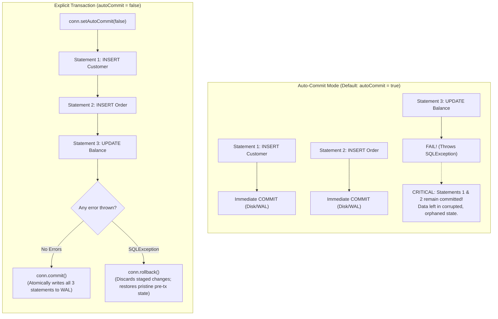

# Transaction Management: ACID Guarantees, Commit/Rollback Mechanics & Auto-Commit Pitfalls

---

## Key Takeaways

A **database transaction** is a logical unit of work executed against a database management system that satisfies the **ACID** properties (**A**tomicity, **C**onsistency, **I**solation, **D**urability). In its simplest form, a transaction guarantees that a sequence of operations either **all succeed** or **all fail** together—there is no partial persistent state.

By default, JDBC connections operate in **auto-commit mode** (`autoCommit = true`), where the database engine treats every individual SQL statement as an independent, immediately committed unit of work. Disabling auto-commit (`conn.setAutoCommit(false)`) establishes an explicit transaction boundary across multiple statements. Modifying operations remain staged in write buffers and uncommitted transaction logs until finalized via `conn.commit()` or reverted via `conn.rollback()`.



- **Unit of Work & Atomicity**: Multi-statement operations (such as debiting one account and crediting another) must run inside a single transaction to prevent partial state corruption if a failure occurs halfway through.
- **Commit Point**: Issues a flush to the database's Write-Ahead Log (WAL), releasing write locks and making changes visible to other concurrent sessions.
- **Rollback Mechanics**: Discards all intermediate, uncommitted writes staged during the transaction, restoring rows to their pre-transaction snapshot.
- **The Auto-Commit Trap**: Operating with `autoCommit = true` treats every statement as an isolated commit. If statement 3 of 4 fails, statements 1 and 2 remain permanently committed, causing orphaned or inconsistent data.
- **Distributed Breakdown**: Traditional ACID transactions rely on a shared database engine and local lock manager. In distributed microservice architectures, cross-database ACID guarantees fail, requiring higher-level coordination patterns (e.g., SAGA, Outbox pattern).

---

## Main Discussion

### ACID Properties in Relational Databases

| Property        | Core Guarantee                                                                                                                    | Failure Mode Prevented                                                       |
| --------------- | --------------------------------------------------------------------------------------------------------------------------------- | ---------------------------------------------------------------------------- |
| **Atomicity**   | "All-or-nothing" execution. If any operation fails, the entire transaction is rolled back.                                        | Partial records (e.g., order created, but payment record missing).           |
| **Consistency** | The database transitions from one valid state to another, strictly satisfying all constraints (Foreign Keys, Checks, Uniqueness). | Invalid data formats or broken referential relationships persisting to disk. |
| **Isolation**   | Concurrent transactions execute without cross-talk or race conditions, governed by isolation levels.                              | Dirty reads, non-repeatable reads, phantom rows, and lost updates.           |
| **Durability**  | Once committed, changes are permanently preserved in non-volatile storage (WAL `fsync`), surviving crashes or power outages.      | Committed data vanishing after an unexpected server restart.                 |

---

### Commit vs. Rollback: What Happens Under the Hood?

```
   TRANSACTION STAGING & LOGGING IN POSTGRESQL

   Client Session (autoCommit = false)               PostgreSQL Storage Engine
+------------------------------------+          +------------------------------------+
| 1. INSERT INTO customers ...       |          | Local Backend Buffer (Private Mem) |
| 2. INSERT INTO orders ...          |--------->| Staged in shared_buffers           |
| 3. UPDATE balance ...              |          | Assigned temporary xmin = Tx 305   |
+------------------------------------+          +------------------------------------+
                  |                                                |
                  v                                                v
   SCENARIO A: Success                           SCENARIO B: Failure
+------------------------------------+          +------------------------------------+
| conn.commit()                      |          | conn.rollback()                    |
| - Writes commit record to pg_wal   |          | - Writes abort record to pg_xact   |
| - Issues fsync() to persistent disk|          | - Tuple marked dead (xmax = Tx 305)|
| - Status in pg_xact = COMMITTED    |          | - Status in pg_xact = ABORTED      |
| - Releases RowExclusiveLocks       |          | - Zero uncommitted rows visible    |
+------------------------------------+          +------------------------------------+
```

1. **Transaction Header Initialization:**
   When conn.setAutoCommit(false) is set, PostgreSQL allocates a 32-bit transaction ID (xid) and assigns a virtual transaction handle (vxid). The engine records this in ProcArray in shared memory.
2. **Staging in Memory (No Direct File Overwrites):**
   Modifications execute in shared memory buffers. Tuple headers receive the active transaction ID in t_xmin. Because concurrent transactions inspect pg_xact and find this xid still in-progress, they treat these tuples as invisible, preventing dirty reads.
3. **Commit Finalization (The WAL fsync):**
   When conn.commit() runs, PostgreSQL appends a COMMIT record to the Write-Ahead Log buffer and forces a synchronous disk write via fsync(). The transaction status in pg_xact flips to committed, and row locks are released.
4. **Rollback Invalidation:**
   When conn.rollback() is triggered, PostgreSQL writes an ABORT record to pg_xact. The engine does not immediately erase the modified pages from disk; instead, future MVCC snapshots see the abort status and ignore the dead tuples. They are later reclaimed during background VACUUM runs.

---

### Why Auto-Commit is Dangerous for Business Logic

- Consider an invoice creation workflow:
  1. Deduct customer credits (`UPDATE customers SET balance = balance - 100 WHERE customer_id = ?`)
  2. Create invoice record (`INSERT INTO invoices (...) VALUES (...)`)
  3. Insert invoice line items (`INSERT INTO invoice_items (...) VALUES (...)`)
- If `autoCommit = true` is left active:
  - Step 1 executes and commits to disk immediately.
  - Step 2 executes and commits to disk immediately.
  - Step 3 encounters a foreign key violation or network timeout and fails.
  - **Result**: The customer has been charged $100 and an empty invoice header exists, but the invoice line items are missing. Rolling back is impossible because Steps 1 and 2 are already permanent.
- With `autoCommit = false`:
  - An exception at Step 3 triggers the catch block, executing `conn.rollback()`.
  - Steps 1, 2, and 3 are discarded as if they never occurred. The customer's balance remains untouched.

---

### Idiomatic Java Implementation: Multi-Entity Transaction with Nested Rollback

The following pattern demonstrates a complete multi-statement transactional boundary managing accounts and audit logs:

```java
package com.rensaputra.lil.data.transaction;

import com.rensaputra.lil.data.util.DatabaseUtils;

import java.math.BigDecimal;
import java.sql.Connection;
import java.sql.PreparedStatement;
import java.sql.SQLException;
import java.util.UUID;
import java.util.logging.Logger;

public class TransactionalBillingService {

    private static final Logger LOGGER = Logger.getLogger(TransactionalBillingService.class.getName());

    private static final String DEBIT_CUSTOMER =
            "UPDATE wisdom.customers SET balance = balance - ? WHERE customer_id = ?";
    private static final String RECORD_INVOICE =
            "INSERT INTO wisdom.invoices (invoice_id, customer_id, amount) VALUES (?, ?, ?)";
    private static final String RECORD_AUDIT =
            "INSERT INTO wisdom.audit_logs (log_id, message) VALUES (?, ?)";

    public boolean processPayment(UUID customerId, BigDecimal amount) {
        Connection conn = null;
        boolean originalAutoCommit = true;

        try {
            conn = DatabaseUtils.getConnection();
            originalAutoCommit = conn.getAutoCommit();

            // 1. Begin explicit transaction boundary
            conn.setAutoCommit(false);

            UUID invoiceId = UUID.randomUUID();
            UUID logId = UUID.randomUUID();

            // Statement 1: Deduct balance
            try (PreparedStatement debitStmt = conn.prepareStatement(DEBIT_CUSTOMER)) {
                debitStmt.setBigDecimal(1, amount);
                debitStmt.setObject(2, customerId);
                debitStmt.executeUpdate();
            }

            // Statement 2: Insert invoice
            try (PreparedStatement invoiceStmt = conn.prepareStatement(RECORD_INVOICE)) {
                invoiceStmt.setObject(1, invoiceId);
                invoiceStmt.setObject(2, customerId);
                invoiceStmt.setBigDecimal(3, amount);
                invoiceStmt.executeUpdate();
            }

            // Statement 3: Insert audit record
            try (PreparedStatement auditStmt = conn.prepareStatement(RECORD_AUDIT)) {
                auditStmt.setObject(1, logId);
                auditStmt.setString(2, "Processed payment for invoice: " + invoiceId);
                auditStmt.executeUpdate();
            }

            // 2. All statements succeeded: commit atomically
            conn.commit();
            return true;

        } catch (SQLException e) {
            // 3. Any statement failed: rollback all operations
            if (conn != null) {
                try {
                    conn.rollback();
                } catch (SQLException rollbackEx) {
                    DatabaseUtils.handleSQLException("TransactionalBillingService.rollback", rollbackEx, LOGGER);
                }
            }
            DatabaseUtils.handleSQLException("TransactionalBillingService.processPayment", e, LOGGER);
            return false;

        } finally {
            // 4. Restore original auto-commit state and close connection handle
            if (conn != null) {
                try {
                    conn.setAutoCommit(originalAutoCommit);
                    conn.close(); // Returns to pool if using HikariCP
                } catch (SQLException ex) {
                    LOGGER.warning("Failed to reset connection state: " + ex.getMessage());
                }
            }
        }
    }
}
```

---

### Structural Comparisons

#### Auto-Commit vs. Explicit Transaction Demarcation

| Architectural Attribute  | `autoCommit = true` (Default)                  | `autoCommit = false` (Explicit)                         |
| ------------------------ | ---------------------------------------------- | ------------------------------------------------------- |
| **Transaction Boundary** | Single SQL statement                           | Multi-statement block until `commit()`                  |
| **Atomicity**            | Per statement only                             | **Across the entire operational sequence**              |
| **Failure Recovery**     | Cannot undo previously executed statements     | `conn.rollback()` reverts all intermediate writes       |
| **Lock Lifetime**        | Released immediately after statement execution | Held until `commit()` or `rollback()` completes         |
| **Disk I/O (`fsync`)**   | Forces disk flush on every statement execution | Flushes to WAL once per transaction commit              |
| **Best Used For**        | Read-only reporting, isolated batch reads      | **All enterprise writes, billing, and order workflows** |

#### Local RDBMS Transactions vs. Distributed Architecture (Microservices)

| Dimension               | Local ACID Transaction (PostgreSQL)     | Distributed Transactions (Microservices)              |
| ----------------------- | --------------------------------------- | ----------------------------------------------------- |
| **Lock Coordination**   | Shared memory lock manager (`pg_locks`) | No shared memory; network partitions exist            |
| **Protocol**            | Standard engine commit / rollback       | Two-Phase Commit (2PC) or SAGA Pattern                |
| **Availability Impact** | Minimal (sub-millisecond lock duration) | High latency; vulnerable to coordinator blocking      |
| **Recovery Strategy**   | Automatic via WAL replay on reboot      | Compensating transactions (`undo` actions via queues) |

---

### Common Anti-Patterns & Edge Cases

- **Leaving Auto-Commit Enabled for Multi-Step Business Operations**:
  Allowing default auto-commit on multi-table writes leaves data corrupted if an error occurs midway through. Always set `conn.setAutoCommit(false)`.
- **Long-Running Open Transactions**:
  Holding an explicit transaction open while waiting for external REST API calls or slow file I/O holds table and row locks open, blocking concurrent writers and causing lock escalation or connection pool starvation. Only open transactions around database statements.
- **Unprotected Rollback Calls**:
  Executing `conn.rollback()` without wrapping it in a nested `try-catch` block allows secondary network failures during rollback to swallow the original `SQLException` that caused the failure.
- **Failing to Reset Auto-Commit on Pooled Connections**:
  Returning a borrowed connection to a pool with `autoCommit = false` causes subsequent threads to execute inside uncommitted transactions. (HikariCP automatically resets this, but manual code should restore it in a `finally` block).

---

## Knowledge Check & JetBrains-Style Coding Challenges

### Theory Tips

- **Disabling Auto-Commit**: In JDBC, multi-statement transactions are initiated by invoking `connection.setAutoCommit(false)`.
- **Settling a Transaction**: Call `connection.commit()` to persist all staged changes, or `connection.rollback()` to undo them.
- **Connection Pools & Auto-Commit**: Most modern connection pools (and ORMs like Hibernate) disable or reset auto-commit by default to prevent partial writes.

### Question 1: Conceptual / Code Analysis

Consider the following banking transfer method:

```java
public void transferFunds(Connection conn, UUID fromId, UUID toId, BigDecimal amount) throws SQLException {
    // Note: Developer forgot conn.setAutoCommit(false);

    String debitSql = "UPDATE accounts SET balance = balance - ? WHERE id = ?";
    String creditSql = "UPDATE accounts SET balance = balance + ? WHERE id = ?";

    try (PreparedStatement debit = conn.prepareStatement(debitSql);
         PreparedStatement credit = conn.prepareStatement(creditSql)) {

        debit.setBigDecimal(1, amount);
        debit.setObject(2, fromId);
        debit.executeUpdate(); // Statement 1

        // Simulated crash or constraint failure:
        if (true) {
            throw new SQLException("Simulated network drop before credit");
        }

        credit.setBigDecimal(1, amount);
        credit.setObject(2, toId);
        credit.executeUpdate(); // Statement 2

        conn.commit();
    } catch (SQLException e) {
        conn.rollback();
        throw e;
    }
}
```

What happens to the database when this method is invoked with a standard JDBC connection whose auto-commit has not been modified?

- [ ] **A.** The entire operation is rolled back, and neither account balance changes.
- [ ] **B.** Statement 1 is permanently committed when executed; Statement 2 fails; `conn.rollback()` throws a `SQLException` or has no effect, leaving the sender debited with no money credited to the receiver.
- [ ] **C.** PostgreSQL detects the unbalanced transfer and aborts the session.
- [ ] **D.** The application enters a deadlock state.

<details>
<summary>Correct Answer</summary>

**Correct Answer**: **B**

**Technical Breakdown**:

- **B is correct**: Because `conn.setAutoCommit(false)` was omitted, the connection remains in default auto-commit mode (`autoCommit = true`). Statement 1 commits immediately upon executing `debit.executeUpdate()`. When the exception triggers, execution shifts to `catch (SQLException e)`. Calling `conn.rollback()` in auto-commit mode either throws an exception (e.g., `"Cannot call rollback when auto-commit is enabled"`) or acts as a no-op depending on the driver. In either case, Statement 1 remains committed to disk, corrupting the financial state.
- **A is incorrect**: Rollback cannot undo an already committed auto-commit statement.
- **C is incorrect**: Relational engines enforce declared constraints, not application-level balance parity.
- **D is incorrect**: Statement locks are released immediately upon auto-commit; no deadlock occurs.

</details>

---

### Question 2: Mini Coding Problem / Implementation Challenge

**Task**: Implement an atomic multi-table transfer coordinator named `ServiceOrderCoordinator` inside package `com.rensaputra.lil.data.transaction`:

1. Method signature:
   `public static boolean createOrderWithItems(Connection conn, UUID customerId, List<UUID> serviceIds, BigDecimal total)`
2. Requirements:
   - Reject null parameters: if `conn`, `customerId`, or `serviceIds` is null, or `serviceIds` is empty, return `false`.
   - Capture initial auto-commit setting: `boolean initialAutoCommit = conn.getAutoCommit()`.
   - Set `conn.setAutoCommit(false)`.
   - Insert into `wisdom.orders`:
     `INSERT INTO wisdom.orders (order_id, customer_id, total_amount, status) VALUES (?, ?, ?, 'PENDING')`.
     Generate an `orderId = UUID.randomUUID()`.
   - Insert into `wisdom.order_items` for each service ID in `serviceIds`:
     `INSERT INTO wisdom.order_items (item_id, order_id, service_id) VALUES (?, ?, ?)`.
     Generate a new `UUID` for each `item_id`.
   - If all insertions succeed, call `conn.commit()` and return `true`.
   - If any `SQLException` occurs:
     - Roll back inside a nested try-catch block.
     - Route error through `DatabaseUtils.handleSQLException("ServiceOrderCoordinator.createOrderWithItems", e, LOGGER)`.
     - Return `false`.
   - In a `finally` block, restore the original auto-commit status.

**Test Assertions**:

- Valid customer and 3 service IDs $\rightarrow$ Commits 1 order record and 3 order item records atomically, returns `true`.
- Second service ID points to an invalid UUID violating the foreign key constraint on `wisdom.services` $\rightarrow$ Catches exception, rolls back transaction (zero rows remain in `orders` or `order_items`), restores auto-commit, returns `false`.

<details>
<summary>Solution</summary>

```java
package com.rensaputra.lil.data.transaction;

import com.rensaputra.lil.data.util.DatabaseUtils;

import java.math.BigDecimal;
import java.sql.Connection;
import java.sql.PreparedStatement;
import java.sql.SQLException;
import java.util.List;
import java.util.UUID;
import java.util.logging.Logger;

public class ServiceOrderCoordinator {

    private static final Logger LOGGER = Logger.getLogger(ServiceOrderCoordinator.class.getName());

    private static final String INSERT_ORDER =
            "INSERT INTO wisdom.orders (order_id, customer_id, total_amount, status) VALUES (?, ?, ?, 'PENDING')";
    private static final String INSERT_ITEM =
            "INSERT INTO wisdom.order_items (item_id, order_id, service_id) VALUES (?, ?, ?)";

    public static boolean createOrderWithItems(Connection conn, UUID customerId, List<UUID> serviceIds, BigDecimal total) {
        if (conn == null || customerId == null || serviceIds == null || serviceIds.isEmpty() || total == null) {
            return false;
        }

        boolean originalAutoCommit = true;

        try {
            originalAutoCommit = conn.getAutoCommit();
            conn.setAutoCommit(false);

            UUID orderId = UUID.randomUUID();

            // Insert parent order
            try (PreparedStatement orderStmt = conn.prepareStatement(INSERT_ORDER)) {
                orderStmt.setObject(1, orderId);
                orderStmt.setObject(2, customerId);
                orderStmt.setBigDecimal(3, total);
                orderStmt.executeUpdate();
            }

            // Insert child items
            try (PreparedStatement itemStmt = conn.prepareStatement(INSERT_ITEM)) {
                for (UUID serviceId : serviceIds) {
                    itemStmt.setObject(1, UUID.randomUUID());
                    itemStmt.setObject(2, orderId);
                    itemStmt.setObject(3, serviceId);
                    itemStmt.executeUpdate();
                }
            }

            // Finalize writes atomically
            conn.commit();
            return true;

        } catch (SQLException e) {
            try {
                conn.rollback();
            } catch (SQLException rollbackEx) {
                DatabaseUtils.handleSQLException("ServiceOrderCoordinator.createOrderWithItems.rollback", rollbackEx, LOGGER);
            }
            DatabaseUtils.handleSQLException("ServiceOrderCoordinator.createOrderWithItems", e, LOGGER);
            return false;

        } finally {
            try {
                conn.setAutoCommit(originalAutoCommit);
            } catch (SQLException ex) {
                LOGGER.warning("Failed to restore connection auto-commit: " + ex.getMessage());
            }
        }
    }
}
```

**Complexity Analysis**:

- **Time Complexity**: $\mathcal{O}(M)$ where $M$ is the number of child items. Dispatches $1 + M$ DML updates across the socket and commits in a single Write-Ahead Log (WAL) sync operation ($\mathcal{O}(1)$ disk flush).
- **Space Complexity**: $\mathcal{O}(1)$ auxiliary memory allocated on the JVM heap for statement execution handles.

</details>

---
