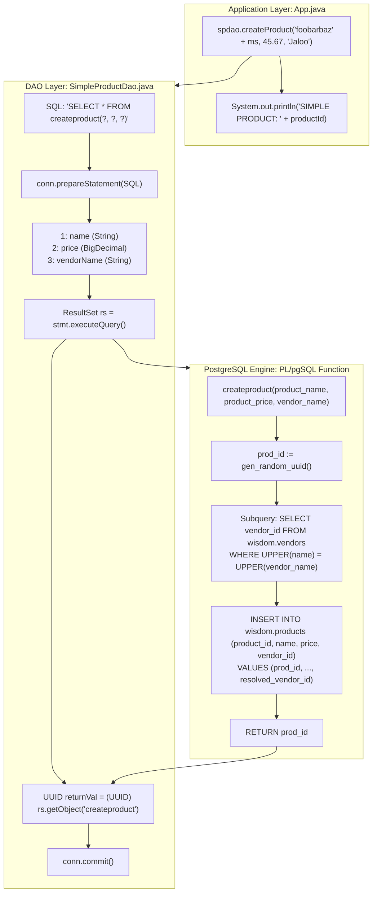

# Executing Stored Functions & Procedures: PostgreSQL `PL/pgSQL`, Functional Invocation via `SELECT`, & Cross-Table Key Resolution

---

## Key Takeaways

Relational database management systems support procedural encapsulation through **stored procedures** and **user-defined functions (UDFs)**. In PostgreSQL, procedural code written in `PL/pgSQL` can encapsulate business rules, generate primary keys server-side (e.g., `gen_random_uuid()`), and perform subqueries across foreign keys—such as resolving a `vendor_name` to its corresponding `vendor_id` on the fly during insertion.

While standard SQL procedures are traditionally invoked using `CALL procedure_name(...)` via `CallableStatement`, PostgreSQL functions that return scalar values or record sets can be invoked directly inside standard SQL queries using `SELECT * FROM function_name(?, ?, ?)` or `SELECT function_name(?, ?, ?)` via a standard `PreparedStatement`. When a function returns a scalar value (such as `RETURNS UUID`), the database exposes the returned value as a column matching the **name of the function itself** in the resulting `ResultSet`.



- **Functions vs. Procedures in PostgreSQL**:
  - **Functions (`CREATE FUNCTION`)**: Always return a value (scalar, composite, or `void`). They run within the calling statement's transaction context and can be invoked inside `SELECT` queries via `PreparedStatement`.
  - **Procedures (`CREATE PROCEDURE`)**: Invoked using `CALL procedure_name(...)`. They do not return direct scalar values (relying on `INOUT` parameters) but support managing transaction states (`COMMIT`/`ROLLBACK`) inside the procedure body.
- **Functional Query Invocation**: Executing `SELECT * FROM createproduct(?, ?, ?)` treats the function execution as a virtual table source, returning a single row with a single column whose default label matches the function identifier (`"createproduct"`).
- **Cross-Table Subquery Resolution**: The `createproduct` function resolves foreign key references internally (`SELECT vendor_id FROM wisdom.vendors WHERE UPPER(name) = UPPER(vendor_name)`), keeping client code decoupled from internal vendor lookup queries.
- **Server-Side Key Generation**: Generating identifiers via `gen_random_uuid()` delegates primary key management to PostgreSQL's cryptographic engine rather than the JVM.
- **Transaction Control**: Explicit transactions (`setAutoCommit(false)`, `commit()`, and nested `rollback()`) remain critical when invoking writing functions to ensure data consistency.

---

## Main Discussion

### Step 1: The Domain Entity (`SimpleProduct.java`)

Create `SimpleProduct.java` in package `com.rensaputra.lil.data.entity`. This entity captures the product attributes alongside the denormalized vendor fields:

```java
package com.rensaputra.lil.data.entity;

import java.math.BigDecimal;
import java.util.Objects;
import java.util.UUID;

public class SimpleProduct {

    private UUID productId;
    private String name;
    private BigDecimal price;
    private UUID vendorId;
    private String vendorName;
    private String contact;
    private String phoneNumber;
    private String email;
    private String address;

    public SimpleProduct() {
    }

    public SimpleProduct(UUID productId, String name, BigDecimal price, UUID vendorId,
                         String vendorName, String contact, String phoneNumber,
                         String email, String address) {
        this.productId = productId;
        this.name = name;
        this.price = price;
        this.vendorId = vendorId;
        this.vendorName = vendorName;
        this.contact = contact;
        this.phoneNumber = phoneNumber;
        this.email = email;
        this.address = address;
    }

    public UUID getProductId() {
        return productId;
    }

    public void setProductId(UUID productId) {
        this.productId = productId;
    }

    public String getName() {
        return name;
    }

    public void setName(String name) {
        this.name = name;
    }

    public BigDecimal getPrice() {
        return price;
    }

    public void setPrice(BigDecimal price) {
        this.price = price;
    }

    public UUID getVendorId() {
        return vendorId;
    }

    public void setVendorId(UUID vendorId) {
        this.vendorId = vendorId;
    }

    public String getVendorName() {
        return vendorName;
    }

    public void setVendorName(String vendorName) {
        this.vendorName = vendorName;
    }

    public String getContact() {
        return contact;
    }

    public void setContact(String contact) {
        this.contact = contact;
    }

    public String getPhoneNumber() {
        return phoneNumber;
    }

    public void setPhoneNumber(String phoneNumber) {
        this.phoneNumber = phoneNumber;
    }

    public String getEmail() {
        return email;
    }

    public void setEmail(String email) {
        this.email = email;
    }

    public String getAddress() {
        return address;
    }

    public void setAddress(String address) {
        this.address = address;
    }

    @Override
    public boolean equals(Object o) {
        if (this == o) return true;
        if (!(o instanceof SimpleProduct that)) return false;
        return Objects.equals(productId, that.productId);
    }

    @Override
    public int hashCode() {
        return Objects.hash(productId);
    }

    @Override
    public String toString() {
        return "SimpleProduct{" +
                "productId=" + productId +
                ", name='" + name + '\'' +
                ", price=" + price +
                ", vendorId=" + vendorId +
                ", vendorName='" + vendorName + '\'' +
                ", contact='" + contact + '\'' +
                ", phoneNumber='" + phoneNumber + '\'' +
                ", email='" + email + '\'' +
                ", address='" + address + '\'' +
                '}';
    }
}
```

---

### Step 2: The Data Access Object (`SimpleProductDao.java`)

Create `SimpleProductDao.java` in package `com.rensaputra.lil.data.dao`. The DAO issues a parameterized query against `createproduct(?, ?, ?)`, extracts the returned scalar UUID from the column named after the function, and manages transaction commit/rollback:

```java
package com.rensaputra.lil.data.dao;

import com.rensaputra.lil.data.util.DatabaseUtils;

import java.math.BigDecimal;
import java.sql.Connection;
import java.sql.PreparedStatement;
import java.sql.ResultSet;
import java.sql.SQLException;
import java.util.UUID;
import java.util.logging.Logger;

public class SimpleProductDao {

    private static final Logger LOGGER = Logger.getLogger(SimpleProductDao.class.getName());

    // Functional invocation syntax: queries the stored function as a tabular source
    private static final String CREATE = "SELECT * FROM createproduct(?, ?, ?)";

    /**
     * Executes the stored database function 'createproduct' to insert a product record.
     *
     * @param name       The product name
     * @param price      The product price
     * @param vendorName The vendor name to resolve via subquery
     * @return The generated product UUID, or null on failure
     */
    public UUID createProduct(String name, BigDecimal price, String vendorName) {
        Connection connection = DatabaseUtils.getConnection();
        UUID returnVal = null;

        try {
            // Begin explicit transaction
            connection.setAutoCommit(false);

            PreparedStatement statement = connection.prepareStatement(CREATE);
            statement.setString(1, name);
            statement.setBigDecimal(2, price);
            statement.setString(3, vendorName);

            // Execute the function query
            ResultSet rs = statement.executeQuery();

            if (rs.next()) {
                // The returned column name in the ResultSet matches the function identifier
                returnVal = (UUID) rs.getObject("createproduct");
            }

            // Finalize writes to the database
            connection.commit();

            // Clean up handles
            rs.close();
            statement.close();

        } catch (SQLException e) {
            // Roll back changes if an error occurs during execution
            try {
                connection.rollback();
            } catch (SQLException ex) {
                DatabaseUtils.handleSQLException("SimpleProductDao.create.rollback", ex, LOGGER);
            }
            DatabaseUtils.handleSQLException("SimpleProductDao.create", e, LOGGER);
        }

        return returnVal;
    }
}
```

---

### Step 3: Application Integration (`App.java`)

Update `src/main/java/com/rensaputra/lil/App.java` to invoke `SimpleProductDao.createProduct()` with dynamic timestamps and the known seeded vendor `"Jaloo"`:

```java
package com.rensaputra.lil;

import com.rensaputra.lil.data.dao.CustomerDao;
import com.rensaputra.lil.data.dao.ServiceDao;
import com.rensaputra.lil.data.dao.SimpleProductDao;
import com.rensaputra.lil.data.entity.Customer;
import com.rensaputra.lil.data.entity.Service;

import java.math.BigDecimal;
import java.util.List;
import java.util.Optional;
import java.util.UUID;

public class App {

    public static void main(String[] args) {
        // ==========================================
        // 1. SERVICES CRUD
        // ==========================================
        ServiceDao serviceDao = new ServiceDao();
        List<Service> services = serviceDao.getAll();
        System.out.println("**** SERVICES ****\n\n*** GET ALL ***");
        services.forEach(System.out::println);

        if (!services.isEmpty()) {
            Service first = services.get(0);
            Optional<Service> serviceOpt = serviceDao.getOne(first.getServiceId());
            System.out.println("\n*** GET ONE ***\n");
            serviceOpt.ifPresent(System.out::println);
        }

        Service newService = new Service();
        newService.setName("FooBarBaz" + System.currentTimeMillis());
        newService.setPrice(new BigDecimal("4.35"));
        newService = serviceDao.create(newService);
        System.out.println("\n*** CREATE ***\n\n" + newService);

        newService.setPrice(new BigDecimal("13.45"));
        newService = serviceDao.update(newService);
        System.out.println("\n*** UPDATE ***\n\n" + newService);

        serviceDao.delete(newService.getServiceId());
        System.out.println("\n*** DELETE ***\nDelete is done.");

        // ==========================================
        // 2. CUSTOMERS CRUD
        // ==========================================
        CustomerDao customerDao = new CustomerDao();
        System.out.println("\n\n**** CUSTOMERS ****\n\n*** GET ALL ***");
        List<Customer> customers = customerDao.getAll();
        System.out.println("Retrieved: " + customers.size() + " customers");

        if (!customers.isEmpty()) {
            Optional<Customer> custOpt = customerDao.getOne(customers.get(0).getCustomerId());
            System.out.println("\n*** GET ONE ***\n");
            custOpt.ifPresent(System.out::println);
        }

        Customer newCust = new Customer();
        newCust.setFirstName("Jane");
        newCust.setLastName("Doe");
        newCust.setEmail("jane.doe." + System.currentTimeMillis() + "@example.com");
        newCust.setPhone("555-0199");
        newCust.setAddress("123 Innovation Way");
        newCust = customerDao.create(newCust);
        System.out.println("\n*** CREATE ***\n\n" + newCust);

        newCust.setAddress("456 Enterprise Blvd");
        newCust = customerDao.update(newCust);
        System.out.println("\n*** UPDATE ***\n\n" + newCust);

        customerDao.delete(newCust.getCustomerId());
        System.out.println("\n*** DELETE ***\nCustomer delete is done.");

        // ==========================================
        // 3. STORED FUNCTION: SIMPLE PRODUCT
        // ==========================================
        System.out.println("\n\n*** SIMPLE PRODUCT ***");
        SimpleProductDao spdao = new SimpleProductDao();
        UUID productId = spdao.createProduct(
                "foobarbaz" + System.currentTimeMillis(),
                new BigDecimal("45.67"),
                "Jaloo"
        );
        System.out.println("Product Created via Stored Function. ID: " + productId);
    }
}
```

---

### Step 4: Verification Output & Database Inspection

Compile and run the application from your terminal:

```bash
mvn compile exec:java -Dexec.mainClass="com.rensaputra.lil.App"
```

The console output concludes with the generated product UUID:

```text
*** SIMPLE PRODUCT ***
Product Created via Stored Function. ID: 48f93e1a-8212-4217-b765-a0bc5e8a0491
```

Verify that the product was persisted and that the vendor foreign key was resolved correctly using the `psql` client:

```bash
psql -U $POSTGRES_USER -d $POSTGRES_DB -h localhost
```

Run the query against `wisdom.products`:

```sql
SELECT product_id, name, price, vendor_id
FROM wisdom.products
WHERE product_id = '48f93e1a-8212-4217-b765-a0bc5e8a0491';
```

The database confirms the new row, showing that `vendor_id` was mapped to the foreign key of the vendor record matching `"Jaloo"`:

```text
              product_id              |           name            | price |              vendor_id
--------------------------------------+---------------------------+-------+--------------------------------------
 48f93e1a-8212-4217-b765-a0bc5e8a0491 | foobarbaz1729149020411    | 45.67 | 7b3e218c-9a43-41bb-b85e-990a88ef1102
(1 row)
```

---

### Under the Hood / JVM & PostgreSQL Wire Mechanics

```
   APPLICATION (JVM)                             POSTGRESQL ENGINE (Backend Worker)
+------------------------------------+        +----------------------------------------+
| 1. prepareStatement(SELECT * ...)  |------->| Parses query containing function call  |
|    - Passes bind parameters        |        | Plans scan of function result portal   |
+------------------------------------+        +----------------------------------------+
                                                                   |
                                                                   v
+------------------------------------+        +----------------------------------------+
| 2. stmt.executeQuery()             |------->| Enters PL/pgSQL runtime execution:     |
|    - Binds string & numeric args   |        | - Calls gen_random_uuid()              |
|                                    |        | - Evaluates subquery on vendors table  |
|                                    |        | - Inserts row into wisdom.products     |
|                                    |        | - Returns prod_id scalar               |
+------------------------------------+        +----------------------------------------+
                                                                   |
                                                                   v
+------------------------------------+        +----------------------------------------+
| 3. rs.getObject("createproduct")   |<-------| Transmits 1 DataRow tuple              |
|    - Maps returned column          |        | Col header label: "createproduct"      |
+------------------------------------+        +----------------------------------------+
```

1. **Function Execution Context in PL/pgSQL:**
   When PostgreSQL executes `SELECT \* FROM createproduct(...`, the query execution engine calls the PL/pgSQL interpreter. The interpreter assigns local variables (prod_id) and evaluates the subquery `SELECT vendor_id FROM wisdom.vendors WHERE UPPER(name) = UPPER(vendor_name)`. If multiple or zero vendors match, standard SQL subquery rules apply (scalar subqueries must return at most one row, or a constraint error occurs).
2. **Tuple Generation and Implicit Column Naming:**
   When a function returns a scalar value (e.g., RETURNS UUID) and is invoked via `SELECT \* FROM <function>`, PostgreSQL treats the scalar result as a single-column relation. By default, the database assigns the column alias to match the function identifier. Calling rs.getObject("createproduct") reads from this column.
3. **Server-Side gen_random_uuid() vs JVM SecureRandom:**
   Delegating UUID creation to PostgreSQL's native gen_random_uuid() leverages the server's OpenSSL/cryptographic subsystem. This reduces byte serialization overhead across the network and guarantees that ID assignment occurs within the transaction boundary on the server.
4. **AutoCloseable Drain Order:**
   In this manual resource management pattern, closing rs.close() followed by statement.close() frees the statement portal and socket buffer on both the client and server.

---

### Structural Comparisons

#### `PreparedStatement` (`SELECT ...`) vs. `CallableStatement` (`{call ...}`)

| Characteristic        | `PreparedStatement` with `SELECT`                        | `CallableStatement` with `{call / CALL}`                      |
| --------------------- | -------------------------------------------------------- | ------------------------------------------------------------- |
| **SQL Syntax**        | `SELECT * FROM func(?, ?)`                               | `{? = call func(?)}` or `CALL proc(?, ?)`                     |
| **Target Mechanism**  | Stored functions returning tables or scalar values       | Stored procedures and functions with `OUT`/`INOUT` parameters |
| **JDBC Interface**    | `java.sql.PreparedStatement`                             | `java.sql.CallableStatement`                                  |
| **Return Extraction** | Via standard `ResultSet` cursor methods                  | Via `cstmt.registerOutParameter()` and `cstmt.getXXX()`       |
| **Portability**       | High for database engines supporting UDF table functions | Standard JDBC mechanism across Oracle, DB2, and SQL Server    |
| **PostgreSQL Fit**    | Natural and idiomatic for PostgreSQL functions           | Required for PostgreSQL 11+ procedures (`CALL proc(...)`)     |

#### Database Functions vs. Client-Side Orchestration

| Dimension                   | Database Stored Function (`PL/pgSQL`)                     | Client-Side Orchestration (DAO / Java)                        |
| --------------------------- | --------------------------------------------------------- | ------------------------------------------------------------- |
| **Network Overhead**        | Low (single round-trip executes insertion and subqueries) | Higher (multiple round-trips to resolve vendor ID and insert) |
| **Business Logic Location** | Encapsulated in the database engine                       | Encapsulated in the application codebase                      |
| **Maintainability**         | Difficult to version, test, and debug in CI/CD pipelines  | Easy to test via unit/integration harnesses in Java           |
| **Portability**             | Locked to vendor dialect (`PL/pgSQL`, T-SQL, PL/SQL)      | Portable across ANSI SQL-compliant database engines           |

---

### Common Anti-Patterns & Edge Cases

- **Missing Column Match on Scalar Extraction**:

  ```java
  // BUG: Column label does not match function name!
  UUID id = (UUID) rs.getObject("prod_id"); // Throws SQLException: Column "prod_id" not found
  ```

  Unless aliased explicitly in the query (e.g., `SELECT createproduct(?, ?, ?) AS prod_id`), PostgreSQL names the returned column after the function: `rs.getObject("createproduct")`.

- **Subquery Returning Zero Rows (`NULL` Foreign Key)**:
  If the vendor name does not exist in `wisdom.vendors`, the subquery evaluates to `NULL`. If `wisdom.products.vendor_id` has a `NOT NULL` constraint, the function aborts and raises a `23502 (not_null_violation)` error, which propagates back to the caller as a `SQLException`.
- **Subquery Returning Multiple Rows**:
  If the vendor table contains duplicate names (e.g., two entries matching `"Jaloo"`), the scalar subquery throws an error: `more than one row returned by a subquery used as an expression`. Ensure lookup columns have `UNIQUE` constraints or use `LIMIT 1`.
- **Uncommitted Transactions**:
  Because `setAutoCommit(false)` is active, omitting `connection.commit()` will cause the transaction to roll back when the connection closes, discarding the newly inserted product.

---

## Knowledge Check & JetBrains-Style Coding Challenges

### Theory Tips

- **Invoking Scalar Functions**: In PostgreSQL, functions returning values can be queried via `SELECT * FROM function_name(args)` or `SELECT function_name(args)`.
- **Default Column Labeling**: A scalar function queried without an explicit alias names its output column after the function itself.
- **Transaction Rollback in Functions**: If any statement inside a `PL/pgSQL` function raises an exception, the entire function execution fails, and any changes made during that call are rolled back.

### Question 1: Conceptual / Code Analysis

Consider the following query invocation:

```java
String sql = "SELECT createproduct(?, ?, ?) AS new_id";
try (PreparedStatement stmt = conn.prepareStatement(sql)) {
    stmt.setString(1, "Widget");
    stmt.setBigDecimal(2, new BigDecimal("19.99"));
    stmt.setString(3, "NonExistentVendor");

    try (ResultSet rs = stmt.executeQuery()) {
        if (rs.next()) {
            UUID id = (UUID) rs.getObject("new_id");
            System.out.println("ID: " + id);
        }
    }
}
```

Assuming `wisdom.products.vendor_id` is defined with a `NOT NULL` constraint referencing `wisdom.vendors(vendor_id)`, what occurs when this code runs with `"NonExistentVendor"`?

- [ ] **A.** The query succeeds, and `rs.getObject("new_id")` returns `null`.
- [ ] **B.** A `SQLException` is thrown because the subquery yields `NULL`, violating the `NOT NULL` constraint on `vendor_id`.
- [ ] **C.** PostgreSQL automatically inserts a new vendor record named `"NonExistentVendor"`.
- [ ] **D.** A `SQLException: Column "new_id" not found` is thrown.

<details>
<summary>Correct Answer</summary>

**Correct Answer**: **B**

**Technical Breakdown**:

- **B is correct**: The function evaluates `(SELECT vendor_id FROM wisdom.vendors WHERE UPPER(name) = UPPER('NonExistentVendor'))`. Because the vendor does not exist, the scalar subquery returns `NULL`. When the `INSERT INTO wisdom.products` executes, it attempts to insert `NULL` into the `vendor_id` column. Because `vendor_id` has a `NOT NULL` constraint, the engine aborts the transaction and raises a `23502 (not_null_violation)` error, which the JDBC driver surfaces as a checked `SQLException`.
- **A is incorrect**: Constraint violations terminate execution; they do not return `null`.
- **C is incorrect**: Plain subqueries read data; they do not automatically insert missing foreign key records.
- **D is incorrect**: The SQL query defines an explicit alias (`AS new_id`), so `rs.getObject("new_id")` is a valid column reference.

</details>

---

### Question 2: Implementation Challenge — Invoking a Procedure via `CallableStatement`

**Task**: Implement a method that executes a stored function returning a count, demonstrating the standard JDBC `CallableStatement` mechanism:

1. Database function definition:

   ```sql
   CREATE OR REPLACE FUNCTION wisdom.count_products_by_vendor(p_vendor_name VARCHAR)
   RETURNS INTEGER
   LANGUAGE plpgsql
   AS $$
   DECLARE
       v_count INTEGER;
   BEGIN
       SELECT COUNT(p.product_id) INTO v_count
       FROM wisdom.products p
       JOIN wisdom.vendors v ON p.vendor_id = v.vendor_id
       WHERE UPPER(v.name) = UPPER(p_vendor_name);
       RETURN v_count;
   END;
   $$;
   ```

2. Method signature:
   `public int getProductCountByVendor(String vendorName)`
3. Requirements:
   - Reject null or blank vendor names: throw `IllegalArgumentException`.
   - Use a `CallableStatement` with the standard JDBC escape syntax:
     `{? = call wisdom.count_products_by_vendor(?)}`.
   - Register the output parameter at index `1` as `java.sql.Types.INTEGER` using `cstmt.registerOutParameter(1, Types.INTEGER)`.
   - Bind `vendorName.trim()` to input parameter index `2` using `cstmt.setString(2, ...)`.
   - Execute via `cstmt.execute()`.
   - Retrieve and return the integer result using `cstmt.getInt(1)`.
   - Route any `SQLException` through `DatabaseUtils.handleSQLException` and return `0`.

**Test Assertions**:

- `getProductCountByVendor("Jaloo")` $\rightarrow$ Returns a count $\ge 1$.
- `getProductCountByVendor("UnknownVendor")` $\rightarrow$ Returns `0`.
- `getProductCountByVendor("")` $\rightarrow$ Throws `IllegalArgumentException`.

<details>
<summary>Solution</summary>

```java
package com.rensaputra.lil.data.dao;

import com.rensaputra.lil.data.util.DatabaseUtils;

import java.sql.CallableStatement;
import java.sql.Connection;
import java.sql.SQLException;
import java.sql.Types;
import java.util.logging.Logger;

public class VendorProductAnalyticsDao {

    private static final Logger LOGGER = Logger.getLogger(VendorProductAnalyticsDao.class.getName());

    // Standard JDBC escape call syntax for functions returning a scalar value
    private static final String CALL_COUNT_FUNCTION = "{? = call wisdom.count_products_by_vendor(?)}";

    public int getProductCountByVendor(String vendorName) {
        if (vendorName == null || vendorName.isBlank()) {
            throw new IllegalArgumentException("Vendor name must not be null or blank.");
        }

        Connection connection = DatabaseUtils.getConnection();

        try (CallableStatement cstmt = connection.prepareCall(CALL_COUNT_FUNCTION)) {
            // Register return value at parameter index 1
            cstmt.registerOutParameter(1, Types.INTEGER);

            // Bind input argument at parameter index 2
            cstmt.setString(2, vendorName.trim());

            // Execute procedure call
            cstmt.execute();

            // Extract registered OUT parameter
            return cstmt.getInt(1);

        } catch (SQLException e) {
            DatabaseUtils.handleSQLException("VendorProductAnalyticsDao.getProductCountByVendor", e, LOGGER);
            return 0;
        }
    }
}
```

**Complexity Analysis**:

- **Time Complexity**: $\mathcal{O}(\log B)$ index scan over `wisdom.vendors(name)` and foreign key indexes on `wisdom.products(vendor_id)`.
- **Space Complexity**: $\mathcal{O}(1)$ auxiliary memory allocated on the JVM heap for parameter metadata and integer return values.

</details>

---
