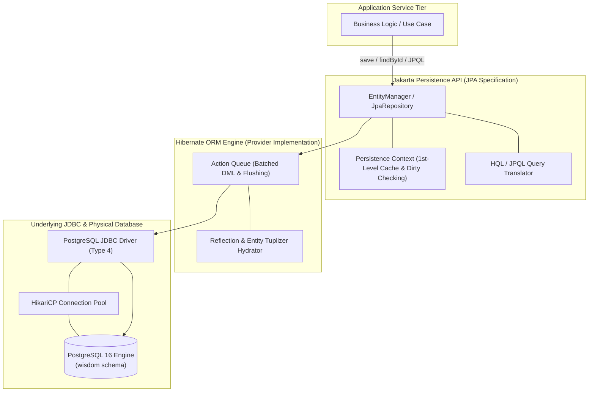

# Object-Relational Mapping (ORM) & JPA: Architectural Trade-Offs, Object-Relational Impedance Mismatch, and the Repository Pattern

---

## Key Takeaways

Every architectural decision in enterprise persistence is a trade-off between **fine-grained control** and **developer velocity**. Pure **JDBC** provides low-level, deterministic execution with zero overhead; every SQL query, parameter binding, connection lifecycle, and `ResultSet` cursor extraction is explicitly managed by the developer. This transparency enables Database Administrators (DBAs) to inspect execution plans, audit index usage, and optimize SQL directly.

Conversely, **Object-Relational Mapping (ORM)** is a technique that enables developers to interact with relational databases using object-oriented entities rather than manual SQL strings and tabular cursors. In the Java ecosystem, this is governed by the **Jakarta Persistence API (JPA)** specification (formerly Java EE / JSR 338), with **Hibernate** serving as the industry-standard reference implementation.

While ORMs eliminate JDBC boilerplate, manage dirty checking, and automate identity mapping, they introduce the **Object-Relational Impedance Mismatch**. Without careful query tuning, abstraction leaks can cause severe performance issues, such as the $N+1$ select problem, unintended Cartesian explosion, and unoptimized multi-table joins. To mitigate these risks, modern architectures pair JPA with the **Repository pattern** (managing single entity aggregates) rather than wide, multi-table DAOs.



- **JPA vs. Hibernate**: JPA is the standard Jakarta EE specification (`jakarta.persistence.*`), providing uniform interfaces (`EntityManager`, `@Entity`, `@Id`). Hibernate is the concrete ORM engine implementing the JPA specification.
- **The Core Trade-off**:
  - **Raw JDBC**: Maximum performance, complete query visibility, fine-tuned DBA auditing, and zero hidden queries—at the cost of repetitive boilerplate, manual cursor mapping, and higher development overhead.
  - **JPA / ORM**: Rapid prototyping, automatic entity hydration, caching, and clean OOP abstractions—at the cost of query generation overhead, potential Cartesian explosions, and complex lifecycle management.
- **The Object-Relational Impedance Mismatch**: The fundamental paradigm disconnect between object graphs (identity, encapsulation, polymorphism, bi-directional navigation) and relational algebra (relations, foreign keys, set operations, mathematical projections).
- **Pattern Alignment**: Pair JPA with the **Repository pattern** (single entity/aggregate per repository) to prevent generating uncontrolled Cartesian products across complex, multi-table joins.

---

## Main Discussion

### Architectural Blueprint: JDBC vs. JPA Implementation Comparison

To see the abstraction difference, compare retrieving a customer by ID and mutating their address in raw JDBC versus JPA.

#### 1. The Pure JDBC Approach (Deterministic & Explicit)

The developer coordinates every step: connection acquisition, SQL construction, parameter binding, result set cursor parsing, in-place update execution, and explicit transaction commits:

```java
public void updateCustomerAddressJdbc(UUID customerId, String newAddress) {
    String selectSql = "SELECT customer_id, first_name, last_name, email, phone, address FROM wisdom.customers WHERE customer_id = ?";
    String updateSql = "UPDATE wisdom.customers SET address = ? WHERE customer_id = ?";

    try (Connection conn = DatabaseUtils.getConnection()) {
        conn.setAutoCommit(false);

        // Explicit Read
        try (PreparedStatement selectStmt = conn.prepareStatement(selectSql)) {
            selectStmt.setObject(1, customerId);
            try (ResultSet rs = selectStmt.executeQuery()) {
                if (!rs.next()) {
                    conn.rollback();
                    return;
                }
            }
        }

        // Explicit Write
        try (PreparedStatement updateStmt = conn.prepareStatement(updateSql)) {
            updateStmt.setString(1, newAddress);
            updateStmt.setObject(2, customerId);
            updateStmt.executeUpdate();
        }

        conn.commit();
    } catch (SQLException e) {
        throw new RuntimeException("JDBC update failed", e);
    }
}
```

#### 2. The JPA / Hibernate Approach (Stateful Entity & Automatic Dirty Checking)

JPA uses the **Persistence Context**. The entity acts as an in-memory proxy for the database row. When properties change within an active transaction, the persistence context's **dirty-checking engine** detects the modification during flush time and automatically issues the minimal parameterized `UPDATE` statement:

```java
import jakarta.persistence.EntityManager;
import jakarta.persistence.EntityTransaction;

public void updateCustomerAddressJpa(EntityManager em, UUID customerId, String newAddress) {
    EntityTransaction tx = em.getTransaction();
    try {
        tx.begin();

        // 1. Fetch managed entity (tracked by Persistence Context)
        Customer customer = em.find(Customer.class, customerId);

        if (customer != null) {
            // 2. Mutate in-memory Java state directly
            // No manual UPDATE statement or PreparedStatement needed!
            customer.setAddress(newAddress);
        }

        // 3. Commit triggers dirty checking -> Hibernate generates & executes SQL UPDATE
        tx.commit();
    } catch (Exception e) {
        if (tx.isActive()) {
            tx.rollback();
        }
        throw new RuntimeException("JPA update failed", e);
    }
}
```

---

### The Anatomy of a JPA Entity

Using Jakarta Persistence annotations, the `Customer` class maps directly to the `wisdom.customers` relation:

```java
package com.rensaputra.lil.data.entity;

import jakarta.persistence.Column;
import jakarta.persistence.Entity;
import jakarta.persistence.Id;
import jakarta.persistence.Table;
import java.util.Objects;
import java.util.UUID;

@Entity
@Table(name = "customers", schema = "wisdom")
public class Customer {

    @Id
    @Column(name = "customer_id", nullable = false, updatable = false)
    private UUID customerId;

    @Column(name = "first_name", nullable = false, length = 50)
    private String firstName;

    @Column(name = "last_name", nullable = false, length = 50)
    private String lastName;

    @Column(name = "email", nullable = false, unique = true, length = 255)
    private String email;

    @Column(name = "phone", length = 50)
    private String phone;

    @Column(name = "address", length = 255)
    private String address;

    // Required by JPA specification for entity reflection instantiation
    protected Customer() {}

    public Customer(UUID customerId, String firstName, String lastName, String email, String phone, String address) {
        this.customerId = customerId;
        this.firstName = firstName;
        this.lastName = lastName;
        this.email = email;
        this.phone = phone;
        this.address = address;
    }

    public UUID getCustomerId() { return customerId; }
    public String getFirstName() { return firstName; }
    public void setFirstName(String firstName) { this.firstName = firstName; }
    public String getLastName() { return lastName; }
    public void setLastName(String lastName) { this.lastName = lastName; }
    public String getEmail() { return email; }
    public void setEmail(String email) { this.email = email; }
    public String getPhone() { return phone; }
    public void setPhone(String phone) { this.phone = phone; }
    public String getAddress() { return address; }
    public void setAddress(String address) { this.address = address; }

    @Override
    public boolean equals(Object o) {
        if (this == o) return true;
        if (!(o instanceof Customer customer)) return false;
        return Objects.equals(customerId, customer.customerId);
    }

    @Override
    public int hashCode() {
        return Objects.hash(customerId);
    }
}
```

---

### Under the Hood: The Persistence Context & Flushing Pipeline

```
   APPLICATION THREAD (em.find -> customer.setAddress)
+------------------------------------------------------------------------------------+
| 1. em.find() reads tuple from DB or First-Level Cache                              |
| 2. Persistence Context stores entity AND an internal snapshot array of its values  |
| 3. Application calls customer.setAddress("789 Tech Boulevard")                     |
+------------------------------------------------------------------------------------+
                                           |
                                transaction.commit()
                                           v
   HIBERNATE ACTION QUEUE & FLUSHING ENGINE
+------------------------------------------------------------------------------------+
| 4. Dirty-Check Algorithm: Compares current entity state against internal snapshot  |
| 5. Detects address field modified ("123 Innovation Way" -> "789 Tech Boulevard")   |
| 6. Generates Dynamic DML: UPDATE wisdom.customers SET address = ? WHERE id = ?     |
| 7. Binds parameters to JDBC PreparedStatement via Type 4 PostgreSQL Driver         |
| 8. Issues executeUpdate() and drains JDBC sockets to disk (WAL commit)             |
+------------------------------------------------------------------------------------+
```

1. **First-Level Cache (Identity Map):**
   The EntityManager maintains a First-Level Cache. If the application requests em.find(Customer.class, id) multiple times within the same transaction, Hibernate queries the database on the first invocation, caches the hydrated reference, and returns the identical Java reference on subsequent calls without touching JDBC or the network.
2. **Snapshot Hydration:**
   When loading an entity from a JDBC ResultSet, Hibernate stores a copy of the raw property values in an internal snapshot array alongside the entity.
3. **Dirty Checking Algorithm:**
   When the transaction commits or a query triggers an auto-flush, Hibernate iterates across all managed entities in the persistence context, comparing each property against its cached snapshot. If an attribute differs, Hibernate stages an EntityUpdateAction into its internal ActionQueue.
4. **Write-Behind Batching:**
   Hibernate groups and sorts staged actions (inserts, updates, deletes) to minimize deadlocks and maximize batch efficiency, converting actions into standard JDBC PreparedStatement.addBatch() calls before finalizing the transaction.

---

### Structural Comparisons

#### Pure JDBC vs. JPA / Hibernate

| Evaluation Vector       | Pure JDBC (`java.sql.*`)                              | JPA / Hibernate ORM                                     |
| ----------------------- | ----------------------------------------------------- | ------------------------------------------------------- |
| **Abstraction Level**   | **Low**: Explicit SQL strings and raw cursors         | **High**: Object-oriented entity graphs and HQL/JPQL    |
| **Boilerplate Code**    | High (manual connection handling, statements, loops)  | **Minimal** (automated mapping, zero cursor loops)      |
| **Query Transparency**  | **100% Deterministic**: Only executes written SQL     | **Opaque**: Queries generated dynamically at flush time |
| **DBA Collaboration**   | **High**: DBAs can review and tune SQL files directly | Low: Tuning requires inspecting ORM runtime logs        |
| **Performance Profile** | Maximum baseline throughput; zero cache overhead      | Fast for simple CRUD, but risks query bloat on graphs   |
| **Batching Support**    | Manual `stmt.addBatch()` and loop indexing            | Automated transparent write-behind batching             |
| **Learning Curve**      | Gentle: Standard SQL and basic JDBC methods           | Steep: Lifecycle states, flushing modes, entity graphs  |

---

### Why the DAO Pattern Clashes with ORMs: The Cartesian Product Trap

A classic mistake when migrating from JDBC to JPA is maintaining wide, multi-table DAOs. In a traditional JDBC DAO, a developer hand-writes an optimized SQL `JOIN`:

```sql
SELECT o.*, c.*, i.*, s.*
FROM orders o
JOIN customers c ON o.customer_id = c.customer_id
JOIN order_items i ON o.order_id = i.order_id
JOIN services s ON i.service_id = s.service_id;
```

In pure JDBC, the developer writes procedural code to loop over the rectangular result set and de-duplicate rows manually into domain DTOs.

However, if an application attempts to replicate this in JPA using eager-fetching relationships (`FetchType.EAGER`) across multiple `@OneToMany` collections inside a broad DAO:

```java
// ANTI-PATTERN: Simultaneous EAGER collection joins in JPA
@Entity
public class Order {
    @OneToMany(fetch = FetchType.EAGER)
    private List<OrderItem> items;

    @OneToMany(fetch = FetchType.EAGER)
    private List<OrderAuditLog> auditLogs;

    @OneToMany(fetch = FetchType.EAGER)
    private List<PaymentReceipt> receipts;
}
```

Hibernate generates an inner join across all collection tables simultaneously, producing a **Cartesian Product**:

$$\text{Total Result Rows} = \vert{}\text{Items}\vert{} \times \vert{}\text{AuditLogs}\vert{} \times \vert{}\text{Receipts}\vert{}$$

If an order has 20 items, 20 audit logs, and 5 receipts, the database streams:

$$20 \times 20 \times 5 = 2,000 \text{ rows}$$

All 2,000 rows must be transferred over the network socket and deserialized into JVM heap memory—for an entity graph that contains only 45 actual records.

#### The Solution: The Repository Pattern

To avoid this trap, use the **Repository pattern**. Repositories isolate single entity aggregates:

- `OrderRepository` loads only the `Order` root and its direct child items.
- `AuditRepository` loads audit logs on demand.
- Relationships default to `FetchType.LAZY`.
- Multi-table views are fetched using explicit, tailored projections (JPQL constructor expressions or DTO records) via `JOIN FETCH` on a single collection path at a time.

---

### Common Anti-Patterns & Edge Cases

- **The $N+1$ Select Problem**:
  Iterating over a collection of 100 `Order` entities and calling `order.getCustomer().getName()` with lazy loading defaults triggers 1 initial query for the orders, followed by 100 individual queries for each customer (101 round trips).
  - _Remedy_: Use `JOIN FETCH o.customer` in JPQL or apply an `@EntityGraph`.
- **Modifying Detached Entities**:
  Updating fields on an entity that is not attached to an active `EntityManager` does not trigger dirty checking; the modifications are silently lost without throwing an error.
- **Using `open-in-view` (OSIV) in Production**:
  Leaving Open Session in View enabled in frameworks like Spring Boot keeps database connections open during HTTP template rendering, causing connection pool exhaustion under high traffic.
- **Over-Mapping Large Schemas**:
  Mapping every table and foreign key in an enterprise database into a single, tightly coupled JPA entity graph causes Hibernate to construct massive dependency graphs, degrading startup time and memory footprint.

---

## Knowledge Check & JetBrains-Style Coding Challenges

### Theory Tips

- **JPA vs. Hibernate**: JPA is the official Jakarta EE specification interface; Hibernate is the underlying engine implementation.
- **Dirty Checking**: JPA entities managed within an active transaction do not require explicit `UPDATE` calls; mutations are detected and flushed automatically at commit time.
- **Cartesian Warning**: Avoid eagerly fetching multiple `@OneToMany` collections simultaneously to prevent Cartesian product explosions in memory and network bandwidth.

### Question 1: Conceptual / Code Analysis

Consider the following service method executing within a Spring / JPA managed transaction:

```java
@Transactional
public void applyPromotionalDiscount(UUID serviceId, BigDecimal discountAmount) {
    Service service = entityManager.find(Service.class, serviceId);
    if (service != null) {
        BigDecimal updatedPrice = service.getPrice().subtract(discountAmount);
        service.setPrice(updatedPrice); // Line 7
        // Developer omitted entityManager.merge(service) or any update SQL
    }
}
```

Assuming the transaction completes successfully without exceptions, what statement correctly describes the database state?

- [ ] **A.** The price is not updated in the database because neither `merge()`, `update()`, nor native SQL was called.
- [ ] **B.** Hibernate's dirty-checking engine compares the managed `Service` entity against its initial snapshot during the transaction commit phase, detects the updated price on Line 7, and automatically executes the parameterized `UPDATE` statement.
- [ ] **C.** An `OptimisticLockException` is thrown because the entity is unmanaged.
- [ ] **D.** Line 7 causes a compilation error because entity setters are disabled in JPA.

<details>
<summary>Correct Answer</summary>

**Correct Answer**: **B**

**Technical Breakdown**:

- **B is correct**: In JPA, an entity loaded via `entityManager.find()` within an active transaction is in the **Managed** lifecycle state. The persistence context retains a snapshot copy of its loaded state. During the transaction commit phase, Hibernate executes a flush, comparing the entity's current in-memory fields against the snapshot. Because `service.setPrice()` modified the price, Hibernate generates and dispatches an `UPDATE wisdom.services SET price = ? WHERE service_id = ?` query via JDBC automatically.
- **A is incorrect**: `merge()` is required only for _detached_ entities; managed entities update automatically via dirty checking.
- **C is incorrect**: Modifying a managed entity within a transaction is standard JPA usage and does not trigger locking exceptions unless an explicit version collision occurs.
- **D is incorrect**: JPA entities are standard Java POJOs with standard mutable getters and setters.

</details>

---

### Question 2: Implementation Challenge — High-Performance DTO Projection in JPA

**Task**: Implement a JPA query repository method named `ServiceCatalogJpaRepository` that avoids entity tracking overhead by retrieving a read-only projection directly into a record:

1. Record `ServiceSummaryView`:
   - Fields: `UUID serviceId`, `String name`, `BigDecimal price`.
2. Class `ServiceCatalogJpaRepository`:
   - Private `EntityManager entityManager`.
   - Method `public List<ServiceSummaryView> findServicesUnderPrice(BigDecimal maxPrice)`:
   - Validates input: throws `IllegalArgumentException` if `maxPrice` is null.
   - Uses a **JPQL Constructor Expression** (`SELECT new com.rensaputra.lil.data.dto.ServiceSummaryView(...)`) to query `Service` entities matching `price <= :maxPrice` ordered by price ascending.
   - Binds the named parameter `:maxPrice`.
   - Returns the direct `List<ServiceSummaryView>`.

**Test Assertions**:

- `findServicesUnderPrice(new BigDecimal("230.00"))` $\rightarrow$ Returns read-only record projections bypassing the First-Level Cache snapshot engine.
- `findServicesUnderPrice(null)` $\rightarrow$ Throws `IllegalArgumentException`.

<details>
<summary>Solution</summary>

```java
package com.rensaputra.lil.data.repository;

import jakarta.persistence.EntityManager;
import jakarta.persistence.TypedQuery;

import java.math.BigDecimal;
import java.util.List;
import java.util.Objects;
import java.util.UUID;

public class ServiceCatalogJpaRepository {

    public record ServiceSummaryView(UUID serviceId, String name, BigDecimal price) {}

    private final EntityManager entityManager;

    public ServiceCatalogJpaRepository(EntityManager entityManager) {
        this.entityManager = Objects.requireNonNull(entityManager, "EntityManager cannot be null");
    }

    /**
     * Executes a JPQL constructor expression to project directly into immutable DTO records.
     * Bypasses Hibernate snapshot creation and first-level cache dirty tracking for read performance.
     */
    public List<ServiceSummaryView> findServicesUnderPrice(BigDecimal maxPrice) {
        if (maxPrice == null) {
            throw new IllegalArgumentException("Maximum price boundary cannot be null.");
        }

        String jpql = """
            SELECT new com.rensaputra.lil.data.repository.ServiceCatalogJpaRepository$ServiceSummaryView(
                s.serviceId, s.name, s.price
            )
            FROM Service s
            WHERE s.price <= :maxPrice
            ORDER BY s.price ASC
            """;

        TypedQuery<ServiceSummaryView> query = entityManager.createQuery(jpql, ServiceSummaryView.class);
        query.setParameter("maxPrice", maxPrice);

        return query.getResultList();
    }
}
```

**Complexity Analysis**:

- **Time Complexity**: $\mathcal{O}(\log B + K)$ where $B$ is the B+Tree index on price and $K$ is the number of matching records. Running direct constructor projections bypasses Hibernate's snapshot dirty-checking allocations, yielding near-pure JDBC read performance.
- **Space Complexity**: $\mathcal{O}(K)$ heap memory allocated for the returned immutable record instances, with zero first-level persistence cache overhead.

</details>

---
