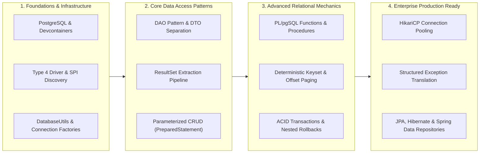

# Course Synthesis, Next Steps & The Java Persistence Learning Roadmap

---

## Key Takeaways

We just completed the entire lifecycle of Java Database Connectivity (JDBC) against containerized PostgreSQL 16. What started as basic relational concepts evolved into a production-grade, architecturally sound data access tier.

Understanding JDBC at this mechanical level gives you a massive advantage. Whether you move into high-throughput reactive systems, enterprise Spring Boot microservices, or complex ORM domains, **every Java data persistence framework ultimately delegates down to the exact JDBC and TCP socket mechanics we built and debugged here**.



- **The Full Pipeline Mastered**:
  - **Core CRUD**: `INSERT`, `SELECT`, `UPDATE`, and `DELETE` using parameterized `PreparedStatement` to eliminate SQL injection.
  - **Cursor Traversal**: Centralized row hydration via `processResultSet(ResultSet rs)` mapping relational columns to immutable types and records.
  - **ACID Demarcation**: Disabling auto-commit (`setAutoCommit(false)`), explicit multi-statement commits (`commit()`), and nested rollback fault tolerance (`rollback()`).
  - **Database Functions**: Invoking PostgreSQL `PL/pgSQL` routines returning scalar values directly via functional SQL.
  - **Pagination**: Deterministic chunking via `ORDER BY` with parameterized `LIMIT` and `OFFSET` boundary math.
  - **Enterprise Resiliency**: Thread-safe singletons via Double-Checked Locking (DCL), pooling fundamentals with HikariCP, and wrapping checked `SQLException` instances into clean runtime exception hierarchies.

---

## Comprehensive Curriculum Review Matrix

| Topic / Module Area               | Core Class / Method Focus           | Primary Technical Guarantee                                                           | Architectural Trade-Off                                                                       |
| --------------------------------- | ----------------------------------- | ------------------------------------------------------------------------------------- | --------------------------------------------------------------------------------------------- |
| **Driver & Connection Setup**     | `DatabaseUtils.getConnection()`     | Lazy initialization via Double-Checked Locking (DCL) and `volatile`                   | Simple for standalone CLI scripts; multi-threaded production requires connection pooling.     |
| **Entity & DAO Abstraction**      | `DAO<T, ID>` & `ServiceDao`         | Strict separation of concerns (SoC); data access isolated from domain logic           | Requires boilerplate mapping code compared to automatic ORM introspection.                    |
| **Cursor Processing**             | `processResultSet(ResultSet rs)`    | 1-based indexing, type-safe UUID extraction (`getObject`), and non-null defaults      | Re-reading streams requires reopening portals; cursors must be deterministically closed.      |
| **Parameterized Reads**           | `getOne(UUID id)` & `getAll()`      | Plan pre-compilation on PostgreSQL engine; immune to SQL injection                    | Dynamic predicates require manual query building or query-builder libraries.                  |
| **Transactional Writes**          | `create()`, `update()`, `delete()`  | Atomic state changes; uncommitted writes discarded on failure via nested rollback     | Locks held until transaction commits; long transactions risk lock contention.                 |
| **Stored Procedures / Functions** | `createproduct(...)` via `SELECT *` | Server-side key generation (`gen_random_uuid`) and cross-table foreign key subqueries | Logic couples to PostgreSQL's `PL/pgSQL` dialect, reducing vendor swappability.               |
| **Deterministic Pagination**      | `getAllPaged(int page, int limit)`  | Predictable slices via multi-column `ORDER BY` with formula: `(page - 1) * limit`     | High offsets discard leading tuples ($\mathcal{O}(N)$ scan); deep paging favors keyset seeks. |
| **Exception Translation**         | `SQLExceptionTranslator`            | Unpacks standardized `SQLState` into unchecked domain runtime exceptions              | Translating requires maintaining custom exception classes and mapping logic.                  |
| **Connection Pooling**            | `HikariDataSource`                  | Reusable physical socket proxies via lock-free `ConcurrentBag`                        | Adds library dependency; requires tuning maximum pool size to host CPU/disk cores.            |
| **ORM & JPA Transition**          | `EntityManager` & Hibernate         | Object-oriented interaction, identity maps, and automated dirty checking              | Abstracts SQL visibility; risks $N+1$ select queries and Cartesian explosions if unmonitored. |

---

## Recommended Next Steps & Learning Roadmap

### 1. Spring Data Repositories (`Spring Data JPA` & `Spring Data JDBC`)

The course highlights the **Repository pattern** as the dominant persistence model in microservices. Spring Data eliminates almost all repetitive CRUD boilerplate:

- **`Spring Data JDBC`**: A lightweight alternative to full JPA. It uses the Repository pattern without lazy loading, dirty checking, or caching overhead—sticking close to the clean JDBC mental model you just built.
- **`Spring Data JPA`**: Built on top of Hibernate. Generates dynamic queries from method names (e.g., `findByLastNameOrderByFirstNameAsc`), provides automated paging abstractions (`Pageable`, `Page<T>`), and coordinates declarative transaction boundaries with `@Transactional`.

### 2. Hibernate & Jakarta Persistence (JPA) Internals

If you work on enterprise Java applications, understanding Hibernate's internal lifecycle states is crucial:

- **Entity Lifecycle**: Transitioning between _Transient_, _Managed_, _Detached_, and _Removed_ states.
- **Query Optimization**: Preventing the $N+1$ select problem using `JOIN FETCH` queries and JPA 2.1 `@NamedEntityGraph`.
- **Caching Tiers**: Understanding the First-Level Cache (persistence context scope) versus the distributed Second-Level Cache (Ehcache / Redis).

### 3. Advanced Relational SQL & Performance Tuning

No matter how high-level your abstractions are, performance is ultimately bound by how PostgreSQL plans and runs queries:

- **Execution Plan Analysis**: Reading `EXPLAIN (ANALYZE, BUFFERS)` to diagnose sequential scans, nested loop joins, and sort spills to disk.
- **Advanced Indexing**: Moving beyond standard B+Trees to explore Partial Indexes, Expression/Functional Indexes, and **GIN (Generalized Inverted Indexes)** for JSONB document queries.
- **Concurrency & Locking**: Mastering transaction isolation levels (`READ COMMITTED`, `REPEATABLE READ`, `SERIALIZABLE`), optimistic locking via `@Version`, and explicit pessimistic locks via `SELECT ... FOR UPDATE`.

---

## Final Verification Test

To verify that your entire test suite, CRUD operations, stored functions, and paged queries run smoothly against the Docker environment:

```bash
mvn clean compile test exec:java -Dexec.mainClass="com.rensaputra.lil.App"
```

A clean build and execution confirms that your local Java workspace, Maven dependencies, JDBC driver, and PostgreSQL containerized schema are fully integrated and operating as expected.
