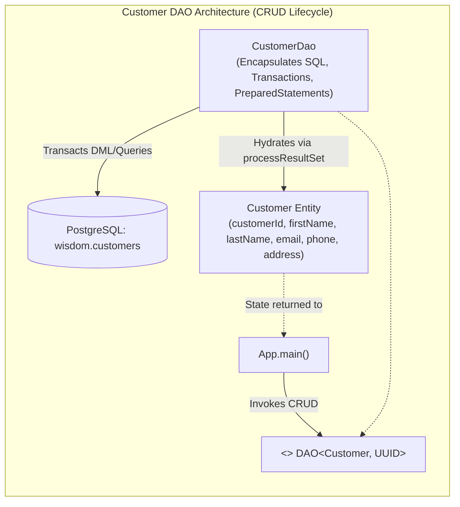
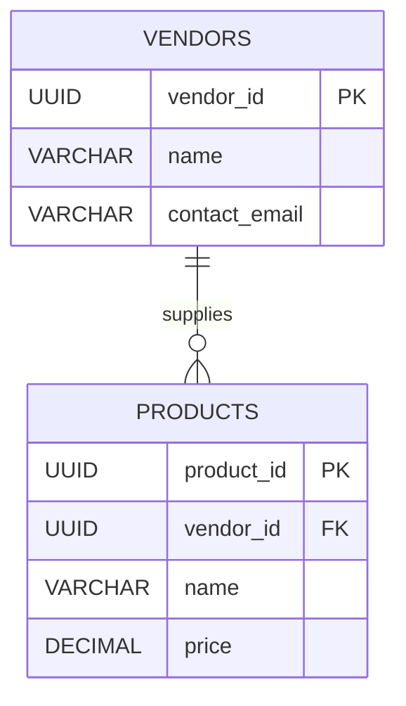

# Coding Challenge & Solution: Implementing the Customer Domain DAO & Multi-Table DTO Extensions

---

## Key Takeaways

Implementing a complete Data Access Object (DAO) for the `Customer` domain reinforces the core principles established throughout our JDBC curriculum:

- Mapping relational columns to domain entity fields using type-safe getters and setters.
- Enforcing the `DAO<T, ID UUID extends>` interface contract across the five fundamental CRUD operations: `getAll()`, `getOne(id)`, `create(entity)`, `update(entity)`, and `delete(id)`.
- Centralizing row hydration within a private `processResultSet(ResultSet rs)` method to eliminate code duplication across queries.
- Managing transactional integrity using explicit transaction boundaries (`setAutoCommit(false)`, `commit()`, and nested `rollback()` blocks) to guard writes against unexpected runtime failures.
- Extending domain models beyond single-table boundaries—such as combining intertwined `Product` and `Vendor` relations into a cohesive multi-table DTO/DAO abstraction.



---

## Main Discussion

### Schema Inspection (`data.sql`)

The `wisdom.customers` relation is structured with a UUID primary key, personal identification fields, and a unique email constraint:

```sql
CREATE TABLE IF NOT EXISTS wisdom.customers (
    customer_id UUID PRIMARY KEY,
    first_name VARCHAR(50) NOT NULL,
    last_name VARCHAR(50) NOT NULL,
    email VARCHAR(255) NOT NULL UNIQUE,
    phone VARCHAR(50),
    address VARCHAR(255)
);
```

---

### Step 1: The Domain Entity (`Customer.java`)

Create `Customer.java` inside package `com.rensaputra.lil.data.entity`:

```java
package com.rensaputra.lil.data.entity;

import java.util.Objects;
import java.util.UUID;

public class Customer {

    private UUID customerId;
    private String firstName;
    private String lastName;
    private String email;
    private String phone;
    private String address;

    public Customer() {
    }

    public Customer(UUID customerId, String firstName, String lastName, String email, String phone, String address) {
        this.customerId = customerId;
        this.firstName = firstName;
        this.lastName = lastName;
        this.email = email;
        this.phone = phone;
        this.address = address;
    }

    public UUID getCustomerId() {
        return customerId;
    }

    public void setCustomerId(UUID customerId) {
        this.customerId = customerId;
    }

    public String getFirstName() {
        return firstName;
    }

    public void setFirstName(String firstName) {
        this.firstName = firstName;
    }

    public String getLastName() {
        return lastName;
    }

    public void setLastName(String lastName) {
        this.lastName = lastName;
    }

    public String getEmail() {
        return email;
    }

    public void setEmail(String email) {
        this.email = email;
    }

    public String getPhone() {
        return phone;
    }

    public void setPhone(String phone) {
        this.phone = phone;
    }

    public String getAddress() {
        return address;
    }

    public void setAddress(String address) {
        this.address = address;
    }

    @Override
    public boolean equals(Object o) {
        if (this == o) return true;
        if (!(o instanceof Customer customer)) return false;
        return Objects.equals(customerId, customer.customerId);
    }

    @Override
    public int hashCode() {
        return Objects.hash(customerId);
    }

    @Override
    public String toString() {
        return "Customer{" +
                "customerId=" + customerId +
                ", firstName='" + firstName + '\'' +
                ", lastName='" + lastName + '\'' +
                ", email='" + email + '\'' +
                ", phone='" + phone + '\'' +
                ", address='" + address + '\'' +
                '}';
    }
}
```

---

### Step 2: The Data Access Object (`CustomerDao.java`)

Create `CustomerDao.java` inside package `com.rensaputra.lil.data.dao`, implementing all five contract methods:

```java
package com.rensaputra.lil.data.dao;

import com.rensaputra.lil.data.entity.Customer;
import com.rensaputra.lil.data.util.DatabaseUtils;

import java.sql.Connection;
import java.sql.PreparedStatement;
import java.sql.ResultSet;
import java.sql.SQLException;
import java.sql.Statement;
import java.util.ArrayList;
import java.util.List;
import java.util.Optional;
import java.util.UUID;
import java.util.logging.Logger;

public class CustomerDao implements DAO<Customer, UUID> {

    private static final Logger LOGGER = Logger.getLogger(CustomerDao.class.getName());

    // 1. Externalized SQL DDL/DML constants
    private static final String GET_ALL =
            "SELECT customer_id, first_name, last_name, email, phone, address FROM wisdom.customers";
    private static final String GET_ONE =
            "SELECT customer_id, first_name, last_name, email, phone, address FROM wisdom.customers WHERE customer_id = ?";
    private static final String CREATE =
            "INSERT INTO wisdom.customers (customer_id, first_name, last_name, email, phone, address) VALUES (?, ?, ?, ?, ?, ?)";
    private static final String UPDATE =
            "UPDATE wisdom.customers SET first_name = ?, last_name = ?, email = ?, phone = ?, address = ? WHERE customer_id = ?";
    private static final String DELETE =
            "DELETE FROM wisdom.customers WHERE customer_id = ?";

    /**
     * Centralized row mapper: converts ResultSet rows into hydrated Customer entities.
     */
    private List<Customer> processResultSet(ResultSet rs) throws SQLException {
        List<Customer> customers = new ArrayList<>();
        while (rs.next()) {
            Customer customer = new Customer();
            customer.setCustomerId((UUID) rs.getObject("customer_id"));
            customer.setFirstName(rs.getString("first_name"));
            customer.setLastName(rs.getString("last_name"));
            customer.setEmail(rs.getString("email"));
            customer.setPhone(rs.getString("phone"));
            customer.setAddress(rs.getString("address"));
            customers.add(customer);
        }
        return customers;
    }

    @Override
    public List<Customer> getAll() {
        List<Customer> customers = new ArrayList<>();
        Connection connection = DatabaseUtils.getConnection();

        try (Statement statement = connection.createStatement();
             ResultSet resultSet = statement.executeQuery(GET_ALL)) {

            customers = this.processResultSet(resultSet);

        } catch (SQLException e) {
            DatabaseUtils.handleSQLException("CustomerDao.getAll", e, LOGGER);
        }

        return customers;
    }

    @Override
    public Optional<Customer> getOne(UUID id) {
        try (PreparedStatement statement = DatabaseUtils.getConnection().prepareStatement(GET_ONE)) {
            statement.setObject(1, id);

            try (ResultSet resultSet = statement.executeQuery()) {
                List<Customer> customers = this.processResultSet(resultSet);
                if (customers.isEmpty()) {
                    return Optional.empty();
                }
                return Optional.of(customers.get(0));
            }

        } catch (SQLException e) {
            DatabaseUtils.handleSQLException("CustomerDao.getOne", e, LOGGER);
            return Optional.empty();
        }
    }

    @Override
    public Customer create(Customer entity) {
        UUID customerId = UUID.randomUUID();
        Connection connection = DatabaseUtils.getConnection();

        try {
            connection.setAutoCommit(false);

            PreparedStatement statement = connection.prepareStatement(CREATE);
            statement.setObject(1, customerId);
            statement.setString(2, entity.getFirstName());
            statement.setString(3, entity.getLastName());
            statement.setString(4, entity.getEmail());
            statement.setString(5, entity.getPhone());
            statement.setString(6, entity.getAddress());

            statement.execute();
            connection.commit();
            statement.close();

        } catch (SQLException e) {
            try {
                connection.rollback();
            } catch (SQLException ex) {
                DatabaseUtils.handleSQLException("CustomerDao.create.rollback", ex, LOGGER);
            }
            DatabaseUtils.handleSQLException("CustomerDao.create", e, LOGGER);
        }

        Optional<Customer> customer = this.getOne(customerId);
        if (customer.isEmpty()) {
            return null;
        }

        return customer.get();
    }

    @Override
    public Customer update(Customer entity) {
        Connection connection = DatabaseUtils.getConnection();

        try {
            connection.setAutoCommit(false);

            PreparedStatement statement = connection.prepareStatement(UPDATE);
            statement.setString(1, entity.getFirstName());
            statement.setString(2, entity.getLastName());
            statement.setString(3, entity.getEmail());
            statement.setString(4, entity.getPhone());
            statement.setString(5, entity.getAddress());
            statement.setObject(6, entity.getCustomerId());

            statement.execute();
            connection.commit();
            statement.close();

        } catch (SQLException e) {
            try {
                connection.rollback();
            } catch (SQLException ex) {
                DatabaseUtils.handleSQLException("CustomerDao.update.rollback", ex, LOGGER);
            }
            DatabaseUtils.handleSQLException("CustomerDao.update", e, LOGGER);
        }

        return this.getOne(entity.getCustomerId()).get();
    }

    @Override
    public void delete(UUID id) {
        Connection connection = DatabaseUtils.getConnection();

        try {
            connection.setAutoCommit(false);

            PreparedStatement statement = connection.prepareStatement(DELETE);
            statement.setObject(1, id);

            statement.execute();
            connection.commit();
            statement.close();

        } catch (SQLException e) {
            try {
                connection.rollback();
            } catch (SQLException ex) {
                DatabaseUtils.handleSQLException("CustomerDao.delete.rollback", ex, LOGGER);
            }
            DatabaseUtils.handleSQLException("CustomerDao.delete", e, LOGGER);
        }
    }
}
```

---

### Step 3: Application Integration (`App.java`)

Update `src/main/java/com/rensaputra/lil/App.java` to execute the full CRUD cycle across both the `Service` and `Customer` domains:

```java
package com.rensaputra.lil;

import com.rensaputra.lil.data.dao.CustomerDao;
import com.rensaputra.lil.data.dao.ServiceDao;
import com.rensaputra.lil.data.entity.Customer;
import com.rensaputra.lil.data.entity.Service;

import java.math.BigDecimal;
import java.util.List;
import java.util.Optional;

public class App {

    public static void main(String[] args) {
        // ==========================================
        // 1. SERVICES DOMAIN OPERATIONS
        // ==========================================
        ServiceDao serviceDao = new ServiceDao();

        List<Service> services = serviceDao.getAll();
        System.out.println("**** SERVICES ****");
        System.out.println("\n*** GET ALL ***");
        services.forEach(System.out::println);

        if (!services.isEmpty()) {
            Service firstService = services.get(0);
            Optional<Service> serviceOptional = serviceDao.getOne(firstService.getServiceId());
            System.out.println("\n*** GET ONE ***\n");
            serviceOptional.ifPresent(System.out::println);
        }

        Service newService = new Service();
        newService.setName("FooBarBaz" + System.currentTimeMillis());
        newService.setPrice(new BigDecimal("4.35"));
        newService = serviceDao.create(newService);
        System.out.println("\n*** CREATE ***\n");
        System.out.println(newService);

        newService.setPrice(new BigDecimal("13.45"));
        newService = serviceDao.update(newService);
        System.out.println("\n*** UPDATE ***\n");
        System.out.println(newService);

        serviceDao.delete(newService.getServiceId());
        System.out.println("\n*** DELETE ***");
        System.out.println("Delete is done.");

        // ==========================================
        // 2. CUSTOMERS DOMAIN OPERATIONS
        // ==========================================
        CustomerDao customerDao = new CustomerDao();

        System.out.println("\n\n**** CUSTOMERS ****");
        List<Customer> customers = customerDao.getAll();
        System.out.println("\n*** GET ALL (Total: " + customers.size() + ") ***");
        customers.forEach(System.out::println);

        if (!customers.isEmpty()) {
            Customer firstCustomer = customers.get(0);
            Optional<Customer> customerOptional = customerDao.getOne(firstCustomer.getCustomerId());
            System.out.println("\n*** GET ONE ***\n");
            customerOptional.ifPresent(System.out::println);
        }

        // CREATE Customer
        Customer newCustomer = new Customer();
        long timestamp = System.currentTimeMillis();
        newCustomer.setFirstName("Jane");
        newCustomer.setLastName("Doe");
        newCustomer.setEmail("jane.doe." + timestamp + "@example.com"); // Unique email constraint
        newCustomer.setPhone("555-0199");
        newCustomer.setAddress("123 Innovation Way");

        newCustomer = customerDao.create(newCustomer);
        System.out.println("\n*** CREATE ***\n");
        System.out.println(newCustomer);

        // UPDATE Customer
        newCustomer.setAddress("456 Enterprise Boulevard");
        newCustomer.setPhone("555-9988");
        newCustomer = customerDao.update(newCustomer);
        System.out.println("\n*** UPDATE ***\n");
        System.out.println(newCustomer);

        // DELETE Customer
        customerDao.delete(newCustomer.getCustomerId());
        System.out.println("\n*** DELETE ***");
        System.out.println("Customer delete is done.");
    }
}
```

---

### Step 4: Verification Output

Executing `mvn compile exec:java -Dexec.mainClass="com.rensaputra.lil.App"` outputs the seeded dataset (approximately 100 customer records), followed by the atomic create, update, and delete verifications:

```text
**** CUSTOMERS ****

*** GET ALL (Total: 100) ***
Customer{customerId=c7a8b9c0-1111-2222-3333-444455556666, firstName='John', lastName='Smith', email='john.smith@example.com', phone='555-0101', address='100 Main St'}
Customer{customerId=d8b9c0d1-2222-3333-4444-555566667777, firstName='Sarah', lastName='Connor', email='sconnor@example.com', phone='555-0102', address='200 Cyber Way'}
... (remaining seed rows) ...

*** GET ONE ***

Customer{customerId=c7a8b9c0-1111-2222-3333-444455556666, firstName='John', lastName='Smith', email='john.smith@example.com', phone='555-0101', address='100 Main St'}

*** CREATE ***

Customer{customerId=e1f2a3b4-5555-6666-7777-888899990000, firstName='Jane', lastName='Doe', email='jane.doe.1729148000123@example.com', phone='555-0199', address='123 Innovation Way'}

*** UPDATE ***

Customer{customerId=e1f2a3b4-5555-6666-7777-888899990000, firstName='Jane', lastName='Doe', email='jane.doe.1729148000123@example.com', phone='555-9988', address='456 Enterprise Boulevard'}

*** DELETE ***
Customer delete is done.
```

---

## Bonus Architectural Extension: Multi-Table Product & Vendor DAO

The prompt notes that products and vendors are intertwined through a foreign key relationship (`products.vendor_id -> vendors.vendor_id`). Rather than creating disjoint single-table DAOs, the DAO pattern allows creating a unified `ProductVendorDao` that operates on an aggregated `ProductSummaryDTO` via an inner join:



```java
package com.rensaputra.lil.data.dto;

import java.math.BigDecimal;
import java.util.UUID;

// Aggregated Multi-Table DTO
public record ProductSummaryDTO(
    UUID productId,
    String productName,
    BigDecimal price,
    UUID vendorId,
    String vendorName,
    String vendorContactEmail
) {}
```

```java
package com.rensaputra.lil.data.dao;

import com.rensaputra.lil.data.dto.ProductSummaryDTO;
import com.rensaputra.lil.data.util.DatabaseUtils;

import java.sql.Connection;
import java.sql.PreparedStatement;
import java.sql.ResultSet;
import java.sql.SQLException;
import java.util.ArrayList;
import java.util.List;
import java.util.Optional;
import java.util.UUID;
import java.util.logging.Logger;

public class ProductVendorDao {

    private static final Logger LOGGER = Logger.getLogger(ProductVendorDao.class.getName());

    private static final String FIND_PRODUCT_WITH_VENDOR = """
        SELECT p.product_id, p.name AS product_name, p.price,
               v.vendor_id, v.name AS vendor_name, v.contact_email
        FROM wisdom.products p
        JOIN wisdom.vendors v ON p.vendor_id = v.vendor_id
        WHERE p.product_id = ?
        """;

    public Optional<ProductSummaryDTO> findProductSummaryById(UUID productId) {
        Connection connection = DatabaseUtils.getConnection();

        try (PreparedStatement stmt = connection.prepareStatement(FIND_PRODUCT_WITH_VENDOR)) {
            stmt.setObject(1, productId);

            try (ResultSet rs = stmt.executeQuery()) {
                if (rs.next()) {
                    return Optional.of(new ProductSummaryDTO(
                        (UUID) rs.getObject("product_id"),
                        rs.getString("product_name"),
                        rs.getBigDecimal("price"),
                        (UUID) rs.getObject("vendor_id"),
                        rs.getString("vendor_name"),
                        rs.getString("contact_email")
                    ));
                }
                return Optional.empty();
            }

        } catch (SQLException e) {
            DatabaseUtils.handleSQLException("ProductVendorDao.findProductSummaryById", e, LOGGER);
            return Optional.empty();
        }
    }
}
```

---

## Knowledge Check & JetBrains-Style Coding Challenges

### Theory Tips

- **Unique Constraint Violations**: When inserting dynamic entities with unique fields (such as `email`), append a unique token (like `System.currentTimeMillis()`) to prevent `23505 (unique_violation)` errors on repeated test runs.
- **Update Parameter Ordering**: In an `UPDATE` statement, attributes in the `SET` clause precede the `WHERE` filter parameter. In `CustomerDao.update()`, the primary key `customerId` is passed as index `6`.
- **Multi-Table DAOs**: DAOs are not required to map 1:1 to single tables; combining related tables (`products` and `vendors`) through SQL joins inside a single DAO encapsulates relational complexity away from the business layer.

### Question 1: Conceptual / Code Analysis

Consider the following attempt to update a customer's email address:

```java
public void updateCustomerEmail(UUID customerId, String newEmail) throws SQLException {
    Connection conn = DatabaseUtils.getConnection();
    String sql = "UPDATE wisdom.customers SET email = ? WHERE customer_id = ?";

    try (PreparedStatement stmt = conn.prepareStatement(sql)) {
        stmt.setString(1, newEmail);
        stmt.setObject(2, customerId);
        stmt.executeUpdate();
    }
}
```

If another customer in `wisdom.customers` already possesses `newEmail`, what happens when `stmt.executeUpdate()` runs?

- [ ] **A.** PostgreSQL silently overwrites the other customer's email to maintain uniqueness.
- [ ] **B.** The statement fails and throws a checked `SQLException` with SQLState `23505` (unique constraint violation).
- [ ] **C.** `executeUpdate()` returns `0` without updating any rows.
- [ ] **D.** The email is stored in a temporary table until the conflict is manually resolved.

<details>
<summary>Solution</summary>

**Correct Answer**: **B**

**Technical Breakdown**:

- **B is correct**: The `email` column in `wisdom.customers` is protected by a `UNIQUE` constraint. When the engine executes the update, it checks the B+Tree unique index. If `newEmail` matches an existing record, the database rejects the change and raises error `23505 (unique_violation)`. The JDBC driver translates this error packet into a checked `SQLException`.
- **A is incorrect**: Relational engines never alter unrelated tuples to satisfy constraints.
- **C is incorrect**: Constraint violations abort statement execution and throw an exception; they do not return an update count of `0`.
- **D is incorrect**: Standard RDBMS engines do not stage conflicting rows in temporary tables.

</details>

---

### Question 2: Mini Coding Problem / Implementation Challenge

**Task**: Implement a lookup method in `CustomerDao` named `findByEmail`:

1. Method signature:
   `public Optional<Customer> findByEmail(String email)`
2. Requirements:
   - Define externalized query:

   ```java
   private static final String GET_BY_EMAIL =
       "SELECT customer_id, first_name, last_name, email, phone, address FROM wisdom.customers WHERE email = ?";
   ```

   - Return `Optional.empty()` immediately if `email` is null or blank.
   - Acquire connection from `DatabaseUtils.getConnection()`.
   - Bind `email.trim()` to parameter index `1`.
   - Execute query and hydrate using `this.processResultSet(rs)`.
   - Return `Optional.of(customers.get(0))` if found, or `Optional.empty()` if no match.
   - Route any `SQLException` through `DatabaseUtils.handleSQLException("CustomerDao.findByEmail", e, LOGGER)` and return `Optional.empty()`.

**Test Assertions**:

- `findByEmail("john.smith@example.com")` $\rightarrow$ Returns populated Optional with matching customer data.
- `findByEmail("unknown@nowhere.com")` $\rightarrow$ Returns `Optional.empty()`.
- `findByEmail(null)` $\rightarrow$ Returns `Optional.empty()` without calling the database.

<details>
<summary>Solution</summary>

```java
// Method implementation to add inside CustomerDao.java:

private static final String GET_BY_EMAIL =
    "SELECT customer_id, first_name, last_name, email, phone, address FROM wisdom.customers WHERE email = ?";

public Optional<Customer> findByEmail(String email) {
    if (email == null || email.isBlank()) {
        return Optional.empty();
    }

    try (PreparedStatement statement = DatabaseUtils.getConnection().prepareStatement(GET_BY_EMAIL)) {
        statement.setString(1, email.trim());

        try (ResultSet resultSet = statement.executeQuery()) {
            List<Customer> customers = this.processResultSet(resultSet);
            if (customers.isEmpty()) {
                return Optional.empty();
            }
            return Optional.of(customers.get(0));
        }

    } catch (SQLException e) {
        DatabaseUtils.handleSQLException("CustomerDao.findByEmail", e, LOGGER);
        return Optional.empty();
    }
}
```

**Complexity Analysis**:

- **Time Complexity**: $\mathcal{O}(\log B)$ page lookups via the unique B+Tree index on `wisdom.customers(email)`.
- **Space Complexity**: $\mathcal{O}(1)$ auxiliary memory allocated for statement handles and the returned `Optional` container.

</details>

---
