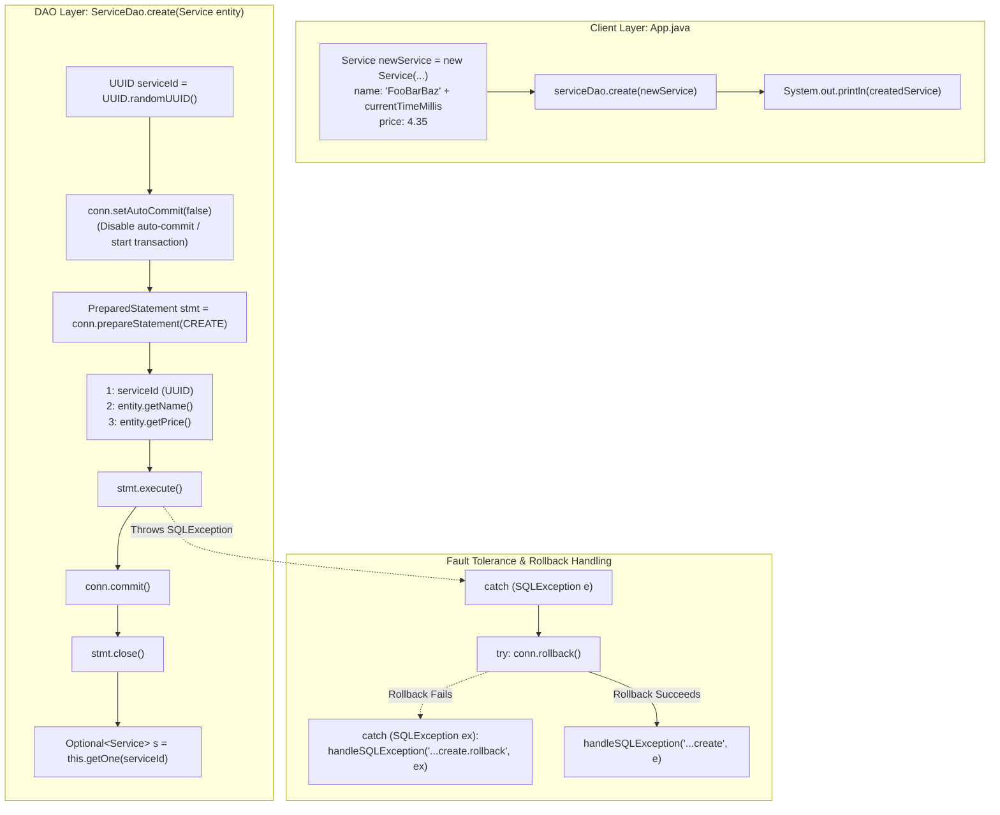

# Data Insertion Mechanics: Manual UUID Generation, Explicit Transaction Control & Rollback Fault Tolerance

---

## Key Takeaways

Implementing the **Create** operation within the DAO pattern requires managing write persistence and explicit transactional boundaries. While databases often generate primary keys automatically via sequence generators or identity columns, generating keys on the application side using `UUID.randomUUID()` grants client code complete control over the entity's identifier prior to executing the `INSERT` statement.

To guarantee **ACID Atomicity**, the connection's default auto-commit behavior is disabled via `connection.setAutoCommit(false)`. If `statement.execute()` completes without error, `connection.commit()` flushes changes to the write-ahead log. If a failure occurs, execution shifts to an outer catch block where `connection.rollback()` reverts uncommitted writes. Because `rollback()` itself can throw a checked `SQLException`, rollback operations must be guarded within a nested try-catch block. Once committed, re-querying the record via `getOne(serviceId)` verifies that the database successfully persisted the tuple.



- **Client-Side UUID Generation**: Generating `UUID.randomUUID()` in Java allows application logic to reference the entity's primary key before issuing the insert statement, avoiding the need for vendor-specific `RETURNING` clauses or complex key-retrieval mechanisms.
- **Explicit Transaction Demarcation**: Invoking `connection.setAutoCommit(false)` starts a manual transaction context. Write operations remain uncommitted in temporary buffers until an explicit `connection.commit()` call executes.
- **Nested Rollback Pattern**: When an `INSERT` statement fails, rolling back the transaction via `connection.rollback()` cleans up in-flight locks and uncommitted state. Because `rollback()` can also fail (e.g., if the network connection drops), it requires its own nested `try-catch` block.
- **Manual Statement Lifecycle**: When a statement is instantiated inside the transaction try block rather than directly within a try-with-resources parameter list, developers must ensure `statement.close()` is invoked to prevent connection and cursor leaks.
- **Post-Creation Verification**: Re-querying the created entity via `this.getOne(serviceId)` provides end-to-end verification that the database accepted, committed, and indexed the new record.

---

## Main Discussion

### Step 1: Updating `ServiceDao.java` with the `create` Implementation

Open `src/main/java/com/rensaputra/lil/data/dao/ServiceDao.java`. Define the static `CREATE` SQL query string and implement the `create(Service entity)` method with manual transaction management and nested rollback handling:

```java
package com.rensaputra.lil.data.dao;

import com.rensaputra.lil.data.entity.Service;
import com.rensaputra.lil.data.util.DatabaseUtils;

import java.math.BigDecimal;
import java.sql.Connection;
import java.sql.PreparedStatement;
import java.sql.ResultSet;
import java.sql.SQLException;
import java.sql.Statement;
import java.util.ArrayList;
import java.util.List;
import java.util.Optional;
import java.util.UUID;
import java.util.logging.Logger;

public class ServiceDao implements DAO<Service, UUID> {

    private static final Logger LOGGER = Logger.getLogger(ServiceDao.class.getName());

    // Externalized SQL statements
    private static final String GET_ALL = "SELECT service_id, name, price FROM wisdom.services";
    private static final String GET_BY_ID = "SELECT service_id, name, price FROM wisdom.services WHERE service_id = ?";
    private static final String CREATE = "INSERT INTO wisdom.services (service_id, name, price) VALUES (?, ?, ?)";

    private List<Service> processResultSet(ResultSet rs) throws SQLException {
        List<Service> services = new ArrayList<>();
        while (rs.next()) {
            Service service = new Service();
            service.setServiceId((UUID) rs.getObject("service_id"));
            service.setName(rs.getString("name"));
            service.setPrice(rs.getBigDecimal("price"));
            services.add(service);
        }
        return services;
    }

    @Override
    public List<Service> getAll() {
        List<Service> services = new ArrayList<>();
        Connection connection = DatabaseUtils.getConnection();

        try (Statement statement = connection.createStatement();
             ResultSet resultSet = statement.executeQuery(GET_ALL)) {

            services = this.processResultSet(resultSet);

        } catch (SQLException e) {
            DatabaseUtils.handleSQLException("ServiceDao.getAll", e, LOGGER);
        }

        return services;
    }

    @Override
    public Optional<Service> getOne(UUID id) {
        try (PreparedStatement statement = DatabaseUtils.getConnection().prepareStatement(GET_BY_ID)) {
            statement.setObject(1, id);

            try (ResultSet resultSet = statement.executeQuery()) {
                List<Service> services = this.processResultSet(resultSet);
                if (services.isEmpty()) {
                    return Optional.empty();
                }
                return Optional.of(services.get(0));
            }

        } catch (SQLException e) {
            DatabaseUtils.handleSQLException("ServiceDao.getOne", e, LOGGER);
            return Optional.empty();
        }
    }

    /**
     * Inserts a new Service entity into the database within an explicit transaction.
     * Manages client-side UUID assignment, commits on success, and rolls back on failure.
     */
    @Override
    public Service create(Service entity) {
        // 1. Generate primary key on the application tier
        UUID serviceId = UUID.randomUUID();
        Connection connection = DatabaseUtils.getConnection();

        try {
            // 2. Start transaction: disable auto-commit
            connection.setAutoCommit(false);

            // 3. Open PreparedStatement and bind attributes
            PreparedStatement statement = connection.prepareStatement(CREATE);
            statement.setObject(1, serviceId);
            statement.setString(2, entity.getName());
            statement.setBigDecimal(3, entity.getPrice());

            // 4. Execute insert
            statement.execute();

            // 5. Commit transaction to persist changes
            connection.commit();

            // 6. Explicitly close statement handle
            statement.close();

        } catch (SQLException e) {
            // 7. Transaction error: attempt rollback
            try {
                connection.rollback();
            } catch (SQLException ex) {
                // Handle failure occurring during the rollback attempt itself
                DatabaseUtils.handleSQLException("ServiceDao.create.rollback", ex, LOGGER);
            }

            // Log and rethrow the primary SQL failure
            DatabaseUtils.handleSQLException("ServiceDao.create", e, LOGGER);
        }

        // 8. Re-query the database to verify persistence and return a fresh entity
        Optional<Service> service = this.getOne(serviceId);
        if (service.isEmpty()) {
            return null;
        }

        return service.get();
    }

    // Reserved for upcoming modules
    @Override public Service update(Service entity) { throw new UnsupportedOperationException(); }
    @Override public void delete(UUID id) { throw new UnsupportedOperationException(); }
}
```

---

### Step 2: Testing Entity Creation via `App.java`

Update `src/main/java/com/rensaputra/lil/App.java` to construct a new `Service` entity, generate a unique name using a millisecond timestamp, insert it via `ServiceDao.create()`, and verify that subsequent reads reflect the new record:

```java
package com.rensaputra.lil;

import com.rensaputra.lil.data.dao.ServiceDao;
import com.rensaputra.lil.data.entity.Service;

import java.math.BigDecimal;
import java.util.List;
import java.util.Optional;

public class App {

    public static void main(String[] args) {
        ServiceDao serviceDao = new ServiceDao();

        // 1. Read existing services before creation
        List<Service> services = serviceDao.getAll();
        System.out.println("**** SERVICES ****");
        System.out.println("\n*** GET ALL ***");
        services.forEach(System.out::println);

        // 2. Read single instance from existing data
        if (!services.isEmpty()) {
            Service firstService = services.get(0);
            Optional<Service> serviceOptional = serviceDao.getOne(firstService.getServiceId());
            System.out.println("\n*** GET ONE ***\n");
            serviceOptional.ifPresent(System.out::println);
        }

        // 3. Construct and persist a new Service record
        Service newService = new Service();
        newService.setName("FooBarBaz" + System.currentTimeMillis());
        newService.setPrice(new BigDecimal("4.35"));

        Service createdService = serviceDao.create(newService);

        System.out.println("\n*** CREATE ***\n");
        System.out.println(createdService);
    }
}
```

---

### Step 3: Terminal Build & Verification

Compile and run the application from the terminal:

```bash
mvn compile exec:java -Dexec.mainClass="com.rensaputra.lil.App"

```

Running the program twice shows the new record created in the first run appearing in the `GET ALL` listing of the second run:

```text
[Run 1 Output]
**** SERVICES ****

*** GET ALL ***
Service{serviceId=a1b2c3d4-e5f6-7a8b-9c0d-1e2f3a4b5c6d, name='Cloud Architecture Consulting', price=250.00}
Service{serviceId=b2c3d4e5-f6a7-8b9c-0d1e-2f3a4b5c6d7e, name='Database Tuning & Optimization', price=220.00}
Service{serviceId=c3d4e5f6-a7b8-9c0d-1e2f-3a4b5c6d7e8f, name='Full-Stack Java Modernization', price=195.00}

*** GET ONE ***

Service{serviceId=a1b2c3d4-e5f6-7a8b-9c0d-1e2f3a4b5c6d, name='Cloud Architecture Consulting', price=250.00}

*** CREATE ***

Service{serviceId=f47ac10b-58cc-4372-a567-0e02b2c3d479, name='FooBarBaz1729143060123', price=4.35}
```

```text
[Run 2 Output: Demonstrates persistence across application executions]
**** SERVICES ****

*** GET ALL ***
Service{serviceId=a1b2c3d4-e5f6-7a8b-9c0d-1e2f3a4b5c6d, name='Cloud Architecture Consulting', price=250.00}
Service{serviceId=b2c3d4e5-f6a7-8b9c-0d1e-2f3a4b5c6d7e, name='Database Tuning & Optimization', price=220.00}
Service{serviceId=c3d4e5f6-a7b8-9c0d-1e2f-3a4b5c6d7e8f, name='Full-Stack Java Modernization', price=195.00}
Service{serviceId=f47ac10b-58cc-4372-a567-0e02b2c3d479, name='FooBarBaz1729143060123', price=4.35}

...

```

---

### Under the Hood / JVM & PostgreSQL Wire Mechanics

```
   APPLICATION THREAD                              POSTGRESQL ENGINE (Backend Worker)
+------------------------------------+          +----------------------------------------+
| 1. setAutoCommit(false)            |--------->| Disables auto-commit mode              |
|                                    |          | Assigns virtual transaction ID (vxid)  |
+------------------------------------+          +----------------------------------------+
                                                                     |
+------------------------------------+                               v
| 2. stmt.execute()                  |          +----------------------------------------+
|    - Sends Parse, Bind, Execute    |--------->| Validates constraints & writes tuple   |
|    - Passes 16-byte UUID payload   |          | Holds exclusive row write lock         |
+------------------------------------+          +----------------------------------------+
                                                                     |
+------------------------------------+                               v
| 3. conn.commit()                   |          +----------------------------------------+
|    - Issues Commit Command         |--------->| Flushes commit record to pg_wal (fsync)|
|                                    |          | Releases all transaction locks         |
+------------------------------------+          +----------------------------------------+

```

1. **Auto-Commit Mode Toggle:**
   When connection.setAutoCommit(false) executes, the driver sends a query protocol command instructing the server to suspend auto-committing subsequent statements. PostgreSQL assigns a virtual transaction identifier (vxid) and tracks locks in its lock manager.
2. **Client-Side UUID vs. Server-Side gen_random_uuid():**
   Calling UUID.randomUUID() uses the JVM's cryptographically secure pseudo-random number generator (SecureRandom) to build a Version 4 variant 2 UUID. This is faster than issuing a database round-trip to compute gen_random_uuid(), and gives client code the key before sending the query.
3. **The Commit / Rollback Wire Command:**
   Invoking connection.commit() sends a commit command over the wire. PostgreSQL assigns a permanent transaction ID (xid), flushes the WAL buffer to disk using fsync(), and releases all row-level locks. If an exception occurs, connection.rollback() instructs the server to discard the transaction's changes, ensuring uncommitted rows remain invisible to concurrent readers.
4. **Nested Catch Block Mechanics:**
   If the network connection drops between statement.execute() and connection.commit(), calling connection.rollback() will also fail because the underlying TCP socket is broken. Wrapping rollback() in a nested try-catch block captures the secondary failure without masking the original exception that caused the rollback.

---

### Structural Comparisons

#### Client-Side UUID Generation vs. Database-Generated Identity

| Dimension                | Client-Side Generation (`UUID.randomUUID()`)          | Server-Side Generation (`BIGSERIAL` / Sequence / Identity)      |
| ------------------------ | ----------------------------------------------------- | --------------------------------------------------------------- |
| **Key Availability**     | Available in Java memory **before** the `INSERT` runs | Known only **after** the `INSERT` runs and returns keys         |
| **Multi-Table Batching** | Sub-objects can reference parent IDs before insertion | Requires child inserts to wait for parent key generation        |
| **Database Overhead**    | Zero sequence contention or synchronization           | Database sequence locks can become write bottlenecks            |
| **Collision Space**      | $2^{122}$ possible random values; collisions are rare | Sequential integers; collisions impossible                      |
| **Index Locality**       | Random UUIDs can cause B+Tree page fragmentation      | Sequential integers provide optimal append-only B+Tree locality |

#### Explicit Transaction Management vs. Default Auto-Commit

| Aspect                   | Explicit Demarcation (`setAutoCommit(false)`)         | Default Auto-Commit (`autoCommit = true`)                |
| ------------------------ | ----------------------------------------------------- | -------------------------------------------------------- |
| **Transaction Boundary** | Spans multiple statements until explicit `commit()`   | Every statement commits immediately upon execution       |
| **Rollback Capability**  | **Full**: Uncommitted statements can be rolled back   | **None**: Completed statements cannot be rolled back     |
| **Failure Recovery**     | Restores database to consistent pre-transaction state | Partial writes remain committed, risking data corruption |
| **Resource Overhead**    | Holds open transaction locks until committed          | Releases locks immediately after statement completion    |

---

### Common Anti-Patterns & Edge Cases

- **Missing `connection.commit()`**:
  Calling `connection.setAutoCommit(false)`and executing an`INSERT`without ever calling`connection.commit()` leaves changes uncommitted. When the connection closes or is returned to a connection pool, uncommitted transactions are rolled back, and the inserted data is lost.
- **Leaking Statements on Abrupt Failures**:
  If an exception occurs during `statement.execute()`, execution skips `statement.close()`. In production code, wrap statements in a try-with-resources block or close them in a `finally` block to prevent resource leaks:

  ```java
  try (PreparedStatement stmt = connection.prepareStatement(CREATE)) {
      stmt.execute();
      connection.commit();
  }
  ```

- **Ignoring Rollback Exceptions**:
  Executing `connection.rollback()` without a nested `try-catch` block causes any secondary connection failure during rollback to hide the root cause of the initial SQL failure.
- **Failing to Restore Auto-Commit**:
  If a connection borrowed from a connection pool has its auto-commit set to `false` and is returned without resetting `connection.setAutoCommit(true)`, subsequent threads borrowing that connection may execute within uncommitted transactions, causing subtle concurrency bugs.

---

## Knowledge Check & JetBrains-Style Coding Challenges

### Theory Tips

- **Starting a Transaction**: In JDBC, transactions are started by calling `connection.setAutoCommit(false)`.
- **Settling a Transaction**: Call `connection.commit()` to persist changes, or `connection.rollback()` to undo them.
- **Nested Rollback Pattern**: Always wrap `connection.rollback()` inside its own `try-catch` block because the rollback call itself can throw a checked `SQLException`.

### Question 1: Conceptual / Code Analysis

Consider the following data insertion method:

```java
public void insertRecord(Connection conn, String name, BigDecimal price) throws SQLException {
    conn.setAutoCommit(false);
    PreparedStatement stmt = conn.prepareStatement("INSERT INTO wisdom.services (service_id, name, price) VALUES (?, ?, ?)");
    stmt.setObject(1, UUID.randomUUID());
    stmt.setString(2, name);
    stmt.setBigDecimal(3, price);
    stmt.execute();
    stmt.close();
    // Developer omitted conn.commit() here
}
```

If `insertRecord` executes without throwing an exception and the calling method subsequently closes `conn`, what will be the persistent state of the database?

- [ ] **A.** The record is permanently committed because `stmt.execute()` executed successfully.
- [ ] **B.** The record is rolled back and discarded because `conn.commit()` was never called before the connection was closed.
- [ ] **C.** PostgreSQL throws a `TransactionUncommittedException` upon connection closure.
- [ ] **D.** The record is committed automatically when `stmt.close()` is called.

<details>
<summary>Correct Answer</summary>

**Correct Answer**: **B**

**Technical Breakdown**:

- **B is correct**: When `autoCommit` is set to `false`, the JDBC specification dictates that any pending DML operations remain uncommitted in the database transaction workspace. If a connection is closed while an explicit transaction is open without an explicit call to `commit()`, compliant JDBC drivers (including PostgreSQL's `org.postgresql.Driver`) issue an automatic `ROLLBACK` to prevent partial or uncommitted writes from corrupting the database. As a result, the inserted tuple is discarded.
- **A is incorrect**: `stmt.execute()` stages changes in the active transaction buffer; it does not commit them.
- **C is incorrect**: Closing a connection with an open transaction performs a rollback cleanly without throwing an exception.
- **D is incorrect**: Closing a `Statement` releases statement handles and server-side cursors; it has no effect on connection-level transaction boundaries.

</details>

---

### Question 2: Implementation Challenge — Batch Transactional Creation with Complete Rollback Protection

**Task**: Implement a batch creation method named `createBatch` in `ServiceDao`:

1. Method signature:
   `public List<Service> createBatch(List<Service> entities)`
2. Requirements:
   - If `entities` is null or empty, return an empty `List`.
   - Obtain the connection from `DatabaseUtils.getConnection()`.
   - Capture the connection's original auto-commit status via `boolean originalAutoCommit = conn.getAutoCommit()`.
   - Set `conn.setAutoCommit(false)`.
   - Use a single `PreparedStatement` within try-with-resources based on the `CREATE` constant.
   - For each entity in `entities`:
     - Assign a new client-side `UUID` via `UUID.randomUUID()`.
     - Bind the ID, name, and price parameters.
     - Execute `stmt.executeUpdate()`.
     - Update the entity instance with its assigned UUID.
   - If all insertions succeed, call `conn.commit()`.
   - If **any** insertion throws a `SQLException`:
     - Attempt a `conn.rollback()` inside a nested try-catch block.
     - Route the failure through `DatabaseUtils.handleSQLException("ServiceDao.createBatch", e, LOGGER)`.
     - Return an empty `List`.
   - In a `finally` block, restore the connection's initial auto-commit setting (`conn.setAutoCommit(originalAutoCommit)`).
   - Return the list of populated entities on success.

**Test Assertions**:

- Passing a list of 3 valid services $\rightarrow$ Commits all 3 records, assigns UUIDs to each, and returns the populated list.
- Passing a list where the second item contains an invalid price or triggers a constraint violation $\rightarrow$ Catches the exception, rolls back the entire batch so that neither the first nor third item is persisted, and returns an empty list.

<details>
<summary>Solution</summary>

```java
// Method implementation to add inside ServiceDao.java:

public List<Service> createBatch(List<Service> entities) {
    if (entities == null || entities.isEmpty()) {
        return List.of();
    }

    Connection connection = DatabaseUtils.getConnection();
    boolean originalAutoCommit = true;
    List<Service> persistedEntities = new ArrayList<>();

    try {
        originalAutoCommit = connection.getAutoCommit();
        connection.setAutoCommit(false);

        try (PreparedStatement statement = connection.prepareStatement(CREATE)) {
            for (Service entity : entities) {
                UUID serviceId = UUID.randomUUID();
                entity.setServiceId(serviceId);

                statement.setObject(1, serviceId);
                statement.setString(2, entity.getName());
                statement.setBigDecimal(3, entity.getPrice());

                statement.executeUpdate();
                persistedEntities.add(entity);
            }

            connection.commit();
            return persistedEntities;
        }

    } catch (SQLException e) {
        try {
            connection.rollback();
        } catch (SQLException ex) {
            DatabaseUtils.handleSQLException("ServiceDao.createBatch.rollback", ex, LOGGER);
        }

        DatabaseUtils.handleSQLException("ServiceDao.createBatch", e, LOGGER);
        return List.of();

    } finally {
        try {
            connection.setAutoCommit(originalAutoCommit);
        } catch (SQLException ex) {
            LOGGER.warning("Failed to restore connection auto-commit state: " + ex.getMessage());
        }
    }
}
```

**Complexity Analysis**:

- **Time Complexity**: $\mathcal{O}(M)$ where $M$ is the number of entities in the batch. Each insertion requires parameter binding, execution plan binding, and index page updates. Calling `commit()` once at the end flushes the Write-Ahead Log in a single I/O operation instead of $M$ individual flushes.
- **Space Complexity**: $\mathcal{O}(M)$ auxiliary memory allocated on the heap to store the generated entity objects and parameter bindings.

</details>

---
