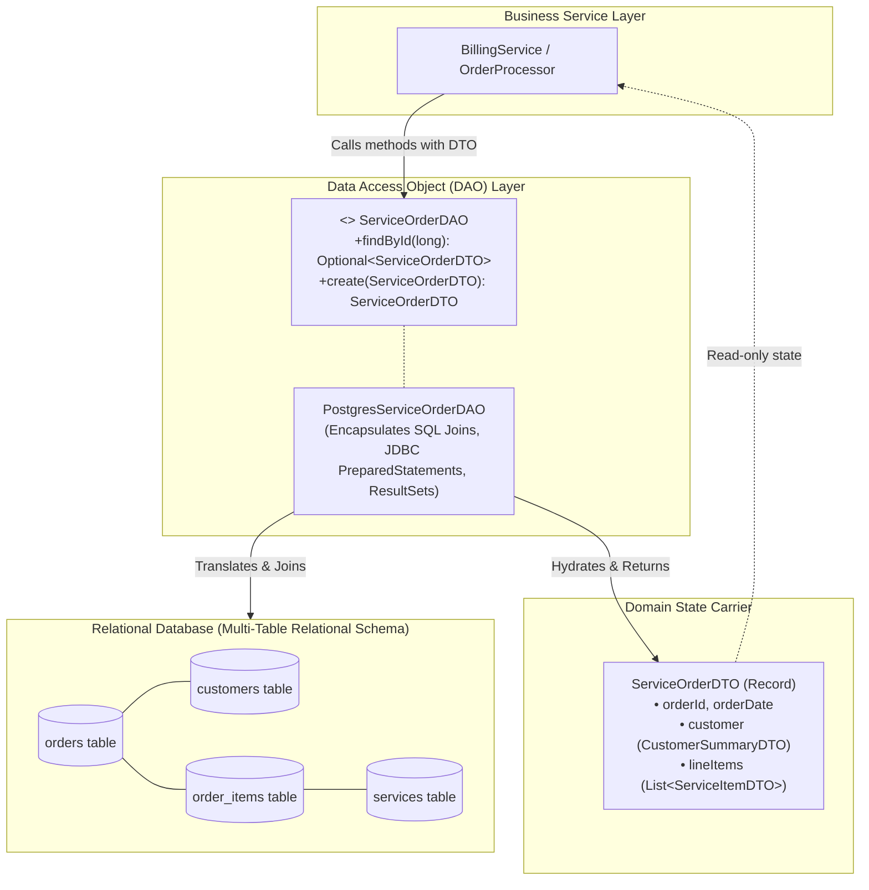

# The Data Access Object (DAO) Pattern: Architectural Abstraction, DTO Domain Boundaries & DAO vs. Repository

---

## Key Takeaways

The **Data Access Object (DAO)** pattern is a foundational enterprise architectural pattern (documented in Core J2EE Patterns) designed to decouple the low-level data persistence layer (JDBC, SQL dialects, connections, transactions) from the high-level business logic layer.

The DAO pattern pairs two primary components:

1. **The Data Access Object (DAO)**: A stateless behavioral component defining operations to create, read, update, and delete data. It handles all raw SQL, `PreparedStatement` binding, and JDBC resource lifecycles.
2. **The Data Transfer Object (DTO) / Domain Model**: A carrier object that encapsulates state passed into and returned from the DAO. A crucial architectural distinction is that a DTO does **not** map 1:1 to a single database table; instead, it encapsulates a cohesive **data domain**, often aggregating multiple joined tables and composite sub-objects into a single domain view.



- **Separation of Concerns (SoC)**: Business services contain zero SQL, driver imports, or JDBC handles; they interact solely with the high-level abstract interface of the DAO.
- **Domain Scope over Table Scope**: While the Repository pattern (from Domain-Driven Design) emphasizes collection-oriented aggregates around entities, a DAO maps to a **data domain** that can span arbitrary relational joins across multiple tables.
- **DTO Separation**: Keeping DTOs (data holders) and DAOs (stateless operations) separate upholds the Single Responsibility Principle. In modern Java, immutable **Records** serve as clean, boilerplate-free DTOs.
- **DAO Factory Pattern**: Reusable factory abstractions streamline repetitive CRUD operations across multiple DAOs, though specialized domain queries are added directly to specific DAO interface definitions.

---

## Main Discussion

### Architectural Blueprint: Defining the Domain DTO

A single domain operation often requires reading across the `orders`, `customers`, `order_items`, and `services` tables. Rather than leaking multiple raw tables into the service layer, we define an aggregated domain model composed of modern Java records:

```java
package com.rensaputra.lil.data.dto;

import java.math.BigDecimal;
import java.time.Instant;
import java.util.List;

// Child Sub-Objects
public record CustomerSummaryDTO(long customerId, String name, String email) {}

public record ServiceItemDTO(long itemId, long serviceId, String serviceName, int hours, BigDecimal rate) {
    public BigDecimal calculateSubtotal() {
        return rate.multiply(BigDecimal.valueOf(hours));
    }
}

// Parent Aggregate Domain DTO spanning multiple joined tables
public record ServiceOrderDTO(
    Long orderId,
    Instant orderDate,
    String status,
    CustomerSummaryDTO customer,
    List<ServiceItemDTO> lineItems,
    BigDecimal totalAmount
) {}
```

---

### Defining the Generic & Domain DAO Interfaces

Using a generic base interface standardizes fundamental lifecycle operations while allowing the domain-specific DAO interface to declare tailored queries:

```java
package com.rensaputra.lil.data.dao;

import java.util.List;
import java.util.Optional;

// Generic Base DAO Contract
public interface DataAccessObject<T, ID> {
    T create(T dto);
    Optional<T> findById(ID id);
    List<T> findAll();
    T update(T dto);
    boolean deleteById(ID id);
}
```

```java
package com.rensaputra.lil.data.dao;

import com.rensaputra.lil.data.dto.ServiceOrderDTO;
import java.util.List;

// Domain-Specific DAO Contract with specialized query methods
public interface ServiceOrderDAO extends DataAccessObject<ServiceOrderDTO, Long> {
    List<ServiceOrderDTO> findOrdersByCustomerId(long customerId);
    boolean updateOrderStatus(long orderId, String newStatus);
}
```

---

### Concrete Implementation: `PostgresServiceOrderDAO.java`

The concrete DAO encapsulates database connectivity, complex relational joins, `PreparedStatement` lifecycle management, and ResultSet hydration:

```java
package com.rensaputra.lil.data.dao;

import com.rensaputra.lil.data.dto.CustomerSummaryDTO;
import com.rensaputra.lil.data.dto.ServiceItemDTO;
import com.rensaputra.lil.data.dto.ServiceOrderDTO;
import com.rensaputra.lil.data.util.DatabaseUtils;

import java.math.BigDecimal;
import java.sql.Connection;
import java.sql.PreparedStatement;
import java.sql.ResultSet;
import java.sql.SQLException;
import java.sql.Timestamp;
import java.time.Instant;
import java.util.ArrayList;
import java.util.List;
import java.util.Objects;
import java.util.Optional;
import java.util.logging.Logger;

public class PostgresServiceOrderDAO implements ServiceOrderDAO {

    private static final Logger LOGGER = Logger.getLogger(PostgresServiceOrderDAO.class.getName());
    private final Connection connection;

    public PostgresServiceOrderDAO(Connection connection) {
        this.connection = Objects.requireNonNull(connection, "Connection cannot be null");
    }

    @Override
    public Optional<ServiceOrderDTO> findById(Long orderId) {
        // Multi-table JOIN query assembling the complete domain state in a single access path
        String querySql = """
            SELECT o.order_id, o.order_date, o.status, o.total_amount,
                   c.customer_id, c.name AS customer_name, c.email AS customer_email,
                   oi.item_id, oi.hours, oi.unit_rate,
                   s.service_id, s.service_name
            FROM wisdom.orders o
            JOIN wisdom.customers c ON o.customer_id = c.customer_id
            LEFT JOIN wisdom.order_items oi ON o.order_id = oi.order_id
            LEFT JOIN wisdom.services s ON oi.service_id = s.service_id
            WHERE o.order_id = ?
            ORDER BY oi.item_id ASC
            """;

        try (PreparedStatement stmt = connection.prepareStatement(querySql)) {
            stmt.setLong(1, orderId);

            try (ResultSet rs = stmt.executeQuery()) {
                if (!rs.next()) {
                    return Optional.empty();
                }

                // Hydrate parent order & customer details from the first row
                Instant orderDate = rs.getTimestamp("order_date").toInstant();
                String status = rs.getString("status");
                BigDecimal totalAmount = rs.getBigDecimal("total_amount");

                CustomerSummaryDTO customer = new CustomerSummaryDTO(
                    rs.getLong("customer_id"),
                    rs.getString("customer_name"),
                    rs.getString("customer_email")
                );

                List<ServiceItemDTO> items = new ArrayList<>();

                // Loop through rows to aggregate 1:N joined line items
                do {
                    long itemId = rs.getLong("item_id");
                    if (!rs.wasNull()) {
                        items.add(new ServiceItemDTO(
                            itemId,
                            rs.getLong("service_id"),
                            rs.getString("service_name"),
                            rs.getInt("hours"),
                            rs.getBigDecimal("unit_rate")
                        ));
                    }
                } while (rs.next());

                return Optional.of(new ServiceOrderDTO(orderId, orderDate, status, customer, items, totalAmount));
            }
        } catch (SQLException e) {
            DatabaseUtils.handleSQLException("PostgresServiceOrderDAO.findById", e, LOGGER);
            return Optional.empty();
        }
    }

    @Override
    public boolean updateOrderStatus(long orderId, String newStatus) {
        String updateSql = "UPDATE wisdom.orders SET status = ? WHERE order_id = ?";
        try (PreparedStatement stmt = connection.prepareStatement(updateSql)) {
            stmt.setString(1, newStatus);
            stmt.setLong(2, orderId);
            return stmt.executeUpdate() == 1;
        } catch (SQLException e) {
            DatabaseUtils.handleSQLException("PostgresServiceOrderDAO.updateOrderStatus", e, LOGGER);
            return false;
        }
    }

    @Override
    public ServiceOrderDTO create(ServiceOrderDTO dto) {
        throw new UnsupportedOperationException("Batch transactional creation demonstrated in Module 72");
    }

    @Override
    public List<ServiceOrderDTO> findAll() {
        throw new UnsupportedOperationException("Pagination queries demonstrated in Module 73");
    }

    @Override
    public ServiceOrderDTO update(ServiceOrderDTO dto) {
        throw new UnsupportedOperationException("Full update demonstrated in Module 72");
    }

    @Override
    public boolean deleteById(Long id) {
        String deleteSql = "DELETE FROM wisdom.orders WHERE order_id = ?";
        try (PreparedStatement stmt = connection.prepareStatement(deleteSql)) {
            stmt.setLong(1, id);
            return stmt.executeUpdate() > 0;
        } catch (SQLException e) {
            DatabaseUtils.handleSQLException("PostgresServiceOrderDAO.deleteById", e, LOGGER);
            return false;
        }
    }

    @Override
    public List<ServiceOrderDTO> findOrdersByCustomerId(long customerId) {
        throw new UnsupportedOperationException("Customer domain filtering demonstrated in Module 73");
    }
}
```

---

### Under the Hood / Architectural Comparison

```
   TRADITIONAL DAO PATTERN                         DOMAIN-DRIVEN REPOSITORY PATTERN
+---------------------------------------+       +---------------------------------------+
| Focus: Data-access operations / SQL   |       | Focus: In-memory collection illusion  |
| Scope: Multi-table joined data domain |       | Scope: Single Aggregate Root Entity   |
| API: Direct CRUD, custom joins, SQL   |       | API: Specification, Collection-like   |
| State: Stateless utility methods      |       | State: Tracks Aggregate Root entities |
+---------------------------------------+       +---------------------------------------+

```

1. **Isolation of Relational Dialects:**
   If the underlying schema undergoes restructuring (e.g., splitting a table, renaming columns, or migrating from PostgreSQL to Oracle), changes are confined entirely inside PostgresServiceOrderDAO. Business logic consuming ServiceOrderDTO remains untouched.
2. **1:N ResultSet Aggregation Algorithm:**
   When executing a multi-table SQL JOIN across a one-to-many relationship (one order to many items), the relational engine returns a Cartesian product table where parent order columns repeat on every row. The DAO's hydration loop normalizes this relational tabular stream into an object graph containing a single parent DTO with a nested `List<ServiceItemDTO>`.
3. **Connection Lifecycle Management:**
   The DAO does not instantiate or open connections directly; it receives an active Connection handle via its constructor (Dependency Injection). This allows external service layers or transaction managers to control transaction boundaries (commit() / rollback()) across multiple collaborating DAOs sharing the same physical connection.

---

### Structural Comparisons

#### DAO Pattern vs. Repository Pattern

| Characteristic          | Data Access Object (DAO)                                              | Repository Pattern                                          |
| ----------------------- | --------------------------------------------------------------------- | ----------------------------------------------------------- |
| **Origin / Context**    | J2EE Core Patterns (Data Tier)                                        | Domain-Driven Design (Eric Evans)                           |
| **Mental Model**        | Closer to the database engine and SQL operations                      | Emulates an in-memory collection of domain entities         |
| **Scope of Data**       | **Data Domain** (frequently spans multiple joined tables)             | **Aggregate Root** (strictly manages one root entity)       |
| **API Vocabulary**      | Database-centric (`insert`, `update`, `delete`, `query`)              | Collection-centric (`add`, `remove`, `find`, `get`)         |
| **Technology Coupling** | Explicitly aware of persistence tech (e.g., JDBC `PreparedStatement`) | Technology-agnostic abstraction; hides persistence entirely |

#### Combined DAO/DTO vs. Separated DAO & DTO

| Dimension                  | Combined ("Active Record" Style)                             | Separated DAO + DTO (Idiomatic Enterprise)             |
| -------------------------- | ------------------------------------------------------------ | ------------------------------------------------------ |
| **Class Responsibilities** | Holds entity state **and** contains `.save()` / `.delete()`  | DTO holds state; DAO executes operations               |
| **Single Responsibility**  | **Violated**: Mixes data transport with persistence I/O      | **Respected**: State modeling is decoupled from I/O    |
| **Testability**            | Harder to mock; testing data objects triggers database calls | Simple to mock; services accept dummy immutable DTOs   |
| **Thread Safety**          | Risky if active record instances are shared                  | High; immutable DTO records are inherently thread-safe |

---

### Common Anti-Patterns & Edge Cases

- **1:1 Table-to-DAO Fallacy**:
  Treating every individual relational table as requiring its own DAO. This forces business services to orchestrate and execute manual joins in application memory. DAOs should be designed around **data domains**, encapsulating multi-table joins internally.
- **Leaking JDBC Types Across the DAO Boundary**:
  Returning `ResultSet`, `SQLException`, or `PreparedStatement` from DAO public methods leaks persistence plumbing to the caller, defeating the abstraction. Always map rows into clean DTOs and rethrow standardized unchecked exceptions.
- **Stateful DAOs**:
  Storing query state, primary keys, or dirty tracking fields inside the DAO instance itself. DAOs should remain stateless operational service objects; all state belongs in the DTOs.
- **Opening and Closing Connections Inside Every DAO Method**:
  Instantiating a fresh `DriverManager.getConnection()` inside each method prevents multiple operations from sharing a single atomic ACID transaction. Pass the connection into the DAO constructor or fetch it from a shared transaction context.

---

## Knowledge Check & JetBrains-Style Coding Challenges

### Theory Tips

- **Pattern Definition**: The DAO pattern provides an abstraction layer between low-level persistence APIs (like JDBC) and the business layer.
- **DTO Scope**: A DTO represents a domain data structure and is not restricted to a single table; it commonly aggregates data across multiple joined tables.
- **Modern DTO Standard**: In modern Java, immutable `record` types are preferred for DTOs due to concise syntax, automatic constructor generation, accessors, `equals()`, and `hashCode()`.

### Question 1: Conceptual / Code Analysis

Consider the following service method:

```java
public class BillingCoordinator {
    public void processInvoice(long orderId) {
        try (Connection conn = DatabaseUtils.getConnection()) {
            ServiceOrderDAO orderDAO = new PostgresServiceOrderDAO(conn);
            Optional<ServiceOrderDTO> orderOpt = orderDAO.findById(orderId);

            if (orderOpt.isPresent()) {
                ServiceOrderDTO order = orderOpt.get();
                System.out.println("Customer: " + order.customer().name());
                System.out.println("Items count: " + order.lineItems().size());
            }
        } catch (SQLException e) {
            throw new RuntimeException(e);
        }
    }
}
```

Why does this implementation represent an idiomatic application of the DAO and DTO patterns?

- [ ] **A.** Because `BillingCoordinator` writes native SQL queries directly into the `Connection` handle.
- [ ] **B.** Because `BillingCoordinator` interacts only with the abstract `ServiceOrderDAO` and the aggregated `ServiceOrderDTO`, completely decoupled from database tables, column names, and SQL join logic.
- [ ] **C.** Because the `ServiceOrderDTO` executes its own `.save()` method to update the database.
- [ ] **D.** Because the DAO pattern requires all data to be stored inside an in-memory `ArrayList` rather than PostgreSQL.

<details>
<summary>Correct Answer</summary>
**Correct Answer**: **B**

**Technical Breakdown**:

- **B is correct**: The primary objective of the DAO pattern is separation of concerns. `BillingCoordinator` knows nothing about the underlying SQL syntax, table schemas (`wisdom.orders`, `wisdom.customers`), foreign keys, or JDBC result set cursor navigation. It requests a domain model by ID and receives an immutable `ServiceOrderDTO` containing the aggregated customer and line item data.
- **A is incorrect**: Writing native SQL in the service layer is a violation of the DAO pattern.
- **C is incorrect**: DTOs containing `.save()` methods represent the Active Record anti-pattern, not the separated DAO/DTO pattern.
- **D is incorrect**: DAOs bridge directly to persistent storage like PostgreSQL; they do not replace databases with collections.

</details>

---

### Question 2: Mini Coding Problem / Implementation Challenge

**Task**: Implement a complete DAO and DTO pair for managing consultable services inside package `com.rensaputra.lil.data`:

1. DTO Record `ServiceDTO`:
   - Fields: `Long serviceId`, `String serviceName`, `String description`, `BigDecimal hourlyRate`, `boolean active`.
2. Interface `ConsultingServiceDAO`:
   - Extends `DataAccessObject<ServiceDTO, Long>`.
   - Method `List<ServiceDTO> findActiveServices()`.
3. Concrete Class `PostgresConsultingServiceDAO`:
   - Implements `ConsultingServiceDAO`.
   - Accepts `Connection` in constructor.
   - Implements `findById(Long id)`:
     - Executes `SELECT service_id, service_name, description, hourly_rate, active FROM wisdom.services WHERE service_id = ?`.
   - Returns `Optional<ServiceDTO>`.
   - Implements `findActiveServices()`:
     - Executes `SELECT service_id, service_name, description, hourly_rate, active FROM wisdom.services WHERE active = TRUE ORDER BY hourly_rate DESC`.
     - Returns `List<ServiceDTO>`.

**Test Assertions**:

- `dao.findById(1L)` $\rightarrow$ Returns non-empty Optional with `serviceName = "Cloud Architecture Consulting"`.
- `dao.findById(9999L)` $\rightarrow$ Returns `Optional.empty()`.
- `dao.findActiveServices()` $\rightarrow$ Returns all seeded active services ordered from highest hourly rate to lowest.

<details>
<summary>Solution</summary>

```java
package com.rensaputra.lil.data.dto;

import java.math.BigDecimal;

public record ServiceDTO(
    Long serviceId,
    String serviceName,
    String description,
    BigDecimal hourlyRate,
    boolean active
) {}
```

```java
package com.rensaputra.lil.data.dao;

import com.rensaputra.lil.data.dto.ServiceDTO;
import java.util.List;

public interface ConsultingServiceDAO extends DataAccessObject<ServiceDTO, Long> {
    List<ServiceDTO> findActiveServices();
}
```

```java
package com.rensaputra.lil.data.dao;

import com.rensaputra.lil.data.dto.ServiceDTO;
import com.rensaputra.lil.data.util.DatabaseUtils;

import java.sql.Connection;
import java.sql.PreparedStatement;
import java.sql.ResultSet;
import java.sql.SQLException;
import java.util.ArrayList;
import java.util.List;
import java.util.Objects;
import java.util.Optional;
import java.util.logging.Logger;

public class PostgresConsultingServiceDAO implements ConsultingServiceDAO {

    private static final Logger LOGGER = Logger.getLogger(PostgresConsultingServiceDAO.class.getName());
    private final Connection connection;

    public PostgresConsultingServiceDAO(Connection connection) {
        this.connection = Objects.requireNonNull(connection, "Connection cannot be null");
    }

    @Override
    public Optional<ServiceDTO> findById(Long id) {
        String sql = """
            SELECT service_id, service_name, description, hourly_rate, active
            FROM wisdom.services
            WHERE service_id = ?
            """;

        try (PreparedStatement stmt = connection.prepareStatement(sql)) {
            stmt.setLong(1, id);
            try (ResultSet rs = stmt.executeQuery()) {
                if (rs.next()) {
                    return Optional.of(mapRowToDTO(rs));
                }
                return Optional.empty();
            }
        } catch (SQLException e) {
            DatabaseUtils.handleSQLException("PostgresConsultingServiceDAO.findById", e, LOGGER);
            return Optional.empty();
        }
    }

    @Override
    public List<ServiceDTO> findActiveServices() {
        String sql = """
            SELECT service_id, service_name, description, hourly_rate, active
            FROM wisdom.services
            WHERE active = TRUE
            ORDER BY hourly_rate DESC
            """;

        List<ServiceDTO> activeList = new ArrayList<>();
        try (PreparedStatement stmt = connection.prepareStatement(sql);
             ResultSet rs = stmt.executeQuery()) {

            while (rs.next()) {
                activeList.add(mapRowToDTO(rs));
            }
        } catch (SQLException e) {
            DatabaseUtils.handleSQLException("PostgresConsultingServiceDAO.findActiveServices", e, LOGGER);
        }
        return activeList;
    }

    private ServiceDTO mapRowToDTO(ResultSet rs) throws SQLException {
        return new ServiceDTO(
            rs.getLong("service_id"),
            rs.getString("service_name"),
            rs.getString("description"),
            rs.getBigDecimal("hourly_rate"),
            rs.getBoolean("active")
        );
    }

    // Skeletal default overrides for unused interface methods
    @Override public ServiceDTO create(ServiceDTO dto) { throw new UnsupportedOperationException(); }
    @Override public List<ServiceDTO> findAll() { return findActiveServices(); }
    @Override public ServiceDTO update(ServiceDTO dto) { throw new UnsupportedOperationException(); }
    @Override public boolean deleteById(Long id) { throw new UnsupportedOperationException(); }
}
```

**Complexity Analysis**:

- **Time Complexity**:
  - `findById`: $\mathcal{O}(\log B)$ point lookup against the `service_id` primary key B+Tree.
  - `findActiveServices`: $\mathcal{O}(N \log N)$ without an index on `hourly_rate`, or $\mathcal{O}(K)$ index scan where $K$ is the number of active services when indexed via `CREATE INDEX ON wisdom.services (hourly_rate DESC) WHERE active = TRUE`.
- **Space Complexity**: $\mathcal{O}(K)$ heap memory allocated for the collection of hydrated `ServiceDTO` records.

</details>

---
