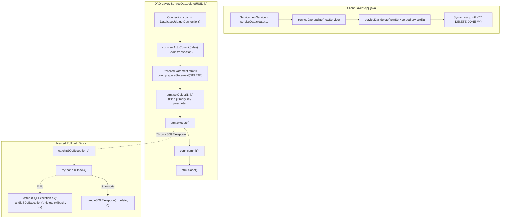

# Physical Deletion: Primary Key Targeting, Explicit Transaction Management & Full CRUD Lifecycle Completion

---

## Key Takeaways

Implementing the **Delete** operation completes the foundational CRUD lifecycle in the Data Access Object (DAO) pattern. In SQL, removing persistent tuples corresponds to the `DELETE FROM <relation> WHERE <predicate>` DML statement. Because an unqualified `DELETE` removes all records in a table, the query must explicitly isolate the target record using the primary key bind parameter (`WHERE service_id = ?`).

Executing deletions within an explicit transaction boundary (`connection.setAutoCommit(false)`) guarantees atomicity: the removal is written to the database transaction log, locking the tuple until `connection.commit()` persists the deletion and releases locks. If a failure occurs, the nested rollback catch block reverts uncommitted actions. Because the delete operation removes the entity created earlier in the workflow, running the application multiple times keeps the total table count stable, demonstrating the complete Create, Read, Update, and Delete lifecycle.



- **Targeting via Primary Key**: The query `DELETE FROM wisdom.services WHERE service_id = ?` ensures only the specific record matching the UUID is removed.
- **Atomic Transaction Demarcation**: Disabling auto-commit ensures the tuple's deletion is committed to the write-ahead log only when `conn.commit()` succeeds.
- **Nested Rollback Pattern**: Reuses the dual-catch structure to guarantee that connection failures during `conn.rollback()` do not swallow the primary `SQLException`.
- **Full CRUD Lifecycle**: Combining `getAll()`, `getOne()`, `create()`, `update()`, and `delete()` provides a complete, reusable DAO implementation for managing database entities.

---

## Main Discussion

### Step 1: Completing `ServiceDao.java` with the `delete` Implementation

Open `src/main/java/com/rensaputra/lil/data/dao/ServiceDao.java`. Define the static `DELETE` SQL constant and implement the `delete(UUID id)` method:

```java
package com.rensaputra.lil.data.dao;

import com.rensaputra.lil.data.entity.Service;
import com.rensaputra.lil.data.util.DatabaseUtils;

import java.math.BigDecimal;
import java.sql.Connection;
import java.sql.PreparedStatement;
import java.sql.ResultSet;
import java.sql.SQLException;
import java.sql.Statement;
import java.util.ArrayList;
import java.util.List;
import java.util.Optional;
import java.util.UUID;
import java.util.logging.Logger;

public class ServiceDao implements DAO<Service, UUID> {

    private static final Logger LOGGER = Logger.getLogger(ServiceDao.class.getName());

    // 1. Externalized SQL statements covering all CRUD operations
    private static final String GET_ALL = "SELECT service_id, name, price FROM wisdom.services";
    private static final String GET_BY_ID = "SELECT service_id, name, price FROM wisdom.services WHERE service_id = ?";
    private static final String CREATE = "INSERT INTO wisdom.services (service_id, name, price) VALUES (?, ?, ?)";
    private static final String UPDATE = "UPDATE wisdom.services SET name = ?, price = ? WHERE service_id = ?";
    private static final String DELETE = "DELETE FROM wisdom.services WHERE service_id = ?";

    private List<Service> processResultSet(ResultSet rs) throws SQLException {
        List<Service> services = new ArrayList<>();
        while (rs.next()) {
            Service service = new Service();
            service.setServiceId((UUID) rs.getObject("service_id"));
            service.setName(rs.getString("name"));
            service.setPrice(rs.getBigDecimal("price"));
            services.add(service);
        }
        return services;
    }

    @Override
    public List<Service> getAll() {
        List<Service> services = new ArrayList<>();
        Connection connection = DatabaseUtils.getConnection();

        try (Statement statement = connection.createStatement();
             ResultSet resultSet = statement.executeQuery(GET_ALL)) {

            services = this.processResultSet(resultSet);

        } catch (SQLException e) {
            DatabaseUtils.handleSQLException("ServiceDao.getAll", e, LOGGER);
        }

        return services;
    }

    @Override
    public Optional<Service> getOne(UUID id) {
        try (PreparedStatement statement = DatabaseUtils.getConnection().prepareStatement(GET_BY_ID)) {
            statement.setObject(1, id);

            try (ResultSet resultSet = statement.executeQuery()) {
                List<Service> services = this.processResultSet(resultSet);
                if (services.isEmpty()) {
                    return Optional.empty();
                }
                return Optional.of(services.get(0));
            }

        } catch (SQLException e) {
            DatabaseUtils.handleSQLException("ServiceDao.getOne", e, LOGGER);
            return Optional.empty();
        }
    }

    @Override
    public Service create(Service entity) {
        UUID serviceId = UUID.randomUUID();
        Connection connection = DatabaseUtils.getConnection();

        try {
            connection.setAutoCommit(false);

            PreparedStatement statement = connection.prepareStatement(CREATE);
            statement.setObject(1, serviceId);
            statement.setString(2, entity.getName());
            statement.setBigDecimal(3, entity.getPrice());

            statement.execute();
            connection.commit();
            statement.close();

        } catch (SQLException e) {
            try {
                connection.rollback();
            } catch (SQLException ex) {
                DatabaseUtils.handleSQLException("ServiceDao.create.rollback", ex, LOGGER);
            }
            DatabaseUtils.handleSQLException("ServiceDao.create", e, LOGGER);
        }

        Optional<Service> service = this.getOne(serviceId);
        if (service.isEmpty()) {
            return null;
        }

        return service.get();
    }

    @Override
    public Service update(Service entity) {
        Connection connection = DatabaseUtils.getConnection();

        try {
            connection.setAutoCommit(false);

            PreparedStatement statement = connection.prepareStatement(UPDATE);
            statement.setString(1, entity.getName());
            statement.setBigDecimal(2, entity.getPrice());
            statement.setObject(3, entity.getServiceId());

            statement.execute();
            connection.commit();
            statement.close();

        } catch (SQLException e) {
            try {
                connection.rollback();
            } catch (SQLException ex) {
                DatabaseUtils.handleSQLException("ServiceDao.update.rollback", ex, LOGGER);
            }
            DatabaseUtils.handleSQLException("ServiceDao.update", e, LOGGER);
        }

        return this.getOne(entity.getServiceId()).get();
    }

    /**
     * Deletes a service entity matching the provided UUID within a transaction.
     */
    @Override
    public void delete(UUID id) {
        Connection connection = DatabaseUtils.getConnection();

        try {
            // 2. Start transaction
            connection.setAutoCommit(false);

            // 3. Prepare statement and bind the UUID primary key
            PreparedStatement statement = connection.prepareStatement(DELETE);
            statement.setObject(1, id);

            // 4. Execute deletion and commit changes
            statement.execute();
            connection.commit();
            statement.close();

        } catch (SQLException e) {
            // 5. Nested rollback error handling
            try {
                connection.rollback();
            } catch (SQLException ex) {
                DatabaseUtils.handleSQLException("ServiceDao.delete.rollback", ex, LOGGER);
            }
            DatabaseUtils.handleSQLException("ServiceDao.delete", e, LOGGER);
        }
    }
}
```

---

### Step 2: Testing Full CRUD Execution via `App.java`

Update `src/main/java/com/rensaputra/lil/App.java` to invoke the entire CRUD lifecycle sequentially: `getAll()`, `getOne()`, `create()`, `update()`, and finally `delete()`:

```java
package com.rensaputra.lil;

import com.rensaputra.lil.data.dao.ServiceDao;
import com.rensaputra.lil.data.entity.Service;

import java.math.BigDecimal;
import java.util.List;
import java.util.Optional;

public class App {

    public static void main(String[] args) {
        ServiceDao serviceDao = new ServiceDao();

        // 1. READ ALL: Fetch existing table records
        List<Service> services = serviceDao.getAll();
        System.out.println("**** SERVICES ****");
        System.out.println("\n*** GET ALL ***");
        services.forEach(System.out::println);

        // 2. READ ONE: Fetch single instance by ID
        if (!services.isEmpty()) {
            Service firstService = services.get(0);
            Optional<Service> serviceOptional = serviceDao.getOne(firstService.getServiceId());
            System.out.println("\n*** GET ONE ***\n");
            serviceOptional.ifPresent(System.out::println);
        }

        // 3. CREATE: Construct and persist a new record
        Service newService = new Service();
        newService.setName("FooBarBaz" + System.currentTimeMillis());
        newService.setPrice(new BigDecimal("4.35"));

        newService = serviceDao.create(newService);
        System.out.println("\n*** CREATE ***\n");
        System.out.println(newService);

        // 4. UPDATE: Mutate price and persist changes
        newService.setPrice(new BigDecimal("13.45"));
        newService = serviceDao.update(newService);
        System.out.println("\n*** UPDATE ***\n");
        System.out.println(newService);

        // 5. DELETE: Remove the created entity by primary key
        serviceDao.delete(newService.getServiceId());
        System.out.println("\n*** DELETE ***");
        System.out.println("Delete is done.");
    }
}
```

---

### Step 3: Terminal Build & Verification

Compile and run the application from your terminal:

```bash
mvn compile exec:java -Dexec.mainClass="com.rensaputra.lil.App"
```

The output shows the created entity being updated and then deleted. Repeating the command confirms that the created record was removed, leaving the initial dataset count unchanged across runs:

```text
**** SERVICES ****

*** GET ALL ***
Service{serviceId=a1b2c3d4-e5f6-7a8b-9c0d-1e2f3a4b5c6d, name='Cloud Architecture Consulting', price=250.00}
Service{serviceId=b2c3d4e5-f6a7-8b9c-0d1e-2f3a4b5c6d7e, name='Database Tuning & Optimization', price=220.00}
Service{serviceId=c3d4e5f6-a7b8-9c0d-1e2f-3a4b5c6d7e8f, name='Full-Stack Java Modernization', price=195.00}
Service{serviceId=d4e5f6a7-b8c9-0d1e-2f3a-4b5c6d7e8f90, name='FooBarBaz1729143060123', price=4.35}
Service{serviceId=e5f6a7b8-c9d0-1e2f-3a4b-5c6d7e8f9012, name='FooBarBaz1729145200100', price=13.45}

*** GET ONE ***

Service{serviceId=a1b2c3d4-e5f6-7a8b-9c0d-1e2f3a4b5c6d, name='Cloud Architecture Consulting', price=250.00}

*** CREATE ***

Service{serviceId=99000000-1111-2222-3333-444455556666, name='FooBarBaz1729146000000', price=4.35}

*** UPDATE ***

Service{serviceId=99000000-1111-2222-3333-444455556666, name='FooBarBaz1729146000000', price=13.45}

*** DELETE ***
Delete is done.
```

---

### Under the Hood / JVM & PostgreSQL Wire Mechanics

```
   APPLICATION THREAD                              POSTGRESQL ENGINE (Backend Worker)
+------------------------------------+          +----------------------------------------+
| 1. setAutoCommit(false)            |--------->| Disables auto-commit mode              |
|                                    |          | Starts open transaction block          |
+------------------------------------+          +----------------------------------------+
                                                                     |
+------------------------------------+                               v
| 2. stmt.execute(DELETE)            |          +----------------------------------------+
|    - Passes bound UUID parameter   |--------->| Locates tuple via service_id index scan|
|    - Sends Execute message         |          | Sets t_xmax = current_tx_id            |
|                                    |          | Acquires RowExclusiveLock              |
+------------------------------------+          +----------------------------------------+
                                                                     |
+------------------------------------+                               v
| 3. conn.commit()                   |          +----------------------------------------+
|    - Issues Commit Command         |--------->| Writes commit record to WAL buffer     |
|                                    |          | Tuple marked dead for future VACUUM    |
+------------------------------------+          +----------------------------------------+

```

1. **MVCC Dead Tuple Marking (No Immediate Disk Erasure):**
   When PostgreSQL executes DELETE FROM wisdom.services WHERE service_id = ?, it does not wipe the physical disk bytes immediately. It sets the tuple header's t_xmax field to the current transaction ID. From that moment on, new snapshots consider the tuple non-existent.
2. **Index Pointer Retention:**
   The primary key B+Tree index entry remains pointing to the heap tuple until background cleanup occurs. When queries scan the index, they read the heap tuple header, determine that t_xmax is committed, and filter it out of query results.
3. **Space Reclamation via VACUUM:**
   Once all transactions that could view the row complete, the background autovacuum daemon scans heap pages. It removes the dead tuple, marks the space as reusable in the Free Space Map (FSM), and cleans up corresponding index leaves.
4. **Socket and Cursor Cleanup:**
   Calling statement.close() frees the statement handle and server-side cursor resources, while connection.commit() flushes the deletion record to disk logs (WAL).

---

### Structural Comparisons

#### Physical Delete vs. Logical (Soft) Delete

| Characteristic        | Physical Delete (`DELETE FROM ...`)                | Logical / Soft Delete (`UPDATE ... SET deleted = true`) |
| --------------------- | -------------------------------------------------- | ------------------------------------------------------- |
| **Storage Impact**    | Reclaims heap space after vacuuming                | Table grows continuously; dead rows remain active       |
| **Query Complexity**  | Simple: standard `SELECT` queries return live rows | Requires `WHERE deleted = false` on every query         |
| **Audit Trails**      | Historical data is permanently removed             | Historical records and references remain intact         |
| **Index Performance** | Maintains smaller, more compact B+Tree indexes     | Unfiltered indexes include inactive rows                |
| **Foreign Keys**      | Subject to `ON DELETE RESTRICT` or `CASCADE`       | Preserves referential integrity naturally               |

#### `statement.execute()` vs. `statement.executeUpdate()` for Deletes

| Aspect            | `statement.execute()`                                        | `statement.executeUpdate()`                                    |
| ----------------- | ------------------------------------------------------------ | -------------------------------------------------------------- |
| **Return Type**   | `boolean` (`true` for `ResultSet`, `false` for update count) | `int` (exact number of rows affected)                          |
| **Verification**  | Requires calling `statement.getUpdateCount()` to check rows  | Directly returns whether rows were modified (`rows > 0`)       |
| **Best Used For** | Dynamic SQL or procedures returning unknown results          | DML updates, deletes, and inserts where affected counts matter |

---

### Common Anti-Patterns & Edge Cases

- **Unbounded Deletions**:

  ```java
  // CRITICAL MISTAKE: Omitting WHERE deletes all rows in the table
  String sql = "DELETE FROM wisdom.services";
  ```

  Always ensure the query filters strictly on the primary key bind parameter (`WHERE service_id = ?`).

- **Foreign Key Violations (`23503`)**:
  Attempting to delete a record referenced by child tables configured with `ON DELETE RESTRICT` throws a `SQLException: foreign_key_violation`. Ensure child records are removed first or configure `ON DELETE CASCADE`.
- **Assuming Non-Existent Keys Throw Errors**:
  Executing `DELETE FROM wisdom.services WHERE service_id = ?` with a UUID that does not exist in the database completes normally without throwing an exception, reporting `0` rows affected.
- **Leaking Transaction State on Return**:
  Because auto-commit is set to `false`, failing to commit or roll back before returning a pooled connection can cause subsequent operations on that connection to execute inside an open transaction.

---

## Knowledge Check & JetBrains-Style Coding Challenges

### Theory Tips

- **Primary Key Filtering**: Always filter deletions using the unique identifier (`WHERE id = ?`) to avoid affecting unintended records.
- **PostgreSQL MVCC Deletions**: In PostgreSQL, `DELETE` statements do not erase bytes immediately; they update the tuple header's `t_xmax` attribute.
- **Idempotency**: Deleting by primary key is idempotent regarding final database state: the target entity is guaranteed absent whether executed once or repeatedly.

### Question 1: Conceptual / Code Analysis

Consider the following deletion method:

```java
public boolean deleteServiceSafely(UUID id) throws SQLException {
    Connection conn = DatabaseUtils.getConnection();
    String sql = "DELETE FROM wisdom.services WHERE service_id = ?";

    try (PreparedStatement stmt = conn.prepareStatement(sql)) {
        stmt.setObject(1, id);
        int rows = stmt.executeUpdate();
        return rows == 1;
    }
}
```

If `id` refers to an existing record, the method returns `true`. What occurs if the method is immediately called a second time with the exact same `id`?

- [ ] **A.** A `SQLException` is thrown indicating the tuple does not exist.
- [ ] **B.** The method executes successfully, `stmt.executeUpdate()` returns `0`, and the method returns `false`.
- [ ] **C.** PostgreSQL recreates the deleted row.
- [ ] **D.** The application deadlocks waiting for a table lock.

<details>
<summary>Correct Answer</summary>

**Correct Answer**: **B**

**Technical Breakdown**:

- **B is correct**: In SQL, executing `DELETE` against a primary key that does not exist is a valid operation. The query searches the B+Tree index, finds zero matching tuples, and deletes zero rows. `stmt.executeUpdate()` returns `0`, causing `rows == 1` to evaluate to `false`.
- **A is incorrect**: Relational databases do not throw exceptions when a `WHERE` condition matches zero rows.
- **C is incorrect**: `DELETE` statements cannot create or restore records.
- **D is incorrect**: Point deletions that match no rows release their scan lock immediately without deadlocking.

</details>

---

### Question 2: Implementation Challenge — Verified Deletion with Boolean Return

**Task**: Implement a verified deletion method named `deleteWithVerification` in `ServiceDao`:

1. Method signature:
   `public boolean deleteWithVerification(UUID id)`
2. Requirements:
   - Reject null parameters: throw `IllegalArgumentException` if `id` is null.
   - Obtain connection via `DatabaseUtils.getConnection()`.
   - Capture initial auto-commit setting via `boolean originalAutoCommit = conn.getAutoCommit()`.
   - Disable auto-commit (`conn.setAutoCommit(false)`).
   - Prepare statement within try-with-resources based on `DELETE`.
   - Bind index `1` to `id` using `stmt.setObject(1, id)`.
   - Execute via `int affected = stmt.executeUpdate()`.
   - If `affected == 1`:
     - Commit the transaction (`conn.commit()`).
     - Return `true`.
   - If `affected == 0`:
     - Roll back the transaction (`conn.rollback()`).
     - Return `false` (record did not exist).
   - In the `catch (SQLException e)` block:
     - Roll back inside a nested try-catch block.
     - Route error through `DatabaseUtils.handleSQLException("ServiceDao.deleteWithVerification", e, LOGGER)`.
     - Return `false`.
   - In a `finally` block, restore the original auto-commit status.

**Test Assertions**:

- Calling `deleteWithVerification(existingId)` $\rightarrow$ Returns `true`, removes row from database.
- Calling `deleteWithVerification(existingId)` a second time $\rightarrow$ Returns `false` (row was already removed).
- Calling `deleteWithVerification(null)` $\rightarrow$ Throws `IllegalArgumentException`.

<details>
<summary>Solution</summary>

```java
// Method implementation to add inside ServiceDao.java:

public boolean deleteWithVerification(UUID id) {
    if (id == null) {
        throw new IllegalArgumentException("Service ID cannot be null.");
    }

    Connection connection = DatabaseUtils.getConnection();
    boolean originalAutoCommit = true;

    try {
        originalAutoCommit = connection.getAutoCommit();
        connection.setAutoCommit(false);

        try (PreparedStatement statement = connection.prepareStatement(DELETE)) {
            statement.setObject(1, id);
            int affectedRows = statement.executeUpdate();

            if (affectedRows == 1) {
                connection.commit();
                return true;
            } else {
                connection.rollback();
                return false;
            }
        }

    } catch (SQLException e) {
        try {
            connection.rollback();
        } catch (SQLException ex) {
            DatabaseUtils.handleSQLException("ServiceDao.deleteWithVerification.rollback", ex, LOGGER);
        }
        DatabaseUtils.handleSQLException("ServiceDao.deleteWithVerification", e, LOGGER);
        return false;

    } finally {
        try {
            connection.setAutoCommit(originalAutoCommit);
        } catch (SQLException ex) {
            LOGGER.warning("Failed to restore connection auto-commit state: " + ex.getMessage());
        }
    }
}
```

**Complexity Analysis**:

- **Time Complexity**: $\mathcal{O}(\log B)$ point index lookup on `wisdom.services(service_id)`, followed by marking the tuple's `t_xmax` and appending a delete record to the Write-Ahead Log.
- **Space Complexity**: $\mathcal{O}(1)$ auxiliary memory allocated for statement handles and parameter buffers on the JVM heap.

</details>

---
