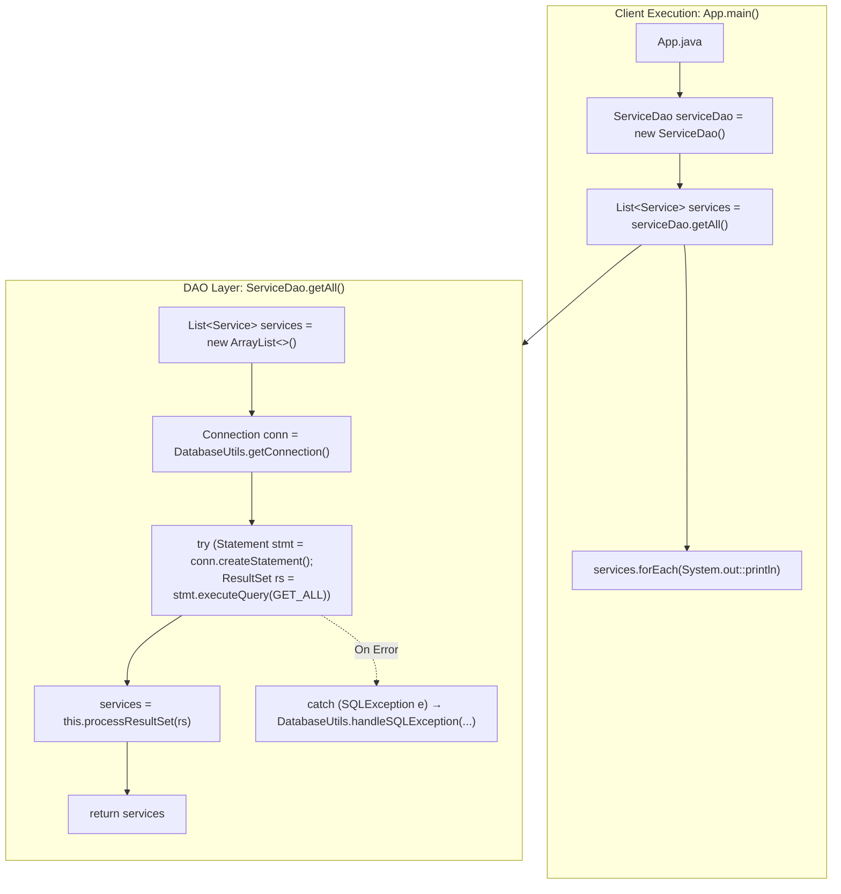

# Full Dataset Retrieval: Static SQL Externalization, Try-with-Resources Statements & Clean DAO Consumption

---

## Key Takeaways

Implementing a complete read operation across a relational table requires externalizing SQL statements as `private static final String` constants at the class level. This keeps SQL syntax decoupled from Java procedural flow, simplifies query maintenance, and enhances readability. In the `getAll()` method, returning an initialized empty collection (such as `new ArrayList<>()`) guarantees callers never encounter a `NullPointerException`.

Using `Statement.executeQuery()` inside a **try-with-resources** block guarantees that JDBC resources (`Statement` and `ResultSet`) close deterministically, preventing server-side cursor leaks. The raw `ResultSet` is then passed directly into the centralized `processResultSet(rs)` helper method built in Module 72, hydrating our list of `Service` entities.



- **Static SQL Externalization**: Declare query strings as `private static final String GET_ALL` at the top of the DAO class. This separates SQL maintenance from Java control logic.
- **Explicit Projection over Wildcards**: Never use `SELECT *` in production code. Project exact column names (`SELECT service_id, name, price FROM wisdom.services`) to insulate entity hydration from schema changes or column reordering.
- **Null-Object Contract**: Always return an empty list (`new ArrayList<>()` or `Collections.emptyList()`) rather than `null` on queries that yield no records or encounter handled errors.
- **Automated Cursor Cleanup**: Managing `Statement` and `ResultSet` within try-with-resources handles socket packet draining and closes cursors on the PostgreSQL server, even when queries fail mid-stream.
- **Centralized Error Delegation**: Catch `SQLException` and route diagnostics through `DatabaseUtils.handleSQLException("ServiceDao.getAll", e, logger)` to log the method name, message, and vendor code before re-throwing an unchecked `RuntimeException`.

---

## Main Discussion

### Step 1: Updating `ServiceDao.java` with `getAll()` Implementation

Open `src/main/java/com/rensaputra/lil/data/dao/ServiceDao.java`. Add the static logger, externalized query constant, and implement the complete `getAll()` method:

```java
package com.rensaputra.lil.data.dao;

import com.rensaputra.lil.data.entity.Service;
import com.rensaputra.lil.data.util.DatabaseUtils;

import java.math.BigDecimal;
import java.sql.Connection;
import java.sql.ResultSet;
import java.sql.SQLException;
import java.sql.Statement;
import java.util.ArrayList;
import java.util.List;
import java.util.Optional;
import java.util.UUID;
import java.util.logging.Logger;

public class ServiceDao implements DAO<Service, UUID> {

    // 1. Logger configured for the ServiceDao class
    private static final Logger LOGGER = Logger.getLogger(ServiceDao.class.getName());

    // 2. Externalized SQL constant with explicit column projections
    private static final String GET_ALL = "SELECT service_id, name, price FROM wisdom.services";

    // 3. Centralized hydration helper implemented in Module 72
    private List<Service> processResultSet(ResultSet rs) throws SQLException {
        List<Service> services = new ArrayList<>();
        while (rs.next()) {
            Service service = new Service();
            service.setServiceId((UUID) rs.getObject("service_id"));
            service.setName(rs.getString("name"));
            service.setPrice(rs.getBigDecimal("price"));
            services.add(service);
        }
        return services;
    }

    /**
     * Retrieves all service records from the database.
     * Guaranteed to return a non-null List.
     */
    @Override
    public List<Service> getAll() {
        // Defensive non-null default list pattern
        List<Service> services = new ArrayList<>();

        // Obtain shared connection handle from singleton utility
        Connection connection = DatabaseUtils.getConnection();

        // 4. Try-with-resources managing Statement and ResultSet lifecycles
        try (Statement statement = connection.createStatement();
             ResultSet resultSet = statement.executeQuery(GET_ALL)) {

            // Hydrate domain entities using centralized processor
            services = this.processResultSet(resultSet);

        } catch (SQLException e) {
            // Centralized error routing: logs and rethrows unchecked exception
            DatabaseUtils.handleSQLException("ServiceDao.getAll", e, LOGGER);
        }

        return services;
    }

    // Unimplemented DAO contract methods reserved for subsequent modules
    @Override public Service create(Service entity) { throw new UnsupportedOperationException(); }
    @Override public Optional<Service> getOne(UUID id) { throw new UnsupportedOperationException(); }
    @Override public Service update(Service entity) { throw new UnsupportedOperationException(); }
    @Override public void delete(UUID id) { throw new UnsupportedOperationException(); }
}
```

---

### Step 2: Testing Full Retrieval via `App.java`

Open `src/main/java/com/rensaputra/lil/App.java`, strip out the boilerplate archetype code, and execute the full data read workflow:

```java
package com.rensaputra.lil;

import com.rensaputra.lil.data.dao.ServiceDao;
import com.rensaputra.lil.data.entity.Service;

import java.util.List;

public class App {

    public static void main(String[] args) {
        // 1. Instantiate the DAO
        ServiceDao serviceDao = new ServiceDao();

        // 2. Query all records through the DAO boundary
        List<Service> services = serviceDao.getAll();

        // 3. Formatted diagnostic output
        System.out.println("**** SERVICES ****");
        System.out.println("\n*** GET ALL ***");

        // 4. Iterate and print each entity using method reference
        services.forEach(System.out::println);
    }
}
```

---

### Step 3: Terminal Build & Execution Output

From your project root directory inside GitHub Codespaces or your local terminal, compile and run the application:

```bash
mvn compile exec:java -Dexec.mainClass="com.rensaputra.lil.App"
```

The terminal executes the database connection, streams the records, and renders the entities via `Service.toString()`:

```text
**** SERVICES ****

*** GET ALL ***
Service{serviceId=a1b2c3d4-e5f6-7a8b-9c0d-1e2f3a4b5c6d, name='Cloud Architecture Consulting', price=250.00}
Service{serviceId=b2c3d4e5-f6a7-8b9c-0d1e-2f3a4b5c6d7e, name='Database Tuning & Optimization', price=220.00}
Service{serviceId=c3d4e5f6-a7b8-9c0d-1e2f-3a4b5c6d7e8f, name='Full-Stack Java Modernization', price=195.00}
```

---

### Under the Hood / JVM & PostgreSQL Wire Mechanics

```
   APP HEAP (main thread)                        POSTGRESQL SERVER (Backend Process)
+-------------------------------+              +-------------------------------------+
| executeQuery(GET_ALL)         |------------->| Parse & Plan 'GET_ALL' query        |
| - Sends Execute command       |              | - Opens portal / cursor             |
+-------------------------------+              +-------------------------------------+
                                                                  |
                                                                  v
+-------------------------------+              +-------------------------------------+
| ResultSet rs reads DataRows   |<-------------| Streams DataRow tuples across socket|
| - rs.next() parses buffer     |              | - Column meta: UUID, text, numeric  |
+-------------------------------+              +-------------------------------------+
                                                                  |
                                                                  v
+-------------------------------+              +-------------------------------------+
| try-with-resources closes stmt|------------->| Close Statement / Sync command      |
| - Discards local buffer       |              | - Server drops portal & locks       |
+-------------------------------+              +-------------------------------------+
```

1. **Query Transmission over Frontend/Backend Protocol:**
   When statement.executeQuery(GET_ALL) runs, the PostgreSQL driver issues a 'Q' (Query) message across the established TCP connection. The PostgreSQL backend process parses the SQL string, compiles an access plan, and opens a portal cursor over the wisdom.services relation.
2. **Client-Side Socket Buffering:**
   PostgreSQL streams back RowDescription metadata (column OIDs, length limits) followed by sequential DataRow packets. The driver packages this stream into an instance of PgResultSet on the JVM heap.
3. **Row Parsing & Object Allocation:**
   During processResultSet(), invoking rs.next() reads the row bytes. rs.getObject("service_id") decodes the 16-byte binary payload into a java.util.UUID, while rs.getBigDecimal("price") converts the numeric string into an immutable BigDecimal instance.
4. **Deterministic Resource Draining (AutoCloseable):**
   Upon exiting the try block, the generated bytecode calls close() on both the ResultSet and Statement. The driver sends a 'C' (Close) message to PostgreSQL to release the portal on the server and invalidates the local cursor, preventing resource leaks.

---

### Structural Comparisons

#### Static SQL Constants vs. Inline SQL Strings

| Attribute               | Static Constant (`private static final String`)           | Inline String Literal (Inside method)           |
| ----------------------- | --------------------------------------------------------- | ----------------------------------------------- |
| **Maintainability**     | All queries are cataloged at the top of the file          | Queries are scattered across procedural methods |
| **Reusability**         | Can be referenced by companion count or paging queries    | Must be duplicated if needed elsewhere          |
| **Memory Footprint**    | Interned once in the class Constant Pool                  | Re-referenced inside method bytecode blocks     |
| **Code Review Quality** | Schema changes require reviewing only top-level constants | Reviewers must scan deeply nested logic         |

#### `Statement` vs. `PreparedStatement` for Static Queries

| Metric                    | `Statement.createStatement()`                               | `PreparedStatement.prepareStatement()`                     |
| ------------------------- | ----------------------------------------------------------- | ---------------------------------------------------------- |
| **SQL Parameters**        | None (used for static, unparameterized queries)             | Supported (parameterized via `?` bind markers)             |
| **Database Plan Caching** | Prepared on each ad-hoc execution (unless cached by server) | Server pre-compiles and caches execution plan              |
| **Injection Risk**        | Vulnerable if strings are concatenated                      | Completely immune to SQL injection                         |
| **Best Used For**         | Static catalog reads with no user input (`getAll()`)        | Filtered, dynamic, or parameterized queries (`getOne(id)`) |

---

### Common Anti-Patterns & Edge Cases

- **Wildcard Projections (`SELECT *`)**:

  ```java
  // ANTI-PATTERN: Brittle projection
  private static final String GET_ALL = "SELECT * FROM wisdom.services";
  ```

  If a developer alters the table schema (e.g., reordering columns, adding high-overhead binary columns like `BYTEA`, or renaming fields), positional and name-based hydration logic can fail or suffer unexpected memory bloat. Explicitly project required fields.

- **Returning `null` on Empty Sets**:
  Returning `null` from `getAll()` when a table contains 0 records forces callers to litter their code with null checks (`if (services != null)`). Always initialize and return an empty collection.
- **Leaking Connections in `getAll()`**:
  Calling `connection.close()`inside`getAll()`when using the`DatabaseUtils` connection singleton closes the socket for all subsequent queries. Utility-managed singletons or pool handles should only close their statements and result sets locally; the connection itself remains managed by the infrastructure layer.

---

## Knowledge Check & JetBrains-Style Coding Challenges

### Theory Tips

- **Defensive Collections**: Query methods returning collections must return an empty list rather than `null` when no data matches.
- **Method Chaining on ResultSets**: Method calls like `statement.executeQuery(SQL)` return a new `ResultSet` instance; wrapping both the `Statement` and `ResultSet` within the same try-with-resources statement ensures proper, nested closing order.
- **Safe Output Iteration**: Java 8's `forEach(System.out::println)` provides a clean, thread-safe consumer for printing entity collections.

### Question 1: Conceptual / Code Analysis

Consider the following refactoring of the `getAll` method:

```java
public List<Service> getAllBroken() {
    List<Service> services;
    try {
        Connection conn = DatabaseUtils.getConnection();
        Statement stmt = conn.createStatement();
        ResultSet rs = stmt.executeQuery("SELECT service_id, name, price FROM wisdom.services");
        services = this.processResultSet(rs);
    } catch (SQLException e) {
        return null; // Line 9
    }
    return services;
}
```

What two major anti-patterns or bugs are introduced in this refactored code?

- [ ] **A.** Line 9 returns `null` on failure (violating the non-null collection contract), and `stmt` and `rs` are never closed (causing server-side cursor and memory leaks).
- [ ] **B.** `DatabaseUtils.getConnection()` cannot be called inside a method body.
- [ ] **C.** PostgreSQL forbids running `SELECT` queries without an explicit `WHERE` clause.
- [ ] **D.** `processResultSet` throws a compile-time error if called with an open `ResultSet`.

<details>
<summary>Correct Answer</summary>

**Correct Answer**: **A**

**Technical Breakdown**:

- **A is correct**:
  1. **Resource Leak**: `Statement stmt` and `ResultSet rs` are opened without a try-with-resources block or a `finally` block calling `.close()`. Over time, unclosed statements exhaust database cursor limits and leak JVM socket buffers.
  2. **Null-Return Anti-Pattern**: Line 9 catches `SQLException` and returns `null`. Any downstream caller invoking `services.size()` or iterating with `services.forEach(...)` will immediately crash with a `NullPointerException`.
- **B is incorrect**: Calling static factory methods inside method bodies is standard Java practice.
- **C is incorrect**: `SELECT` statements without `WHERE` clauses are valid ANSI SQL statements that return the entire relation.
- **D is incorrect**: `processResultSet` expects an open `ResultSet` to advance its cursor.

</details>

---

### Question 2: Implementation Challenge — Filtered Range Retrieval

**Task**: Extend `ServiceDao` to implement a custom retrieval method named `getByPriceRange` inside `com.rensaputra.lil.data.dao.ServiceDao`:

1. Method signature:
   `public List<Service> getByPriceRange(BigDecimal minPrice, BigDecimal maxPrice)`
2. Requirements:
   - Externalize SQL as a class constant:

   ```java
   private static final String GET_BY_PRICE =
       "SELECT service_id, name, price FROM wisdom.services WHERE price >= ? AND price <= ? ORDER BY price ASC";

   ```

   - Throw an `IllegalArgumentException` if `minPrice` or `maxPrice` is null, or if `minPrice.compareTo(maxPrice) > 0`.
   - Initialize a default empty `List<Service>`.
   - Acquire connection from `DatabaseUtils.getConnection()`.
   - Open `PreparedStatement` and bind the two `BigDecimal` boundaries via `stmt.setBigDecimal(...)`.
   - Execute query and hydrate results using the existing `this.processResultSet(rs)`.
   - Wrap execution in try-with-resources; route any `SQLException` through `DatabaseUtils.handleSQLException`.
   - Return the populated list (guaranteed non-null).

**Test Assertions**:

- `getByPriceRange(new BigDecimal("200.00"), new BigDecimal("300.00"))` $\rightarrow$ Returns a 2-element list containing `"Database Tuning & Optimization"` ($220.00) and `"Cloud Architecture Consulting"` ($250.00).
- `getByPriceRange(new BigDecimal("500.00"), new BigDecimal("600.00"))` $\rightarrow$ Returns an empty list (`[]`).
- `getByPriceRange(new BigDecimal("300.00"), new BigDecimal("100.00"))` $\rightarrow$ Throws `IllegalArgumentException`.

<details>
<summary>Solution</summary>

```java
// Method implementation to add inside ServiceDao.java:

private static final String GET_BY_PRICE =
    "SELECT service_id, name, price FROM wisdom.services WHERE price >= ? AND price <= ? ORDER BY price ASC";

public List<Service> getByPriceRange(BigDecimal minPrice, BigDecimal maxPrice) {
    if (minPrice == null || maxPrice == null) {
        throw new IllegalArgumentException("Price range boundaries cannot be null.");
    }
    if (minPrice.compareTo(maxPrice) > 0) {
        throw new IllegalArgumentException("Minimum price cannot exceed maximum price.");
    }

    List<Service> services = new ArrayList<>();
    Connection connection = DatabaseUtils.getConnection();

    try (PreparedStatement statement = connection.prepareStatement(GET_BY_PRICE)) {
        statement.setBigDecimal(1, minPrice);
        statement.setBigDecimal(2, maxPrice);

        try (ResultSet resultSet = statement.executeQuery()) {
            services = this.processResultSet(resultSet);
        }
    } catch (SQLException e) {
        DatabaseUtils.handleSQLException("ServiceDao.getByPriceRange", e, LOGGER);
    }

    return services;
}
```

**Complexity Analysis**:

- **Time Complexity**: $\mathcal{O}(K)$ where $K$ is the number of matching records in the price boundary. Without a B+Tree index on `price`, PostgreSQL performs a sequential scan ($\mathcal{O}(N)$).
- **Space Complexity**: $\mathcal{O}(K)$ auxiliary memory allocated on the heap to store the returned `Service` instances in the `ArrayList`.

</details>

---
