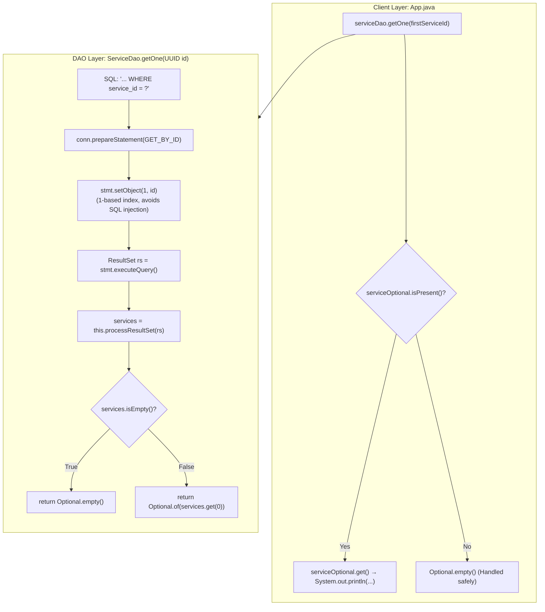

# Parameterized Queries: `PreparedStatement`, Positional Binding & `Optional` Hydration Mechanics

---

## Key Takeaways

Querying specific instance data requires passing dynamic parameters into SQL statements without opening security vulnerabilities. In JDBC, this is achieved using **`PreparedStatement`** and positional parameter markers (`?`). Unlike standard `Statement`, a `PreparedStatement` pre-compiles the SQL template on the database engine, separating the query structure from the runtime data and eliminating **SQL Injection** risks entirely.

When binding values to a `PreparedStatement`, JDBC uses a **1-based index**—the first `?` placeholder is index `1`, not `0`. For non-standard or vendor-specific types like PostgreSQL's native `UUID`, values are bound via `stmt.setObject(1, id)`. When returning a single entity by its primary key, the DAO method should return `java.util.Optional<T>` to explicitly model the possibility that no matching record exists in the database.



- **Dynamic Data Binding via `?`**: Placeholders (`?`) instruct the database driver where bind variables will be supplied. Never concatenate user input directly into SQL strings.
- **1-Based Indexing**: All parameter setters (`setString`, `setLong`, `setObject`) begin at index **`1`**. Supplying index `0` triggers a `SQLException: Parameter index out of range`.
- **UUID Binding with `setObject()`**: The PostgreSQL JDBC driver transparently handles `java.util.UUID`instances passed through`stmt.setObject(index, uuid)`, mapping them to PostgreSQL's native 16-byte `UUID` data type.
- **Safe Single-Record Handling**: Delegating to `processResultSet(rs)` guarantees consistency across the DAO. If the query finds a match, the list contains exactly one element at index `0`; if not, the list is empty, yielding `Optional.empty()`.
- **Expressive API Contracts**: Using `Optional<Service>` as the return type forces callers to handle the missing-record scenario explicitly, avoiding unchecked `NullPointerException` failures.

---

## Main Discussion

### Step 1: Updating `ServiceDao.java` with `getOne(UUID id)`

Open `src/main/java/com/rensaputra/lil/data/dao/ServiceDao.java`. Define the externalized `GET_BY_ID` query constant and implement the `getOne(UUID id)` contract method:

```java
package com.rensaputra.lil.data.dao;

import com.rensaputra.lil.data.entity.Service;
import com.rensaputra.lil.data.util.DatabaseUtils;

import java.math.BigDecimal;
import java.sql.Connection;
import java.sql.PreparedStatement;
import java.sql.ResultSet;
import java.sql.SQLException;
import java.sql.Statement;
import java.util.ArrayList;
import java.util.List;
import java.util.Optional;
import java.util.UUID;
import java.util.logging.Logger;

public class ServiceDao implements DAO<Service, UUID> {

    private static final Logger LOGGER = Logger.getLogger(ServiceDao.class.getName());

    // 1. Externalized SQL statements
    private static final String GET_ALL = "SELECT service_id, name, price FROM wisdom.services";
    private static final String GET_BY_ID = "SELECT service_id, name, price FROM wisdom.services WHERE service_id = ?";

    private List<Service> processResultSet(ResultSet rs) throws SQLException {
        List<Service> services = new ArrayList<>();
        while (rs.next()) {
            Service service = new Service();
            service.setServiceId((UUID) rs.getObject("service_id"));
            service.setName(rs.getString("name"));
            service.setPrice(rs.getBigDecimal("price"));
            services.add(service);
        }
        return services;
    }

    @Override
    public List<Service> getAll() {
        List<Service> services = new ArrayList<>();
        Connection connection = DatabaseUtils.getConnection();

        try (Statement statement = connection.createStatement();
             ResultSet resultSet = statement.executeQuery(GET_ALL)) {

            services = this.processResultSet(resultSet);

        } catch (SQLException e) {
            DatabaseUtils.handleSQLException("ServiceDao.getAll", e, LOGGER);
        }

        return services;
    }

    /**
     * Retrieves a single service record by its primary key UUID.
     * Uses PreparedStatement with safe positional parameter binding.
     */
    @Override
    public Optional<Service> getOne(UUID id) {
        // Fluent single-line connection acquisition and PreparedStatement creation
        try (PreparedStatement statement = DatabaseUtils.getConnection().prepareStatement(GET_BY_ID)) {

            // 2. Bind parameter: 1-based index (index 1 maps to the first '?')
            statement.setObject(1, id);

            // 3. Execute query and hydrate using the centralized processor
            try (ResultSet resultSet = statement.executeQuery()) {
                List<Service> services = this.processResultSet(resultSet);

                // 4. Evaluate presence and wrap inside Optional
                if (services.isEmpty()) {
                    return Optional.empty();
                }
                return Optional.of(services.get(0));
            }

        } catch (SQLException e) {
            DatabaseUtils.handleSQLException("ServiceDao.getOne", e, LOGGER);
            return Optional.empty();
        }
    }

    // Reserved for upcoming modules
    @Override public Service create(Service entity) { throw new UnsupportedOperationException(); }
    @Override public Service update(Service entity) { throw new UnsupportedOperationException(); }
    @Override public void delete(UUID id) { throw new UnsupportedOperationException(); }
}
```

---

### Step 2: Testing Single-Instance Retrieval via `App.java`

Update `src/main/java/com/rensaputra/lil/App.java` to fetch all services, extract the ID of the first service, and query for that specific instance using `getOne`:

```java
package com.rensaputra.lil;

import com.rensaputra.lil.data.dao.ServiceDao;
import com.rensaputra.lil.data.entity.Service;

import java.util.List;
import java.util.Optional;

public class App {

    public static void main(String[] args) {
        ServiceDao serviceDao = new ServiceDao();

        // 1. Fetch all records to inspect the table
        List<Service> services = serviceDao.getAll();
        System.out.println("**** SERVICES ****");
        System.out.println("\n*** GET ALL ***");
        services.forEach(System.out::println);

        // 2. Fetch single instance using ID from the first element
        if (!services.isEmpty()) {
            Service firstService = services.get(0);
            Optional<Service> serviceOptional = serviceDao.getOne(firstService.getServiceId());

            System.out.println("\n*** GET ONE ***\n");
            serviceOptional.ifPresent(System.out::println);
        }
    }
}
```

---

### Step 3: Terminal Build & Verification

Compile and run the updated application from your terminal:

```bash
mvn compile exec:java -Dexec.mainClass="com.rensaputra.lil.App"
```

The terminal prints the complete listing followed by the individual instance retrieved via parameterized query:

```text
**** SERVICES ****

*** GET ALL ***
Service{serviceId=a1b2c3d4-e5f6-7a8b-9c0d-1e2f3a4b5c6d, name='Cloud Architecture Consulting', price=250.00}
Service{serviceId=b2c3d4e5-f6a7-8b9c-0d1e-2f3a4b5c6d7e, name='Database Tuning & Optimization', price=220.00}
Service{serviceId=c3d4e5f6-a7b8-9c0d-1e2f-3a4b5c6d7e8f, name='Full-Stack Java Modernization', price=195.00}

*** GET ONE ***

Service{serviceId=a1b2c3d4-e5f6-7a8b-9c0d-1e2f3a4b5c6d, name='Cloud Architecture Consulting', price=250.00}
```

---

### Under the Hood / JVM & PostgreSQL Wire Mechanics

```
   APPLICATION (JVM)                             POSTGRESQL ENGINE (Backend Worker)
+------------------------------------+        +----------------------------------------+
| 1. prepareStatement(GET_BY_ID)     |------->| Parse Command ('P')                    |
|    - Sends SQL template over wire  |        | - Constructs Query AST                 |
|    - Caches statement handle       |        | - Creates plan: Index Scan on PK       |
+------------------------------------+        +----------------------------------------+
                                                                   |
+------------------------------------+                             v
| 2. stmt.setObject(1, id)           |        +----------------------------------------+
|    stmt.executeQuery()             |------->| Bind ('B') & Execute ('E') Commands    |
|    - Sends 16 raw UUID bytes       |        | - Binds parameter to execution plan    |
|    - No SQL parsing occurs!        |        | - Traverses B+Tree index (service_id)  |
+------------------------------------+        +----------------------------------------+
                                                                   |
                                                                   v
+------------------------------------+        +----------------------------------------+
| 3. Reads DataRow & hydrates entity |<-------| Returns matching DataRow tuple         |
+------------------------------------+        +----------------------------------------+
```

1. **Server-Side SQL Pre-Compilation (Extended Query Protocol):**
   When connection.prepareStatement(sql) is called, the PostgreSQL JDBC driver issues a Parse message to the server over the Frontend/Backend Protocol. The PostgreSQL server validates the SQL grammar, resolves column references, and compiles an execution plan with parameter slots marked as open types.
2. **Binary Parameter Binding (Bind Protocol):**
   Calling stmt.setObject(1, id) does not manipulate the query string in Java memory. Instead, when executeQuery() is invoked, the driver sends a Bind message containing the raw, serialized binary bytes of the UUID alongside the compiled statement identifier. Because SQL commands and data payloads travel in separate protocol frames, malicious inputs (e.g., ' OR 1=1 --) are treated strictly as literal data values, preventing SQL injection.
3. **B+Tree Index Scan Execution:**
   The database executes the prepared plan using an Index Scan against the primary key B+Tree on wisdom.services(service_id). It traverses tree pages in $\mathcal{O}(\log B)$ page reads to find the exact tuple without scanning unrelated rows.
4. **Optional Container Allocation:**
   If the tuple is found, Optional.of(services.get(0)) wraps the heap reference in a lightweight, immutable value-based container. If the query returns zero rows, Optional.empty() returns the shared static singleton empty instance without allocating unnecessary heap objects.

---

### Structural Comparisons

#### `Statement` vs. `PreparedStatement`

| Architectural Dimension     | Standard `Statement`                           | Parameterized `PreparedStatement`                       |
| --------------------------- | ---------------------------------------------- | ------------------------------------------------------- |
| **SQL Definition Point**    | Passed at execution time (`executeQuery(sql)`) | Defined at creation time (`prepareStatement(sql)`)      |
| **Parameter Markers (`?`)** | **Unsupported**                                | Fully supported (1-based index)                         |
| **SQL Injection Defense**   | Vulnerable if using string concatenation       | **Immune**: Data is never parsed as SQL syntax          |
| **Execution Plan Caching**  | Engine parses and plans query on every run     | Plan is pre-compiled and reused on repeated runs        |
| **Binary Data & Types**     | Requires tedious string escaping               | Direct type-safe mapping (`UUID`, `Date`, `BigDecimal`) |
| **Performance on Repeats**  | Linear compilation overhead                    | Amortized $\mathcal{O}(1)$ compile overhead             |

#### Return Types: `Optional<T>` vs. Returning `null`

| Metric                        | `Optional<T>`                                       | Direct `null` Reference                                |
| ----------------------------- | --------------------------------------------------- | ------------------------------------------------------ |
| **API Expressiveness**        | Explicitly declares that the value may be absent    | Ambiguous: Does `null` mean absent or error?           |
| **Compile-Time Safety**       | Callers must unpack via `ifPresent()` or `orElse()` | Compiler provides no warnings for direct dereferencing |
| **NullPointerException Risk** | Significantly reduced                               | High: Calling `service.getName()` on `null` crashes    |
| **Memory Allocation**         | Allocates one small wrapper object (if present)     | Zero allocation overhead                               |

---

### Common Anti-Patterns & Edge Cases

- **The 0-Based Indexing Pitfall**:

  ```java
  // CRITICAL BUG: JDBC parameters are 1-based!
  stmt.setObject(0, id); // Throws SQLException: Parameter index out of range (0 < 1)
  ```

- **SQL Injection via String Formatting**:

  ```java
  // SECURITY VULNERABILITY
  String sql = "SELECT * FROM wisdom.services WHERE service_id = '" + id + "'";
  PreparedStatement stmt = conn.prepareStatement(sql);
  ```

  Always use `?` placeholders and setter methods.

- **Calling `Optional.get()` Without Checking `isPresent()`**:

  ```java
  Optional<Service> opt = serviceDao.getOne(nonExistentId);
  Service s = opt.get(); // Throws NoSuchElementException if empty!
  ```

  Prefer modern functional patterns: `opt.ifPresent(System.out::println)` or `opt.orElseThrow(() -> new EntityNotFoundException("..."))`.

- **Resource Leak in Nested ResultSets**:
  Ensure both the `PreparedStatement` and the `ResultSet` are closed. Wrapping both in a single try-with-resources statement or nesting them guarantees deterministic cleanup.

---

## Knowledge Check & JetBrains-Style Coding Challenges

### Theory Tips

- **Parameter Index Starting Point**: Positional parameter markers in a `PreparedStatement` start at index **`1`**, not `0`.
- **Placeholder Symbol**: Dynamic values are marked with an unquoted question mark (`?`). Placing quotes around the placeholder (`'?'`) treats it as a literal string character rather than a bind parameter.
- **`Optional` Contract**: Use `Optional.empty()` to represent the absence of a value, and `Optional.of(value)` when the value is guaranteed non-null.

### Question 1: Conceptual / Code Analysis

Consider the following DAO method snippet written by a junior developer:

```java
public Optional<Service> findByName(String serviceName) {
    String sql = "SELECT service_id, name, price FROM wisdom.services WHERE name = '?'";
    try (PreparedStatement stmt = DatabaseUtils.getConnection().prepareStatement(sql)) {
        stmt.setString(1, serviceName);
        try (ResultSet rs = stmt.executeQuery()) {
            List<Service> list = processResultSet(rs);
            return list.isEmpty() ? Optional.empty() : Optional.of(list.get(0));
        }
    } catch (SQLException e) {
        throw new RuntimeException(e);
    }
}
```

What happens when `findByName("Cloud Architecture Consulting")` is executed?

- [ ] **A.** It executes successfully and returns the matching `Service` record.
- [ ] **B.** A `SQLException` is thrown stating that the parameter index `1` is out of range, because `'?'` inside single quotes is treated as a string literal, not a bind parameter.
- [ ] **C.** It compiles and runs, but always returns `Optional.empty()` because no service is named `"?"`.
- [ ] **D.** A `NullPointerException` occurs during `stmt.setString`.

<details>
<summary>Correct Answer</summary>

**Correct Answer**: **B**

**Technical Breakdown**:

- **B is correct**: In SQL syntax, enclosing a character inside single quotes (`'?'`) defines a literal string containing the question mark character. The database parser does not treat it as a parameter placeholder. Consequently, the compiled statement has **0** bind parameters. When `stmt.setString(1, serviceName)` runs, the JDBC driver detects that parameter index `1` exceeds the statement's parameter count (0) and throws a `SQLException: Parameter index out of range (1 > 0)`. The correct SQL syntax is `WHERE name = ?` (without single quotes).
- **A is incorrect**: The query fails during parameter binding before execution.
- **C is incorrect**: Execution never reaches the query phase because parameter setting fails first.
- **D is incorrect**: `stmt` is non-null; the exception is a checked `SQLException` from the driver.

</details>

---

### Question 2: Implementation Challenge — Finding Records by Exact Name

**Task**: Implement a dedicated finder method named `getByName` inside `com.rensaputra.lil.data.dao.ServiceDao`:

1. Method signature:
   `public Optional<Service> getByName(String name)`
2. Requirements:

   - Externalize the query as a class-level constant:

   ```java
   private static final String GET_BY_NAME =
       "SELECT service_id, name, price FROM wisdom.services WHERE name = ?";
   ```

   - Validate input: if `name` is null or blank, return `Optional.empty()` immediately without querying the database.
   - Acquire connection via `DatabaseUtils.getConnection()`.
   - Open `PreparedStatement` inside try-with-resources.
   - Bind the parameter at index `1` using `stmt.setString(1, name.trim())`.
   - Execute the query and hydrate results using `this.processResultSet(rs)`.
   - Return `Optional.empty()` if the resulting list is empty, or `Optional.of(list.get(0))` if present.
   - Route any caught `SQLException` through `DatabaseUtils.handleSQLException("ServiceDao.getByName", e, LOGGER)` and return `Optional.empty()`.

**Test Assertions**:

- `getByName("Database Tuning & Optimization")` $\rightarrow$ Returns populated Optional with matching service ID and price.
- `getByName("Non-Existent Service")` $\rightarrow$ Returns `Optional.empty()`.
- `getByName(null)` $\rightarrow$ Returns `Optional.empty()` without calling the database.
- `getByName("   ")` $\rightarrow$ Returns `Optional.empty()` without calling the database.

<details>
<summary>Solution</summary>

```java
// Method implementation to add inside ServiceDao.java:

private static final String GET_BY_NAME =
    "SELECT service_id, name, price FROM wisdom.services WHERE name = ?";

public Optional<Service> getByName(String name) {
    if (name == null || name.isBlank()) {
        return Optional.empty();
    }

    try (PreparedStatement statement = DatabaseUtils.getConnection().prepareStatement(GET_BY_NAME)) {
        statement.setString(1, name.trim());

        try (ResultSet resultSet = statement.executeQuery()) {
            List<Service> services = this.processResultSet(resultSet);
            if (services.isEmpty()) {
                return Optional.empty();
            }
            return Optional.of(services.get(0));
        }

    } catch (SQLException e) {
        DatabaseUtils.handleSQLException("ServiceDao.getByName", e, LOGGER);
        return Optional.empty();
    }
}
```

**Complexity Analysis**:

- **Time Complexity**: $\mathcal{O}(\log B)$ page lookups if `name` is indexed with a B+Tree, or $\mathcal{O}(N)$ sequential table scan if unindexed.
- **Space Complexity**: $\mathcal{O}(1)$ auxiliary memory allocated on the heap for the `Optional` container and single entity reference.

</details>

---
