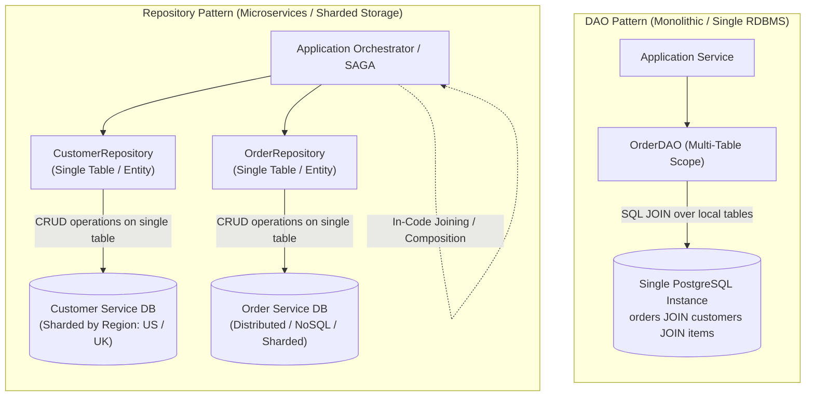

# The Repository Pattern: Domain-Driven Data Access, Microservices Sharding & DAO vs. Repository Selection

---

## Key Takeaways

The **Repository Pattern**—formalized in Domain-Driven Design (DDD)—mediates between the domain and data-mapping layers, acting like an in-memory collection of domain aggregate roots. While the **Data Access Object (DAO)** pattern maps to cohesive _data domains_ and leverages multi-table SQL `JOIN` operations inside a single database instance, the Repository pattern typically focuses on **single-table (or single-aggregate) access per class**.

In modern distributed microservices and horizontally partitioned (sharded) architectures, relational joins across distinct database instances or independent services are physically impossible. The Repository pattern resolves this by isolating persistence per table/service, delegating data assembly and joining logic to the **application code** (or API composition layers).



- **Single-Table / Single-Entity Isolation**: A Repository typically manages persistence for a single table or aggregate root entity (e.g., `ServiceRepository` manages only `wisdom.services`), unlike DAOs which frequently execute complex multi-table SQL joins.
- **In-Code Joining**: In distributed architectures where data is sharded across different database servers or microservices, database-level `JOIN` operations cannot execute; joining and aggregation occur in application code.
- **Horizontal Scalability & Sharding**: The Repository pattern excels in horizontally scaled systems (e.g., routing UK customers to a UK database shard and US customers to a US database shard).
- **Normalization vs. Processing Costs**: Highly normalized schemas (3NF/BCNF) leverage database indexes for fast server-side joins in DAOs. Horizontally scalable microservices often favor denormalization or in-code joins because disk storage is cheap, whereas distributed cross-database joins are inefficient.
- **Cross-Table Transaction Demarcation**: If an operation requires atomic ACID writes across multiple tables simultaneously, a DAO backed by a single relational instance handles it natively. In a Repository-driven distributed setup, transactions must be coordinated at a higher layer (e.g., via Outbox patterns or SAGA orchestrations).

---

## Main Discussion

### Architectural Comparison: Database Joins vs. In-Code Joining

#### 1. The DAO Approach (Database-Centric JOIN)

The DAO leverages database horsepower to execute an ANSI SQL join, returning a fully hydrated aggregate directly over the socket:

```sql
-- Executed inside a single PostgreSQL instance
SELECT o.order_id, o.order_date, c.name, c.email, s.service_name, oi.unit_rate
FROM wisdom.orders o
JOIN wisdom.customers c ON o.customer_id = c.customer_id
JOIN wisdom.order_items oi ON o.order_id = oi.order_id
JOIN wisdom.services s ON oi.service_id = s.service_id
WHERE o.order_id = ?;
```

#### The Repository Approach (Application-Level Composition)

When `Customer` and `Order` live in distinct database shards or microservices, repositories handle single-table lookups, and the application orchestrator composes the result:

```java
package com.rensaputra.lil.data.service;

import com.rensaputra.lil.data.dto.CustomerSummaryDTO;
import com.rensaputra.lil.data.dto.ServiceOrderDTO;
import com.rensaputra.lil.data.entity.Customer;
import com.rensaputra.lil.data.entity.Order;
import com.rensaputra.lil.data.repository.CustomerRepository;
import com.rensaputra.lil.data.repository.OrderRepository;

import java.util.List;
import java.util.Optional;
import java.util.UUID;

public class OrderAggregationService {

    private final OrderRepository orderRepository;
    private final CustomerRepository customerRepository;

    public OrderAggregationService(OrderRepository orderRepository, CustomerRepository customerRepository) {
        this.orderRepository = orderRepository;
        this.customerRepository = customerRepository;
    }

    /**
     * In-Code Join: Queries separate repositories and composes domain view in application memory.
     */
    public Optional<ServiceOrderDTO> getAggregatedOrder(UUID orderId) {
        // Step 1: Fetch order from Order Service / DB Shard
        Optional<Order> orderOpt = orderRepository.findById(orderId);
        if (orderOpt.isEmpty()) {
            return Optional.empty();
        }
        Order order = orderOpt.get();

        // Step 2: Fetch customer from Customer Service / DB Shard (e.g., Sharded by Region)
        Optional<Customer> customerOpt = customerRepository.findById(order.getCustomerId());
        CustomerSummaryDTO customerSummary = customerOpt
                .map(c -> new CustomerSummaryDTO(c.getCustomerId(), c.getName(), c.getEmail()))
                .orElse(new CustomerSummaryDTO(order.getCustomerId(), "Unknown", "Unknown"));

        // Step 3: Compose and return aggregated DTO in application code
        return Optional.of(new ServiceOrderDTO(
            order.getOrderId(),
            order.getOrderDate(),
            order.getStatus(),
            customerSummary,
            List.of(), // Line items retrieved similarly via ItemRepository
            order.getTotalAmount()
        ));
    }
}
```

---

### Idiomatic Repository Implementation (`ServiceRepository.java`)

A typical repository implementation focuses on single-table CRUD operations and collection-oriented semantics:

```java
package com.rensaputra.lil.data.repository;

import com.rensaputra.lil.data.entity.Service;
import com.rensaputra.lil.data.util.DatabaseUtils;

import java.sql.Connection;
import java.sql.PreparedStatement;
import java.sql.ResultSet;
import java.sql.SQLException;
import java.util.ArrayList;
import java.util.List;
import java.util.Objects;
import java.util.Optional;
import java.util.UUID;
import java.util.logging.Logger;

/**
 * Repository interface emulating an in-memory collection of Service entities.
 */
public interface Repository<T, ID> {
    T save(T entity);
    Optional<T> findById(ID id);
    List<T> findAll();
    void deleteById(ID id);
    boolean existsById(ID id);
}
```

```java
package com.rensaputra.lil.data.repository;

import com.rensaputra.lil.data.entity.Service;
import com.rensaputra.lil.data.util.DatabaseUtils;

import java.sql.Connection;
import java.sql.PreparedStatement;
import java.sql.ResultSet;
import java.sql.SQLException;
import java.util.ArrayList;
import java.util.List;
import java.util.Optional;
import java.util.UUID;
import java.util.logging.Logger;

public class ServiceRepositoryImpl implements Repository<Service, UUID> {

    private static final Logger LOGGER = Logger.getLogger(ServiceRepositoryImpl.class.getName());

    // Single-table access queries strictly confined to wisdom.services
    private static final String FIND_ALL = "SELECT service_id, name, price FROM wisdom.services";
    private static final String FIND_BY_ID = "SELECT service_id, name, price FROM wisdom.services WHERE service_id = ?";
    private static final String INSERT = "INSERT INTO wisdom.services (service_id, name, price) VALUES (?, ?, ?)";
    private static final String UPDATE = "UPDATE wisdom.services SET name = ?, price = ? WHERE service_id = ?";
    private static final String DELETE = "DELETE FROM wisdom.services WHERE service_id = ?";
    private static final String EXISTS = "SELECT 1 FROM wisdom.services WHERE service_id = ?";

    @Override
    public Service save(Service entity) {
        if (entity.getServiceId() == null || !existsById(entity.getServiceId())) {
            return insert(entity);
        } else {
            return update(entity);
        }
    }

    private Service insert(Service entity) {
        UUID id = entity.getServiceId() != null ? entity.getServiceId() : UUID.randomUUID();
        entity.setServiceId(id);

        try (PreparedStatement stmt = DatabaseUtils.getConnection().prepareStatement(INSERT)) {
            stmt.setObject(1, id);
            stmt.setString(2, entity.getName());
            stmt.setBigDecimal(3, entity.getPrice());
            stmt.executeUpdate();
            return entity;
        } catch (SQLException e) {
            DatabaseUtils.handleSQLException("ServiceRepositoryImpl.insert", e, LOGGER);
            return null;
        }
    }

    private Service update(Service entity) {
        try (PreparedStatement stmt = DatabaseUtils.getConnection().prepareStatement(UPDATE)) {
            stmt.setString(1, entity.getName());
            stmt.setBigDecimal(2, entity.getPrice());
            stmt.setObject(3, entity.getServiceId());
            stmt.executeUpdate();
            return entity;
        } catch (SQLException e) {
            DatabaseUtils.handleSQLException("ServiceRepositoryImpl.update", e, LOGGER);
            return null;
        }
    }

    @Override
    public Optional<Service> findById(UUID id) {
        try (PreparedStatement stmt = DatabaseUtils.getConnection().prepareStatement(FIND_BY_ID)) {
            stmt.setObject(1, id);
            try (ResultSet rs = stmt.executeQuery()) {
                if (rs.next()) {
                    Service s = new Service();
                    s.setServiceId((UUID) rs.getObject("service_id"));
                    s.setName(rs.getString("name"));
                    s.setPrice(rs.getBigDecimal("price"));
                    return Optional.of(s);
                }
                return Optional.empty();
            }
        } catch (SQLException e) {
            DatabaseUtils.handleSQLException("ServiceRepositoryImpl.findById", e, LOGGER);
            return Optional.empty();
        }
    }

    @Override
    public List<Service> findAll() {
        List<Service> list = new ArrayList<>();
        try (PreparedStatement stmt = DatabaseUtils.getConnection().prepareStatement(FIND_ALL);
             ResultSet rs = stmt.executeQuery()) {
            while (rs.next()) {
                Service s = new Service();
                s.setServiceId((UUID) rs.getObject("service_id"));
                s.setName(rs.getString("name"));
                s.setPrice(rs.getBigDecimal("price"));
                list.add(s);
            }
        } catch (SQLException e) {
            DatabaseUtils.handleSQLException("ServiceRepositoryImpl.findAll", e, LOGGER);
        }
        return list;
    }

    @Override
    public void deleteById(UUID id) {
        try (PreparedStatement stmt = DatabaseUtils.getConnection().prepareStatement(DELETE)) {
            stmt.setObject(1, id);
            stmt.executeUpdate();
        } catch (SQLException e) {
            DatabaseUtils.handleSQLException("ServiceRepositoryImpl.deleteById", e, LOGGER);
        }
    }

    @Override
    public boolean existsById(UUID id) {
        try (PreparedStatement stmt = DatabaseUtils.getConnection().prepareStatement(EXISTS)) {
            stmt.setObject(1, id);
            try (ResultSet rs = stmt.executeQuery()) {
                return rs.next();
            }
        } catch (SQLException e) {
            DatabaseUtils.handleSQLException("ServiceRepositoryImpl.existsById", e, LOGGER);
            return false;
        }
    }
}
```

---

### Under the Hood / Architectural Selection Matrix

```
   ARCHITECTURE WORKLOAD DECISION TREE

                   [Storage & Workload Analysis]
                                |
             Is the database horizontally sharded or microservice-based?
                                |
               +----------------+----------------+
               | YES                             | NO
               v                                 v
   [Use Repository Pattern]              Can single DB handle joins?
   • Single-table/entity access                  |
   • In-code data aggregation         +----------+----------+
   • High write scalability          | YES                 | NO (Heavy DB Load)
                                      v                     v
                             [Use DAO Pattern]     [Use Repository Pattern]
                             • SQL JOIN queries    • Denormalize data
                             • Multi-table ACID    • In-code join assembly

```

1. **Sharding & Locality Constraints:**
   In sharded environments (e.g., partitioning users by country code into independent database nodes), a customer record in shard A cannot be joined via SQL to an invoice record in shard B. Repositories query each shard independently by partition key, and the application tier combines the records.
2. **Storage Costs vs. Processing Trade-offs:**
   Historically, Third Normal Form (3NF) was prioritized because hard drive storage was expensive, requiring deduplication across normalized tables. Modern architectures often prioritize CPU efficiency and throughput: disk storage is inexpensive, whereas cross-network relational joins are costly. This makes single-table repositories or denormalized models attractive.
3. **Atomic Transactions Across Multiple Tables:**
   A relational database engine natively provides ACID atomicity across multiple tables using a single transaction. When moving to the Repository pattern across distributed databases, cross-table atomicity requires higher-level architectural patterns like Two-Phase Commit (2PC) or SAGA compensations.

---

### Structural Comparisons

#### DAO Pattern vs. Repository Pattern

| Architectural Dimension  | Data Access Object (DAO)                            | Repository Pattern                                       |
| ------------------------ | --------------------------------------------------- | -------------------------------------------------------- |
| **Primary Scope**        | **Data Domain** (often joins multiple tables)       | **Single Entity / Table** (Aggregate Root)               |
| **Where Joins Occur**    | **Inside the database engine** via SQL `JOIN`       | **In application code** across repositories              |
| **Target Architecture**  | Monolithic, vertically scaled RDBMS                 | Horizontally scaled, microservices, sharded, NoSQL       |
| **Transaction Model**    | Database-level multi-table ACID transactions        | Managed at higher service layer (SAGA / Outbox)          |
| **Schema Normalization** | Thrives on normalized schemas (3NF / BCNF)          | Compatible with denormalized or isolated tables          |
| **Collection Emulation** | Database-centric API (`create`, `update`, `getAll`) | Collection-centric API (`save`, `findById`, `findAll`)   |
| **Spring Framework**     | Common in raw JDBC / legacy J2EE applications       | **Primary standard** (`CrudRepository`, `JpaRepository`) |

---

### Common Anti-Patterns & Edge Cases

- **Attempting Distributed SQL Joins**:
  Assuming that two tables residing in separate microservice databases can be linked with a SQL `JOIN` statement. Distributed tables must be queried individually through their respective repositories and merged in application code.
- **Leaking Persistence Operations into Repositories**:
  Writing explicit SQL join logic across unrelated domain aggregates inside a single repository class breaks aggregate isolation. If multiple tables must be queried together via complex SQL, a DAO is often the more appropriate pattern.
- **N+1 In-Code Join Performance Traps**:
  When performing in-code joins, avoid looping over a parent list and querying the child repository once per iteration ($N$ round-trips). Instead, collect all required foreign keys and fetch records in a single batch query (e.g., `WHERE id IN (?, ?, ?)`).
- **Distributed Transactions Without Compensation**:
  Mutating state across two separate repositories without an explicit transaction management strategy (such as an outbox table or SAGA coordinator) risks partial writes if the second repository call fails.

---

## Knowledge Check & JetBrains-Style Coding Challenges

### Theory Tips

- **Core Distinction**: DAOs generally encapsulate multi-table joins within database queries; Repositories focus on single-table or single-aggregate-root access, performing joins in application code when necessary.
- **Scalability Profiles**: The DAO pattern fits vertically scalable, centralized RDBMS environments; the Repository pattern suits horizontally scalable, sharded, or microservices-based architectures.
- **Spring Standard**: Spring Data adopts the Repository pattern (`Repository<T, ID>`, `CrudRepository<T, ID>`) as its primary data access abstraction.

### Question 1: Conceptual / Architecture Analysis

An engineering team is migrating a monolithic application to a microservices architecture. The existing `BillingDAO` executes a query that joins `accounts`, `invoices`, and `payment_methods`. In the new architecture, `accounts` resides in an independent user-service database, while `invoices` lives in a dedicated billing-service database.

How should the data access layer be restructured to follow the Repository pattern?

- [ ] **A.** Keep `BillingDAO` unchanged and configure a PostgreSQL database link (dblink) to perform cross-network SQL joins between the two microservice databases.
- [ ] **B.** Split the access into an `AccountRepository` (interacting with the user database) and an `InvoiceRepository` (interacting with the billing database), delegating data assembly to an application service.
- [ ] **C.** Replace both databases with a single in-memory `ArrayDeque` to eliminate database dependencies.
- [ ] **D.** Move all billing records into the customer database to preserve the SQL join.

<details>
<summary>Correct Answer</summary>

**Correct Answer**: **B**

**Technical Breakdown**:

- **B is correct**: In a microservices architecture, each service owns its data storage exclusively. Multi-table SQL joins across service boundaries are antipatterns that create tight database coupling. The Repository pattern isolates access to a single table or aggregate root per service (`AccountRepository` and `InvoiceRepository`). The application or orchestrator then coordinates the queries and joins the results in memory.
- **A is incorrect**: Cross-database links create operational coupling and failure cascading between microservices.
- **C is incorrect**: In-memory collections do not provide durable persistence for production data.
- **D is incorrect**: Consolidating storage violates service boundary isolation.

</details>

---

### Question 2: Implementation Challenge — Batch In-Code Joining Service

**Task**: Implement an application-tier in-memory joining service named `CustomerServiceJoiner`:

1. Record `CustomerDTO(UUID customerId, String name)`
2. Record `ServiceUsageDTO(UUID serviceId, UUID customerId, String serviceName)`
3. Record `EnrichedCustomerUsage(UUID customerId, String customerName, List<String> serviceNames)`
4. Method `public static List<EnrichedCustomerUsage> joinCustomerServices(List<CustomerDTO> customers, List<ServiceUsageDTO> usages)`:
   - Returns an empty list if `customers` is null or empty.
   - If `usages` is null, treats it as an empty list.
   - Joins the two datasets in memory by matching `customerId`.
   - Groups all service names associated with each customer into `serviceNames`.
   - Preserves customers that have zero associated services (represented with an empty `serviceNames` list).
   - Returns a list of `EnrichedCustomerUsage` objects.

**Test Assertions**:

- `customers`: `[ (id1, "Alice"), (id2, "Bob") ]`
- `usages`: `[ (s1, id1, "Cloud Arch"), (s2, id1, "Tuning") ]`
- Result contains:
  - `Alice` with services `["Cloud Arch", "Tuning"]`
  - `Bob` with an empty services list `[]`

<details>
<summary>Solution</summary>

```java
package com.rensaputra.lil.data.service;

import java.util.ArrayList;
import java.util.HashMap;
import java.util.List;
import java.util.Map;
import java.util.UUID;

public class CustomerServiceJoiner {

    public record CustomerDTO(UUID customerId, String name) {}
    public record ServiceUsageDTO(UUID serviceId, UUID customerId, String serviceName) {}
    public record EnrichedCustomerUsage(UUID customerId, String customerName, List<String> serviceNames) {}

    public static List<EnrichedCustomerUsage> joinCustomerServices(
            List<CustomerDTO> customers,
            List<ServiceUsageDTO> usages) {

        if (customers == null || customers.isEmpty()) {
            return List.of();
        }

        // Map customerId to list of associated service names
        Map<UUID, List<String>> usageMap = new HashMap<>();
        if (usages != null) {
            for (ServiceUsageDTO usage : usages) {
                if (usage.customerId() != null && usage.serviceName() != null) {
                    usageMap.computeIfAbsent(usage.customerId(), k -> new ArrayList<>())
                            .add(usage.serviceName());
                }
            }
        }

        // Perform in-memory left join over customers
        List<EnrichedCustomerUsage> results = new ArrayList<>();
        for (CustomerDTO customer : customers) {
            List<String> services = usageMap.getOrDefault(customer.customerId(), List.of());
            results.add(new EnrichedCustomerUsage(
                customer.customerId(),
                customer.name(),
                services
            ));
        }

        return results;
    }
}
```

**Complexity Analysis**:

- **Time Complexity**: $\mathcal{O}(N + M)$ linear time, where $N$ is the number of customers and $M$ is the number of usage records. Populating the hash map takes $\mathcal{O}(M)$ time, and iterating through customers takes $\mathcal{O}(N)$ time with $\mathcal{O}(1)$ average map lookups.
- **Space Complexity**: $\mathcal{O}(N + M)$ auxiliary memory allocated for the intermediate hash map and output list.

</details>

---
