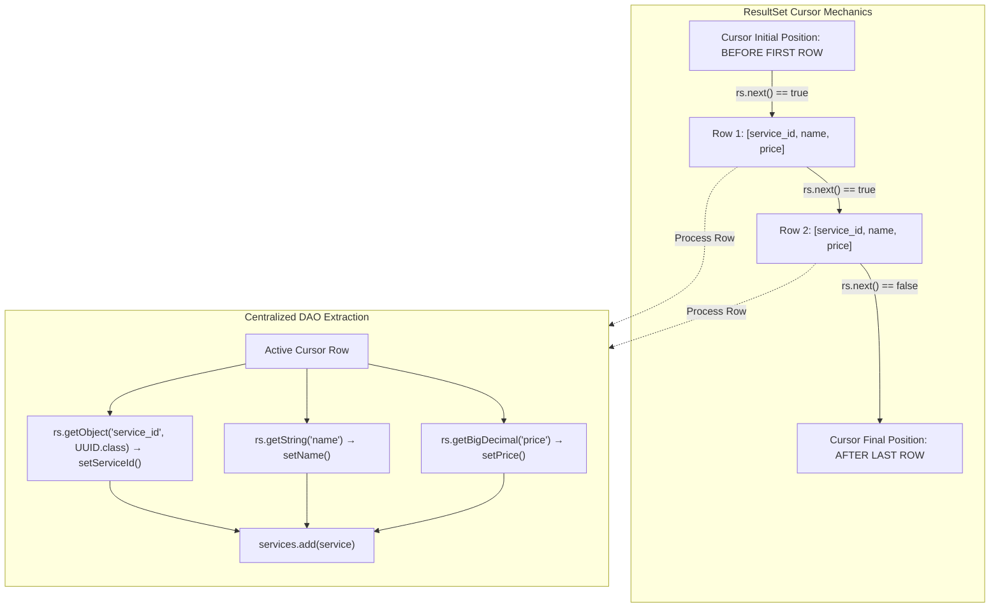

# Working with `ResultSet`: Cursor Traversal, Type-Safe Extraction & Centralized DAO Hydration

---

## Key Takeaways

A **`ResultSet`** is a tabular data stream returned by the database engine when executing a query statement (`executeQuery()`). It maintains an internal **cursor** that points to its current row of data. Initially, this cursor is positioned **before the first row**; invoking **`rs.next()`** advances the cursor forward one row at a time, returning `true` while valid rows remain and `false` when the end of the stream is reached.

Centralizing entity hydration inside a reusable private mapping method (such as `processResultSet(ResultSet rs)`) eliminates duplication across `getAll()`, `getOne()`, and custom domain query methods. To safely bridge database column types with Java models:

- Text fields map via `rs.getString(columnLabel)`
- Exact monetary/numeric fields map via `rs.getBigDecimal(columnLabel)`
- Non-standard or vendor-specific types (such as PostgreSQL's native `UUID` type) are extracted via `(UUID) rs.getObject(columnLabel)` or `rs.getObject(columnLabel, UUID.class)`.



- **Cursor Navigation**: The cursor starts before row 1. Calling `rs.next()` is mandatory before reading any columns; omitting it causes an immediate `SQLException: ResultSet not positioned on valid row`.
- **Column Identification**: Columns can be retrieved by index (1-based, e.g., `rs.getString(1)`) or by label name (`rs.getString("name")`). Label names make mapping resilient against column order changes in SQL queries.
- **Type-Safe Mapping**:
  - Use `java.math.BigDecimal` for financial values to prevent floating-point inaccuracies.
  - Use `UUID` alongside `getObject(..., UUID.class)` to map PostgreSQL `UUID` column types without string serialization overhead.
- **Centralized DAO Hydration**: Factoring the `while (rs.next())` extraction loop into a dedicated helper (`processResultSet`) allows single-record and batch-query methods to share the exact same mapping logic.

---

## Main Discussion

### Step 1: Creating the Entity (`Service.java`)

In package `com.rensaputra.lil.data.entity`, declare the mutable domain entity matching the schema defined in `data.sql`:

```java
package com.rensaputra.lil.data.entity;

import java.math.BigDecimal;
import java.util.Objects;
import java.util.UUID;

public class Service {

    private UUID serviceId;
    private String name;
    private BigDecimal price;

    public Service() {
    }

    public Service(UUID serviceId, String name, BigDecimal price) {
        this.serviceId = serviceId;
        this.name = name;
        this.price = price;
    }

    public UUID getServiceId() {
        return serviceId;
    }

    public void setServiceId(UUID serviceId) {
        this.serviceId = serviceId;
    }

    public String getName() {
        return name;
    }

    public void setName(String name) {
        this.name = name;
    }

    public BigDecimal getPrice() {
        return price;
    }

    public void setPrice(BigDecimal price) {
        this.price = price;
    }

    @Override
    public boolean equals(Object o) {
        if (this == o) return true;
        if (!(o instanceof Service service)) return false;
        return Objects.equals(serviceId, service.serviceId);
    }

    @Override
    public int hashCode() {
        return Objects.hash(serviceId);
    }

    @Override
    public String toString() {
        return "Service{" +
                "serviceId=" + serviceId +
                ", name='" + name + '\'' +
                ", price=" + price +
                '}';
    }
}
```

---

### Step 2: Defining the Generic DAO Interface (`DAO.java`)

In package `com.rensaputra.lil.data.dao`, define the generalized generic contract with a bounded type parameter requiring the ID to be a subtype of `UUID`:

```java
package com.rensaputra.lil.data.dao;

import java.util.List;
import java.util.Optional;
import java.util.UUID;

/**
 * Generic Data Access Object contract.
 *
 * @param <T>  The domain entity type.
 * @param <ID> The primary key type, bounded to subclasses of UUID.
 */
public interface DAO<T, ID extends UUID> {

    List<T> getAll();

    T create(T entity);

    Optional<T> getOne(ID id);

    T update(T entity);

    void delete(ID id);
}
```

---

### Step 3: Implementing the DAO & Centralized Hydration (`ServiceDao.java`)

Implement `DAO<Service, UUID>` and build the `processResultSet` hydration pipeline:

```java
package com.rensaputra.lil.data.dao;

import com.rensaputra.lil.data.entity.Service;
import com.rensaputra.lil.data.util.DatabaseUtils;

import java.math.BigDecimal;
import java.sql.Connection;
import java.sql.PreparedStatement;
import java.sql.ResultSet;
import java.sql.SQLException;
import java.sql.Statement;
import java.util.ArrayList;
import java.util.List;
import java.util.Optional;
import java.util.UUID;
import java.util.logging.Logger;

public class ServiceDao implements DAO<Service, UUID> {

    private static final Logger LOGGER = Logger.getLogger(ServiceDao.class.getName());
    private final Connection connection;

    public ServiceDao(Connection connection) {
        this.connection = connection;
    }

    /**
     * Centralized ResultSet processor.
     * Iterates through rows and converts each tuple into a hydrated Service entity.
     */
    private List<Service> processResultSet(ResultSet rs) throws SQLException {
        List<Service> services = new ArrayList<>();

        while (rs.next()) {
            Service service = new Service();

            // Extract native PostgreSQL UUID via getObject
            // Cast style demonstrated in curriculum:
            service.setServiceId((UUID) rs.getObject("service_id"));

            // Extract String and BigDecimal
            service.setName(rs.getString("name"));
            service.setPrice(rs.getBigDecimal("price"));

            services.add(service);
        }

        return services;
    }

    @Override
    public List<Service> getAll() {
        String sql = "SELECT service_id, name, price FROM wisdom.services ORDER BY name ASC";

        try (Statement stmt = connection.createStatement();
             ResultSet rs = stmt.executeQuery(sql)) {

            // Reuses the centralized hydration logic
            return processResultSet(rs);

        } catch (SQLException e) {
            DatabaseUtils.handleSQLException("ServiceDao.getAll", e, LOGGER);
            return List.of();
        }
    }

    @Override
    public Optional<Service> getOne(UUID id) {
        String sql = "SELECT service_id, name, price FROM wisdom.services WHERE service_id = ?";

        try (PreparedStatement stmt = connection.prepareStatement(sql)) {
            stmt.setObject(1, id);

            try (ResultSet rs = stmt.executeQuery()) {
                List<Service> results = processResultSet(rs);
                return results.isEmpty() ? Optional.empty() : Optional.of(results.get(0));
            }

        } catch (SQLException e) {
            DatabaseUtils.handleSQLException("ServiceDao.getOne", e, LOGGER);
            return Optional.empty();
        }
    }

    @Override
    public Service create(Service entity) {
        String sql = "INSERT INTO wisdom.services (service_id, name, price) VALUES (?, ?, ?)";

        try (PreparedStatement stmt = connection.prepareStatement(sql)) {
            UUID id = entity.getServiceId() != null ? entity.getServiceId() : UUID.randomUUID();
            stmt.setObject(1, id);
            stmt.setString(2, entity.getName());
            stmt.setBigDecimal(3, entity.getPrice());

            stmt.executeUpdate();
            entity.setServiceId(id);
            return entity;

        } catch (SQLException e) {
            DatabaseUtils.handleSQLException("ServiceDao.create", e, LOGGER);
            return null;
        }
    }

    @Override
    public Service update(Service entity) {
        String sql = "UPDATE wisdom.services SET name = ?, price = ? WHERE service_id = ?";

        try (PreparedStatement stmt = connection.prepareStatement(sql)) {
            stmt.setString(1, entity.getName());
            stmt.setBigDecimal(2, entity.getPrice());
            stmt.setObject(3, entity.getServiceId());

            stmt.executeUpdate();
            return entity;

        } catch (SQLException e) {
            DatabaseUtils.handleSQLException("ServiceDao.update", e, LOGGER);
            return null;
        }
    }

    @Override
    public void delete(UUID id) {
        String sql = "DELETE FROM wisdom.services WHERE service_id = ?";

        try (PreparedStatement stmt = connection.prepareStatement(sql)) {
            stmt.setObject(1, id);
            stmt.executeUpdate();

        } catch (SQLException e) {
            DatabaseUtils.handleSQLException("ServiceDao.delete", e, LOGGER);
        }
    }
}
```

---

### Under the Hood / JVM & Driver Mechanics

```
   POSTGRESQL SOCKET RECEIVE BUFFER                  JVM HEAP ALLOCATION
+------------------------------------+        +------------------------------------+
| Data Row Packet (Protocol 3.0)     |------->| PgResultSet Instance               |
| - Col 0: UUID Bytes (16 bytes)     |        | - current_row: byte[][]            |
| - Col 1: Text Bytes ('Consulting') |        | - rowOffset: 0                     |
| - Col 2: Numeric ('250.00')        |        +------------------------------------+
+------------------------------------+                          |
                                                                v
   CONVERSION PIPELINE ON getObject() / getString()             |
+---------------------------------------------------------------+
| 1. rs.getObject("service_id") &rarr; Driver parses 16-byte buffer into java.util.UUID
| 2. rs.getString("name")        &rarr; Driver decodes UTF-8 bytes into java.lang.String
| 3. rs.getBigDecimal("price")   &rarr; Driver parses arbitrary precision digits into BigDecimal
+---------------------------------------------------------------+

```

1. **Server-Side Result Buffering & Protocol 3.0:**
   When stmt.executeQuery() runs, PostgreSQL's backend worker process streams rows across the network socket as DataRow messages (Type 'D') conforming to the PostgreSQL Frontend/Backend Protocol v3.0.
2. **The Client-Side Cursor Pointer (rs.next()):**
   The driver initializes a cursor pointing before the first item. Invoking rs.next() advances an internal array pointer or reads the next row payload from the socket buffer. If rows exist, it returns true. Once exhausted, it returns false and signals completion.
3. **Native UUID Type Conversion:**
   Because JDBC 4.x has no native getUUID() method, PostgreSQL exposes UUIDs via rs.getObject(columnLabel). The driver identifies the internal PostgreSQL type OID (`2950` for `UUID`), reads the 16-byte raw payload, constructs a standard java.util.UUID, and pushes the reference onto the operand stack.
4. **AutoCloseable Cascade:**
   ResultSet extends AutoCloseable. When closed (either explicitly or when its parent Statement closes), the driver discards pending unread network packets and marks the local buffer eligible for garbage collection, preventing cursor leaks on the database server.

---

### Structural Comparisons

#### Column Index vs. Column Label Retrieval

| Dimension                 | Column Index (`rs.getString(1)`)                               | Column Label (`rs.getString("name")`)                                |
| ------------------------- | -------------------------------------------------------------- | -------------------------------------------------------------------- |
| **Indexing Base**         | **1-based** (index `1` is the first column)                    | Case-insensitive string matching                                     |
| **Execution Performance** | Fastest (direct array index lookup inside driver)              | Slightly slower (requires internal label-to-index map lookup)        |
| **Refactoring Safety**    | **Fragile**: Changing `SELECT` column order breaks all mapping | **Resilient**: Mapping remains correct regardless of column ordering |
| **Readability**           | Poor: Requires manual tracking of column positions             | **High**: The target column is explicitly named                      |
| **Best Practice**         | High-performance micro-benchmarks with fixed projections       | **Standard enterprise DAO development**                              |

#### Direct Instantiation vs. Centralized Processing

| Aspect               | Ad-Hoc Mapping (Inlined in every query method)             | Centralized Mapping (`processResultSet`)                       |
| -------------------- | ---------------------------------------------------------- | -------------------------------------------------------------- |
| **Code Duplication** | High: Every query re-writes the extraction boilerplate     | **Zero**: Single source of truth for entity hydration          |
| **Schema Changes**   | Renaming a column requires editing every method in the DAO | Editing `processResultSet` updates all query paths immediately |
| **Bug Density**      | High risk of omitting fields in some methods               | Low; all queries hydrate identical object graphs               |

---

### Common Anti-Patterns & Edge Cases

- **Extracting Values Before Calling `rs.next()`**:

  ```java
  ResultSet rs = stmt.executeQuery("SELECT * FROM wisdom.services");
  // CRITICAL BUG: Cursor is positioned BEFORE row 1!
  String name = rs.getString("name"); // Throws SQLException: ResultSet not positioned on valid row
  ```

- **0-Based Index Fallacy**:
  Attempting to call `rs.getString(0)` triggers a `SQLException: Column index out of range`. JDBC column and parameter indices are strictly **1-based**.
- **Ignoring SQL `NULL` with Primitives**:
  If a column contains a SQL `NULL` and you call `rs.getInt("discount")` or `rs.getDouble("rate")`, Java converts the SQL `NULL` to primitive `0` or `0.0`. To detect whether the underlying database value was truly `null`, you must check `rs.wasNull()` immediately after the extraction, or map nullable fields to boxed wrappers via `rs.getObject("rate", Double.class)`.
- **Leaving ResultSets Open Across Heavy Loops**:
  Failing to close a `ResultSet` inside an explicit try-with-resources block holds open database cursor buffers. Always nest `ResultSet` inside try-with-resources blocks.

---

## Knowledge Check & JetBrains-Style Coding Challenges

### Theory Tips

- **Initial Cursor Position**: A newly returned `ResultSet` is positioned **before** the first row. You must invoke `rs.next()` at least once before accessing data.
- **1-Based Indexing**: Column numbers in JDBC begin at **`1`**, not `0`.
- **UUID Extraction**: In PostgreSQL JDBC, retrieve UUID columns using `(UUID) rs.getObject("column_name")` or `rs.getObject("column_name", UUID.class)`.

### Question 1: Conceptual / Code Analysis

Consider the following DAO method snippet:

```java
public Service readFirstService(Connection conn) throws SQLException {
    String sql = "SELECT service_id, name, price FROM wisdom.services WHERE name = 'Cloud Architecture'";
    try (Statement stmt = conn.createStatement();
         ResultSet rs = stmt.executeQuery(sql)) {

        Service service = new Service();
        service.setName(rs.getString("name")); // Line 7
        service.setPrice(rs.getBigDecimal("price"));
        return service;
    }
}
```

What occurs when `readFirstService` executes against a database containing a matching record?

- [ ] **A.** It executes successfully and returns the populated `Service` instance.
- [ ] **B.** A `SQLException` is thrown at Line 7 stating that the `ResultSet` is not positioned on a valid row.
- [ ] **C.** A `NullPointerException` occurs because `rs` is null.
- [ ] **D.** The method returns a `Service` instance with null values.

<details>
<summary>Correct Answer</summary>

**Correct Answer**: **B**

**Technical Breakdown**:

- **B is correct**: In JDBC, when `executeQuery()` returns a `ResultSet`, the cursor is positioned _before the first row_. Attempting to call column extraction methods (`rs.getString`, `rs.getBigDecimal`, etc.) without first calling `rs.next()` throws a `SQLException` because the cursor does not currently point to a valid tuple. The developer must guard or advance the read with `if (rs.next()) { ... }`.
- **A is incorrect**: Accessing columns without calling `rs.next()` is prohibited.
- **C is incorrect**: `stmt.executeQuery()` returns a valid non-null `ResultSet` instance.
- **D is incorrect**: Execution terminates abruptly with a `SQLException` before the method returns.

</details>

---

### Question 2: Implementation Challenge — Null-Safe Customer Mapping

**Task**: Implement a dedicated data access layer for customer entities named `CustomerDao` inside package `com.rensaputra.lil.data.dao`:

1. Entity `Customer`:
   - Private fields: `UUID customerId`, `String name`, `String email`, `Integer loyaltyPoints`.
   - Default constructor, parameterized constructor, getters, and setters.
2. Class `CustomerDao`:
   - Constructor accepting `Connection`.
   - Private method `List<Customer> processResultSet(ResultSet rs) throws SQLException`:
     - Loops via `while (rs.next())`.
     - Extracts `customer_id` using `(UUID) rs.getObject("customer_id")`.
     - Extracts `name` and `email` using `rs.getString(...)`.
     - Handles nullable integer `loyalty_points`: extracts via `rs.getInt("loyalty_points")`; if `rs.wasNull()` is true, sets `loyaltyPoints` to `null`.
     - Populates and returns a `List<Customer>`.
   - Method `public Optional<Customer> findByEmail(String email)`:
     - Prepares `SELECT customer_id, name, email, loyalty_points FROM wisdom.customers WHERE email = ?`.
     - Uses `processResultSet(rs)`.
     - Returns an `Optional<Customer>`.

**Test Assertions**:

- Finding existing customer `"john.doe@example.com"` returns populated Optional with valid `UUID` and `loyaltyPoints`.
- Finding existing customer with SQL `NULL` for loyalty points correctly sets the Java entity's `loyaltyPoints` field to `null`.
- Finding non-existent customer returns `Optional.empty()`.

<details>
<summary>Solution</summary>

```java
package com.rensaputra.lil.data.entity;

import java.util.Objects;
import java.util.UUID;

public class Customer {
    private UUID customerId;
    private String name;
    private String email;
    private Integer loyaltyPoints;

    public Customer() {}

    public Customer(UUID customerId, String name, String email, Integer loyaltyPoints) {
        this.customerId = customerId;
        this.name = name;
        this.email = email;
        this.loyaltyPoints = loyaltyPoints;
    }

    public UUID getCustomerId() { return customerId; }
    public void setCustomerId(UUID customerId) { this.customerId = customerId; }
    public String getName() { return name; }
    public void setName(String name) { this.name = name; }
    public String getEmail() { return email; }
    public void setEmail(String email) { this.email = email; }
    public Integer getLoyaltyPoints() { return loyaltyPoints; }
    public void setLoyaltyPoints(Integer loyaltyPoints) { this.loyaltyPoints = loyaltyPoints; }

    @Override
    public boolean equals(Object o) {
        if (this == o) return true;
        if (!(o instanceof Customer customer)) return false;
        return Objects.equals(customerId, customer.customerId);
    }

    @Override
    public int hashCode() {
        return Objects.hash(customerId);
    }
}
```

```java
package com.rensaputra.lil.data.dao;

import com.rensaputra.lil.data.entity.Customer;
import com.rensaputra.lil.data.util.DatabaseUtils;

import java.sql.Connection;
import java.sql.PreparedStatement;
import java.sql.ResultSet;
import java.sql.SQLException;
import java.util.ArrayList;
import java.util.List;
import java.util.Objects;
import java.util.Optional;
import java.util.UUID;
import java.util.logging.Logger;

public class CustomerDao {

    private static final Logger LOGGER = Logger.getLogger(CustomerDao.class.getName());
    private final Connection connection;

    public CustomerDao(Connection connection) {
        this.connection = Objects.requireNonNull(connection, "Connection cannot be null");
    }

    private List<Customer> processResultSet(ResultSet rs) throws SQLException {
        List<Customer> customerList = new ArrayList<>();

        while (rs.next()) {
            Customer customer = new Customer();
            customer.setCustomerId((UUID) rs.getObject("customer_id"));
            customer.setName(rs.getString("name"));
            customer.setEmail(rs.getString("email"));

            // Null-safe extraction for primitive-wrapped integer
            int points = rs.getInt("loyalty_points");
            if (rs.wasNull()) {
                customer.setLoyaltyPoints(null);
            } else {
                customer.setLoyaltyPoints(points);
            }

            customerList.add(customer);
        }

        return customerList;
    }

    public Optional<Customer> findByEmail(String email) {
        String sql = "SELECT customer_id, name, email, loyalty_points FROM wisdom.customers WHERE email = ?";

        try (PreparedStatement stmt = connection.prepareStatement(sql)) {
            stmt.setString(1, email);

            try (ResultSet rs = stmt.executeQuery()) {
                List<Customer> results = processResultSet(rs);
                return results.isEmpty() ? Optional.empty() : Optional.of(results.get(0));
            }
        } catch (SQLException e) {
            DatabaseUtils.handleSQLException("CustomerDao.findByEmail", e, LOGGER);
            return Optional.empty();
        }
    }
}
```

**Complexity Analysis**:

- **Time Complexity**: $\mathcal{O}(K)$ where $K$ is the number of rows matching the query predicate. Point lookups using an index run in $\mathcal{O}(\log B)$ page reads.
- **Space Complexity**: $\mathcal{O}(K)$ heap memory allocated for the collection of hydrated `Customer` objects.

</details>

---
