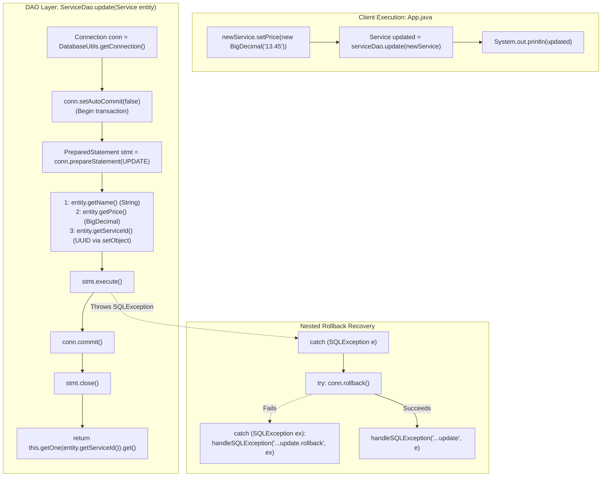

# In-Place Mutation: Parameterized `UPDATE`, Primary Key Targeting & Post-Commit State Synchronization

---

## Key Takeaways

Implementing the **Update** operation in the Data Access Object (DAO) pattern allows mutating existing database records without changing their persistent identity (`service_id`). While structurally similar to the `create` workflow, updating introduces distinct SQL binding rules: mutable domain attributes are assigned via the `SET` clause, while the immutable primary key is bound strictly within the `WHERE` predicate to prevent unbounded, multi-row table modifications.

To maintain transactional consistency, auto-commit is disabled (`conn.setAutoCommit(false)`), parameters are bound via a `PreparedStatement`, changes are flushed via `statement.execute()`, and committed to disk via `conn.commit()`. If an exception occurs, a nested try-catch block executes `conn.rollback()` to undo uncommitted writes. Because an updated entity is assumed to already exist in the database, `this.getOne(id).get()` can be invoked to retrieve a fresh, synchronized representation of the persisted tuple.



- **Targeting via Primary Key**: The `WHERE service_id = ?` clause is mandatory. Omitting or misconfiguring the predicate risks modifying every row in the relation.
- **Parameter Index Ordering**: Parameter bindings match placeholder positions in the SQL statement:
  - Index `1`: `name` (SET attribute)
  - Index `2`: `price` (SET attribute)
  - Index `3`: `service_id` (WHERE predicate filter)
- **Atomic Transaction Execution**: Disabling auto-commit ensures the row-level write lock acquired during `stmt.execute()` is finalized only when `conn.commit()` succeeds.
- **Nested Rollback Pattern**: Reuses the dual-catch structure from `create` to guarantee that socket or connection failures during rollback do not suppress the primary exception.
- **Post-Commit Synchronization**: Re-querying via `this.getOne(entity.getServiceId()).get()` returns the updated database state, confirming that the change was successfully written and indexed.

---

## Main Discussion

### Step 1: Updating `ServiceDao.java` with the `update` Implementation

Open `src/main/java/com/rensaputra/lil/data/dao/ServiceDao.java`. Define the static `UPDATE` SQL string and implement the `update(Service entity)` method:

```java
package com.rensaputra.lil.data.dao;

import com.rensaputra.lil.data.entity.Service;
import com.rensaputra.lil.data.util.DatabaseUtils;

import java.math.BigDecimal;
import java.sql.Connection;
import java.sql.PreparedStatement;
import java.sql.ResultSet;
import java.sql.SQLException;
import java.sql.Statement;
import java.util.ArrayList;
import java.util.List;
import java.util.Optional;
import java.util.UUID;
import java.util.logging.Logger;

public class ServiceDao implements DAO<Service, UUID> {

    private static final Logger LOGGER = Logger.getLogger(ServiceDao.class.getName());

    // Externalized SQL statements
    private static final String GET_ALL = "SELECT service_id, name, price FROM wisdom.services";
    private static final String GET_BY_ID = "SELECT service_id, name, price FROM wisdom.services WHERE service_id = ?";
    private static final String CREATE = "INSERT INTO wisdom.services (service_id, name, price) VALUES (?, ?, ?)";
    private static final String UPDATE = "UPDATE wisdom.services SET name = ?, price = ? WHERE service_id = ?";

    private List<Service> processResultSet(ResultSet rs) throws SQLException {
        List<Service> services = new ArrayList<>();
        while (rs.next()) {
            Service service = new Service();
            service.setServiceId((UUID) rs.getObject("service_id"));
            service.setName(rs.getString("name"));
            service.setPrice(rs.getBigDecimal("price"));
            services.add(service);
        }
        return services;
    }

    @Override
    public List<Service> getAll() {
        List<Service> services = new ArrayList<>();
        Connection connection = DatabaseUtils.getConnection();

        try (Statement statement = connection.createStatement();
             ResultSet resultSet = statement.executeQuery(GET_ALL)) {

            services = this.processResultSet(resultSet);

        } catch (SQLException e) {
            DatabaseUtils.handleSQLException("ServiceDao.getAll", e, LOGGER);
        }

        return services;
    }

    @Override
    public Optional<Service> getOne(UUID id) {
        try (PreparedStatement statement = DatabaseUtils.getConnection().prepareStatement(GET_BY_ID)) {
            statement.setObject(1, id);

            try (ResultSet resultSet = statement.executeQuery()) {
                List<Service> services = this.processResultSet(resultSet);
                if (services.isEmpty()) {
                    return Optional.empty();
                }
                return Optional.of(services.get(0));
            }

        } catch (SQLException e) {
            DatabaseUtils.handleSQLException("ServiceDao.getOne", e, LOGGER);
            return Optional.empty();
        }
    }

    @Override
    public Service create(Service entity) {
        UUID serviceId = UUID.randomUUID();
        Connection connection = DatabaseUtils.getConnection();

        try {
            connection.setAutoCommit(false);

            PreparedStatement statement = connection.prepareStatement(CREATE);
            statement.setObject(1, serviceId);
            statement.setString(2, entity.getName());
            statement.setBigDecimal(3, entity.getPrice());

            statement.execute();
            connection.commit();
            statement.close();

        } catch (SQLException e) {
            try {
                connection.rollback();
            } catch (SQLException ex) {
                DatabaseUtils.handleSQLException("ServiceDao.create.rollback", ex, LOGGER);
            }
            DatabaseUtils.handleSQLException("ServiceDao.create", e, LOGGER);
        }

        Optional<Service> service = this.getOne(serviceId);
        if (service.isEmpty()) {
            return null;
        }

        return service.get();
    }

    /**
     * Updates an existing Service record within an explicit transaction.
     * Binds updated fields and filters by the primary key.
     */
    @Override
    public Service update(Service entity) {
        Connection connection = DatabaseUtils.getConnection();

        try {
            // 1. Begin manual transaction
            connection.setAutoCommit(false);

            // 2. Prepare statement and bind parameters
            PreparedStatement statement = connection.prepareStatement(UPDATE);
            statement.setString(1, entity.getName());
            statement.setBigDecimal(2, entity.getPrice());
            statement.setObject(3, entity.getServiceId());

            // 3. Execute update
            statement.execute();

            // 4. Commit transaction to persist changes
            connection.commit();

            // 5. Clean up statement handle
            statement.close();

        } catch (SQLException e) {
            // 6. Handle failure with nested rollback
            try {
                connection.rollback();
            } catch (SQLException ex) {
                DatabaseUtils.handleSQLException("ServiceDao.update.rollback", ex, LOGGER);
            }
            DatabaseUtils.handleSQLException("ServiceDao.update", e, LOGGER);
        }

        // 7. Fetch and return fresh entity state from the database
        return this.getOne(entity.getServiceId()).get();
    }

    // Reserved for the delete module
    @Override public void delete(UUID id) { throw new UnsupportedOperationException(); }
}
```

---

### Step 2: Testing Entity Updates via `App.java`

Update `src/main/java/com/rensaputra/lil/App.java` to create a record, modify its price, run `serviceDao.update()`, and print the updated entity:

```java
package com.rensaputra.lil;

import com.rensaputra.lil.data.dao.ServiceDao;
import com.rensaputra.lil.data.entity.Service;

import java.math.BigDecimal;
import java.util.List;
import java.util.Optional;

public class App {

    public static void main(String[] args) {
        ServiceDao serviceDao = new ServiceDao();

        // 1. Read existing records
        List<Service> services = serviceDao.getAll();
        System.out.println("**** SERVICES ****");
        System.out.println("\n*** GET ALL ***");
        services.forEach(System.out::println);

        // 2. Read single record by ID
        if (!services.isEmpty()) {
            Service firstService = services.get(0);
            Optional<Service> serviceOptional = serviceDao.getOne(firstService.getServiceId());
            System.out.println("\n*** GET ONE ***\n");
            serviceOptional.ifPresent(System.out::println);
        }

        // 3. Insert a new service record
        Service newService = new Service();
        newService.setName("FooBarBaz" + System.currentTimeMillis());
        newService.setPrice(new BigDecimal("4.35"));

        newService = serviceDao.create(newService);

        System.out.println("\n*** CREATE ***\n");
        System.out.println(newService);

        // 4. Mutate price in memory and persist via update()
        newService.setPrice(new BigDecimal("13.45"));
        newService = serviceDao.update(newService);

        System.out.println("\n*** UPDATE ***\n");
        System.out.println(newService);
    }
}
```

---

### Step 3: Terminal Build & Verification

Compile and run the application from your terminal:

```bash
mvn compile exec:java -Dexec.mainClass="com.rensaputra.lil.App"
```

The output confirms that the initial create set the price to `4.35`, and the subsequent update persisted `13.45` under the same `serviceId`:

```text
**** SERVICES ****

*** GET ALL ***
Service{serviceId=a1b2c3d4-e5f6-7a8b-9c0d-1e2f3a4b5c6d, name='Cloud Architecture Consulting', price=250.00}
Service{serviceId=b2c3d4e5-f6a7-8b9c-0d1e-2f3a4b5c6d7e, name='Database Tuning & Optimization', price=220.00}
Service{serviceId=c3d4e5f6-a7b8-9c0d-1e2f-3a4b5c6d7e8f, name='Full-Stack Java Modernization', price=195.00}

*** GET ONE ***

Service{serviceId=a1b2c3d4-e5f6-7a8b-9c0d-1e2f3a4b5c6d, name='Cloud Architecture Consulting', price=250.00}

*** CREATE ***

Service{serviceId=9e8c45ab-2341-47d0-a92d-947f63d0851f, name='FooBarBaz1729145200100', price=4.35}

*** UPDATE ***

Service{serviceId=9e8c45ab-2341-47d0-a92d-947f63d0851f, name='FooBarBaz1729145200100', price=13.45}
```

---

### Under the Hood / JVM & PostgreSQL Wire Mechanics

```
   HEAP TUPLE REPLACEMENT (PostgreSQL MVCC Update Engine)

   Initial State: Tuple V1 (ctid: 0,1)
+------------------------------------------------------------------------------------+
| t_xmin: 201 (Creating Tx) | t_xmax: 0 (Live) | service_id: 9e8c... | price: 4.35   |
+------------------------------------------------------------------------------------+
                                           |
                   stmt.execute(UPDATE) with Tx ID 205
                                           v
   Old Tuple V1 (Marked Dead by Tx 205)
+------------------------------------------------------------------------------------+
| t_xmin: 201               | t_xmax: 205      | service_id: 9e8c... | price: 4.35   |
+------------------------------------------------------------------------------------+
                                           |
                                           +---> Points via t_ctid to new Tuple V2
                                           v
   New Tuple V2 (ctid: 0,2)
+------------------------------------------------------------------------------------+
| t_xmin: 205 (Updating Tx) | t_xmax: 0 (Live) | service_id: 9e8c... | price: 13.45  |
+------------------------------------------------------------------------------------+

```

1. **MVCC Tuple Versioning (No In-Place Overwrites):**
   When PostgreSQL processes UPDATE wisdom.services SET ... WHERE service_id = ?, it does not overwrite the bytes of the existing row on disk. Under Multi-Version Concurrency Control (MVCC), it writes an entirely new version of the tuple with the updated price (13.45) to an available heap page, sets the new tuple's t_xmin to the active transaction ID (e.g., 205), and marks the old tuple's t_xmax with the same transaction ID.
2. **Tuple Chaining via t_ctid:**
   The old tuple's header pointer (t_ctid) is updated to reference the physical block and offset of the new tuple. If Heap-Only Tuples (HOT) optimization applies—meaning indexed columns like service_id did not change—PostgreSQL avoids updating the table's indexes, pointing index entries directly to the root of the tuple chain.
3. **Row Lock Release on Commit:**
   During execution, the transaction holds an exclusive row-level write lock (RowExclusiveLock) on the updated tuple. When connection.commit() is called, the write-ahead log record is flushed via fsync(), the transaction is marked committed in pg_xact, and the row lock is released for other transactions.
4. **Verification Read via getOne().get():**
   Calling this.getOne(...).get() executes a SELECT query within a new statement context. The database engine reads the newly committed tuple (Tuple V2) whose t_xmin is now committed, returning the synchronized state to the caller.

---

### Structural Comparisons

#### `CREATE` vs. `UPDATE` Mechanics in JDBC DAOs

| Characteristic             | `CREATE` Operation                                             | `UPDATE` Operation                                                      |
| -------------------------- | -------------------------------------------------------------- | ----------------------------------------------------------------------- |
| **Primary DML Statement**  | `INSERT INTO table (...) VALUES (...)`                         | `UPDATE table SET ... WHERE id = ?`                                     |
| **Primary Key Role**       | Generated (client or sequence); inserted as new value          | Used as a filter in the `WHERE` predicate to isolate the row            |
| **Idempotency**            | **Non-idempotent** (re-running causes duplicate key errors)    | **Idempotent** (re-running with the same values leaves state identical) |
| **Row Count Verification** | Affects exactly 1 row on success                               | May affect 0 rows if the target entity does not exist                   |
| **Post-Execution Sync**    | Checks if present (`service.isEmpty() ? null : service.get()`) | Assumes row existence (`this.getOne(...).get()`)                        |

#### Re-Querying (`getOne()`) vs. Returning the Passed Entity vs. `RETURNING` Clause

| Approach                   | Implementation                                 | Pros                                                           | Cons                                                                    |
| -------------------------- | ---------------------------------------------- | -------------------------------------------------------------- | ----------------------------------------------------------------------- |
| **Re-Query (`getOne()`)**  | Query database again after commit              | Guarantees entity state matches database triggers and defaults | Incurs an extra network round-trip                                      |
| **Return Passed Entity**   | Return the in-memory object directly           | Fastest (zero extra network calls)                             | Misses database-applied defaults, conversions, or triggers              |
| **SQL `RETURNING` Clause** | `UPDATE ... RETURNING service_id, name, price` | Returns updated row in a single query execution                | Vendor-specific extension (PostgreSQL supports it; MySQL/Oracle differ) |

---

### Common Anti-Patterns & Edge Cases

- **Missing `WHERE` Clause in `UPDATE`**:

  ```java
  // CRITICAL BUG: Updates every row in the entire table!
  String sql = "UPDATE wisdom.services SET name = ?, price = ?";
  ```

  Always ensure the query includes `WHERE service_id = ?`.

- **Silent Zero-Row Updates (Missing Target Entity)**:
  `statement.execute()` returns `false` (indicating an update count, not a `ResultSet`), but does not throw an exception if the `WHERE` clause matches 0 rows. In that case, `this.getOne(id)` returns `Optional.empty()`, and calling `.get()` throws a `NoSuchElementException`. In production code, check `statement.getUpdateCount() == 1` before fetching.
- **Mismatched Parameter Positions**:
  Swapping parameter indices (e.g., binding price to index 1 and name to index 2) throws a `SQLException` due to data type mismatches (e.g., attempting to write a string into a `NUMERIC` column).
- **Failing to Close Statements on Failure**:
  If `statement.execute()` throws an exception, `statement.close()` is skipped. Wrap statements in a try-with-resources block to guarantee proper cleanup.

---

## 3. Knowledge Check & JetBrains-Style Coding Challenges

### Exam / Theory Tips

- **Parameter Index Order**: PreparedStatement indices correspond directly to the order of `?` markers in the query, from left to right:
  `UPDATE table SET col1 = ?, col2 = ? WHERE pk = ?`
  Index `1` = `col1`, Index `2` = `col2`, Index `3` = `pk`.
- **Checking Affected Rows**: Use `statement.executeUpdate()` or `statement.getUpdateCount()` to verify how many rows were modified.
- **MVCC Update Mechanics**: PostgreSQL updates write a new tuple version to the heap and mark the old version with `t_xmax`; rows are not overwritten in place.

### Question 1: Conceptual / Code Analysis

Consider the following DAO update method:

```java
public Service updateServicePrice(UUID id, BigDecimal newPrice) throws SQLException {
    Connection conn = DatabaseUtils.getConnection();
    String sql = "UPDATE wisdom.services SET price = ? WHERE service_id = ?";

    try (PreparedStatement stmt = conn.prepareStatement(sql)) {
        stmt.setBigDecimal(1, newPrice);
        stmt.setObject(2, id);

        int rowsUpdated = stmt.executeUpdate(); // Line 9
        if (rowsUpdated == 0) {
            throw new NoSuchElementException("Service record not found: " + id);
        }
        return getOne(id).orElseThrow();
    }
}
```

If `id` points to a non-existent UUID in the database, what occurs when this method executes under auto-commit mode?

- [ ] **A.** PostgreSQL throws a `SQLException: EntityNotFoundException` at Line 9.
- [ ] **B.** `stmt.executeUpdate()` returns `0`, and the method throws a `NoSuchElementException` on the subsequent line.
- [ ] **C.** PostgreSQL creates a new record containing `newPrice` and generates a new random UUID.
- [ ] **D.** The method blocks indefinitely waiting for a row-level lock.

<details>
<summary>Correct Answer</summary>

**Correct Answer**: **B**

**Technical Breakdown**:

- **B is correct**: In relational databases, executing an `UPDATE` statement whose `WHERE` predicate matches zero rows is a syntactically valid operation that completes normally without errors. The database reports an update count of `0`. In this method, `rowsUpdated` receives `0`, triggering the condition `rowsUpdated == 0` and throwing a `NoSuchElementException`.
- **A is incorrect**: Relational engines do not raise errors when query filters match zero rows.
- **C is incorrect**: Standard `UPDATE` statements do not perform inserts unless written as an explicit `UPSERT` (`INSERT ... ON CONFLICT`).
- **D is incorrect**: A row lock cannot be acquired on a tuple that does not exist; the scan finishes immediately.

</details>

---

### Question 2: Implementation Challenge — Safe Conditional Update with Row Count Verification

**Task**: Implement a safe, optimistic rate update method named `updatePriceIfLower` in `ServiceDao`:

1. Method signature:
   `public boolean updatePriceIfLower(UUID id, BigDecimal maxAcceptableRate)`
2. Requirements:
   - Externalize SQL constant:

   ```java
   private static final String UPDATE_PRICE_CONDITIONAL =
       "UPDATE wisdom.services SET price = ? WHERE service_id = ? AND price > ?";
   ```

   - Validate parameters: throw `IllegalArgumentException` if `id` or `maxAcceptableRate` is null, or if `maxAcceptableRate.compareTo(BigDecimal.ZERO) < 0`.
   - Obtain connection via `DatabaseUtils.getConnection()`.
   - Use explicit transaction demarcation (`conn.setAutoCommit(false)`).
   - Prepare statement within try-with-resources:
     - Bind index `1`: `maxAcceptableRate` (new price value)
     - Bind index `2`: `id` (primary key filter)
     - Bind index `3`: `maxAcceptableRate` (condition: update only if current price exceeds this rate)
   - Execute via `int affectedRows = stmt.executeUpdate()`.
   - If `affectedRows == 1`, call `conn.commit()` and return `true`.
   - If `affectedRows == 0`, call `conn.rollback()` and return `false` (no changes made).
   - In a `catch (SQLException e)` block:
     - Roll back inside a nested try-catch.
     - Route error through `DatabaseUtils.handleSQLException("ServiceDao.updatePriceIfLower", e, LOGGER)`.
     - Return `false`.

**Test Assertions**:

- Service currently priced at `$250.00`:
  - `updatePriceIfLower(id, new BigDecimal("200.00"))` $\rightarrow$ Condition passes ($250.00 > 200.00$), updates price to `$200.00`, commits, returns `true`.
  - `updatePriceIfLower(id, new BigDecimal("220.00"))` $\rightarrow$ Condition fails ($200.00 \ngtr 220.00$), affected rows = 0, rolls back, returns `false`.
- Non-existent UUID:
  - `updatePriceIfLower(randomId, new BigDecimal("100.00"))` $\rightarrow$ Affected rows = 0, returns `false`.

<details>
<summary>Solution</summary>

```java
// Method implementation to add inside ServiceDao.java:

private static final String UPDATE_PRICE_CONDITIONAL =
    "UPDATE wisdom.services SET price = ? WHERE service_id = ? AND price > ?";

public boolean updatePriceIfLower(UUID id, BigDecimal maxAcceptableRate) {
    if (id == null || maxAcceptableRate == null) {
        throw new IllegalArgumentException("ID and target rate must not be null.");
    }
    if (maxAcceptableRate.compareTo(BigDecimal.ZERO) < 0) {
        throw new IllegalArgumentException("Rate cannot be negative.");
    }

    Connection connection = DatabaseUtils.getConnection();

    try {
        connection.setAutoCommit(false);

        try (PreparedStatement statement = connection.prepareStatement(UPDATE_PRICE_CONDITIONAL)) {
            statement.setBigDecimal(1, maxAcceptableRate);
            statement.setObject(2, id);
            statement.setBigDecimal(3, maxAcceptableRate);

            int affectedRows = statement.executeUpdate();

            if (affectedRows == 1) {
                connection.commit();
                return true;
            } else {
                connection.rollback();
                return false;
            }
        }

    } catch (SQLException e) {
        try {
            connection.rollback();
        } catch (SQLException ex) {
            DatabaseUtils.handleSQLException("ServiceDao.updatePriceIfLower.rollback", ex, LOGGER);
        }
        DatabaseUtils.handleSQLException("ServiceDao.updatePriceIfLower", e, LOGGER);
        return false;
    }
}
```

**Complexity Analysis**:

- **Time Complexity**: $\mathcal{O}(\log B)$ point lookup on the primary key B+Tree index, followed by evaluating the price filter, acquiring the row lock, and appending the new tuple version to the heap table.
- **Space Complexity**: $\mathcal{O}(1)$ auxiliary memory allocated for statement handles and parameter buffers on the JVM heap.

</details>

---
