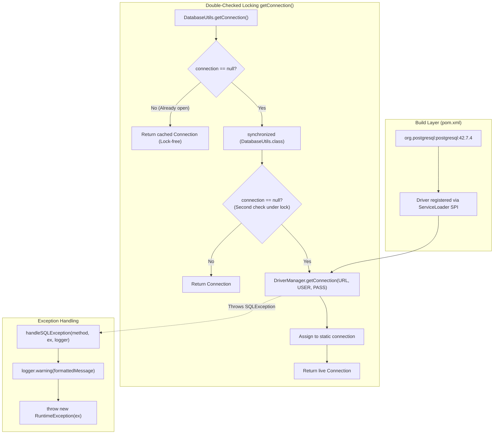

# Driver Configuration: Maven Dependencies, JDBC URL Construction & Double-Checked Locking Connection Singletons

---

## Key Takeaways

Connecting a Java application to a relational engine begins with adding the vendor's driver dependency to the build descriptor (`pom.xml`) and establishing a connection factory. For PostgreSQL, adding `org.postgresql:postgresql:42.7.4` provides the pure Java (Type 4) JDBC driver that implements the `java.sql` driver contracts via the Service Provider Interface (SPI).

To manage the connection lifecycle in standalone utility classes, developers frequently employ the **Double-Checked Locking (DCL)** pattern to implement a thread-safe, lazy-initialized connection singleton. This avoids the cost of opening redundant physical TCP sockets. In addition, centralizing diagnostic handling converts checked `SQLException` instances into unhandled `RuntimeException` failures while logging standardized error messages (including method name, error message, and vendor-specific error codes).



- **Type 4 Driver Dependency**: PostgreSQL's `org.postgresql:postgresql` driver is a 100% pure Java driver that communicates directly with the database daemon over TCP port `5432` using the PostgreSQL Frontend/Backend Protocol v3.0.
- **JDBC URL Anatomy**: The connection string `jdbc:postgresql://localhost:5432/localdb` identifies the sub-protocol (`postgresql`), network address and port (`localhost:5432`), and target database catalog (`localdb`).
- **Double-Checked Locking (DCL)**: Mitigates synchronization overhead by evaluating `connection == null` before acquiring the intrinsic class monitor (`synchronized (DatabaseUtils.class)`), followed by a second verification check inside the lock.
- **Centralized Exception Diagnostics**: Extracting error formatting into a reusable handler standardizes logs across data-access routines, logging the calling method, `ex.getMessage()`, and the vendor `ex.getErrorCode()` before wrapping the checked exception in an unchecked `RuntimeException`.

---

## Main Discussion

### Step 1: Adding the Driver Dependency (`pom.xml`)

Add the PostgreSQL JDBC driver inside the `<dependencies>` block of your `pom.xml`:

```xml
<dependencies>
    <!-- PostgreSQL JDBC Driver (Type 4 Pure Java) -->
    <dependency>
        <groupId>org.postgresql</groupId>
        <artifactId>postgresql</artifactId>
        <version>42.7.4</version>
    </dependency>

    <!-- JUnit 5 test harness -->
    <dependency>
        <groupId>org.junit.jupiter</groupId>
        <artifactId>junit-jupiter-api</artifactId>
        <version>5.11.0</version>
        <scope>test</scope>
    </dependency>
</dependencies>

```

---

### Step 2: Implementing `DatabaseUtils.java`

Create the package `com.rensaputra.lil.data.util` and implement the `DatabaseUtils` utility class.

```java
package com.rensaputra.lil.data.util;

import java.sql.Connection;
import java.sql.DriverManager;
import java.sql.SQLException;
import java.util.logging.Logger;

public class DatabaseUtils {

    // Connection configuration matching local Docker container credentials
    private static final String URL = "jdbc:postgresql://localhost:5432/localdb";
    private static final String USERNAME = "localDBUser";
    private static final String PASSWORD = "P@ssw0rd!";

    private static final Logger LOGGER = Logger.getLogger(DatabaseUtils.class.getName());

    // Standardized log message format: method name, error message, vendor error code
    private static final String EXCEPTION_FORMAT = "Exception in %s Message: %s, Code: %s";

    // Singleton connection handle
    // In production, volatile is required for full Double-Checked Locking safety across CPU cores
    private static volatile Connection connection;

    private DatabaseUtils() {
        // Prevent instantiation of static utility class
    }

    /**
     * Retrieves the singleton Connection handle using the Double-Checked Locking pattern.
     */
    public static Connection getConnection() {
        // First check: Read without synchronization overhead for fast path
        if (connection == null) {
            // Synchronize on the Class object to serialize thread initialization
            synchronized (DatabaseUtils.class) {
                // Second check: Ensure another thread hasn't already opened the connection
                if (connection == null) {
                    try {
                        connection = DriverManager.getConnection(URL, USERNAME, PASSWORD);
                    } catch (SQLException e) {
                        handleSQLException("DatabaseUtils.getConnection", e, LOGGER);
                    }
                }
            }
        }
        return connection;
    }

    /**
     * Centralized diagnostic handler that formats the exception and rethrows as unchecked RuntimeException.
     */
    public static void handleSQLException(String method, SQLException e, Logger log) {
        String formattedMessage = String.format(EXCEPTION_FORMAT, method, e.getMessage(), e.getErrorCode());
        log.warning(formattedMessage);
        throw new RuntimeException(formattedMessage, e);
    }
}

```

---

### Under the Hood / JVM Mechanics

```
   CPU CACHE COHERENCY & MEMORY BARRIERS IN DOUBLE-CHECKED LOCKING

   Thread A (Entering Sync Block)               Thread B (Executing getConnection)
+------------------------------------+       +------------------------------------+
| 1. Evaluates connection == null    |       | 1. Reads connection reference      |
| 2. Acquires Class Monitor Lock     |       |    (Without volatile, might see    |
| 3. Allocates PgConnection instance |       |     partially constructed object!) |
| 4. Stores reference into field     |       +------------------------------------+
| 5. Releases Class Monitor Lock     |                          ^
+------------------------------------+                          |
                  |                                             |
                  +--- StoreStore Barrier (guaranteed by volatile)

```

1. **The Danger of Instruction Reordering Without volatile:**
   In Java, creating an object via new PgConnection(...) involves three JVM steps: allocating heap memory, invoking the `<init>` constructor over the network socket, and assigning the resulting memory pointer to the static variable connection. Without the volatile keyword, the JIT compiler or hardware CPU may reorder step 3 before step 2. Thread B could then read a non-null connection reference whose internal state has not finished initializing, leading to runtime failures.
2. **Memory Barriers (LoadLoad / StoreStore):**
   Declaring connection as volatile instructs the JVM to emit hardware memory fences (e.g., mfence or lock addl on x86). This forces any write to connection to complete after constructor execution and flushes CPU cache lines, ensuring all threads immediately observe a fully constructed connection object.
3. **Intrinsic Monitor Acquisition (monitorenter / monitorexit):**
   The synchronized (DatabaseUtils.class) block compiles into monitorenter and monitorexit bytecode instructions targeting the `Class<DatabaseUtils>` instance in Metaspace. Only one thread can enter the critical initialization section; all competing threads block on the monitor queue until the handshake finishes.
4. **Socket Persistence in Singletons:**
   Because a single static Connection is reused across calls, the underlying operating system file descriptor (TCP socket connected to port 5432) remains continuously open. While convenient for simple console utilities, sharing a single non-thread-safe JDBC Connection across concurrent threads risks socket buffer interleaving—which is why production applications replace connection singletons with dedicated connection pools like HikariCP.

---

### Structural Comparisons

#### Connection Management Strategies: Singleton vs. On-Demand vs. Connection Pool

| Architectural Strategy                      | Concurrency Safety                         | Performance Profile                                  | Resource Consumption                            | Typical Application Context                           |
| ------------------------------------------- | ------------------------------------------ | ---------------------------------------------------- | ----------------------------------------------- | ----------------------------------------------------- |
| **Connection Singleton (Current Pattern)**  | **Unsafe for multi-threaded transactions** | Fast for single thread (no reconnect overhead)       | Low (1 active socket held open)                 | CLI scripts, batch tools, educational POCs            |
| **On-Demand (`getConnection()` per query)** | Safe (each thread gets its own socket)     | **Very Poor** (TCP + TLS + auth handshake per query) | High socket churn; risks OS port exhaustion     | Legacy scripts (generally considered an anti-pattern) |
| **Connection Pool (HikariCP / DataSource)** | **Safe & Highly Scalable**                 | **Fastest** (pre-warmed reusable connection pool)    | Bounded (fixed pool size, e.g., 10 connections) | **Production enterprise applications**                |

#### Checked `SQLException` vs. Unchecked `RuntimeException` Wrapping

| Aspect                      | Checked `SQLException`                             | Wrapped `RuntimeException`                                        |
| --------------------------- | -------------------------------------------------- | ----------------------------------------------------------------- |
| **Method Signature Impact** | Must declare `throws SQLException` on every method | Clean signatures; hides data-layer plumbing from callers          |
| **Compiler Enforcement**    | Forces caller to catch or propagate                | Callers handle failures at central boundary exception handlers    |
| **Framework Alignment**     | Traditional core JDBC style                        | Modern architecture style (matches Spring `DataAccessException`)  |
| **Risk**                    | Boilerplate try-catch blocks everywhere            | Unhandled exceptions bubble up and terminate threads if unhandled |

---

### Common Anti-Patterns & Edge Cases

- **Missing `volatile` on DCL Singletons**:
  Omitting `volatile` on the static `connection` variable can result in subtle race conditions on multi-core systems, where threads observe a non-null reference to an uninitialized connection.
- **Sharing a Single Connection Across Concurrent Threads**:
  JDBC `Connection` implementations (such as PostgreSQL's `PgConnection`) are **not thread-safe**. Sharing one connection across multiple concurrent threads can cause interleaved byte streams on the underlying TCP socket and corrupt in-flight transactions.
- **Hardcoded Credentials in Source Repositories**:
  Storing plaintext credentials (`P@ssw0rd!`) inside `.java` source files risks credential leakage in version control. Production setups should inject these values via environment variables (`System.getenv(...)`) or external configuration files.
- **Ignoring the Vendor Error Code**:
  Relying solely on `e.getMessage()` misses the structured database error code (`e.getErrorCode()`) or standard SQLState (`e.getSQLState()`), which provide reliable error classification across localized database engines.

---

## Knowledge Check & JetBrains-Style Coding Challenges

### Theory Tips

- **PostgreSQL Default Port**: The default network port for PostgreSQL connections is **`5432`**.
- **JDBC URL Prefix**: The JDBC connection scheme for PostgreSQL always begins with **`jdbc:postgresql://`**.
- **Double-Checked Locking Requirements**: A correct DCL implementation requires two `null` checks (one outside the synchronized block, one inside) and a **`volatile`** field declaration.

### Question 1: Conceptual / Code Analysis

Consider the following refactoring of `getConnection()`:

```java
public class BrokenConnectionManager {
    private static Connection conn;

    public static synchronized Connection getConnection() {
        if (conn == null) {
            try {
                conn = DriverManager.getConnection("jdbc:postgresql://localhost:5432/localdb", "user", "pass");
            } catch (SQLException e) {
                throw new RuntimeException(e);
            }
        }
        return conn;
    }
}

```

While this implementation is thread-safe and functional, what is its primary performance drawback compared to the Double-Checked Locking implementation?.

- [ ] **A.** It throws an `IllegalMonitorStateException` on every call.
- [ ] **B.** Every invocation acquires the method-level class lock, forcing all reading threads to serialize and block even after the connection has already been initialized.
- [ ] **C.** It forces the JVM to reopen a new network socket on every invocation.
- [ ] **D.** It prevents the PostgreSQL driver from using SSL encryption.

<details>
<summary>Correct Answer</summary>

**Correct Answer**: **B**

**Technical Breakdown**:

- **B is correct**: Synchronizing the entire method (`public static synchronized Connection getConnection()`) forces every calling thread to acquire the `Class<BrokenConnectionManager>` monitor lock, even when the connection has already been initialized and only requires a read. In high-concurrency environments, this creates severe lock contention. The Double-Checked Locking pattern solves this by checking `conn == null` _before_ acquiring the lock, allowing subsequent calls to return the connection without synchronization overhead.
- **A is incorrect**: Method-level synchronization is valid Java syntax and does not throw monitor exceptions.
- **C is incorrect**: The connection is initialized once; the issue is thread contention, not socket churn.
- **D is incorrect**: Method synchronization has no impact on TLS/SSL socket configuration.

</details>

---

### Question 2: Mini Coding Problem / Implementation Challenge

**Task**: Implement a resilient connection factory named `ConfigurableConnectionFactory` inside package `com.rensaputra.lil.data.util`:

1. Class `ConfigurableConnectionFactory`:

- Private `static volatile Connection connection`.
- Method `public static Connection getConnection(String url, String user, String pass)`:
  - Implements thread-safe Double-Checked Locking.
  - If the current `connection` is null or closed (`connection.isClosed()`), acquires the class monitor and checks again before instantiating via `DriverManager.getConnection(url, user, pass)`.
  - Catches any `SQLException`, logs a warning using `DatabaseUtils.handleSQLException`, and rethrows a `RuntimeException`.
- Method `public static synchronized void resetConnection()`:
  - If `connection` is non-null and open, closes it (`connection.close()`) and resets the field to `null`.
  - Catches and suppresses any `SQLException` during closure.

**Test Assertions**:

- Calling `getConnection(url, user, pass)` returns a valid, open connection.
- Subsequent calls return the exact same instance (`assertSame(conn1, conn2)`).
- Calling `resetConnection()` closes the socket and resets the singleton.
- Calling `getConnection(url, user, pass)` after reset opens a fresh connection instance.

<details>
<summary>Solution</summary>

```java
package com.rensaputra.lil.data.util;

import java.sql.Connection;
import java.sql.DriverManager;
import java.sql.SQLException;
import java.util.logging.Logger;

public class ConfigurableConnectionFactory {

    private static final Logger LOGGER = Logger.getLogger(ConfigurableConnectionFactory.class.getName());
    private static volatile Connection connection;

    private ConfigurableConnectionFactory() {}

    public static Connection getConnection(String url, String user, String pass) {
        if (connection == null || isClosed(connection)) {
            synchronized (ConfigurableConnectionFactory.class) {
                if (connection == null || isClosed(connection)) {
                    try {
                        connection = DriverManager.getConnection(url, user, pass);
                    } catch (SQLException e) {
                        DatabaseUtils.handleSQLException("ConfigurableConnectionFactory.getConnection", e, LOGGER);
                    }
                }
            }
        }
        return connection;
    }

    private static boolean isClosed(Connection conn) {
        try {
            return conn == null || conn.isClosed();
        } catch (SQLException e) {
            return true;
        }
    }

    public static synchronized void resetConnection() {
        if (connection != null) {
            try {
                if (!connection.isClosed()) {
                    connection.close();
                }
            } catch (SQLException ignored) {
                // Suppress exception during teardown
            } finally {
                connection = null;
            }
        }
    }
}

```

**Complexity Analysis**:

- **Time Complexity**:
  - First invocation: $\mathcal{O}(1)$ plus network latency for the TCP/PostgreSQL socket handshake.
  - Subsequent invocations: $\mathcal{O}(1)$ lock-free volatile read.
- **Space Complexity**: $\mathcal{O}(1)$ heap space allocating a single `PgConnection` handle and its underlying socket buffers.

</details>

---
