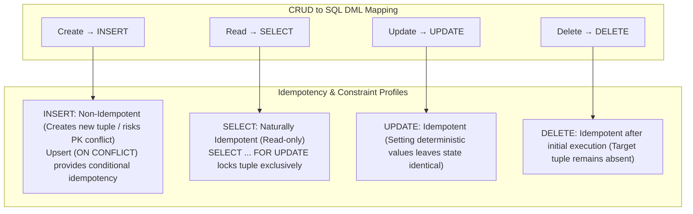

# CRUD Operations in Relational Databases: DML Semantics, Idempotency, Constraints & JDBC Patterns

---

## Key Takeaways

**CRUD** (**C**reate, **R**ead, **U**pdate, **D**elete) represents the four foundational data lifecycle operations performed on persistent storage. While frequently referenced in API design (e.g., HTTP `POST`, `GET`, `PUT`, `DELETE`), CRUD specifically maps to **Data Manipulation Language (DML)** statements in SQL: `INSERT`, `SELECT`, `UPDATE`, and `DELETE`.

Understanding CRUD in relational database management systems requires evaluating four dimensions:

1. **DML Mechanics**: Syntax, constraint enforcement (primary keys, foreign keys, unique checks, and not-null constraints), and index tree traversal.
2. **Relational Formalism**: Viewing data through relational algebra—treating tables as _relations_ and records as _tuples_—which grounds why constraints and join operations behave deterministically.
3. **Idempotency Profiles**: Whether executing an operation multiple times yields the exact same persistent state.
4. **Concurrency & Locking**: How transaction isolation levels and explicit row-level locking mechanisms (such as `SELECT ... FOR UPDATE` for pessimistic locking workflows) guard against concurrent race conditions.



- **DML Classification**: CRUD operations belong to SQL Data Manipulation Language (DML). DDL (Data Definition Language) handles schema structures (`CREATE TABLE`, `ALTER`), while DML handles tuple manipulation within those structures.
- **Idempotency Breakdown**:
  - **`INSERT`**: Non-idempotent by default. Repeating a standard `INSERT` either appends duplicate records or throws a unique constraint violation (`23505`).
  - **`SELECT`**: Inherently idempotent. Does not mutate the relation state (except when acquiring lock intent in `SELECT ... FOR UPDATE`).
  - **`UPDATE`**: Idempotent when setting deterministic values (e.g., `SET status = 'ACTIVE'`). Non-idempotent when using relative increments (e.g., `SET balance = balance + 10`).
  - **`DELETE`**: Idempotent regarding final state. The initial execution deletes the tuple (returning updated row count 1); subsequent executions find zero matching tuples and modify nothing, leaving the end state identical.
- **Constraints as Gatekeepers**: Foreign key constraints dictate that parent tuples must exist before child insertions, and restrict deletion of parent tuples referenced by active children unless cascading (`ON DELETE CASCADE`) is declared.
- **`SELECT ... FOR UPDATE`**: Acquires an exclusive write lock on matching tuples during a transaction, blocking concurrent transactions from updating or locking those same rows until `COMMIT` or `ROLLBACK` executes.

---

## Main Discussion

### Formal Relational Mapping: Relations, Tuples & Attributes

Relational database theory treats databases as mathematical sets:

- **Relation**: A mathematical set of tuples sharing the same attribute schema (represented physically as a **Table**).
- **Tuple**: An unordered set of attribute-value pairs representing an individual entity instance (represented physically as a **Row**).
- **Attribute**: A named domain value with a specific data type (represented physically as a **Column**).

Because relations are mathematical sets, a pure relation **cannot contain duplicate tuples**. In SQL, this mathematical invariant is enforced via **Primary Keys** and **Unique Constraints**.

---

### The Four CRUD Operations Under the Hood

#### 1. Create (`INSERT`)

- **SQL Form**: `INSERT INTO relation_name (attributes...) VALUES (values...);`
- **Mechanics**: The storage engine checks table constraints (not null, check constraints, foreign keys). It inserts a new tuple into the heap page, updates all associated table B+Tree indexes (e.g., primary key index, foreign key index), and writes an append-only entry to the Write-Ahead Log (WAL).
- **Idempotency**: Standard `INSERT` is **not idempotent**. To achieve idempotency, modern SQL engines use upsert extensions:

  ```sql
  -- PostgreSQL / ANSI SQL UPSERT for Idempotent Ingestion
  INSERT INTO wisdom.services (service_id, service_name, hourly_rate)
  VALUES (10, 'Security Audit', 300.00)
  ON CONFLICT (service_id)
  DO UPDATE SET service_name = EXCLUDED.service_name, hourly_rate = EXCLUDED.hourly_rate;
  ```

#### 2. Read (`SELECT`)

- **SQL Form**: `SELECT attributes... FROM relation_name WHERE condition;`
- **Mechanics**: The query optimizer evaluates table statistics. If an index matches the `WHERE` predicate, it executes an index scan ($\mathcal{O}(\log B)$ page lookups); otherwise, it performs a sequential heap scan ($\mathcal{O}(N)$).
- **Pessimistic Concurrency (`SELECT ... FOR UPDATE`)**:
  When reading data that will be updated in the same transaction based on business logic calculations (e.g., checking balance before debiting), standard reads allow race conditions. Appending `FOR UPDATE` instructs the lock manager to acquire an exclusive row-level lock on the read tuples:

  ```sql
  SELECT hourly_rate FROM wisdom.services WHERE service_id = ? FOR UPDATE;
  ```

#### 3. Update (`UPDATE`)

- **SQL Form**: `UPDATE relation_name SET attribute = value WHERE condition;`
- **Mechanics**: Locates the matching tuple via index or sequential scan. Under PostgreSQL's MVCC, the engine does not mutate the raw bytes in place; it writes a new version of the tuple with the updated values and marks the old tuple's header `t_xmax` with the current transaction ID.
- **Idempotency**: `UPDATE wisdom.services SET hourly_rate = 250.00 WHERE service_id = 1;` is **idempotent** because running it 1,000 times leaves `hourly_rate` at `250.00`. Conversely, `UPDATE ... SET hourly_rate = hourly_rate + 10` is **non-idempotent**.

#### 4. Delete (`DELETE`)

- **SQL Form**: `DELETE FROM relation_name WHERE condition;`
- **Mechanics**: Locates target tuples, verifies foreign key dependencies (checking whether child tables restrict the deletion), and marks the tuple header as dead (`t_xmax = current_tx`). The space is reclaimed later during database vacuuming.
- **Idempotency**: Idempotent with respect to final database state. After the first call removes the row, subsequent invocations match zero rows and perform no mutation.

---

### Idiomatic Java Implementation: Full CRUD Repository via JDBC

Demonstrating complete CRUD lifecycle methods using `PreparedStatement`, type-safe mappings, and pessimistic locking:

```java
package jdbc_crud;

import java.math.BigDecimal;
import java.sql.Connection;
import java.sql.PreparedStatement;
import java.sql.ResultSet;
import java.sql.SQLException;
import java.sql.Statement;
import java.util.ArrayList;
import java.util.List;
import java.util.Objects;
import java.util.Optional;

public class ServiceCrudRepository {

    public record ServiceEntity(Long id, String name, String description, BigDecimal hourlyRate, boolean active) {}

    private final Connection connection;

    public ServiceCrudRepository(Connection connection) {
        this.connection = Objects.requireNonNull(connection, "Database connection cannot be null");
    }

    // 1. CREATE: Non-idempotent insertion returning generated key
    public ServiceEntity create(String name, String description, BigDecimal rate, boolean active) throws SQLException {
        String insertSql = """
            INSERT INTO wisdom.services (service_name, description, hourly_rate, active)
            VALUES (?, ?, ?, ?)
            """;

        try (PreparedStatement stmt = connection.prepareStatement(insertSql, Statement.RETURN_GENERATED_KEYS)) {
            stmt.setString(1, name);
            stmt.setString(2, description);
            stmt.setBigDecimal(3, rate);
            stmt.setBoolean(4, active);
            stmt.executeUpdate();

            try (ResultSet keys = stmt.getGeneratedKeys()) {
                if (keys.next()) {
                    long generatedId = keys.getLong(1);
                    return new ServiceEntity(generatedId, name, description, rate, active);
                }
                throw new SQLException("Insertion failed: unable to obtain generated primary key.");
            }
        }
    }

    // 2. READ: Idempotent lookup by primary key
    public Optional<ServiceEntity> findById(long id) throws SQLException {
        String querySql = """
            SELECT service_id, service_name, description, hourly_rate, active
            FROM wisdom.services
            WHERE service_id = ?
            """;

        try (PreparedStatement stmt = connection.prepareStatement(querySql)) {
            stmt.setLong(1, id);

            try (ResultSet rs = stmt.executeQuery()) {
                if (rs.next()) {
                    return Optional.of(mapRowToEntity(rs));
                }
                return Optional.empty();
            }
        }
    }

    // 2b. READ FOR UPDATE: Pessimistic Row Lock
    public Optional<ServiceEntity> findByIdForUpdate(long id) throws SQLException {
        String lockSql = """
            SELECT service_id, service_name, description, hourly_rate, active
            FROM wisdom.services
            WHERE service_id = ?
            FOR UPDATE
            """;

        try (PreparedStatement stmt = connection.prepareStatement(lockSql)) {
            stmt.setLong(1, id);

            try (ResultSet rs = stmt.executeQuery()) {
                if (rs.next()) {
                    return Optional.of(mapRowToEntity(rs));
                }
                return Optional.empty();
            }
        }
    }

    // 3. UPDATE: Idempotent attribute modification
    public boolean updateRateAndStatus(long id, BigDecimal newRate, boolean active) throws SQLException {
        String updateSql = """
            UPDATE wisdom.services
            SET hourly_rate = ?, active = ?
            WHERE service_id = ?
            """;

        try (PreparedStatement stmt = connection.prepareStatement(updateSql)) {
            stmt.setBigDecimal(1, newRate);
            stmt.setBoolean(2, active);
            stmt.setLong(3, id);

            int affectedRows = stmt.executeUpdate();
            return affectedRows > 0;
        }
    }

    // 4. DELETE: Idempotent removal (Target state is guaranteed absent)
    public boolean deleteById(long id) throws SQLException {
        String deleteSql = "DELETE FROM wisdom.services WHERE service_id = ?";

        try (PreparedStatement stmt = connection.prepareStatement(deleteSql)) {
            stmt.setLong(1, id);
            int affectedRows = stmt.executeUpdate();
            return affectedRows > 0;
        }
    }

    private ServiceEntity mapRowToEntity(ResultSet rs) throws SQLException {
        return new ServiceEntity(
            rs.getLong("service_id"),
            rs.getString("service_name"),
            rs.getString("description"),
            rs.getBigDecimal("hourly_rate"),
            rs.getBoolean("active")
        );
    }
}
```

---

### Structural Comparisons

#### CRUD Operations: Architectural Characteristics Matrix

| Dimension             | CREATE (`INSERT`)                          | READ (`SELECT`)                                    | UPDATE (`UPDATE`)                          | DELETE (`DELETE`)                          |
| --------------------- | ------------------------------------------ | -------------------------------------------------- | ------------------------------------------ | ------------------------------------------ |
| **SQL Command**       | `INSERT INTO ...`                          | `SELECT ... FROM`                                  | `UPDATE ... SET`                           | `DELETE FROM ...`                          |
| **Idempotency**       | **Non-Idempotent** (Unless UPSERT)         | **Strictly Idempotent**                            | **Idempotent** (with fixed values)         | **Idempotent** (final state is identical)  |
| **Constraint Checks** | Primary Key, Foreign Key, Not Null, Checks | None (Joins benefit from FK indexes)               | Foreign Key, Not Null, Check Constraints   | Foreign Key (`ON DELETE RESTRICT/CASCADE`) |
| **Index Impact**      | Inserts node into every index B+Tree       | Uses index for $\mathcal{O}(\log B)$ point lookups | Rebalances indexes on updated columns only | Removes node from all index B+Trees        |
| **Locking Mode**      | Exclusive page/tuple lock                  | Shared read lock / Non-blocking MVCC snapshot      | Exclusive row-level write lock             | Exclusive row-level write lock             |

---

### Common Anti-Patterns & Edge Cases

- **Assuming `executeUpdate()` Returns Total Table Rows**:
  `PreparedStatement.executeUpdate()` returns the **number of tuples affected** by the DML statement, not the total row count of the relation. If an `UPDATE` or `DELETE` matches no rows, it returns `0`.
- **Read-Modify-Write Race Conditions**:
  Executing a `SELECT`, evaluating state inside Java memory, and then issuing an `UPDATE` without a transaction or without `SELECT ... FOR UPDATE` introduces race conditions when concurrent threads execute simultaneously. Always lock the tuple or use an atomic conditional statement (`UPDATE ... WHERE version = expectedVersion`).
- **Ignoring Foreign Key Constraint Ordering**:
  Attempting to `DELETE` a parent tuple while active child records exist with `ON DELETE RESTRICT` throws a foreign key constraint violation (`23503`). Child tuples must be removed first unless the relation is configured with cascading deletes.
- **Non-Idempotent Updates**:
  Executing relative mathematical mutations (e.g., `SET retry_count = retry_count + 1`) inside retry loops causes duplicate mutations if network acknowledgments drop. Prefer absolute status transitions.

---

## Knowledge Check & JetBrains-Style Coding Challenges

### Theory Tips

- **DML Classification**: `INSERT`, `SELECT`, `UPDATE`, and `DELETE` belong to **Data Manipulation Language (DML)**.
- **Idempotency Definition**: An operation is idempotent if executing it multiple times yields the exact same resultant system state as executing it once.
- **Pessimistic Locking**: `SELECT ... FOR UPDATE` acquires an exclusive lock on the queried row, preventing concurrent transactions from modifying it until the current transaction commits or rolls back.

### Question 1: Conceptual / Code Analysis

Consider the following two SQL statements executed against a PostgreSQL database:

```sql
-- Execution Sequence:
-- Initial state: Table orders has 1 record: (order_id = 100, status = 'PENDING')

-- Session 1:
UPDATE orders SET status = 'CANCELLED' WHERE order_id = 100; -- Run 1
UPDATE orders SET status = 'CANCELLED' WHERE order_id = 100; -- Run 2

-- Session 2:
DELETE FROM orders WHERE order_id = 100; -- Run 3
DELETE FROM orders WHERE order_id = 100; -- Run 4
```

Which statement correctly evaluates the idempotency of Run 1 through Run 4?

- [ ] **A.** Run 1 and 2 are non-idempotent because Run 2 updates an already cancelled order; Run 3 and 4 are non-idempotent because Run 4 throws an exception.
- [ ] **B.** Both operations are idempotent: Run 2 leaves the tuple in the exact same state as Run 1 (`status = 'CANCELLED'`), and Run 4 leaves the database in the exact same end state as Run 3 (the tuple is absent).
- [ ] **C.** Only `SELECT` statements are idempotent in relational databases; all DML write operations are non-idempotent.
- [ ] **D.** Run 4 throws a `SQLException: TupleNotFoundException`.

<details>
<summary>Correct Answer</summary>

**Correct Answer**: **B**

**Technical Breakdown**:

- **B is correct**:
- An operation is idempotent if the resulting state of the system is identical after one execution or multiple identical executions ($f(f(x)) = f(x)$).
- In Session 1, Run 1 sets `status = 'CANCELLED'`. Run 2 sets `status = 'CANCELLED'`. The persistent database state after Run 2 is identical to the state after Run 1. Thus, setting absolute values via `UPDATE` is idempotent.
- In Session 2, Run 3 deletes the record (affected rows = 1). Run 4 finds 0 matching rows and deletes nothing (affected rows = 0). The end state after Run 4 is identical to Run 3: the record with `order_id = 100` does not exist in the database. Deleting by primary key is idempotent with respect to state.

- **A & D are incorrect**: In SQL, executing `DELETE` on a non-existent row does not throw an exception; it returns an update count of `0`.
- **C is incorrect**: Idempotency is an operational state property; many write operations (such as absolute updates and deletes) are fully idempotent.

</details>

---
