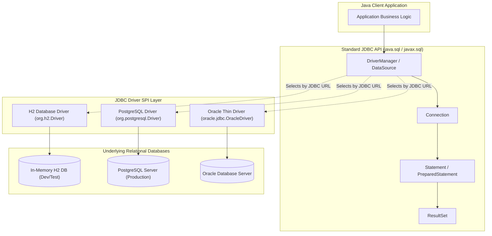

# Java Database Connectivity (JDBC): Specification, Universal Data Access & The Lifecycle Pipeline

---

## Key Takeaways

**Java Database Connectivity (JDBC)** is the foundational Java standard API (defined under **JSR 221**, updated to version **4.3** in Java 9) that provides vendor-agnostic, client-side access to relational database management systems. By decoupling the programmatic API (`java.sql` and `javax.sql`) from underlying vendor implementations via the **Driver Manager / SPI architecture**, JDBC delivers **Universal Data Access**. When application code uses ANSI-standard SQL, the underlying database engine can be swapped seamlessly—such as executing against an in-memory H2 database during local development and testing, and transitioning to PostgreSQL or Oracle in production—with minimal to zero modifications to client code.



- **Core Definition & Specification**: JDBC is a standardized client-side API defined under JSR 221 (JDBC 4.3). It abstracts relational database access into uniform interfaces.
- **Universal Data Access**: Adhering to ANSI-standard SQL allows developers to swap database vendors (e.g., H2 $\leftrightarrow$ PostgreSQL) by simply updating the JDBC connection URL and driver classpath dependencies.
- **The Universal 6-Stage JDBC Lifecycle**:
  1. **Mount Driver**: Load and register the driver (automatic via Java ServiceLoader SPI since JDBC 4.0).
  2. **Obtain Connection**: Request a physical or pooled connection handle via `DriverManager` or `DataSource`.
  3. **Demarcate Transaction**: Optionally disable auto-commit (`conn.setAutoCommit(false)`) to define atomic transaction boundaries.
  4. **Execute SQL**: Dispatch statements via `PreparedStatement`, `Statement`, or `CallableStatement` (stored procedures).
  5. **Commit or Roll Back**: If operating inside an explicit transaction, finalize state via `conn.commit()` or recover via `conn.rollback()`.
  6. **Release Resources**: Close result sets, statements, and connections (managed idiomatically via try-with-resources).
- **Checked Exception Architecture (`SQLException`)**: JDBC wraps database failures into the checked `SQLException`. The exception exposes two diagnostic fields: the standardized **SQLState** code (X/Open and SQL:2003 specs) and a vendor-specific **ErrorCode**.

---

## Main Discussion

### The 6-Stage JDBC Lifecycle Pipeline

1. **Driver Loading & Registration (SPI Architecture):**
   In modern JDBC (4.0+), drivers package a META-INF/services/java.sql.Driver file. The JVM's ServiceLoader automatically registers the driver with DriverManager upon scanning the classpath, eliminating obsolete calls to Class.forName("org.postgresql.Driver").
2. **Connection Handshake:**
   The application supplies a JDBC URL (e.g., jdbc:postgresql://localhost:5432/orders). DriverManager iterates through its registered drivers, delegating to the first one whose acceptsURL() returns true, establishing a TCP socket handshake.
3. **Transaction Demarcation:**
   By default, JDBC connections operate in auto-commit mode (every statement commits individually). Setting connection.setAutoCommit(false) instructs the database to initiate an open transaction context.
4. **Statement Execution & Parameter Binding:**
   Using PreparedStatement, SQL is pre-compiled on the database engine. Parameter markers (?) are securely bound, preventing SQL injection and allowing plan caching.
5. **Transaction Settlement (Commit / Rollback):**
   The client executes business assertions. If all statements succeed, connection.commit() persists changes to the Write-Ahead Log. If any statement fails, connection.rollback() undoes all intermediate operations.
6. **Deterministic Cleanup:**
   Failing to close JDBC handles causes connection and cursor leaks on both the JVM and database server. Implementing AutoCloseable via try-with-resources guarantees deterministic cleanup.

---

### Idiomatic Java Code Snippets

#### The Complete JDBC Lifecycle Pipeline with Safe Resource Management

Demonstrating universal ANSI SQL execution, transactional atomicity, and robust error management:

```java
package jdbc_architecture;

import java.sql.Connection;
import java.sql.DriverManager;
import java.sql.PreparedStatement;
import java.sql.ResultSet;
import java.sql.SQLException;
import java.sql.Statement;

public class JdbcLifecyclePipeline {

    public record AccountRecord(long id, String ownerName, double balance) {}

    public static void executeLifecycle(String jdbcUrl, String username, String password) throws SQLException {
        String createTableSql = """
            CREATE TABLE IF NOT EXISTS bank_accounts (
                account_id BIGINT PRIMARY KEY,
                owner_name VARCHAR(100) NOT NULL,
                balance DOUBLE PRECISION NOT NULL
            )
            """;

        String insertSql = "INSERT INTO bank_accounts (account_id, owner_name, balance) VALUES (?, ?, ?)";
        String querySql = "SELECT account_id, owner_name, balance FROM bank_accounts WHERE account_id = ?";

        // STAGE 1 & 2: Obtain Connection via DriverManager
        try (Connection conn = DriverManager.getConnection(jdbcUrl, username, password)) {

            // STAGE 3: Begin explicit transaction boundary
            conn.setAutoCommit(false);

            try (Statement ddlStmt = conn.createStatement();
                 PreparedStatement insertStmt = conn.prepareStatement(insertSql);
                 PreparedStatement selectStmt = conn.prepareStatement(querySql)) {

                // STAGE 4: Execute DDL & Seed Data
                ddlStmt.execute(createTableSql);

                // Bind parameters using typesafe methods
                insertStmt.setLong(1, 101L);
                insertStmt.setString(2, "Bruce Wayne");
                insertStmt.setDouble(3, 100_000.50);
                insertStmt.executeUpdate();

                // STAGE 5a: Commit the seeding transaction
                conn.commit();

                // Query and inspect data
                selectStmt.setLong(1, 101L);
                try (ResultSet rs = selectStmt.executeQuery()) {
                    if (rs.next()) {
                        AccountRecord account = new AccountRecord(
                            rs.getLong("account_id"),
                            rs.getString("owner_name"),
                            rs.getDouble("balance")
                        );
                        System.out.println("Retrieved: " + account);
                    }
                }

            } catch (SQLException ex) {
                // STAGE 5b: Rollback upon unexpected failure
                try {
                    conn.rollback();
                } catch (SQLException rollbackEx) {
                    ex.addSuppressed(rollbackEx);
                }
                // Delegate to centralized exception diagnosis
                JdbcExceptionDiagnostic.inspectSQLException(ex);
                throw ex;
            } finally {
                // Restore auto-commit before returning connection handle
                conn.setAutoCommit(true);
            }
        } // STAGE 6: Connection, Statements, and ResultSets automatically closed via try-with-resources
    }
}
```

#### 2. Centralized `SQLException` Diagnostic Pattern

Parsing standard `SQLState` vs. vendor `ErrorCode`, and unwinding chained exceptions:

```java
package jdbc_architecture;

import java.sql.SQLException;

public final class JdbcExceptionDiagnostic {

    private JdbcExceptionDiagnostic() {}

    /**
     * Diagnostic handler that traverses the entire SQLException chain,
     * differentiating standardized SQLState codes from vendor error codes.
     */
    public static void inspectSQLException(SQLException rootEx) {
        // SQLException implements Iterable<Throwable>, enabling direct traversal of chained causes
        for (Throwable throwable : rootEx) {
            if (throwable instanceof SQLException sqlEx) {
                System.err.println("--- Database Error Detected ---");
                System.err.println("Message:         " + sqlEx.getMessage());

                // Standardized 5-character alphanumeric code (X/Open & SQL:2003)
                // Class (first 2 chars) + Subclass (last 3 chars)
                // e.g., "23505" = Unique violation, "08001" = Unable to connect
                System.err.println("SQLState:        " + sqlEx.getSQLState());

                // Vendor-specific integer error code (e.g., PostgreSQL internal code, Oracle ORA-XXXXX)
                System.err.println("Vendor Code:     " + sqlEx.getErrorCode());
                System.err.println("Class Type:      " + sqlEx.getClass().getName());
            }
        }
    }
}
```

---

### Under the Hood / JVM Mechanics

```
   APPLICATION THREAD (DriverManager.getConnection)
+--------------------------------------------------------+
| URL: "jdbc:postgresql://localhost:5432/app"            |
+--------------------------------------------------------+
                           |
                           v
   METASPACE: java.sql.DriverManager (Registered Drivers)
+--------------------------------------------------------+
| Driver 1: org.h2.Driver (acceptsURL -> false)          |
| Driver 2: org.postgresql.Driver (acceptsURL -> true)   | ---> Instantiates Socket to 5432
+--------------------------------------------------------+
                           |
                           v
   JVM HEAP: Concrete Driver Implementations
+--------------------------------------------------------+
| PgConnection (implements java.sql.Connection)          |
|   - Holds OS Socket Descriptor                         |
|   - Protocol: PostgreSQL Frontend/Backend v3.0         |
|   - In-flight statement queue                          |
+--------------------------------------------------------+

```

1. **Java ServiceLoader Provider Registration:**
   When the JVM loads DriverManager, its static initializer invokes ServiceLoader.load(Driver.class). It inspects all JARs in the runtime module/classpath for META-INF/services/java.sql.Driver, instantiating and registering compliant driver singletons into an internal copy-on-write registry.
2. **The Connection Handshake Protocol:**
   Calling DriverManager.getConnection(url) invokes each registered driver's connect(url, info) method. The matching driver opens a low-level network socket, negotiates transport encryption (TLS/SSL), executes authentication handshakes, and returns an implementation instance (such as org.postgresql.jdbc.PgConnection).
3. **Native Prepared Statement Compilation:**
   When conn.prepareStatement(sql) is called, the driver sends a parse command over the network socket to the database engine. The DB parser constructs an Abstract Syntax Tree (AST) and caches the execution plan. Subsequent executions send only bind variable packets over the wire, saving parsing overhead and eliminating SQL injection vectors.
4. **SQLException Chaining Architecture:**
   Database servers can return multiple warnings or errors for a single query execution. The JDBC driver constructs an initial SQLException and chains subsequent issues using sqlEx.setNextException(...). Because SQLException implements `Iterable<Throwable>`, calling code can iterate through the entire failure graph without recursive unwinding.

---

### Structural Comparisons

#### `SQLState` vs. Vendor `ErrorCode`

| Attribute              | Standardized `SQLState`                                                                                    | Vendor `ErrorCode`                                                  |
| ---------------------- | ---------------------------------------------------------------------------------------------------------- | ------------------------------------------------------------------- |
| **Origin & Authority** | ANSI SQL:2003 / ISO & X/Open Standards                                                                     | Database Vendor Engine (Oracle, Postgres, MySQL)                    |
| **Format**             | Strict 5-character string (2-char Class + 3-char Subclass)                                                 | Integer (e.g., Oracle `ORA-00001`, MySQL `1062`)                    |
| **Portability**        | **High**: Predictable across swappable database engines                                                    | **None**: Completely proprietary to specific database vendor        |
| **Example Values**     | `"23505"` (Unique constraint violation)<br/>`"08006"` (Connection failure)<br/>`"42P01"` (Undefined table) | PostgreSQL: `0`<br/>MySQL: `1062`<br/>Oracle: `1` (for `ORA-00001`) |
| **Handling Strategy**  | Use for cross-database error classification and retry policies                                             | Use only when diagnosing vendor-specific engine diagnostics         |

#### Driver Management: Modern JDBC 4.0+ SPI vs. Legacy JDBC 3.0

| Feature                 | Modern JDBC 4.0+ (Java 6 through Java 25+)                                   | Legacy JDBC 3.0 (Early Java)                                     |
| ----------------------- | ---------------------------------------------------------------------------- | ---------------------------------------------------------------- |
| **Driver Registration** | Automatic via `ServiceLoader` and `META-INF/services`                        | Manual explicit call: `Class.forName("com.mysql.jdbc.Driver")`   |
| **Classpath Errors**    | Driver found automatically if dependency exists                              | Required string-based reflection; threw `ClassNotFoundException` |
| **Exception Model**     | Categorized subclasses (`SQLTransientException`, `SQLNonTransientException`) | Monolithic generic `SQLException`                                |
| **Connection Pooling**  | Standardized `javax.sql.DataSource` integration                              | Custom wrappers / ad-hoc connection management                   |

---

### Common Anti-Patterns & Edge Cases

- **SQL Injection via String Concatenation**:

  ```java
  // CRITICAL SECURITY VULNERABILITY
  Statement stmt = conn.createStatement();
  String sql = "SELECT * FROM users WHERE email = '" + userInput + "'";
  ResultSet rs = stmt.executeQuery(sql); // Allows ' OR '1'='1
  ```

  Always use `PreparedStatement` with bind parameter markers (`?`).

- **Resource Leaks via Manual `.close()` Calls**:
  Calling `.close()` at the end of a method body without try-with-resources fails to run if an intervening statement throws an exception, leaking database sockets and transaction locks.
- **Catching and Discarding `SQLException` Details**:
  Catching `SQLException` and merely printing `e.getMessage()` discards critical diagnostic context. Always inspect `e.getSQLState()` and traverse chained exceptions via `e.iterator()` or `e.getNextException()`.
- **Vendor-Specific SQL Dialect Creep**:
  Using proprietary SQL extensions (e.g., PostgreSQL `ILIKE`, Oracle `ROWNUM`, MySQL `LIMIT` without ANSI `OFFSET/FETCH`) destroys the swappability advantage of JDBC. Stick to ANSI standard SQL whenever cross-database compatibility is a design goal.

---

## Knowledge Check & JetBrains-Style Coding Challenges

### Exam / Theory Tips

- **JSR Specification**: JDBC is standardized under **JSR 221**, with its latest core baseline updated in Java 9 to version **4.3**.
- **Universal Access Rule**: By writing ANSI standard SQL queries, application code can swap underlying relational engines (e.g., H2 in-memory for testing, PostgreSQL for production) by simply altering connection credentials and driver libraries.
- **Auto-Commit Behavior**: JDBC connections default to `autoCommit = true`. Explicit transaction boundaries require `setAutoCommit(false)` followed by explicit `commit()` or `rollback()`.

### Question 1: Conceptual / Code Analysis

A developer writes the following database test method to evaluate connection resilience:

```java
import java.sql.*;

public class JdbcDriverVerification {
    public static void testConnection(String url, String user, String pass) {
        try (Connection conn = DriverManager.getConnection(url, user, pass)) {
            System.out.println("Connection successful");
        } catch (SQLException ex) {
            String sqlState = ex.getSQLState();
            int errorCode = ex.getErrorCode();
            System.out.println(sqlState + " : " + errorCode);
        }
    }
}
```

If the database server is completely offline and unreachable at the supplied network address, which statement correctly describes the behavior of `sqlState` and `errorCode`?

- [ ] **A.** `sqlState` will be null, and `errorCode` will be `0` because no SQL was dispatched.
- [ ] **B.** `sqlState` will contain a standardized 5-character connection exception code (typically starting with class `"08"`), while `errorCode` will be vendor-specific.
- [ ] **C.** `DriverManager` will throw a runtime `NetworkTimeoutException` instead of a checked `SQLException`.
- [ ] **D.** The application will halt with a compile-time error because `Class.forName()` was not called.

<details>
<summary>Correct Answer</summary>

**Correct Answer**: **B**

**Technical Breakdown**:

- **B is correct**: Connection failures trigger a `SQLException` with a standardized SQLState defined by X/Open and SQL:2003 standards. Connection-class errors use class `"08"` (e.g., `"08001"` for client unable to establish connection, or `"08006"` for connection failure). The `errorCode` is assigned by the specific vendor's driver.
- **A is incorrect**: Drivers populate `SQLState` for connection-level errors; it is not null.
- **C is incorrect**: All connectivity failures in JDBC are wrapped in `SQLException` (specifically `SQLTransientConnectionException` or `SQLNonTransientConnectionException`).
- **D is incorrect**: Since JDBC 4.0, drivers are loaded automatically via the Java ServiceLoader SPI, making `Class.forName()` unnecessary.

</details>

---
