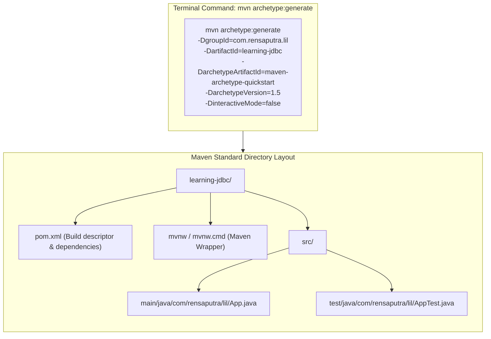

# Project Scaffolding: Generating a Java Project via the Maven Quickstart Archetype

---

## Key Takeaways

To interface with the seeded PostgreSQL database using JDBC, we bootstrap a clean Java application workspace using **Apache Maven**. Rather than assembling directory hierarchies and XML configurations manually, Maven provides the **`archetype:generate`** plugin—a templating toolkit that scaffolds projects conforming to Maven's **Standard Directory Layout**.

By targeting the official **`maven-archetype-quickstart`** (version `1.5`) in non-interactive batch mode (`-DinteractiveMode=false`), Maven generates a production-standard directory tree (`src/main/java`, `src/test/java`), populates a foundational `pom.xml` (Project Object Model), creates a starter entry point (`App.java`), and packages self-contained Maven Wrapper scripts (`mvnw` and `mvnw.cmd`).



- **Maven Coordinates**: Every Maven project is uniquely identified in the global repository space by its **GAV** coordinates:
  - **`groupId`**: The reverse domain name packaging root (e.g., `com.rensaputra.lil`).
  - **`artifactId`**: The build output / project directory identifier (e.g., `learning-jdbc`).
  - **`version`**: The release iteration (defaults to `1.0-SNAPSHOT` when omitted).
- **Archetype Templating (`maven-archetype-quickstart`)**: A project template that generates the basic structure needed for a standalone Java application.
- **Non-Interactive Execution (`-DinteractiveMode=false`)**: Suppresses prompt-and-confirm questions, allowing immediate, deterministic automation directly in CI/CD pipelines or cloud environments like GitHub Codespaces.
- **Standard Directory Layout**: Separates production source code (`src/main/java`) from test harnesses (`src/test/java`) and runtime resources (`src/main/resources`).
- **The Maven Wrapper (`mvnw`)**: A distribution tool ensuring builds run consistently with a pinned, self-downloading Maven version across developer machines without requiring a pre-installed system Maven binary.

---

## Main Discussion

### Executing the Archetype Generation in the Terminal

Run the following command from the root of your workspace in Codespaces or your local terminal:

```bash
mvn archetype:generate \
  -DgroupId=com.rensaputra.lil \
  -DartifactId=learning-jdbc \
  -DarchetypeArtifactId=maven-archetype-quickstart \
  -DarchetypeVersion=1.5 \
  -DinteractiveMode=false
```

1. **Artifact Resolution & Archetype Download:**
   Maven contacts the local repository cache (~/.m2/repository) or Maven Central to download maven-archetype-quickstart:1.5.
2. **Directory Scaffolding:**
   Maven creates a new subfolder named after the artifactId (learning-jdbc/) and generates the Standard Directory Layout underneath it.
3. **Package Directory Translation:**
   The dot-separated groupId (com.rensaputra.lil) is translated into the physical filesystem directory path src/main/java/com/rensaputra/lil/.
4. **Source & POM Generation:**
   A default executable entry-point class App.java and a starter JUnit test file AppTest.java are created, alongside the baseline pom.xml file.

---

### Anatomy of the Generated Directory Tree

```
learning-jdbc/
├── pom.xml                     # Core Project Object Model descriptor
├── mvnw                        # Linux/macOS Maven Wrapper shell script
├── mvnw.cmd                    # Windows Maven Wrapper batch file
├── .mvn/
│   └── wrapper/
│       └── maven-wrapper.properties  # Pinned Maven distribution URL
└── src/
    ├── main/
    │   └── java/
    │       └── com/
    │           └── rensaputra/
    │               └── lil/
    │                   └── App.java     # Application entry-point (main)
    └── test/
        └── java/
            └── com/
                └── rensaputra/
                    └── lil/
                        └── AppTest.java # Default unit test harness
```

---

### The Generated Source Files

#### 1. Application Entry Point (`src/main/java/com/rensaputra/lil/App.java`)

The starter class generated at the base package:

```java
package com.rensaputra.lil;

/**
 * Default entry point generated by maven-archetype-quickstart:1.5.
 */
public class App {
    public static void main(String[] args) {
        System.out.println("Hello World!");
    }
}
```

#### 2. Project Object Model (`learning-jdbc/pom.xml`)

The declarative XML file defining build plugins, compiler target versions, and dependencies:

```xml
<?xml version="1.0" encoding="UTF-8"?>
<project xmlns="http://maven.apache.org/POM/4.0.0"
         xmlns:xsi="http://www.w3.org/2001/XMLSchema-instance"
         xsi:schemaLocation="http://maven.apache.org/POM/4.0.0
                             http://maven.apache.org/xsd/maven-4.0.0.xsd">
    <modelVersion>4.0.0</modelVersion>

    <groupId>com.rensaputra.lil</groupId>
    <artifactId>learning-jdbc</artifactId>
    <version>1.0-SNAPSHOT</version>

    <properties>
        <project.build.sourceEncoding>UTF-8</project.build.sourceEncoding>
        <maven.compiler.release>21</maven.compiler.release>
    </properties>

    <!-- In upcoming modules, dependencies like org.postgresql:postgresql will be added here -->
    <dependencies>
        <dependency>
            <groupId>org.junit.jupiter</groupId>
            <artifactId>junit-jupiter-api</artifactId>
            <version>5.11.0</version>
            <scope>test</scope>
        </dependency>
    </dependencies>
</project>
```

---

### Maven Wrapper (`mvnw`) Mechanics

The archetype bundles the **Maven Wrapper** files (`mvnw`, `mvnw.cmd`, `.mvn/`).

- **When to keep it**: Essential in team workflows where developers or CI/CD runners may not have Maven pre-installed, or to prevent build differences caused by mismatched local Maven versions. Running `./mvnw clean compile` auto-downloads the exact Maven binary specified in `maven-wrapper.properties`.
- **When to delete it**: If your environment (such as the devcontainer in Codespaces) already provides a globally installed, standardized `mvn` CLI, the wrapper files can be deleted without affecting project builds.

---

## Knowledge Check

### Theory Tips

- **Archetype Purpose**: An archetype is an abstract project pattern or template used to scaffold a new project structure and default POM.
- **Property Flags (`-D`)**: The `-D` flag in Maven commands sets system properties on the command line (e.g., `-DgroupId=...`, `-DartifactId=...`).
- **Non-Interactive Flag**: Passing `-DinteractiveMode=false` instructs the archetype plugin to accept default configurations without prompting the terminal for confirmation.
