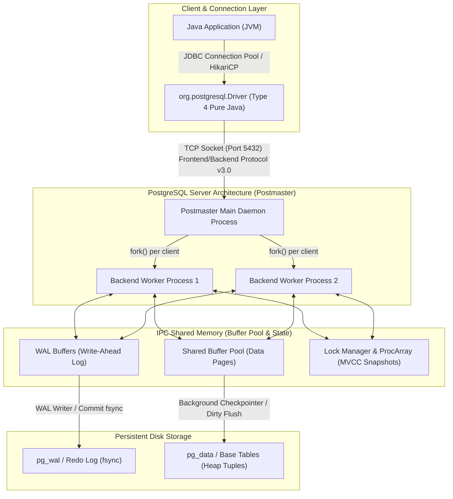

# PostgreSQL Architecture: Object-Relational Models, MVCC Engine Mechanics & JDBC Driver Integration

---

## Key Takeaways

**PostgreSQL** is an open-source **Object-Relational Database Management System (ORDBMS)** originally conceived as the POSTGRES project under Michael Stonebraker at UC Berkeley (1986). It bridges relational relational-algebra modeling with object-oriented capabilities, supporting user-defined composite types, table inheritance, and custom operators while maintaining strict **ACID compliance**.

Unlike conventional single-process threaded engines, PostgreSQL employs a **process-based concurrency architecture** coordinated via shared memory and **Multi-Version Concurrency Control (MVCC)**. For modern software engineering and enterprise JDBC workflows, PostgreSQL stands out for its deep compliance with ANSI-standard SQL (SQL:2023 core features), native JSON/JSONB document processing, robust procedural capabilities (`PL/pgSQL` functions and stored procedures), triggers, materialized views, and containerized deployment patterns (Docker/Kubernetes).



- **Object-Relational Architecture**: Extends standard relational tables with object concepts: custom domain types, structural composites, functions, table inheritance, and array data types.
- **ACID & MVCC Guarantees**: Enforces transactional durability without read-write locking contention; readers never block writers, and writers never block readers.
- **Process-Based Execution Model**: The `postmaster` supervisor daemon listens on port 5432 and `fork()`s an isolated OS process for each connected client connection, isolating memory address spaces.
- **Advanced RDBMS Features**:
  - **Materialized Views**: Caches query results on disk and supports asynchronous or concurrent refresh (`REFRESH MATERIALIZED VIEW CONCURRENTLY`).
  - **Triggers & Rules**: Event-driven hooks executed row-by-row or per-statement on `INSERT`, `UPDATE`, `DELETE`, or `TRUNCATE`.
  - **Stored Procedures & Functions**: Procedural business logic written in `PL/pgSQL`, SQL, Python (`PL/Python`), or C, with full transaction management (`COMMIT`/`ROLLBACK` inside procedures).
- **Portability & Local Dev**: Cross-platform support across Linux, macOS, and Windows, commonly containerized locally via Docker or local Kubernetes setups.

---

## Main Discussion

### The PostgreSQL Process & Memory Engine

PostgreSQL relies on an Inter-Process Communication (IPC) architecture rather than a shared-thread paradigm:

1. **Client Connection**: When a Java application connects using the Type 4 `org.postgresql.Driver`, it connects to port 5432 over the PostgreSQL Frontend/Backend Protocol 3.0.
2. **Process Forking**: The `postmaster` listener receives the connection and invokes the `fork()` system call to spawn a dedicated backend worker process (`postgres`).
3. **Memory Isolation vs. Shared Memory**:
   - **Local Backend Memory**: Each worker process allocates private memory for execution, governed by configuration parameters like `work_mem` (for sorting and hash tables) and `maintenance_work_mem` (for vacuuming and index creation).
   - **Shared Memory (`shared_buffers`)**: All worker processes attach to a global shared memory segment managed by the operating system (typically sized to 25%–40% of system RAM on dedicated servers). This holds cached data pages, the lock manager, and the transaction status log (`pg_xact`).

---

### Object-Relational Capabilities: Beyond Standard SQL

PostgreSQL extends standard relational algebra with object-oriented and semi-structured capabilities:

```sql
-- 1. Custom Composite Object Type
CREATE TYPE currency_amount AS (
    amount NUMERIC(12, 2),
    currency_code VARCHAR(3)
);

-- 2. Domain Type with Built-in Check Constraints
CREATE DOMAIN email_address AS VARCHAR(255)
    CHECK (VALUE ~* '^[A-Za-z0-9._%+-]+@[A-Za-z0-9.-]+\.[A-Za-z]{2,}$');

-- 3. Object-Relational Table using Domains, Composites, and Native Arrays
CREATE TABLE merchant_invoices (
    invoice_id BIGSERIAL PRIMARY KEY,
    billing_email email_address NOT NULL,
    total_due currency_amount NOT NULL,
    payment_tags TEXT[] NOT NULL DEFAULT '{}',
    audit_metadata JSONB NOT NULL DEFAULT '{}'::jsonb,
    created_at TIMESTAMP WITH TIME ZONE DEFAULT CURRENT_TIMESTAMP
);

-- 4. Materialized View Caching Query Executions
CREATE MATERIALIZED VIEW mv_daily_invoice_summary AS
SELECT
    CAST(created_at AS DATE) AS invoice_date,
    COUNT(*) AS total_invoices,
    SUM((total_due).amount) AS gross_total
FROM merchant_invoices
GROUP BY CAST(created_at AS DATE);

-- 5. Stored Procedure with Explicit Transaction Control (Introduced in PostgreSQL 11+)
CREATE OR REPLACE PROCEDURE pr_reconcile_invoice(p_invoice_id BIGINT, p_tag TEXT)
LANGUAGE plpgsql
AS $$
BEGIN
    UPDATE merchant_invoices
    SET payment_tags = array_append(payment_tags, p_tag)
    WHERE invoice_id = p_invoice_id;

    -- Stored procedures can explicitly control transactional state
    IF NOT FOUND THEN
        RAISE EXCEPTION 'Invoice ID % not found for reconciliation', p_invoice_id;
    END IF;

    COMMIT;
END;
$$;
```

---

### Modern Java Integration: Interfacing via Pure JDBC

Interacting with PostgreSQL features (such as array types, transactional procedures, and auto-generated keys) via standard JDBC:

```java
package postgresql_integration;

import java.sql.Array;
import java.sql.CallableStatement;
import java.sql.Connection;
import java.sql.DriverManager;
import java.sql.PreparedStatement;
import java.sql.ResultSet;
import java.sql.SQLException;
import java.sql.Statement;
import java.util.Arrays;
import java.util.List;

public class PostgresJdbcRepository {

    private final String url;
    private final String username;
    private final String password;

    public PostgresJdbcRepository(String url, String username, String password) {
        this.url = url;
        this.username = username;
        this.password = password;
    }

    public record InvoiceSummary(long id, String email, double amount, String currency, List<String> tags) {}

    public long createInvoice(String email, double amount, String currency, String[] tags) throws SQLException {
        String insertSql = """
            INSERT INTO merchant_invoices (billing_email, total_due, payment_tags)
            VALUES (?, ROW(?, ?)::currency_amount, ?)
            """;

        try (Connection conn = DriverManager.getConnection(url, username, password);
             PreparedStatement stmt = conn.prepareStatement(insertSql, Statement.RETURN_GENERATED_KEYS)) {

            // Bind domain primitives
            stmt.setString(1, email);
            stmt.setDouble(2, amount);
            stmt.setString(3, currency);

            // Mapping Java array to native PostgreSQL SQL Array
            Array sqlArray = conn.createArrayOf("text", tags);
            stmt.setArray(4, sqlArray);

            stmt.executeUpdate();

            try (ResultSet keys = stmt.getGeneratedKeys()) {
                if (keys.next()) {
                    return keys.getLong(1);
                }
                throw new SQLException("Failed to retrieve generated invoice key.");
            }
        }
    }

    public void invokeReconciliationProcedure(long invoiceId, String tag) throws SQLException {
        // Calling a PostgreSQL PL/pgSQL Procedure via JDBC CallableStatement
        String callSql = "CALL pr_reconcile_invoice(?, ?)";

        try (Connection conn = DriverManager.getConnection(url, username, password);
             CallableStatement cstmt = conn.prepareCall(callSql)) {

            cstmt.setLong(1, invoiceId);
            cstmt.setString(2, tag);
            cstmt.execute();
        }
    }

    public InvoiceSummary findInvoiceById(long invoiceId) throws SQLException {
        String querySql = """
            SELECT invoice_id, billing_email, (total_due).amount AS amt,
                   (total_due).currency_code AS curr, payment_tags
            FROM merchant_invoices
            WHERE invoice_id = ?
            """;

        try (Connection conn = DriverManager.getConnection(url, username, password);
             PreparedStatement stmt = conn.prepareStatement(querySql)) {

            stmt.setLong(1, invoiceId);

            try (ResultSet rs = stmt.executeQuery()) {
                if (rs.next()) {
                    // Extracting native SQL array back into Java List
                    Array sqlArray = rs.getArray("payment_tags");
                    String[] tagStrings = (String[]) sqlArray.getArray();

                    return new InvoiceSummary(
                        rs.getLong("invoice_id"),
                        rs.getString("billing_email"),
                        rs.getDouble("amt"),
                        rs.getString("curr"),
                        Arrays.asList(tagStrings)
                    );
                }
                return null;
            }
        }
    }
}
```

---

### Under the Hood / JVM Mechanics

```
   HEAP TUPLE RECORD (Physical Disk Block)
+------------------------------------------------------------------------------------+
| Header: t_xmin (Tx 101) | t_xmax (Tx 105) | t_cid | t_ctid (Tuple Pointer)         |
+------------------------------------------------------------------------------------+
| Data Payload: invoice_id=1, email='dev@example.com', amount=150.00                 |
+------------------------------------------------------------------------------------+
```

1. **Tuple Header Snapshot Metadata (xmin & xmax):**
   Every row (tuple) in a PostgreSQL table header contains two critical metadata fields:
2. **MVCC Non-Blocking Isolation Resolution:**
   When a query runs under READ COMMITTED isolation, it takes a snapshot of the active transaction array (ProcArray). A tuple is visible only if its t_xmin has committed prior to the snapshot and its t_xmax is uncommitted or greater than the current transaction ID. This guarantees reading queries never lock out writing queries.
3. **In-Place Updates vs. Tuple Deadweight:**
   PostgreSQL never overwrites existing records during an UPDATE. It marks the existing tuple's t_xmax with the current transaction ID, appends an entirely new version of the tuple to the heap table, and updates indexes to point to the new location (unless HOT—Heap-Only Tuple optimization—applies).
4. **Vacuuming & Space Reclamation:**
   Because dead tuples remain on disk to support historical isolation snapshots, the background VACUUM engine scans heap pages once transactions complete. It reclaims storage space, updates visibility maps, and freezes old transaction IDs to prevent transaction ID wraparound.

---

### Structural Comparisons

#### Relational vs. Object-Relational vs. Document Engines

| Characteristic         | Traditional RDBMS (e.g., MySQL InnoDB)  | Object-Relational (PostgreSQL)                      | Native Document NoSQL (e.g., MongoDB)      |
| ---------------------- | --------------------------------------- | --------------------------------------------------- | ------------------------------------------ |
| **Data Paradigm**      | Flat Relational Tables & Standard Types | Tables, Composite Types, Arrays, Objects, JSONB     | Hierarchical BSON/JSON Documents           |
| **Concurrency Model**  | Two-Phase Locking / InnoDB MVCC         | Process-based MVCC (Snapshot-based)                 | WiredTiger Cache & Document-level locking  |
| **Type Extensibility** | Fixed set of SQL primitive types        | **Unlimited**: User-defined types, custom operators | Schema-free / Document validation          |
| **Procedural Logic**   | Stored Procedures (`SQL/PSM`)           | Procedures & Functions (`PL/pgSQL`, Python, C)      | Server-side JavaScript (limited)           |
| **Index Types**        | B-Tree, Fulltext                        | **B-Tree, Hash, GiST, SP-GiST, GIN, BRIN**          | B-Tree, Geospatial, Text                   |
| **ACID Guarantees**    | Strict multi-row ACID                   | **Strict multi-row ACID across all data models**    | Tunable / Document-level atomicity default |

#### PostgreSQL Procedural Execution: Functions vs. Procedures

| Architectural Property  | Function (`CREATE FUNCTION`)                                   | Stored Procedure (`CREATE PROCEDURE`)                          |
| ----------------------- | -------------------------------------------------------------- | -------------------------------------------------------------- |
| **Invocation Syntax**   | `SELECT my_func(args);`                                        | `CALL my_procedure(args);`                                     |
| **Return Capability**   | **Mandatory**: Must return a value, composite, or `void`       | Cannot return values directly (uses `INOUT` parameters)        |
| **Transaction Control** | **Cannot** manage transactions (`COMMIT`/`ROLLBACK` forbidden) | **Can** execute explicit `COMMIT` and `ROLLBACK` mid-execution |
| **Query Embedding**     | Can be called directly inside `WHERE`, `SELECT`, or `JOIN`     | Cannot be called inside a `SELECT` statement                   |

---

### Common Anti-Patterns & Edge Cases

- **Connection-per-Request without Pooling (Process Exhaustion)**:
  Because PostgreSQL allocates a separate OS process per connection, opening hundreds of raw connections directly from Java exhausts server RAM and causes CPU thrashing due to OS context switching. Always manage connections through a high-performance connection pool (such as **HikariCP**), sized appropriately for your hardware.
- **Neglecting VACUUM on High-Write Workloads (Table Bloat)**:
  Workloads with heavy `UPDATE` and `DELETE` activity generate millions of dead tuples. Disabling the `autovacuum` daemon causes table bloat, degrades index lookups, and risks emergency shutdowns from 32-bit transaction ID wraparound.
- **Using `JSON` Instead of `JSONB`**:
  PostgreSQL supports both `JSON`and`JSONB`. The `JSON`type stores raw text, requiring re-parsing on every query.`JSONB` stores decomposed binary data, which introduces minor write parsing overhead but provides substantially faster read operations and support for **GIN (Generalized Inverted Index)** indexing.
- **Overusing Table Inheritance**:
  While PostgreSQL supports `CREATE TABLE child () INHERITS (parent)`, foreign keys, unique constraints, and indexes do not propagate across the inheritance boundary automatically. Favor standard foreign-key composition over table inheritance for domain modeling.

---

## Knowledge Check & JetBrains-Style Coding Challenges

### Exam / Theory Tips

- **Engine Type**: PostgreSQL is classified as an **Object-Relational Database Management System (ORDBMS)**, not merely a flat relational engine.
- **Default Port**: The default listening port for PostgreSQL services and JDBC connection URLs is **`5432`**.
- **Driver Class & Prefix**: The official JDBC driver class name is `org.postgresql.Driver`, connecting via the URL scheme prefix `jdbc:postgresql://<host>:<port>/<database>`.
- **MVCC Isolation Principle**: In PostgreSQL, readers never block writers, and writers never block readers.

### Question 1: Conceptual / Code Analysis

Consider the following two database transactions running concurrently in PostgreSQL under the default `READ COMMITTED` isolation level:

```sql
-- Initial State:
-- Table: products (id INT PRIMARY KEY, stock INT);
-- Initial Row: id = 1, stock = 100;

-- Session A:
BEGIN;
UPDATE products SET stock = 75 WHERE id = 1;

-- Session B (executed while Session A is still open and uncommitted):
SELECT stock FROM products WHERE id = 1; -- Statement 1

-- Session A:
COMMIT;

-- Session B:
SELECT stock FROM products WHERE id = 1; -- Statement 2
COMMIT;
```

What values are returned by Statement 1 and Statement 2 in Session B, and why?

- [ ] **A.** Statement 1 blocks until Session A commits; Statement 2 returns `75`.
- [ ] **B.** Statement 1 returns `75`; Statement 2 returns `100`.
- [ ] **C.** Statement 1 returns `75`; Statement 2 returns `75`.
- [ ] **D.** Statement 1 throws a `DeadlockException`.

<details>
<summary>Correct Answer</summary>

**Correct Answer**: **B**

**Technical Breakdown**:

- **B is correct**:
  1. Statement 1 runs in Session A:
     - Session A begins a transaction and updates the `stock` from `100` to `75`, but does not commit yet.
  2. Statement 2 runs in Session B:
     - Session B executes a `SELECT` query while Session A's transaction is still open. Under the `READ COMMITTED` isolation level, Session B sees the last committed value of `stock`, which is still `100`. Therefore, Statement 1 returns `100`.
- **A is incorrect**: In PostgreSQL, readers do not block on row write locks.
- **C is incorrect**: Reading `75` in Statement 1 would violate read-committed isolation (a dirty read).
- **D is incorrect**: Concurrent non-blocking reads do not trigger deadlocks.

</details>

---
