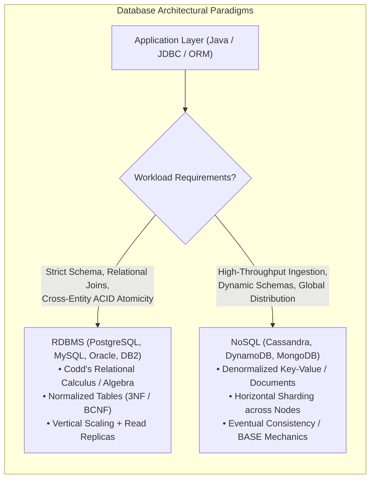
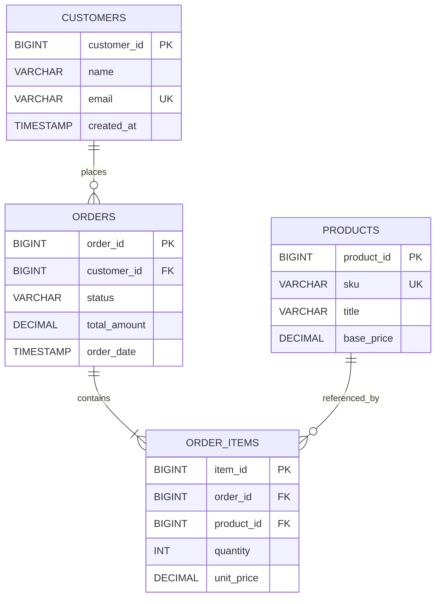

# Relational Database Management Systems: Codd’s Relational Model, ACID Mechanics & RDBMS vs. NoSQL Architectural Selection

---

## Key Takeaways

Relational Database Management Systems (**RDBMS**) originate from Edgar F. Codd’s 1970 IBM research paper, _"A Relational Model of Data for Large Shared Data Banks"_. Codd introduced relational algebra, formal normalization rules (leading to 1NF, 2NF, 3NF, and BCNF), and what became known as Codd’s 12 Rules (technically 13, numbered 0 to 12). Commercial pioneers like IBM (System R $\rightarrow$ DB2) and Larry Ellison (Relational Software Inc. $\rightarrow$ Oracle Database) brought the relational engine to market.

RDBMS architectures prioritize **ACID transactions** (Atomicity, Consistency, Isolation, Durability) and normalized schemas modeling structured entities with strict foreign-key integrity constraints. In contrast, modern distributed **NoSQL systems** (e.g., wide-column, document, key-value, and graph stores) emerged to handle horizontal scalability across commodity clusters, trading immediate consistency or multi-table atomic operations for partition tolerance and eventual consistency (BASE model).



- **Codd's Relational Foundations**: Data is organized into relations (tables) composed of tuples (rows) and attributes (columns), manipulated via relational algebra rather than physical pointer paths.
- **Normalization Hierarchy**: 1NF (atomic values, no repeating groups), 2NF (no partial dependencies on a composite key), 3NF (no transitive functional dependencies), and **BCNF** (Boyce-Codd Normal Form: for every functional dependency $X \rightarrow Y$, $X$ must be a super key).
- **The ACID Guarantee**:
  - **Atomicity**: The entire transaction completes successfully or rolls back completely ("all or nothing").
  - **Consistency**: Transitions the database only between valid states satisfying all constraints, triggers, and foreign keys.
  - **Isolation**: Concurrent transactions execute without cross-contaminating intermediate states (governed by isolation levels).
  - **Durability**: Committed transactions persist permanently across crashes, power failures, or server restarts via write-ahead logging (WAL).
- **RDBMS vs. NoSQL Decision Heuristics**:
  - Choose **RDBMS** when strong entity relationships, normalization, strict schema governance, and multi-entity atomic transactions are non-negotiable.
  - Choose **NoSQL** for massively distributed architectures requiring horizontal sharding, flexible document schemas, or write-heavy append workloads.

---

## Main Discussion

### Architectural Blueprint & The Core Relational Schema

Relational databases use declarative SQL to execute relational operations (projection, restriction, cartesian product, join, union, intersection, difference).



### Relational Schema Definition (DDL)

```sql
-- DDL illustrating normalization, primary keys, foreign keys, and integrity constraints
CREATE TABLE customers (
    customer_id BIGSERIAL PRIMARY KEY,
    name VARCHAR(100) NOT NULL,
    email VARCHAR(255) NOT NULL UNIQUE,
    created_at TIMESTAMP WITH TIME ZONE DEFAULT CURRENT_TIMESTAMP
);

CREATE TABLE orders (
    order_id BIGSERIAL PRIMARY KEY,
    customer_id BIGINT NOT NULL,
    status VARCHAR(30) NOT NULL,
    total_amount NUMERIC(12, 2) NOT NULL CHECK (total_amount >= 0.0),
    order_date TIMESTAMP WITH TIME ZONE DEFAULT CURRENT_TIMESTAMP,
    CONSTRAINT fk_orders_customer FOREIGN KEY (customer_id)
        REFERENCES customers (customer_id) ON DELETE RESTRICT
);

CREATE TABLE products (
    product_id BIGSERIAL PRIMARY KEY,
    sku VARCHAR(64) NOT NULL UNIQUE,
    title VARCHAR(150) NOT NULL,
    base_price NUMERIC(10, 2) NOT NULL CHECK (base_price >= 0.0)
);

CREATE TABLE order_items (
    item_id BIGSERIAL PRIMARY KEY,
    order_id BIGINT NOT NULL,
    product_id BIGINT NOT NULL,
    quantity INT NOT NULL CHECK (quantity > 0),
    unit_price NUMERIC(10, 2) NOT NULL CHECK (unit_price >= 0.0),
    CONSTRAINT fk_items_order FOREIGN KEY (order_id)
        REFERENCES orders (order_id) ON DELETE CASCADE,
    CONSTRAINT fk_items_product FOREIGN KEY (product_id)
        REFERENCES products (product_id) ON DELETE RESTRICT
);
```

### JDBC Implementation: Enforcing ACID Atomicity in Java

In JDBC, `Connection.setAutoCommit(false)` starts an explicit atomic boundary. The transaction either completes via `connection.commit()` or rolls back via `connection.rollback()` inside a `catch` block:

```java
package rdbms_foundations;

import java.math.BigDecimal;
import java.sql.Connection;
import java.sql.DriverManager;
import java.sql.PreparedStatement;
import java.sql.ResultSet;
import java.sql.SQLException;
import java.sql.Statement;

public class OrderTransactionService {

    private final String dbUrl;
    private final String user;
    private final String password;

    public OrderTransactionService(String dbUrl, String user, String password) {
        this.dbUrl = dbUrl;
        this.user = user;
        this.password = password;
    }

    /**
     * Executes an atomic multi-table order placement under strict ACID guarantees.
     */
    public long placeOrderAtomically(long customerId, long productId, int quantity, BigDecimal unitPrice)
            throws SQLException {

        String insertOrderSql = "INSERT INTO orders (customer_id, status, total_amount) VALUES (?, ?, ?)";
        String insertItemSql = "INSERT INTO order_items (order_id, product_id, quantity, unit_price) VALUES (?, ?, ?, ?)";

        BigDecimal totalAmount = unitPrice.multiply(BigDecimal.valueOf(quantity));

        try (Connection conn = DriverManager.getConnection(dbUrl, user, password)) {
            // STEP 1: Disable Auto-Commit to manually control ACID boundary
            conn.setAutoCommit(false);

            long generatedOrderId;

            try (PreparedStatement orderStmt = conn.prepareStatement(insertOrderSql, Statement.RETURN_GENERATED_KEYS);
                 PreparedStatement itemStmt = conn.prepareStatement(insertItemSql)) {

                // Insert Parent Order
                orderStmt.setLong(1, customerId);
                orderStmt.setString(2, "CONFIRMED");
                orderStmt.setBigDecimal(3, totalAmount);
                orderStmt.executeUpdate();

                try (ResultSet keys = orderStmt.getGeneratedKeys()) {
                    if (keys.next()) {
                        generatedOrderId = keys.getLong(1);
                    } else {
                        throw new SQLException("Failed to obtain generated order_id.");
                    }
                }

                // Insert Child Order Item
                itemStmt.setLong(1, generatedOrderId);
                itemStmt.setLong(2, productId);
                itemStmt.setInt(3, quantity);
                itemStmt.setBigDecimal(4, unitPrice);
                itemStmt.executeUpdate();

                // STEP 2: Atomic Commit (Flushes to disk via Write-Ahead Log)
                conn.commit();
                return generatedOrderId;

            } catch (SQLException | RuntimeException ex) {
                // STEP 3: Atomic Rollback (Reverts all writes on error)
                try {
                    conn.rollback();
                } catch (SQLException rollbackEx) {
                    ex.addSuppressed(rollbackEx);
                }
                throw ex;
            } finally {
                // Reset connection state before returning to pool
                conn.setAutoCommit(true);
            }
        }
    }
}
```

### Under the Hood / Database Engine Mechanics

```
   RDBMS TRANSACTION LIFECYCLE
+------------------------------------+        +----------------------------------------+
| Client: conn.commit()              |------->| 1. Write to Write-Ahead Log (WAL / Redo)|
+------------------------------------+        |    - fsync() commits data to disk log  |
                                              +----------------------------------------+
                                                                   |
                                                                   v
+------------------------------------+        +----------------------------------------+
| 3. Dirty Buffer Pool Flushed       |<-------| 2. Shared Memory Buffer Pool Updated   |
|    - Background Checkpointer       |        |    - In-memory data pages dirtied      |
+------------------------------------+        +----------------------------------------+

```

1. **Write-Ahead Logging (WAL / Redo Log) for Durability:**
   When an RDBMS processes an insert or update, it does not immediately flush modified tablespace pages to disk. Instead, it writes a compact change record to the append-only Write-Ahead Log (WAL). The transaction is marked committed only when the WAL is synced to disk via an fsync() system call, guaranteeing durability with high write throughput.
2. **Concurrency Control (MVCC vs. 2PL):**
   Modern relational engines (such as PostgreSQL, MySQL InnoDB, and Oracle) use Multi-Version Concurrency Control (MVCC) rather than strict Two-Phase Locking (2PL) for reads. Writers create new versions of row tuples with creation/deletion transaction identifiers (xmin/xmax). Readers read a consistent snapshot of the data without blocking concurrent writers, preventing read-write lock contention.
3. **B+Tree Index Traversals:**
   Primary keys and foreign keys are backed by B+Tree indexes. All data pointers reside in leaf nodes connected by bi-directional linked pointers, enabling both point queries and range scans in guaranteed $\mathcal{O}(\log B)$ page I/O lookups, where $B$ is the tree fan-out factor.
4. **Crash Recovery (ARIES Algorithm):**
   If power fails mid-transaction, during reboot the database engine scans the WAL in three passes:

### Structural Comparisons

#### RDBMS vs. NoSQL Architecture Matrix

| Architectural Dimension   | Relational Database (RDBMS)                        | Distributed NoSQL (Key-Value, Document, Columnar)                |
| ------------------------- | -------------------------------------------------- | ---------------------------------------------------------------- |
| **Foundational Theory**   | Codd’s Relational Algebra & Calculus               | Distributed Systems Theory, CAP Theorem, Dynamo/Bigtable         |
| **Primary Data Model**    | Normalized Relations (Tables, Rows, Columns)       | Key-Value, JSON Documents, Wide-Column, Graph                    |
| **Schema Governance**     | **Strict, strongly typed schema** (DDL)            | Dynamic, schema-on-read, or schemaless                           |
| **Transaction Model**     | **Strict ACID** (Multi-table, multi-row atomicity) | **BASE** (Basically Available, Soft-state, Eventual consistency) |
| **Scaling Vector**        | **Vertical scaling** (scale-up); read replicas     | **Horizontal scaling** (scale-out via partition keys / sharding) |
| **Query Mechanism**       | Standardized Declarative SQL                       | Proprietary APIs, CQL, MongoDB Query DSL                         |
| **Relationships / Joins** | Native, highly optimized relational joins          | Denormalization, client-side joins, pre-computed views           |

#### Database Normalization Forms

| Normal Form                  | Structural Rule Enforced                                                                           | Anomaly Eliminated                                     |
| ---------------------------- | -------------------------------------------------------------------------------------------------- | ------------------------------------------------------ |
| **First Normal Form (1NF)**  | All column values are atomic (no repeating groups or arrays).                                      | Eliminates duplicate multi-valued columns.             |
| **Second Normal Form (2NF)** | In 1NF, and all non-key attributes are fully functionally dependent on the entire primary key.     | Eliminates **partial dependencies** in composite keys. |
| **Third Normal Form (3NF)**  | In 2NF, and no non-key attribute depends on another non-key attribute ($X \rightarrow Y$).         | Eliminates **transitive dependencies**.                |
| **Boyce-Codd Form (BCNF)**   | Strict version of 3NF: For every functional dependency $X \rightarrow Y$, $X$ must be a super key. | Eliminates anomalies with overlapping candidate keys.  |

### Common Anti-Patterns & Edge Cases

- **Leaking Connections in JDBC Transactions**:
  Failing to close `Connection` or resetting `setAutoCommit(true)` when borrowing connections from a pool (like HikariCP) leaks uncommitted transaction locks back into the pool, which can stall subsequent queries.
- **Denormalizing Prematurely in RDBMS**:
  Duplicating customer addresses directly into order tables to avoid a `JOIN` creates update anomalies: when a customer updates their address, historical records may show inconsistent data. Keep models normalized to 3NF/BCNF by default, denormalizing only when driven by verified read-performance bottlenecks.
- **Over-Indexation / Index Blindness**:
  Adding indexes to every single column speeds up `SELECT` filters, but causes write penalties because every `INSERT`, `UPDATE`, and `DELETE` must rebalance each table's B+Tree indexes.
- **Distributed ACID Fallacy**:
  Attempting to run classic multi-table ACID transactions across distributed cloud nodes without specialized distributed transaction coordinators (e.g., Two-Phase Commit / 2PC or Raft/Paxos consensus engines like Spanner/CockroachDB) can lead to split-brain states or performance bottlenecks.

---

## Knowledge Check & JetBrains-Style Coding Challenges

### Theory Tips

- **Codd's Rule 1 (The Information Rule)**: All information in an RDBMS is represented explicitly at the logical level in exactly one way: as values in tables.
- **ACID vs. BASE**: RDBMS relies on ACID (Atomicity, Consistency, Isolation, Durability); NoSQL typically relies on BASE (Basically Available, Soft state, Eventual consistency).
- **JDBC Auto-Commit Rule**: In JDBC, auto-commit is enabled by default. To implement atomic multi-statement transactions, you must explicitly call `connection.setAutoCommit(false)` and wrap logic in `commit()` / `rollback()`.

### Question 1: Conceptual / Code Analysis

Consider the following JDBC transaction method:

```java
public void transferFunds(Connection conn, long fromAcc, long toAcc, BigDecimal amount) throws SQLException {
    try {
        conn.setAutoCommit(false);

        try (PreparedStatement debit = conn.prepareStatement("UPDATE accounts SET balance = balance - ? WHERE id = ?");
             PreparedStatement credit = conn.prepareStatement("UPDATE accounts SET balance = balance + ? WHERE id = ?")) {

            debit.setBigDecimal(1, amount);
            debit.setLong(2, fromAcc);
            debit.executeUpdate();

            // Simulating an unexpected runtime error (e.g., division by zero or network timeout)
            if (amount.compareTo(new BigDecimal("10000.00")) > 0) {
                throw new IllegalStateException("Exceeded single transfer velocity limit");
            }

            credit.setBigDecimal(1, amount);
            credit.setLong(2, toAcc);
            credit.executeUpdate();

            conn.commit();
        }
    } catch (Exception e) {
        // Line 24: No rollback explicitly called here
        throw new SQLException("Transaction aborted", e);
    }
}
```

If `amount` is `15000.00` and `transferFunds` is called using a pooled database connection where auto-commit is enabled outside the method, what is the state of the database?

- [ ] **A.** The funds are debited from `fromAcc` permanently, but `toAcc` is never credited because `commit()` was not reached.
- [ ] **B.** Neither debit nor credit commits immediately. However, the connection remains dirty with `autoCommit = false` and an uncommitted debit lock. When returned to a pool that resets auto-commit to `true`, the uncommitted debit may be inadvertently committed or stall other transactions.
- [ ] **C.** The JDBC driver automatically issues a `ROLLBACK` whenever any `RuntimeException` is thrown.
- [ ] **D.** A compilation error occurs because `SQLException` cannot wrap `Exception`.

<details>
<summary>Correct Answer</summary>

**Correct Answer**: **B**

**Technical Breakdown**:

- **B is correct**: In JDBC, setting `conn.setAutoCommit(false)` begins an uncommitted transaction on the database connection. When the `IllegalStateException` is thrown, execution jumps directly to `catch (Exception e)`. Because Line 24 does not call `conn.rollback()`, the debit update remains uncommitted in the database transaction log, holding row-level locks. If the connection is closed or returned to a connection pool that naively executes `conn.setAutoCommit(true)` during cleanup, the database engine commits the pending transaction, causing money to vanish from `fromAcc` without crediting `toAcc`. Always call `conn.rollback()` inside error catch blocks.
- **A is incorrect**: The debit did not commit because `conn.commit()` was bypassed.
- **C is incorrect**: The JDBC specification does not automatically issue rollbacks for unchecked Java exceptions; rollback management must be handled explicitly in application code.
- **D is incorrect**: `new SQLException("...", e)` is a valid standard Java constructor accepting a `Throwable` cause.

</details>

---
