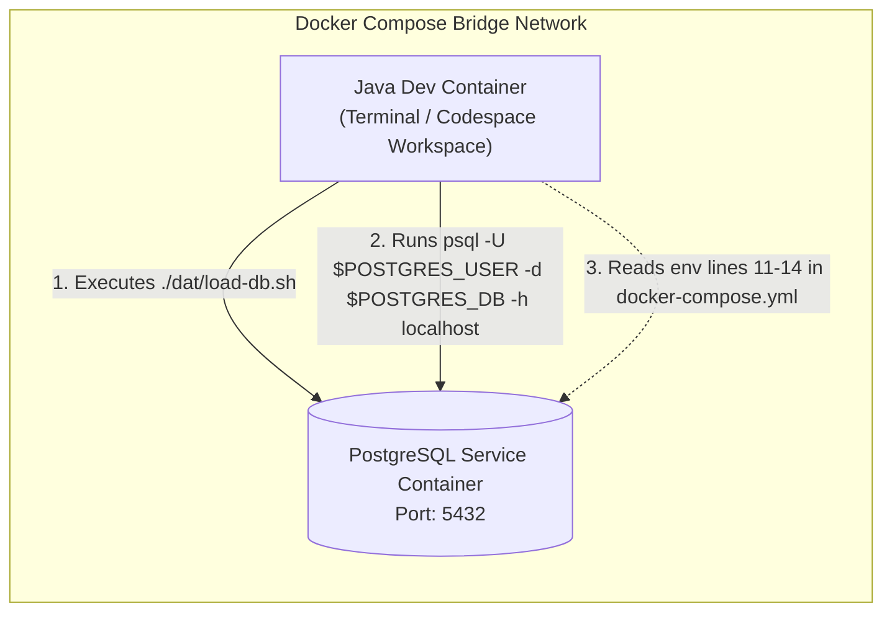

# Environment Provisioning: Initializing PostgreSQL in GitHub Codespaces & Devcontainer Configuration

---

## Key Takeaways

Development environments using GitHub Codespaces or VS Code Dev Containers pre-configure running services via Docker Compose. In this setup, the Java application workspace container and the PostgreSQL database service run as peers on a shared Docker bridge network. Initializing the development database requires executing the seed loader script (`load-db.sh`), which executes schema definitions, sample entity data, and stored procedural functions (`data.sql`) into the target database.

Verifying connectivity and schema creation is handled directly in the terminal via the interactive `psql` command-line client using injected container environment variables (`$POSTGRES_USER` and `$POSTGRES_DB`). Crucially, the connection credentials defined in `.devcontainer/docker-compose.yml` (database name, user, password, and port) serve as the exact configuration values required when configuring JDBC `DriverManager` and connection pools in later application code.



- **Database Pre-Seeding**: The `dat/load-db.sh` shell script wraps the execution of `dat/data.sql`, running DDL statements (creating the `wisdom` schema and tables), DML insertions, and user-defined function declarations.
- **Non-Interactive Execution**: Running `load-db.sh` hydrates the database in seconds without manual copy-pasting of large SQL statements.
- **Interactive CLI Verification (`psql`)**: Using `psql -U $POSTGRES_USER -d $POSTGRES_DB -h localhost` verifies that the engine is accepting local TCP connections and confirms that table rows are retrievable.
- **The `docker-compose.yml` Connection Anchor**: The environment variables under the `postgres` service definition (lines 11–14) define the exact database name (`localdb`), user, password, and port that will form our JDBC Connection URL: $$\text{jdbc:postgresql://localhost:5432/localdb}$$

---

## Main Discussion

### Step-by-Step Environment Setup & Verification

Execute the following sequential terminal steps inside your Codespaces or Devcontainer terminal.

1.  **Inspect Seed Assets**: Verify the files inside the `dat` directory:
    - `data.sql`: DDL/DML script setting up the `wisdom` schema, tables, and data.
    - `load-db.sh`: Shell wrapper executing the SQL script against the database.
    - _Verification:_ Run `ls -la dat/` to confirm both files exist and `load-db.sh` has executable permissions (`-rwxr-xr-x`).
2.  **Run the Database Seed Script**: Execute the shell script from the workspace root:

    ```bash
    ./dat/load-db.sh
    ```

        _Verification:_ The terminal will display multiple `CREATE SCHEMA`, `CREATE TABLE`, `INSERT 0 1`, and `CREATE FUNCTION` command receipts. 3. **Connect via `psql` Terminal Client**:

    Use the injected container environment variables to connect over the loopback interface:

    ```bash
    psql -U $POSTGRES_USER -d $POSTGRES_DB -h localhost
    ```

    _Verification:_ The terminal prompt changes from the bash prompt to:

    ```text
    localdb=#
    ```

3.  **Verify Schema & Query Sample Data**: Query the seeded `services` table under the `wisdom` schema:

    ```sql
    SELECT * FROM wisdom.services;
    ```

    _Verification:_ The terminal prints a formatted table containing service records. Exit the client by typing `\q` and pressing Enter.

---

### Devcontainer Configuration Architecture (`docker-compose.yml`)

The devcontainer infrastructure links the Java workspace to the PostgreSQL instance. Below is the reference architecture matching lines 11–14 referenced in the walkthrough:

```yaml
volumes:
  postgres-data:
services:
  app:
    build:
      context: .
      dockerfile: Dockerfile
    environment:
      POSTGRES_PASSWORD: P@ssw0rd!
      POSTGRES_USER: localdbuser
      POSTGRES_DB: localdb
      POSTGRES_HOSTNAME: db

    volumes:
      - ../..:/workspaces:cached
    command: sleep infinity
    depends_on:
      - db
  db:
    image: postgres:17
    pull_policy: if_not_present
    restart: unless-stopped
    ports:
      - '5432:5432'
    volumes:
      - postgres-data:/var/lib/postgresql/data
    environment:
      POSTGRES_PASSWORD: P@ssw0rd!
      POSTGRES_USER: localdbuser
      POSTGRES_DB: localdb
```

### The Database Seed Script Internals (`load-db.sh` & `data.sql`)

The loader script runs the following command internally:

```bash
#!/usr/bin/env bash
set -euo pipefail

cd "$(dirname "$0")"

export PGPASSWORD=$POSTGRES_PASSWORD
export PGUSER=$POSTGRES_USER
export PGHOST=${POSTGRES_HOSTNAME:-localhost}
export PGDATABASE=$POSTGRES_DB

psql -a -f ./data.sql

echo "Database initialization complete."
```

And `data.sql` sets up the schema and entities used throughout the course:

```sql
-- dat/data.sql
CREATE SCHEMA IF NOT EXISTS wisdom;

CREATE TABLE IF NOT EXISTS wisdom.services (
    service_id BIGSERIAL PRIMARY KEY,
    service_name VARCHAR(100) NOT NULL,
    description TEXT,
    hourly_rate NUMERIC(10, 2) NOT NULL CHECK (hourly_rate >= 0.0),
    active BOOLEAN DEFAULT TRUE
);

-- Populating initial seed data
INSERT INTO wisdom.services (service_name, description, hourly_rate, active) VALUES
('Cloud Architecture Consulting', 'Enterprise AWS/GCP cloud native design', 250.00, true),
('Database Tuning & Optimization', 'PostgreSQL indexing, query optimization, and VACUUM analysis', 220.00, true),
('Full-Stack Java Modernization', 'Migration to Spring Boot and modern modular Java', 195.00, true);

-- Sample custom function
CREATE OR REPLACE FUNCTION wisdom.get_service_count()
RETURNS INTEGER
LANGUAGE plpgsql
AS $$
DECLARE
    total INTEGER;
BEGIN
    SELECT COUNT(*) INTO total FROM wisdom.services;
    RETURN total;
END;
$$;
```

---

### JDBC Configuration Mapping

The values identified in lines 28–30 of `docker-compose.yml` map directly to standard JDBC configuration parameters:

| `docker-compose.yml` Variable | Container / Local Value | Corresponding JDBC Property | Java Connection Configuration              |
| ----------------------------- | ----------------------- | --------------------------- | ------------------------------------------ |
| Host / Network Interface      | `localhost` (or `db`)   | Hostname / IP address       | Port `5432`                                |
| `POSTGRES_DB`                 | `localdb`               | Database catalog name       | `jdbc:postgresql://localhost:5432/localdb` |
| `POSTGRES_USER`               | `localdbuser`           | Authentication principal    | `props.put("user", "localdbuser")`         |
| `POSTGRES_PASSWORD`           | `P@ssw0rd!`             | Authentication secret       | `props.put("password", "P@ssw0rd!")`       |

---

## Knowledge Check

### Theory Tips

- **CLI Parameter Flags**:
  - `-U`: Database user/role (e.g., `-U localdbuser`).
  - `-d`: Target database catalog (e.g., `-d localdb`).
  - `-h`: Hostname address (`-h localhost` forces TCP connection instead of local UNIX domain sockets).
  - `-f`: File path argument to execute a SQL script file.
- **Environment Variable Expansion**: In Linux bash environments, prefixing a variable name with `$` (e.g., `$POSTGRES_USER`) evaluates its current shell value.
