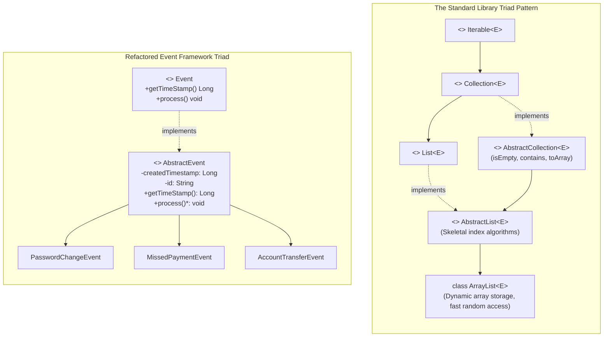

# Architectural Abstraction: The Interface-Abstract-Concrete Triad in the JDK & The Event Framework Challenge

---

## Key Takeaways

The Java standard library organizes complex systems using a three-tier pattern: the **Interface-Abstract-Concrete Triad**. At the top, pure **interfaces** (e.g., `Iterable`, `Collection`, `List`) declare behavioral specifications and can extend one another to compose capabilities. In the middle, skeletal **abstract classes** (e.g., `AbstractCollection`, `AbstractList`) implement those interfaces, holding shared state, boilerplate constructor logic, and reusable template algorithms (such as computing `isEmpty()` by checking `size() == 0`). At the bottom, **concrete leaf classes** (e.g., `ArrayList`) inherit those shared algorithms, leaving them free to focus solely on storage-specific mechanics like dynamic array buffer resizing.



- **The Three-Tier Triad Pattern**:
  1. **Interface Layer**: Defines the pure contractual capability (_"What"_ can be done). Interfaces can extend other interfaces (`Collection extends Iterable`).
  2. **Abstract Skeletal Layer**: Implements the interface, providing common fields, constructors, and algorithms (_"How common behavior works"_).
  3. **Concrete Leaf Layer**: Extends the skeletal class, providing specialized storage or domain implementations (_"How specific mechanisms work"_).
- **Multiplicity Rules**: In Java, a class can `extend` only one class (single inheritance), but can `implement` multiple interfaces (`implements List, RandomAccess, Cloneable, Serializable`).
- **Skeletal Value ("Free" Algorithms)**: Subclasses that implement small primitives like `iterator()` and `size()` get complete algorithms like `isEmpty()`, `contains()`, and `toArray()` without writing any extra code.
- **Eliminating Duplicate Event Code**: Moving `createdTimestamp`, `id`, and `getTimeStamp()` into `AbstractEvent` centralizes common event logic while leaving `process()` abstract for child-specific execution.

---

## Main Discussion

### Idiomatic Java Code Snippets

#### 1. Architectural Blueprint: The JDK Skeletal Collections Pattern

Illustrating how `AbstractCollection` uses abstract primitives to supply derived algorithms:

```java
package jdk_architecture;

import java.util.Iterator;

// Step 1: Interface defines contract
interface SimpleCollection<E> extends Iterable<E> {
    int size();
    boolean isEmpty();
    boolean contains(Object o);
}

// Step 2: Skeletal Abstract Class supplies universal algorithms
abstract class SimpleAbstractCollection<E> implements SimpleCollection<E> {

    // Subclasses MUST provide these low-level primitives:
    @Override
    public abstract int size();

    @Override
    public abstract Iterator<E> iterator();

    // Reusable template algorithms provided for free:
    @Override
    public boolean isEmpty() {
        return size() == 0;
    }

    @Override
    public boolean contains(Object target) {
        Iterator<E> it = iterator();
        if (target == null) {
            while (it.hasNext()) {
                if (it.next() == null) return true;
            }
        } else {
            while (it.hasNext()) {
                if (target.equals(it.next())) return true;
            }
        }
        return false;
    }
}
```

---

#### 2. Challenge Solution: The Refactored Event Framework

##### Step 1: The Behavioral Contract (`Event.java`)

The top-level interface remains clean and unchanged:

```java
package event_framework;

public interface Event {
    Long getTimeStamp();
    void process();
}
```

##### Step 2: The Skeletal Base (`AbstractEvent.java`)

Centralizes the duplicated fields, constructor logic, and the `getTimeStamp()` implementation:

```java
package event_framework;

import java.util.Objects;

public abstract class AbstractEvent implements Event {

    // Centralized attributes: set once, immutable per event
    private final Long createdTimestamp;
    private final String id;

    // Primary constructor establishing shared invariant state
    public AbstractEvent(String id) {
        this.id = Objects.requireNonNull(id, "Event ID cannot be null.");
        this.createdTimestamp = System.currentTimeMillis();
    }

    // Overloaded constructor supporting pre-generated timestamps
    public AbstractEvent(String id, Long createdTimestamp) {
        this.id = Objects.requireNonNull(id, "Event ID cannot be null.");
        this.createdTimestamp = Objects.requireNonNull(createdTimestamp, "Timestamp cannot be null.");
    }

    public String getId() {
        return this.id;
    }

    // Common implementation fulfilled for all inheriting events
    @Override
    public Long getTimeStamp() {
        return this.createdTimestamp;
    }

    // Left abstract: concrete subclasses must supply specialized behavior
    @Override
    public abstract void process();
}
```

##### Step 3: Conforming Concrete Leaf Classes

Each event class now focuses purely on its own domain logic:

```java
package event_framework;

public class PasswordChangeEvent extends AbstractEvent {

    public PasswordChangeEvent(String customerId) {
        super(customerId);
    }

    @Override
    public void process() {
        System.out.println("Processing password change for Customer ID: " + getId());
    }
}
```

```java
package event_framework;

public class MissedPaymentEvent extends AbstractEvent {

    private final double amountDue;

    public MissedPaymentEvent(String customerId, double amountDue) {
        super(customerId);
        this.amountDue = amountDue;
    }

    public double getAmountDue() {
        return amountDue;
    }

    @Override
    public void process() {
        System.out.println("Processing missed payment alert: Customer " + getId()
                + " owes $" + String.format("%.2f", amountDue));
    }
}
```

```java
package event_framework;

public class AccountTransferEvent extends AbstractEvent {

    private final String destinationAccount;
    private final double transferAmount;

    public AccountTransferEvent(String customerId, String destinationAccount, double transferAmount) {
        super(customerId);
        this.destinationAccount = destinationAccount;
        this.transferAmount = transferAmount;
    }

    @Override
    public void process() {
        System.out.println("Processing account transfer: Customer " + getId()
                + " transferred $" + String.format("%.2f", transferAmount)
                + " to " + destinationAccount);
    }
}
```

##### Step 4: Client Execution via Interface Polymorphism (`Main.java`)

The calling client consumes events through the top-level `Event` interface without caring about the concrete hierarchy underneath:

```java
package event_framework;

public class Main {

    public static void main(String[] args) {
        // Concrete events instantiated with shared constructor mechanics
        Event pwd = new PasswordChangeEvent("USER-401");
        Event payment = new MissedPaymentEvent("USER-812", 249.50);
        Event transfer = new AccountTransferEvent("USER-993", "ACCT-7734", 1200.00);

        // Grouped polymorphically into an Event contract array
        Event[] eventStream = { pwd, payment, transfer };

        System.out.println("--- Processing Refactored Event Stream ---");
        for (Event event : eventStream) {
            System.out.print("[" + event.getTimeStamp() + "] ");
            event.process(); // Dispatches dynamically to each concrete implementation
        }
    }
}
```

### Under the Hood / JVM Mechanics

```
   METASPACE CLASS METADATA                       JVM HEAP ALLOCATION
+------------------------------------+        +----------------------------------------+
| <<interface>> Event.class          |        | MissedPaymentEvent Instance (0x00FE)   |
+------------------------------------+        |                                        |
                  ^                           | [From AbstractEvent]                   |
                  | implements                | - createdTimestamp: 1728701234567L     |
+------------------------------------+        | - id: "USER-812"                       |
| <<abstract>> AbstractEvent.class   |        |                                        |
+------------------------------------+        | [From MissedPaymentEvent]              |
                  ^                           | - amountDue: 249.50                    |
                  | extends                   +----------------------------------------+
+------------------------------------+                             ^
| class MissedPaymentEvent.class     |-----------------------------+
| - vtable: process() -> local code  |
| - itable: Event -> maps to local   |
+------------------------------------+

```

1. **Transitive Interface Implementation:**
   Because AbstractEvent implements Event, the compiler marks MissedPaymentEvent as transitively implementing Event. Its itable (Interface Table) maps Event.getTimeStamp() to the code inherited from AbstractEvent, and maps Event.process() to its own local method.
2. **Single Contiguous Object Layout:**
   When new MissedPaymentEvent(...) executes, the JVM allocates a single contiguous block on the Heap. It reserves space for the object header, the fields declared in AbstractEvent (createdTimestamp, id), and the specialized child field (amountDue).
3. **Constructor Chaining Across Boundaries:**
   Executing super(customerId) compiles to an invokespecial instruction that invokes `AbstractEvent.<init>`, ensuring parent state is initialized before child-specific constructor logic runs.
4. **invokeinterface Dynamic Dispatch:**
   When the loop executes event.process(), the JVM issues an invokeinterface instruction. It reads the runtime class of the heap instance, references its itable, and branches to that event's specialized process() bytecode without any reflection or manual casting overhead.

### Structural Comparisons

#### The Three Layers of Architectural Abstraction

| Architectural Tier      | Java Construct   | Primary Responsibility                                   | State & Fields                                  | Instantiable? |
| ----------------------- | ---------------- | -------------------------------------------------------- | ----------------------------------------------- | ------------- |
| **Contract Tier**       | `interface`      | Declares capabilities and public API methods             | No instance state (constants only)              | **No**        |
| **Skeletal Tier**       | `abstract class` | Implements interface; provides shared state & algorithms | Full instance fields (`private`, `final`, etc.) | **No**        |
| **Implementation Tier** | `class`          | Supplies concrete, specialized leaf logic                | Leaf-specific fields and data structures        | **Yes**       |

#### Direct Interface Implementation vs. The Skeletal Pattern

| Dimension               | Direct Implementation (`Class implements Interface`)     | The Skeletal Pattern (`Class extends AbstractClass implements Interface`) |
| ----------------------- | -------------------------------------------------------- | ------------------------------------------------------------------------- |
| **Code Duplication**    | High: Every class re-implements common state and getters | **Eliminated**: Common state and logic live in the abstract class         |
| **Maintenance Burden**  | Bug fixes in boilerplate must be applied to all classes  | Fixes in the abstract class update all subclasses immediately             |
| **Subclass Simplicity** | Subclasses carry boilerplate plumbing                    | Subclasses contain only their specialized domain logic                    |
| **Flexibility**         | Classes can still extend an unrelated base class         | Uses up the class's single inheritance slot (`extends`)                   |

### Common Anti-Patterns & Edge Cases

- **Missing `abstract` on Unimplemented Methods in the Skeletal Class**:
  If an abstract class implements an interface but does not provide bodies for all of its methods (like `process()`), it can either declare them as `public abstract void process();` or simply omit them. If omitted, the method remains abstract implicitly. However, leaving the method without a body in a non-abstract class causes an immediate compile error.
- **Overusing Abstract State When an Interface Suffices**:
  If subclasses share **no common state** and **no common algorithms**, forcing an abstract class between the interface and implementations introduces unnecessary hierarchy depth. Use an abstract class only when there is real code or state to share.
- **Constructing the Skeletal Class Directly**:
  Attempting `new AbstractEvent("ID-1")` triggers a compile error: `AbstractEvent is abstract; cannot be instantiated`. Only leaf classes can be instantiated.

---

## Knowledge Check & JetBrains-Style Coding Challenges

### Theory Tips

- **Inheritance vs. Implementation Limits**: A Java class can extend only **one** class (abstract or concrete), but can implement **multiple** interfaces.
- **Transitive Implementations**: If superclass `A` implements interface `I`, any subclass `B extends A` also implements `I` automatically.
- **Template Methods in Skeletal Classes**: Skeletal classes frequently implement high-level interface methods (like `isEmpty()`) by calling other abstract methods (like `size()`).

### Question 1: Conceptual / Code Analysis

Consider the following structure inspired by the Java Collections Framework:

```java
interface Measurable {
    int size();
    boolean hasContent();
}

abstract class AbstractContainer implements Measurable {
    @Override
    public boolean hasContent() {
        return size() > 0; // Template algorithm
    }
}

class FixedBox extends AbstractContainer {
    private final int items;
    public FixedBox(int items) { this.items = items; }

    @Override
    public int size() { return this.items; }
}
```

A developer writes:

```java
Measurable m = new FixedBox(3);
System.out.println(m.hasContent());

```

What happens when this code is compiled and executed?

- [ ] **A.** A compilation error occurs because `AbstractContainer` does not implement `size()`.
- [ ] **B.** A compilation error occurs because `FixedBox` does not implement `hasContent()`.
- [ ] **C.** It compiles and prints `true` at runtime via template method dynamic dispatch.
- [ ] **D.** A runtime `AbstractMethodError` is thrown when `hasContent()` runs.

<details>
<summary>Correct Answer</summary>

**Correct Answer**: **C**

**Technical Breakdown**:

- **C is correct**:

1. `AbstractContainer` is an abstract class, so it is not required to implement every method from `Measurable`. It leaves `size()` abstract for subclasses to define, while providing a concrete template implementation for `hasContent()`.
2. `FixedBox` extends `AbstractContainer` and implements the missing `size()` method. It inherits `hasContent()` directly from `AbstractContainer`.
3. `Measurable m = new FixedBox(3)` is a valid polymorphic assignment.
4. Calling `m.hasContent()` invokes the inherited method from `AbstractContainer`. That method calls `this.size()`, which dispatches dynamically to `FixedBox.size()`, returning `3`. Because `3 > 0` is true, the program prints `true`.

- **A is incorrect**: Abstract classes are allowed to leave interface methods unimplemented.
- **B is incorrect**: `FixedBox` inherits the concrete implementation of `hasContent()` from its parent.
- **D is incorrect**: All methods have valid implementations in the hierarchy; no runtime errors occur.

</details>

---

### Question 2: Mini Coding Problem / Implementation Challenge

**Task**: Implement an extensible financial order validation pipeline inside package `event_framework`:

1. Interface `OrderValidation`:
   - `String getOrderId()`
   - `double getOrderAmount()`
   - `boolean isValid()`
2. Skeletal Abstract Class `AbstractOrderValidation`:
   - Implements `OrderValidation`.
   - Private fields: `orderId` (`String`), `orderAmount` (`double`).
   - Constructor `public AbstractOrderValidation(String orderId, double orderAmount)` validating that `orderId` is non-null and `orderAmount >= 0.0` (throws `IllegalArgumentException` otherwise).
   - Implements `getOrderId()` and `getOrderAmount()`.
   - Leaves `isValid()` abstract for child-specific risk checks.
3. Concrete Subclasses:
   - Class `DomesticOrderValidation`:
     - Extends `AbstractOrderValidation`.
     - Constructor calling `super(orderId, orderAmount)`.
     - Implements `isValid()`: returns `true` if `getOrderAmount() <= 10000.0`.
   - Class `InternationalOrderValidation`:
     - Extends `AbstractOrderValidation`.
     - Constructor calling `super(orderId, orderAmount)`.
     - Implements `isValid()`: returns `true` if `getOrderAmount() <= 2500.0`.

**Test Assertions**:

- `OrderValidation dom = new DomesticOrderValidation("ORD-DOM-1", 5000.0);`
- `OrderValidation intl = new InternationalOrderValidation("ORD-INT-2", 3000.0);`
- `dom.isValid()` $\rightarrow$ Returns: `true` (5000.0 $\le$ 10000.0)
- `intl.isValid()` $\rightarrow$ Returns: `false` (3000.0 $>$ 2500.0)
- `dom.getOrderId()` $\rightarrow$ Returns: `"ORD-DOM-1"` (Inherited from `AbstractOrderValidation`)

<details>
<summary>Solution</summary>

```java
package event_framework;

public interface OrderValidation {
    String getOrderId();
    double getOrderAmount();
    boolean isValid();
}
```

```java
package event_framework;

import java.util.Objects;

public abstract class AbstractOrderValidation implements OrderValidation {

    private final String orderId;
    private final double orderAmount;

    public AbstractOrderValidation(String orderId, double orderAmount) {
        this.orderId = Objects.requireNonNull(orderId, "Order ID cannot be null.");
        if (orderAmount < 0.0) {
            throw new IllegalArgumentException("Order amount cannot be negative.");
        }
        this.orderAmount = orderAmount;
    }

    @Override
    public String getOrderId() {
        return this.orderId;
    }

    @Override
    public double getOrderAmount() {
        return this.orderAmount;
    }

    // Retains isValid() as abstract for concrete risk rules
    @Override
    public abstract boolean isValid();
}
```

```java
package event_framework;

public class DomesticOrderValidation extends AbstractOrderValidation {

    public DomesticOrderValidation(String orderId, double orderAmount) {
        super(orderId, orderAmount);
    }

    @Override
    public boolean isValid() {
        return getOrderAmount() <= 10000.0;
    }
}
```

```java
package event_framework;

public class InternationalOrderValidation extends AbstractOrderValidation {

    public InternationalOrderValidation(String orderId, double orderAmount) {
        super(orderId, orderAmount);
    }

    @Override
    public boolean isValid() {
        return getOrderAmount() <= 2500.0;
    }
}
```

**Complexity Analysis**:

- **Time Complexity**: $\mathcal{O}(1)$ for object instantiation, getter field reads, and `isValid()` threshold comparisons. Interface method dispatch executes in $\mathcal{O}(1)$ time via the JVM `itable`.
- **Space Complexity**: $\mathcal{O}(1)$ auxiliary heap memory allocated per validation instance.

</details>

---
