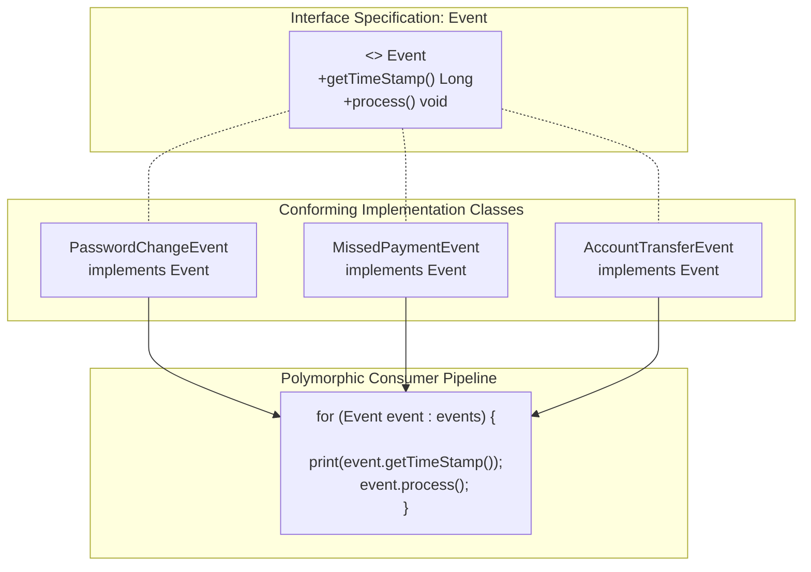

# Interface Contracts: Behavioral Conformity, Polymorphic Event Pipelines & Contract Evolution

---

## Key Takeaways

An **interface** in Java is a reference type that acts as a pure behavioral specification. It defines a set of method signatures without implementation details, establishing a strict contractual standard of conformity for any class that uses the `implements` keyword. Like abstract classes, interfaces cannot be instantiated directly via `new`. However, while abstract classes provide skeletal code and share instance state down a single inheritance tree, interfaces enforce what an entity can _do_ across unrelated class hierarchies. Pairing an interface (such as `Event`) with a heterogeneous polymorphic collection (such as `Event[]`) allows client applications to decouple ingestion and processing pipelines from concrete event mechanics.



- **Contractual Conformity**: An interface defines _what_ behaviors must exist. Any concrete class implementing the interface must provide complete method bodies for every declared signature or fail compilation.
- **The `implements` Keyword**: Links a concrete class to one or more interface contracts.
- **Overriding Interface Methods**: Implementing methods declared in an interface uses the `@Override` annotation, providing compile-time verification that method names, return types, and parameter lists match the specification.
- **Handling State in Interfaces**: Interfaces cannot hold mutable instance fields. To enforce state across conformers (such as an event timestamp), the interface declares a getter signature (e.g., `Long getTimeStamp()`), requiring implementers to back it with private instance state.
- **Contract Evolution & Breaking Changes**: Adding a new method signature to an interface immediately forces every implementing class across the entire codebase to conform by supplying an implementation.

---

## Main Discussion

### Idiomatic Java Code Snippets

#### 1. Defining the Contractual Specification (`Event.java`)

Declaring the core contract methods that all domain events must satisfy:

```java
package interface_contracts;

public interface Event {

    // Method signatures establishing the specification (implicitly public abstract)
    Long getTimeStamp();

    void process();
}
```

#### 2. Building Conforming Implementations

Implementing `Event` across diverse domain workflows while maintaining immutability via `final`:

```java
package interface_contracts;

public class PasswordChangeEvent implements Event {

    private final Long timestamp;
    private final String customerId;

    public PasswordChangeEvent(String customerId) {
        this.customerId = customerId;
        this.timestamp = System.currentTimeMillis();
    }

    public PasswordChangeEvent(String customerId, Long timestamp) {
        this.customerId = customerId;
        this.timestamp = timestamp;
    }

    @Override
    public Long getTimeStamp() {
        return this.timestamp;
    }

    @Override
    public void process() {
        System.out.println("Customer " + customerId + " changed their password successfully.");
    }
}
```

```java
package interface_contracts;

public class MissedPaymentEvent implements Event {

    private final Long timestamp;
    private final String customerId;
    private final double amountDue;

    public MissedPaymentEvent(String customerId, double amountDue) {
        this.customerId = customerId;
        this.amountDue = amountDue;
        this.timestamp = System.currentTimeMillis();
    }

    @Override
    public Long getTimeStamp() {
        return this.timestamp;
    }

    @Override
    public void process() {
        System.out.println("Alert: Missed payment of $" + amountDue + " recorded for customer " + customerId);
    }
}
```

```java
package interface_contracts;

public class AccountTransferEvent implements Event {

    private final Long timestamp;
    private final String customerId;
    private final String destinationAccount;
    private final double transferAmount;

    public AccountTransferEvent(String customerId, String destinationAccount, double transferAmount) {
        this.customerId = customerId;
        this.destinationAccount = destinationAccount;
        this.transferAmount = transferAmount;
        this.timestamp = System.currentTimeMillis();
    }

    @Override
    public Long getTimeStamp() {
        return this.timestamp;
    }

    @Override
    public void process() {
        System.out.println("Customer " + customerId + " transferred $" + transferAmount
                + " to account " + destinationAccount);
    }
}
```

#### Polymorphic Ingestion & Decoupled Execution (`EventDispatcher.java`)

Processing varied concrete event types through an array of the shared interface type:

```java
package interface_contracts;

public class EventDispatcher {

    public static void main(String[] args) {
        // Individual domain events instantiated with specific attributes
        Event pwdEvent = new PasswordChangeEvent("CUST-101");
        Event paymentEvent = new MissedPaymentEvent("CUST-202", 150.75);
        Event transferEvent = new AccountTransferEvent("CUST-303", "ACC-9944", 2500.00);

        // Polymorphic collection grouping distinct event forms into a single contract array
        Event[] eventQueue = { pwdEvent, paymentEvent, transferEvent };

        System.out.println("--- Processing Ingested Event Stream ---");
        for (Event event : eventQueue) {
            // Uniform interaction: Client relies strictly on interface specifications
            System.out.print("[" + event.getTimeStamp() + "] ");
            event.process();
        }
    }
}
```

### Under the Hood / JVM Mechanics

```
   CALL SITE (for-each event.process())                JVM HEAP (Heterogeneous Instances)
+--------------------------------------+            +------------------------------------+
| aload_1 (event reference)            |----------->| MissedPaymentEvent (0x00A1)        |
| invokeinterface #4 <Event.process:()V|            | - timestamp: 1728700000000L        |
+--------------------------------------+            | - customerId: "CUST-202"           |
                   |                                +------------------------------------+
                   v                                                  |
   INTERFACE TABLE RESOLUTION (itable)                                |
+--------------------------------------+                              v
| MissedPaymentEvent.class itable      |             +------------------------------------+
| - Interface: Event.class             |------------>| Points to bytecode block:          |
| - Method: process() -> Slot Offset 1 |             | MissedPaymentEvent.process()       |
+--------------------------------------+             +------------------------------------+

```

1. **Bytecode Emission (invokeinterface):**
   When code calls a method on an interface reference (e.g., event.process()), javac does not emit an invokevirtual instruction. It emits the invokeinterface opcode, indicating the target is an abstract specification resolved across varying class hierarchies.
2. **Interface Table (itable) Layout in Metaspace:**
   Every class implementing an interface has an Interface Table (itable) embedded in its Metaspace layout. The itable maps interface method offsets to the class's actual concrete method addresses.
3. **Dynamic Dispatch & Inline Caching:**
   During execution, the JVM reads the receiver object's runtime class header, navigates to its itable, and resolves the concrete method implementation. HotSpot optimizes this lookup using polymorphic inline caching (Monomorphic / Polymorphic IC) to eliminate repeat table searches.
4. **Access Flag Modifiers:**
   Interface method signatures are compiled implicitly with the ACC_PUBLIC and ACC_ABSTRACT access flags. Concrete implementing methods in subclasses must explicitly carry the public access modifier; omitting it causes a compiler error for attempting to assign weaker access privileges (package-private).

### Structural Comparisons

#### Interfaces vs. Abstract Classes

| Feature                | Interface (`interface`)                              | Abstract Class (`abstract class`)                    |
| ---------------------- | ---------------------------------------------------- | ---------------------------------------------------- |
| **Primary Philosophy** | Behavioral Contract / Capability (_"Can-Do"_)        | Structural Blueprint / Taxonomy (_"Is-A"_)           |
| **Class Multiplicity** | Multiple (`implements A, B, C`)                      | Single (`extends BaseClass` only)                    |
| **Instance Fields**    | **Forbidden** (only `public static final` constants) | Fully supported (mutable, private, final, protected) |
| **Constructors**       | **Forbidden** (cannot have constructors)             | Supported (chained via `super(...)`)                 |
| **Method Visibility**  | Implicitly `public`                                  | Can be `public`, `protected`, or package-private     |
| **State Mandates**     | Enforced indirectly via getters (`getTimeStamp()`)   | Maintained directly via inherited instance variables |

#### Direct Implementation vs. Interface Polymorphic Ingestion

| Dimension          | Direct Concrete Ingestion (`MissedPaymentEvent[]`) | Interface Ingestion (`Event[]`)                                 |
| ------------------ | -------------------------------------------------- | --------------------------------------------------------------- |
| **Homogeneity**    | Restricted strictly to a single event type         | Accepts any current or future conforming event type             |
| **Coupling Level** | Tight: Ingestion logic depends on concrete details | **Loose**: Ingestion depends strictly on the interface contract |
| **Extensibility**  | Adding an event requires a new ingestion method    | Adding an event requires zero changes to the consumer           |

### Common Anti-Patterns & Edge Cases

- **Reducing Visibility When Implementing Interface Methods**:

  ```java
  public interface Task { void execute(); }

  public class PrintTask implements Task {
      void execute() { ... } // COMPILATION ERROR: Cannot assign weaker access privileges ('package-private'); was 'public'
  }
  ```

  Methods in interfaces are implicitly `public`. Implementing classes must explicitly declare the method as `public`.

- **State Declaration Fallacy in Interfaces**:
  Attempting to declare an instance attribute like `long timestamp;` inside an interface turns that variable into a `public static final` constant by default. All implementing classes would share that exact compile-time constant rather than individual instance values. Enforce instance state via accessor methods like `Long getTimeStamp()`.
- **Breaking the Contract with Interface Bloat**:
  Adding a new abstract method to a shared interface forces **every single implementing class** to update immediately, breaking downstream builds unless default methods (`default void newMethod() {}`) are supplied.

---

## Knowledge Check & JetBrains-Style Coding Challenges

### Theory Tips

- **Keyword Matching**: Classes use the `implements` keyword to adopt an interface; classes use `extends` to inherit from another class.
- **Implicit Modifiers**: Methods declared in an interface without a body are implicitly `public` and `abstract`.
- **Instantiation Ban**: An interface cannot be instantiated with `new Event()`. It can only be used as a reference type pointing to a conforming heap instance.

### Question 1: Conceptual / Code Analysis

Consider the following interface and class definitions:

```java
interface Notifier {
    void alert(String message);
}

class EmailNotifier implements Notifier {
    @Override
    void alert(String message) { // Line 6
        System.out.println("Email: " + message);
    }
}
```

A developer attempts to compile this code. What is the result?

- [ ] **A.** It compiles cleanly; `@Override` correctly implements `Notifier.alert`.
- [ ] **B.** A compilation error occurs at Line 6 because `alert` in `EmailNotifier` has package-private access, attempting to assign weaker access privileges than `public`.
- [ ] **C.** A compilation error occurs because `Notifier` does not declare a constructor.
- [ ] **D.** A runtime `AbstractMethodError` occurs when `alert` is invoked.

<details>
<summary>Correct Answer</summary>

**Correct Answer**: **B**

**Technical Breakdown**:

- **B is correct**: In Java, all methods declared in an interface without an explicit access modifier are implicitly `public abstract`. When `EmailNotifier` implements `Notifier`, it must implement `alert(String)`. However, the method in `EmailNotifier` omits the `public` modifier, defaulting to package-private visibility. In Java's inheritance model, an overriding or implementing method cannot reduce the visibility of the method it overrides. Because package-private is more restrictive than `public`, the compiler halts: `alert(String) in EmailNotifier cannot implement alert(String) in Notifier; attempting to assign weaker access privileges; was public`.
- **A is incorrect**: Omitting `public` prevents successful compilation.
- **C is incorrect**: Interfaces cannot have constructors; their absence is required.
- **D is incorrect**: The error is caught at compile time.

</details>

---

### Question 2: Mini Coding Problem / Implementation Challenge

**Task**: Implement a resilient telemetry ingestion framework inside package `interface_contracts`:

1. Interface `TelemetryMetric`:
   - Method signatures:
   - `String getMetricName()`
   - `double getMetricValue()`
   - `boolean isAnomaly()`
2. Conforming Class `CpuLoadMetric`:
   - Private fields: `nodeId` (`String`), `loadPercentage` (`double`).
   - Constructor `public CpuLoadMetric(String nodeId, double loadPercentage)`: stores fields.
   - Implements `getMetricName()` returning `"CPU_LOAD[" + nodeId + "]"`.
   - Implements `getMetricValue()` returning `loadPercentage`.
   - Implements `isAnomaly()` returning `true` if `loadPercentage > 85.0`.
3. Conforming Class `MemoryFreeMetric`:
   - Private fields: `nodeId` (`String`), `megabytesFree` (`double`).
   - Constructor `public MemoryFreeMetric(String nodeId, double megabytesFree)`: stores fields.
   - Implements `getMetricName()` returning `"MEMORY_FREE[" + nodeId + "]"`.
   - Implements `getMetricValue()` returning `megabytesFree`.
   - Implements `isAnomaly()` returning `true` if `megabytesFree < 512.0`.
4. Telemetry Monitor Method:
   - Class `TelemetryMonitor` with static method `public static int countAnomalies(TelemetryMetric[] metrics)`:
   - Iterates polymorphically through the array, returning the total number of metrics where `isAnomaly()` returns `true`.

**Test Assertions**:

- `TelemetryMetric m1 = new CpuLoadMetric("node-1", 92.5);`
- `TelemetryMetric m2 = new MemoryFreeMetric("node-1", 1024.0);`
- `TelemetryMetric m3 = new MemoryFreeMetric("node-2", 256.0);`
- `TelemetryMetric[] batch = { m1, m2, m3 };`
- `TelemetryMonitor.countAnomalies(batch)` $\rightarrow$ Returns: `2` (`m1` CPU load $> 85.0$ and `m3` memory free $< 512.0$).

<details>
<summary>Solution</summary>

```java
package interface_contracts;

public interface TelemetryMetric {

    String getMetricName();

    double getMetricValue();

    boolean isAnomaly();
}
```

```java
package interface_contracts;

public class CpuLoadMetric implements TelemetryMetric {

    private final String nodeId;
    private final double loadPercentage;

    public CpuLoadMetric(String nodeId, double loadPercentage) {
        this.nodeId = nodeId;
        this.loadPercentage = loadPercentage;
    }

    @Override
    public String getMetricName() {
        return "CPU_LOAD[" + nodeId + "]";
    }

    @Override
    public double getMetricValue() {
        return loadPercentage;
    }

    @Override
    public boolean isAnomaly() {
        return loadPercentage > 85.0;
    }
}
```

```java
package interface_contracts;

public class MemoryFreeMetric implements TelemetryMetric {

    private final String nodeId;
    private final double megabytesFree;

    public MemoryFreeMetric(String nodeId, double megabytesFree) {
        this.nodeId = nodeId;
        this.megabytesFree = megabytesFree;
    }

    @Override
    public String getMetricName() {
        return "MEMORY_FREE[" + nodeId + "]";
    }

    @Override
    public double getMetricValue() {
        return megabytesFree;
    }

    @Override
    public boolean isAnomaly() {
        return megabytesFree < 512.0;
    }
}
```

```java
package interface_contracts;

public class TelemetryMonitor {

    // Universal processing method relying purely on the interface contract
    public static int countAnomalies(TelemetryMetric[] metrics) {
        if (metrics == null) {
            return 0;
        }

        int anomalyCount = 0;
        for (TelemetryMetric metric : metrics) {
            if (metric != null && metric.isAnomaly()) {
                anomalyCount++;
            }
        }
        return anomalyCount;
    }
}
```

**Complexity Analysis**:

- **Time Complexity**: $\mathcal{O}(N)$ where $N$ is the number of elements in the `metrics` array. Each interface method dispatch executes in $\mathcal{O}(1)$ time via the JVM `itable`.
- **Space Complexity**: $\mathcal{O}(1)$ auxiliary memory allocated; evaluates metrics in place on the heap.

</details>

---
