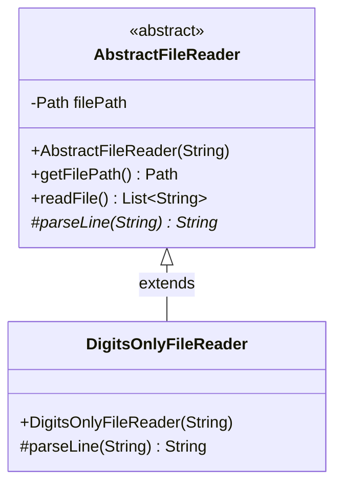

# Abstract Classes: Skeletal Implementations, the Template Method Pattern & Abstract Methods

---

## Key Takeaways

An **abstract class** in Java acts as an incomplete structural blueprint that cannot be instantiated directly via `new`. It combines concrete state and fully realized algorithms with one or more **abstract methods**—placeholders declaring method signatures without bodies that subclasses are required to implement. This architecture directly enables the **Template Method Pattern**: an abstract base class (such as `AbstractFileReader`) defines the overarching invariant workflow (`readFile()`), while delegating specialized algorithmic sub-steps (`parseLine()`) down to concrete subclasses (such as `DigitsOnlyFileReader`).



- **Instantiation Restriction**: Classes marked with the `abstract` keyword cannot be instantiated directly (`new AbstractFileReader(...)` fails at compile time).
- **Abstract Method Contract**: Any method declared with the `abstract` keyword has no body (ends with a semicolon `;`). Any class containing at least one abstract method **must** be marked as `abstract`.
- **State & Constructor Inheritance**: Unlike pure interfaces, abstract classes can declare instance state (including `final` fields like `Path filePath`) and constructors invoked via `super(...)` during subclass initialization.
- **Template Method Pattern**: The parent class orchestrates a high-level algorithm (opening files, looping lines, collecting output), while leaf classes customize specific steps (such as stripping non-numeric characters).
- **Engineering Scalability**: New file readers (e.g., uppercase, redaction, decoding) require writing only a single `parseLine()` method without rewriting file streaming and error-handling boilerplate.

---

## Main Discussion

### Idiomatic Java Code Snippets

#### 1. Defining the Skeletal Base Class (`AbstractFileReader.java`)

Encapsulating common state, constructor logic, and the invariant template method:

```java
package abstract_classes;

import java.io.IOException;
import java.nio.file.Files;
import java.nio.file.Path;
import java.util.List;
import java.util.stream.Collectors;

public abstract class AbstractFileReader {

    // Common invariant state: final path set once during construction
    private final Path filePath;

    // Constructor called via super(...) from concrete subclasses
    public AbstractFileReader(String filePathString) {
        if (filePathString == null || filePathString.isBlank()) {
            throw new IllegalArgumentException("File path must not be null or blank.");
        }
        this.filePath = Path.of(filePathString);
    }

    public Path getFilePath() {
        return this.filePath;
    }

    // THE TEMPLATE METHOD: Invariant workflow algorithm
    // Reads file lines, delegates parsing to the abstract hook, collects results
    public List<String> readFile() throws IOException {
        return Files.lines(this.filePath)
                    .map(this::parseLine) // Dynamic dispatch to subclass implementation
                    .collect(Collectors.toList());
    }

    // Abstract method hook: Must be implemented by concrete subclasses
    // Protected visibility allows subclass access while hiding from arbitrary callers
    protected abstract String parseLine(String rawLine);
}
```

#### 2. Implementing the Concrete Subclass (`DigitsOnlyFileReader.java`)

Extending the abstract skeletal class and overriding the abstract parsing method:

```java
package abstract_classes;

public class DigitsOnlyFileReader extends AbstractFileReader {

    // Subclass constructor passes the path up to the abstract superclass
    public DigitsOnlyFileReader(String filePathString) {
        super(filePathString);
    }

    // Fulfills the abstract contract: strips all non-numeric characters using regex
    @Override
    protected String parseLine(String rawLine) {
        if (rawLine == null) {
            return "";
        }
        // \D matches any character that is NOT a digit [0-9]
        return rawLine.replaceAll("\\D", "");
    }
}
```

#### 3. Client Execution & Extensibility Demonstration (`Main.java`)

Using polymorphism with the abstract class and demonstrating how easily a new reader variant can be created:

```java
package abstract_classes;

import java.io.IOException;
import java.nio.file.Files;
import java.nio.file.Path;
import java.util.List;

public class Main {

    // Inline variant demonstrating rapid extensibility
    static class UppercaseFileReader extends AbstractFileReader {
        public UppercaseFileReader(String path) { super(path); }

        @Override
        protected String parseLine(String rawLine) {
            return rawLine != null ? rawLine.toUpperCase() : "";
        }
    }

    public static void main(String[] args) throws IOException {
        // Create a temporary file simulating message.txt
        Path tempFile = Files.createTempFile("secret_message", ".txt");
        Files.write(tempFile, List.of("Agent: 007 - Status: Active", "Code: 8492-ALPHA"));

        // 1. Using DigitsOnlyFileReader
        AbstractFileReader digitReader = new DigitsOnlyFileReader(tempFile.toString());
        List<String> numericalData = digitReader.readFile();
        System.out.println("Digits extracted: " + numericalData); // Output: [007, 8492]

        // 2. Using UppercaseFileReader
        AbstractFileReader upperReader = new UppercaseFileReader(tempFile.toString());
        List<String> upperData = upperReader.readFile();
        System.out.println("Uppercase extracted: " + upperData);

        // Cleanup
        Files.deleteIfExists(tempFile);
    }
}
```

### Under the Hood / JVM Mechanics

1. **Class Flag ACC_ABSTRACT in Bytecode:**
   When javac compiles an abstract class, it marks the class declaration in the constant pool with the ACC_ABSTRACT access flag (0x0400).
2. **Instantiation Blocking (new opcode):**
   If source code or rogue bytecode attempts a new AbstractFileReader(...) allocation, the JVM bytecode verifier aborts compilation or throws an InstantiationError upon encountering ACC_ABSTRACT.
3. **Constructor Synthesis (`<init>`):**
   Even though the class cannot be instantiated standalone, javac generates a standard `<init>` constructor method. When a subclass executes super(filePathString), it invokes `AbstractFileReader.<init>` via invokespecial to initialize the parent's private fields.
4. **Dynamic Template Method Dispatch:**
   When readFile() invokes this.parseLine(line), the compiler emits an invokevirtual instruction. At runtime, the JVM inspects the heap object's actual class vtable (e.g., DigitsOnlyFileReader), finding the concrete method pointer without any conditional type branching.

### Structural Comparisons

#### Abstract Class vs. Concrete Class vs. Interface

| Characteristic                   | Abstract Class (`abstract class`)           | Concrete Class (`class`)                  | Interface (`interface`)                    |
| -------------------------------- | ------------------------------------------- | ----------------------------------------- | ------------------------------------------ |
| **Direct Instantiation (`new`)** | **Forbidden**                               | Allowed                                   | Forbidden                                  |
| **Abstract Methods**             | Allowed (optional)                          | **Forbidden** (all must have bodies)      | Default (unless `default`/`static`)        |
| **Instance Fields / State**      | Allowed (can have mutable/`final` fields)   | Allowed                                   | **Forbidden** (only `public static final`) |
| **Constructors**                 | **Allowed** (invoked via `super()`)         | Allowed                                   | **Forbidden**                              |
| **Inheritance Multiplicity**     | Single inheritance (`extends`)              | Single inheritance (`extends`)            | Multiple inheritance (`implements`)        |
| **Primary Design Role**          | Reusable base with shared algorithm & state | Fully realized, stand-alone domain object | Pure behavioral API contract               |

### Common Anti-Patterns & Edge Cases

- **Abstract Class with Zero Abstract Methods**: A class can be declared `abstract` even without any abstract methods. This is valid Java syntax, often used to prevent direct instantiation of a base class that should only serve as an inheritance root.
- **Forgetting to Mark Class Abstract**: Declaring an abstract method inside a standard class without adding `abstract` to the class declaration causes a compilation error: `class must be declared abstract or implement abstract method`.
- **Combining `abstract` with `final` or `private`**:

  ```java
  public abstract final class Reader { ... } // COMPILATION ERROR: illegal combination of modifiers
  private abstract void parse();            // COMPILATION ERROR: illegal combination of modifiers
  ```

  `final` prevents extension and `private` prevents subclass access—both directly contradict `abstract`, which requires inheritance and overriding.

- **Instantiating the Abstract Class**: Calling `AbstractFileReader reader = new AbstractFileReader("file.txt");` fails at compile time with: `AbstractFileReader is abstract; cannot be instantiated`.

---

## Knowledge Check & JetBrains-Style Coding Challenges

### Theory Tips

- **No Direct Instances**: Abstract classes can **never** be instantiated using the `new` operator.
- **Compiler Rule**: If a class contains even one `abstract` method, the class itself **must** be marked `abstract`.
- **Constructor Rule**: Abstract classes have constructors, but they can only be invoked by subclass constructors via `super(...)`.

### Question 1: Conceptual / Code Analysis

Consider the following abstract class and subclass snippet:

```java
abstract class ReportGenerator {
    private String title;

    public ReportGenerator(String title) {
        this.title = title;
    }

    public final void printReport() {
        System.out.print(title + ": ");
        System.out.print(formatBody());
    }

    abstract String formatBody();
}

class CsvReportGenerator extends ReportGenerator {
    public CsvReportGenerator(String title) {
        super(title);
    }

    @Override
    String formatBody() {
        return "1,2,3";
    }
}
```

A developer writes:

```java
ReportGenerator gen = new CsvReportGenerator("Metrics");
gen.printReport();

```

What occurs when this code runs?

- [ ] **A.** Compilation fails because `printReport()` is marked `final` in an abstract class.
- [ ] **B.** It executes and prints `Metrics: 1,2,3`.
- [ ] **C.** Compilation fails because `ReportGenerator` cannot have private variables or constructors.
- [ ] **D.** A runtime `InstantiationException` is thrown when `ReportGenerator` is referenced.

<details>
<summary>Correct Answer</summary>

**Correct Answer**: **B**

**Technical Breakdown**:

- **B is correct**:

1. `ReportGenerator` defines a valid template method `printReport()`. Marking a template method `final` is an idiomatic best practice in Java, as it prevents subclasses from altering the high-level workflow while still forcing them to supply the missing step (`formatBody()`).
2. `CsvReportGenerator` calls `super(title)` in its constructor and overrides `formatBody()`.
3. Polymorphic assignment `ReportGenerator gen = new CsvReportGenerator(...)` is valid.
4. At runtime, `gen.printReport()` prints `Metrics: ` followed by the result of dynamic dispatch to `formatBody()`, which returns `1,2,3`. The complete console output is `Metrics: 1,2,3`.

- **A is incorrect**: Non-abstract methods in abstract classes can freely be marked `final`.
- **C is incorrect**: Abstract classes fully support instance variables, constructors, and encapsulation.
- **D is incorrect**: The concrete subclass `CsvReportGenerator` is instantiated, which is fully legal.

</details>

---

### Question 2: Mini Coding Problem / Implementation Challenge

**Task**: Implement a text transformation pipeline using an abstract base class inside package `abstract_classes`:

1. Abstract Class `AbstractTextTransformer`:
   - Private field: `prefix` (`String`).
   - Constructor `public AbstractTextTransformer(String prefix)`: validates that `prefix` is not null (defaults to `""` if null) and sets `this.prefix`.
   - Public Getter: `getPrefix()`.
   - Concrete Template Method `public String transformAndTag(String input)`:
   - If `input` is null, returns `prefix + "[EMPTY]"`.
   - Calls the abstract method `transform(input)`.
     - Returns `prefix + "[" + transformedResult + "]"`.
   - Protected Abstract Method `protected abstract String transform(String rawInput)`.
2. Concrete Subclass `CensorTransformer`:
   - Extends `AbstractTextTransformer`.
   - Private field `bannedWord` (`String`).
   - Constructor `public CensorTransformer(String prefix, String bannedWord)`:
   - Calls `super(prefix)`.
     - Initializes `bannedWord`.
   - Implements `protected String transform(String rawInput)`:
   - Replaces all occurrences of `bannedWord` (case-insensitive) in `rawInput` with `"***"`.

**Test Assertions**:

- `AbstractTextTransformer transformer = new CensorTransformer("AUDIT: ", "secret");`
- `transformer.transformAndTag("Top secret info, keep it secret.")` $\rightarrow$ Returns `"AUDIT: [Top *** info, keep it ***.]"`
- `transformer.transformAndTag(null)` $\rightarrow$ Returns `"AUDIT: [EMPTY]"`

<details>
<summary>Solution</summary>

```java
package abstract_classes;

public abstract class AbstractTextTransformer {

    private final String prefix;

    public AbstractTextTransformer(String prefix) {
        this.prefix = (prefix == null) ? "" : prefix;
    }

    public String getPrefix() {
        return prefix;
    }

    // Template Method: Common invariant formatting algorithm
    public String transformAndTag(String input) {
        if (input == null) {
            return prefix + "[EMPTY]";
        }
        String transformed = transform(input);
        return prefix + "[" + transformed + "]";
    }

    // Abstract method: To be customized by child transformers
    protected abstract String transform(String rawInput);
}
```

```java
package abstract_classes;

public class CensorTransformer extends AbstractTextTransformer {

    private final String bannedWord;

    public CensorTransformer(String prefix, String bannedWord) {
        super(prefix);
        this.bannedWord = bannedWord;
    }

    @Override
    protected String transform(String rawInput) {
        if (bannedWord == null || bannedWord.isEmpty()) {
            return rawInput;
        }
        // Case-insensitive regex replacement
        return rawInput.replaceAll("(?i)" + java.util.regex.Pattern.quote(bannedWord), "***");
    }
}
```

**Complexity Analysis**:

- **Time Complexity**: $\mathcal{O}(L)$ where $L$ is the character length of `rawInput` processed during regex replacement. Calling `transformAndTag` dispatches in $\mathcal{O}(1)$ time.
- **Space Complexity**: $\mathcal{O}(L)$ auxiliary memory allocated for the transformed output string.

</details>

---
