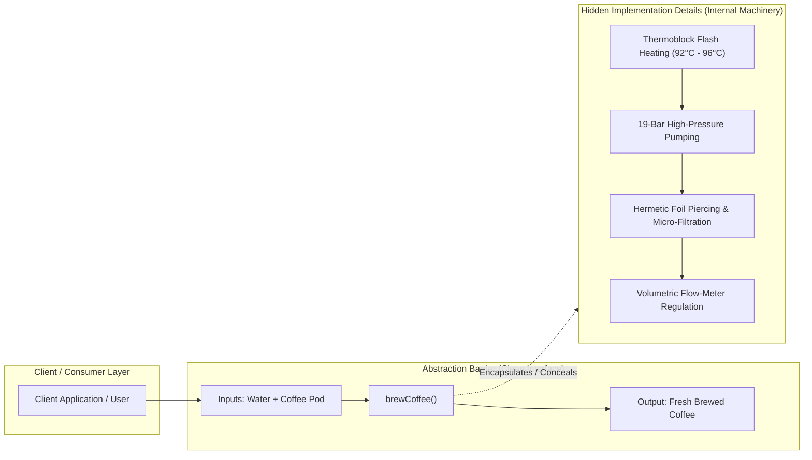

# Object-Oriented Principles: The Core of Abstraction & Complexity Management

---

## Key Takeaways

**Abstraction** is the foundational object-oriented principle dedicated to managing software complexity by hiding intricate internal implementation details and exposing only essential interactions through a clean, generalized interface. Rather than requiring clients or consuming engineers to understand internal mechanics (such as thermoblock water heating, pneumatic pressure regulation, or ground bean extraction in a pod coffee machine), abstraction establishes a contract defining required inputs, expected outputs, and broad behavioral semantics. In Java, abstraction is modeled structurally using **abstract classes** and **interfaces**, allowing teams to build scalable architectures where engineers can integrate, extend, and contribute features without being bogged down by low-level subsystems.



- **Core Definition**: Hiding algorithmic, architectural, or API complexity while exposing a simplified, high-level behavioral contract.
- **The "What" vs. "How" Separation**: Abstraction focuses entirely on _what_ a system accomplishes (inputs & outputs) rather than _how_ it executes internally.
- **The Pod Coffee Machine Model**: A user inserts a pod and water and presses "brew." They obtain a cup of coffee without understanding internal heating elements, fluid dynamics, or pump pressure valves.
- **Java Language Mechanisms**: Primary vehicles for abstraction in Java are **interfaces** (pure behavioral specifications) and **abstract classes** (partial skeletal implementations).
- **Engineering Scalability**: Decouples feature contributors from deep subsystem internals, lowering cognitive overhead and enabling parallel software development across large teams.

---

## Main Discussion

### Idiomatic Java Code Snippets

#### 1. Defining the Abstract Contract (`CoffeeBrewer.java`)

Exposing essential interactions while abstracting away brewing mechanics:

```java
package abstraction_principles;

// The Abstract Contract: Defines what operations exist, omitting internal mechanics
public interface CoffeeBrewer {

    // Inputs: Pod flavor and volume; Output: BrewedCoffee instance
    BrewedCoffee brew(CoffeePod pod, int waterAmountMl);

    // Maintenance contract exposed without leaking heating/pump sensor internals
    boolean hasSufficientWater();
}
```

#### 2. Domain Models & Hidden Concrete Machinery (`PodCoffeeMachine.java`)

Hiding complex multi-step pneumatic and thermal algorithms behind a clean public method:

```java
package abstraction_principles;

public record CoffeePod(String roastName, int intensity) {}
public record BrewedCoffee(String name, int volumeMl, double temperatureC) {}

public class PodCoffeeMachine implements CoffeeBrewer {

    private int waterReservoirMl;
    private boolean thermoblockReady;

    public PodCoffeeMachine(int initialWaterMl) {
        this.waterReservoirMl = initialWaterMl;
        this.thermoblockReady = false;
    }

    @Override
    public boolean hasSufficientWater() {
        return this.waterReservoirMl >= 100;
    }

    // THE ABSTRACTION BOUNDARY: Simple input -> output method
    @Override
    public BrewedCoffee brew(CoffeePod pod, int waterAmountMl) {
        if (pod == null) {
            throw new IllegalArgumentException("Cannot brew without a valid coffee pod.");
        }
        if (this.waterReservoirMl < waterAmountMl) {
            throw new IllegalStateException("Insufficient water in reservoir.");
        }

        // HIDDEN COMPLEXITY: Internal mechanical routines concealed from caller
        heatWaterToOptimalExtraction();
        punctureHermeticSeal(pod);
        apply19BarPressureExtraction(waterAmountMl);

        this.waterReservoirMl -= waterAmountMl;

        // Simplified output returned to client
        return new BrewedCoffee(pod.roastName() + " Espresso", waterAmountMl, 93.5);
    }

    // --- Concealed Internal Engineering Subsystems ---

    private void heatWaterToOptimalExtraction() {
        // Complex thermoblock PID heating loop simulation
        this.thermoblockReady = true;
    }

    private void punctureHermeticSeal(CoffeePod pod) {
        // Mechanical needle alignment and piercing routines
    }

    private void apply19BarPressureExtraction(int ml) {
        // High-pressure solenoid pump pulse-width modulation
    }
}
```

#### 3. Client Interaction via the Abstract Boundary (`CoffeeShopSimulator.java`)

The calling client interacts only with the abstract specification:

```java
package abstraction_principles;

public class CoffeeShopSimulator {

    public static void main(String[] args) {
        // Polymorphic reference to the abstraction
        CoffeeBrewer brewer = new PodCoffeeMachine(1500);

        CoffeePod morningPod = new CoffeePod("Ethiopian Yirgacheffe", 8);

        // Client cares only about the contract: inputs (pod, ml) -> output (cup)
        if (brewer.hasSufficientWater()) {
            BrewedCoffee cup = brewer.brew(morningPod, 200);
            System.out.println("Enjoying: " + cup.name() + " (" + cup.volumeMl() + "ml at " + cup.temperatureC() + "°C)");
        }

        // Client cannot access, tamper with, or worry about thermoblock or pump routines!
    }
}
```

### Under the Hood / JVM Mechanics

1. **Abstract Interface Symbol Binding:**
   When client code compiles against CoffeeBrewer, javac does not reference concrete class offsets. It emits the invokeinterface bytecode opcode rather than invokevirtual, referencing an abstract method symbol in the constant pool.
2. **Metaspace Itable (Interface Table) Construction:**
   When the JVM loads PodCoffeeMachine into Metaspace, it creates an Interface Table (itable) that maps CoffeeBrewer.brew() to the concrete heap implementation offset within PodCoffeeMachine.
3. **Bytecode Boundary Concealment:**
   Private helper methods (like apply19BarPressureExtraction) are compiled with ACC_PRIVATE flags and invoked exclusively via invokespecial. They are completely absent from the public vtable and itable, preventing any external caller frame from discovering or calling them.
4. **HotSpot Inlining Optimization:**
   At runtime, if HotSpot's JIT compiler identifies that brewer.brew(...) is monomorphic (always dispatched to PodCoffeeMachine), it inlines the abstract dispatch into direct machine code, delivering clean architectural abstraction with zero invocation overhead.

### Structural Comparisons

#### Abstraction vs. Encapsulation

While frequently conflated, abstraction and encapsulation solve distinct architectural problems:

| Dimension              | Abstraction                                                | Encapsulation                                                |
| ---------------------- | ---------------------------------------------------------- | ------------------------------------------------------------ |
| **Core Intent**        | **Hiding complexity** and generalizing features            | **Hiding data** and binding state with behavior              |
| **Focus Question**     | _"What does this system do?"_                              | _"How is this state protected from corruption?"_             |
| **Implementation**     | Abstract classes, interfaces, high-level API methods       | Access modifiers (`private`, `protected`), getters/setters   |
| **Perspective**        | **External view**: Provides simplified interface to client | **Internal boundary**: Guards internal fields and invariants |
| **Real-World Analogy** | The button on the coffee machine (_press to brew_)         | The sealed outer casing preventing water tank tampering      |

#### Concrete Class vs. Abstract Contract

| Characteristic     | Direct Concrete Class Usage                     | Abstract Contract Usage (`interface` / `abstract class`)        |
| ------------------ | ----------------------------------------------- | --------------------------------------------------------------- |
| **Coupling Level** | Tight: Callers depend on specific classes       | **Loose**: Callers depend only on behavioral contracts          |
| **Extensibility**  | Low: Swapping implementations breaks call sites | **High**: Can substitute alternative implementations seamlessly |
| **Cognitive Load** | High: Must understand underlying details        | **Low**: Understand only input, output, and behavior            |

### Common Anti-Patterns & Edge Cases

- **Leaky Abstractions**: Exposing internal technical mechanics through the public contract (e.g., adding `getPumpPressurePoundsPerSquareInch()` to the `CoffeeBrewer` interface). When callers rely on internal details, the abstraction breaks down.
- **Premature or Excessive Abstraction**: Creating deep hierarchies of abstract classes and interfaces for simple, stable scripts where a single concrete class is sufficient.
- **Confusing Abstraction with Empty Classes**: An abstraction must still have clearly defined contracts, parameter types, preconditions, and postconditions—it is not merely omitting code.

---

## Knowledge Check & JetBrains-Style Coding Challenges

### Theory Tips

- **Definition of Abstraction**: The process of hiding implementation complexity and exposing a generalized interface focusing on inputs, outputs, and what the system does.
- **Primary Java Constructs**: Java accomplishes abstraction primarily using **abstract classes** and **interfaces**.
- **Team Benefit**: Abstraction allows engineers to contribute to codebases without having to understand every internal technical detail of surrounding subsystems.

### Question 1: Conceptual / Code Analysis

Consider the following architecture:

```java
public interface PaymentGateway {
    boolean processTransaction(String accountId, double amount);
}

public class CloudPaymentService implements PaymentGateway {
    private String apiKey;
    private void signPayloadWithRSA() { /* complex crypto */ }
    private void openTlsSocket() { /* network handshake */ }

    @Override
    public boolean processTransaction(String accountId, double amount) {
        signPayloadWithRSA();
        openTlsSocket();
        return true;
    }
}
```

A merchant checkout controller calls `gateway.processTransaction("ACC-909", 150.0)`. Why is this design an idiomatic example of abstraction?

- [ ] **A.** Because `signPayloadWithRSA` runs on the stack rather than the heap.
- [ ] **B.** Because the caller provides simple inputs (`accountId`, `amount`) and receives an output (`boolean`), completely insulated from underlying cryptographic and network socket complexity.
- [ ] **C.** Because the compiler automatically prevents exceptions from being thrown during runtime.
- [ ] **D.** Because `PaymentGateway` forces `CloudPaymentService` to declare all instance variables as `public`.

<details>
<summary>Correct Answer</summary>

**Correct Answer**: **B**

**Technical Breakdown**:

- **B is correct**: Abstraction is achieved when complex algorithmic or systems logic (such as cryptographic payload signing and TLS socket negotiation) is hidden behind a generalized contract (`PaymentGateway`). The calling checkout controller only needs to know the inputs (account, amount), expected output (boolean status), and broad behavior, insulating it from infrastructure changes.
- **A is incorrect**: Method execution mechanics on the stack have nothing to do with the design concept of abstraction.
- **C is incorrect**: Interfaces do not eliminate runtime exceptions.
- **D is incorrect**: Abstraction encourages data hiding and encapsulation; interface contracts do not make instance variables public.

</details>

---

### Question 2: Mini Coding Problem / Implementation Challenge

**Task**: Design an abstracted reporting pipeline inside package `abstraction_principles`:

1. Model Record `DataPayload`:
   - Fields: `String sourceId`, `byte[] rawBytes`.
2. Model Record `ProcessedReport`:
   - Fields: `String reportSummary`, `int recordCount`.
3. Interface `DataIngestionPipeline`:
   - Method `ProcessedReport process(DataPayload payload)`: defines the abstract contract.
   - Method `boolean isHealthy()`: status check contract.
4. Concrete Class `CsvDataPipeline`:
   - Implements `DataIngestionPipeline`.
   - Hides the following private complex routines:
     - `private void decompressPayload(byte[] bytes)`
     - `private int parseCsvTokens(byte[] bytes)`
   - Implements `process(DataPayload payload)`:
     - Throws `IllegalArgumentException` if payload is null.
     - Calls `decompressPayload` and `parseCsvTokens`.
     - Returns a `ProcessedReport` with summary `"Summary for: " + payload.sourceId()` and the parsed record count.
   - Implements `isHealthy()` returning `true`.

**Test Assertions**:

- `DataIngestionPipeline pipeline = new CsvDataPipeline();`
- `DataPayload payload = new DataPayload("SALES_2026", new byte[]{ 65, 66, 67, 68 });`
- `pipeline.isHealthy()` $\rightarrow$ Returns: `true`
- `ProcessedReport report = pipeline.process(payload);`
- `report.reportSummary()` $\rightarrow$ Evaluates to `"Summary for: SALES_2026"`
- `report.recordCount()` $\rightarrow$ Evaluates to `4` (length of byte array)

<details>
<summary>Solution</summary>

```java
package abstraction_principles;

public record DataPayload(String sourceId, byte[] rawBytes) {}
```

```java
package abstraction_principles;

public record ProcessedReport(String reportSummary, int recordCount) {}
```

```java
package abstraction_principles;

// Behavioral abstraction contract: defines inputs, outputs, and system capabilities
public interface DataIngestionPipeline {

    ProcessedReport process(DataPayload payload);

    boolean isHealthy();
}
```

```java
package abstraction_principles;

public class CsvDataPipeline implements DataIngestionPipeline {

    @Override
    public boolean isHealthy() {
        return true;
    }

    // Public contract exposing simplified processing
    @Override
    public ProcessedReport process(DataPayload payload) {
        if (payload == null || payload.rawBytes() == null) {
            throw new IllegalArgumentException("Payload and raw bytes must not be null.");
        }

        // Hidden low-level complexity
        decompressPayload(payload.rawBytes());
        int count = parseCsvTokens(payload.rawBytes());

        return new ProcessedReport("Summary for: " + payload.sourceId(), count);
    }

    // Concealed low-level algorithmic operations
    private void decompressPayload(byte[] bytes) {
        // Complex decompression logic omitted behind abstraction barrier
    }

    private int parseCsvTokens(byte[] bytes) {
        // Complex byte-level ASCII tokenization logic
        return bytes.length;
    }
}
```

**Complexity Analysis**:

- **Time Complexity**: $\mathcal{O}(N)$ where $N$ is the number of raw bytes parsed during ingestion. Contract method dispatch resolves in $\mathcal{O}(1)$ time via the JVM interface table (`itable`).
- **Space Complexity**: $\mathcal{O}(1)$ auxiliary memory allocated beyond the returned immutable `ProcessedReport` record.

</details>

---
