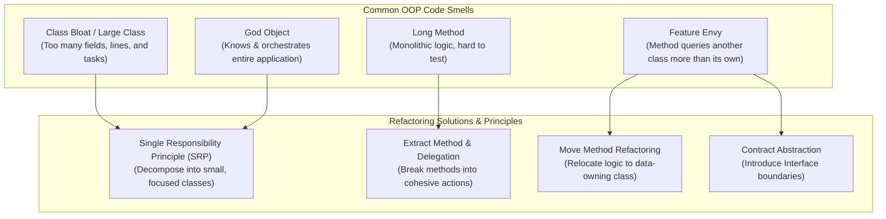

# Code Smells & OOP Anti-Patterns: Class Bloat, God Objects, Feature Envy & SRP

---

## Key Takeaways

A **code smell** is a surface indication or architectural warning sign suggesting an underlying design problem. Code smells are not syntax errors or fatal bugs; the code compiles and runs, but the system exhibits poor maintainability, tight coupling, and high fragility. The primary smells in object-oriented codebases include **Class Bloat / Large Class**, **Long Methods**, **God Objects**, and **Feature Envy**. The primary remedy for bloat and God Objects is the **Single Responsibility Principle (SRP)**—the first of the SOLID design principles—which dictates that a class must have one, and only one, reason to change. For Feature Envy, refactoring strategies involve migrating misplaced logic into the data-owning class or introducing interface boundaries.



- **Code Smell vs. Bug**: A code smell does not crash the program; it indicates structural degradation that increases cognitive load, complicates testing, and causes unexpected side effects during future modifications.
- **Class Bloat & Long Methods**: Classes and functions that grow excessively large and take on multiple disparate tasks. Software should instead consist of small, loosely coupled components with bounded responsibilities.
- **God Object**: An extreme manifestation of class bloat where an omnipotent class concentrates all business logic, holds sprawling state, and treats surrounding classes as anemic data holders, creating a single point of failure.
- **Single Responsibility Principle (SRP)**: Each class or module must encapsulate a single, cohesive piece of functionality and have only one actor or reason to change.
- **Feature Envy**: Occurs when a method in Class A spends most of its execution querying getters and mutating state in Class B rather than using its own instance data. Remedied via **Move Method** refactoring or defining formal interface contracts.

---

## Main Discussion

### Idiomatic Java Code Snippets

#### 1. Code Smell: The God Object & Feature Envy Anti-Pattern

An omnipotent `OrderManager` handling database storage, tax calculations, invoice PDF generation, and customer email alerts, while envying `CustomerAccount`'s internal data:

```java
package oop_smells.antipattern;

class CustomerAccount {
    private String name;
    private String email;
    private String street;
    private String city;
    private String postalCode;

    public CustomerAccount(String name, String email, String street, String city, String postalCode) {
        this.name = name;
        this.email = email;
        this.street = street;
        this.city = city;
        this.postalCode = postalCode;
    }

    public String getName() { return name; }
    public String getEmail() { return email; }
    public String getStreet() { return street; }
    public String getCity() { return city; }
    public String getPostalCode() { return postalCode; }
}

// CODE SMELL: God Object + Class Bloat + Feature Envy
public class OrderManager {

    // ANTI-PATTERN: Feature Envy
    // This method belongs to OrderManager, but queries CustomerAccount repeatedly
    // to format an address label, ignoring OrderManager's own instance state completely.
    public String formatShippingLabel(CustomerAccount customer) {
        return customer.getName() + "\n" +
               customer.getStreet() + "\n" +
               customer.getCity() + ", " + customer.getPostalCode();
    }

    // ANTI-PATTERN: God Object Responsibilities
    public void processOrder(CustomerAccount customer, double subtotal) {
        // 1. Tax calculation logic
        double tax = subtotal * 0.10;
        double total = subtotal + tax;

        // 2. Database persistence logic (Monolithic coupling)
        System.out.println("Executing SQL: INSERT INTO orders VALUES (" + total + ")");

        // 3. Document printing logic
        System.out.println("Generating PDF invoice for: " + customer.getName());

        // 4. Notification delivery logic
        System.out.println("Connecting to SMTP server to email: " + customer.getEmail());
    }
}

```

#### 2. Refactored Solution: Applying SRP & Eliminating Feature Envy

Decomposing the God Object into cohesive, single-purpose classes and moving logic to the data owner:

```java
package oop_smells.refactored;

import java.util.Objects;

// 1. Cohesive Domain Entity: Feature Envy resolved by moving formatting logic here
public class CustomerAccount {
    private final String name;
    private final String email;
    private final String street;
    private final String city;
    private final String postalCode;

    public CustomerAccount(String name, String email, String street, String city, String postalCode) {
        this.name = Objects.requireNonNull(name);
        this.email = Objects.requireNonNull(email);
        this.street = Objects.requireNonNull(street);
        this.city = Objects.requireNonNull(city);
        this.postalCode = Objects.requireNonNull(postalCode);
    }

    public String getName() { return name; }
    public String getEmail() { return email; }

    // MOVE METHOD REFACTORING: Logic now lives where the data resides
    public String formatShippingLabel() {
        return name + "\n" + street + "\n" + city + ", " + postalCode;
    }
}

```

```java
package oop_smells.refactored;

// 2. SRP Decomposition: Independent collaborators with single responsibilities

public class TaxCalculator {
    private final double taxRate;

    public TaxCalculator(double taxRate) {
        this.taxRate = taxRate;
    }

    public double calculateTotal(double subtotal) {
        return subtotal + (subtotal * taxRate);
    }
}

public class OrderRepository {
    public void save(String customerName, double totalAmount) {
        System.out.println("DB [Orders]: Saved record for " + customerName + " totaling $" + totalAmount);
    }
}

public class NotificationService {
    public void sendConfirmation(String emailAddress, double totalAmount) {
        System.out.println("SMTP [Mail]: Dispatching confirmation receipt of $" + totalAmount + " to " + emailAddress);
    }
}

```

```java
package oop_smells.refactored;

// 3. Clean Coordinator: Coordinates collaborating services without bloating
public class OrderService {

    private final TaxCalculator taxCalculator;
    private final OrderRepository orderRepository;
    private final NotificationService notificationService;

    public OrderService(TaxCalculator taxCalculator,
                        OrderRepository orderRepository,
                        NotificationService notificationService) {
        this.taxCalculator = taxCalculator;
        this.orderRepository = orderRepository;
        this.notificationService = notificationService;
    }

    public void checkout(CustomerAccount customer, double subtotal) {
        double total = taxCalculator.calculateTotal(subtotal);
        orderRepository.save(customer.getName(), total);
        notificationService.sendConfirmation(customer.getEmail(), total);
    }
}

```

### Under the Hood / JVM Mechanics

1. **God Object Metaspace Footprint & JIT Deoptimization Risk:**
   A bloated God Object produces a massive .class file with an inflated Constant Pool containing hundreds of external class/method references. The JVM HotSpot compiler enforces strict method inlining thresholds (typically -XX:MaxInlineSize=35 bytes of bytecode). Monolithic methods in God classes exceed inlining limits, remaining interpreted or poorly optimized.
2. **Excessive Stack Frame Allocations:**
   Long methods with dozens of temporary local variables allocate wide call stack frames containing large local variable arrays (LVA). Breaking long methods into focused components allows the JVM to reclaim operand stack space faster and enables HotSpot escape analysis to perform scalar replacement.
3. **Cache Locality & Vtable Efficiency:**
   Decomposing God classes into cohesive SRP units produces small, stable Virtual Method Tables (vtable). This maximizes CPU L1/L2 instruction cache locality and allows HotSpot's polymorphic inline caching (PIC) to resolve method call sites via direct assembly jumps rather than bloated table scans.
4. **Memory Leak Mitigation via Narrowed References:**
   God objects often retain lingering instance references to entities that are no longer needed (e.g., active database connections mixed with completed customer DTOs). Decoupling into short-lived collaborator classes lets the Garbage Collector reclaim unreachable transient objects across young generational sweeps without waiting for long-lived God object lifecycle teardowns.

### Structural Comparisons

#### Code Smell Diagnostic Matrix

| Code Smell                    | Primary Symptoms                                                                    | Root Violation                  | Prescribed Refactoring                                                                  |
| ----------------------------- | ----------------------------------------------------------------------------------- | ------------------------------- | --------------------------------------------------------------------------------------- |
| **Class Bloat (Large Class)** | $> 500$ lines, $> 10$ instance fields, dozens of methods handling different domains | Single Responsibility Principle | **Extract Class**: Split responsibilities into focused domain delegates                 |
| **God Object**                | Orchestrates the entire program, treats surrounding classes as dumb data structs    | Encapsulation & SRP             | **Decompose Responsibility**: Invert control and distribute behaviors to domain objects |
| **Long Method**               | Sprawling loops, nested conditionals, $> 30$ lines mixing calculation with I/O      | Composed Method Pattern         | **Extract Method**: Decompose into small, well-named helper functions                   |
| **Feature Envy**              | Method repeatedly calls getters on a foreign class while ignoring its own fields    | Information Hiding / Cohesion   | **Move Method**: Transfer the method to the foreign class, or expose an interface       |

#### Monolithic God Class vs. SRP Collaborators

| Architectural Attribute | God Class (`OrderManager`)                              | SRP Architecture (`OrderService` + Delegates)              |
| ----------------------- | ------------------------------------------------------- | ---------------------------------------------------------- |
| **Coupling Level**      | Tight (changes to SMTP or DB break checkout)            | **Loose** (changes isolated to individual service modules) |
| **Unit Testability**    | Very low (requires mocking DB, mail, and taxes at once) | **High** (each component can be unit-tested in isolation)  |
| **Code Reusability**    | Low (tax calculation cannot be reused elsewhere)        | **High** (`TaxCalculator` reusable across entire system)   |
| **Merge Conflict Risk** | High (entire engineering team edits the same file)      | **Low** (developers work across isolated, modular files)   |

### Common Anti-Patterns & Edge Cases

- **Mistaking DTOs for Feature Envy Targets**: Transferring every calculation into raw Data Transfer Objects (DTOs) or JPA entities can violate clean architecture if business rules leak into transport structures. Move methods only to classes that truly represent the domain model.
- **Over-Refactoring into Class Anarchy ("Poltergeist" Classes)**: Decomposing a 100-line class into 10 separate one-line classes introduces excessive indirection. Refactor when responsibilities are genuinely distinct, not solely to achieve minimal line counts.
- **Hidden Feature Envy via Law of Demeter Violations**: Chaining foreign getters (e.g., `order.getCustomer().getAddress().getZipCode()`) is a strong indicator of feature envy and train-wreck code. Tell, Don't Ask: ask the parent object for the final calculated outcome (`order.getShippingZip()`).

---

## Knowledge Check & JetBrains-Style Coding Challenges

### Theory Tips

- **Code Smell Definition**: Warning signs indicating poor design or maintainability risks, rather than active runtime errors or crashes.
- **Single Responsibility Principle**: A class or module must have only one well-defined responsibility and a single reason to change.
- **Feature Envy Identification**: A method exhibits feature envy when it accesses the attributes and getters of another class more frequently than its own.

### Question 1: Conceptual / Code Analysis

Consider the following method located inside a `PayrollProcessor` class:

```java
public class PayrollProcessor {
    public double computeTaxDeduction(Employee employee) {
        double gross = employee.getBaseSalary() + employee.getBonus();
        if (employee.getStateCode().equals("CA")) {
            return gross * employee.getTaxBracketPercentage() + employee.getLocalLevy();
        }
        return gross * employee.getTaxBracketPercentage();
    }
}

```

Which code smell is directly demonstrated by `computeTaxDeduction`, and what is the primary refactoring technique to resolve it?

- [ ] **A.** Class Bloat; resolved by merging `PayrollProcessor` into `Employee`.
- [ ] **B.** Feature Envy; resolved by performing a **Move Method** refactoring to relocate or delegate the tax deduction logic inside `Employee` (or an `Employee`-specific compensation module).
- [ ] **C.** God Object; resolved by making all fields in `Employee` public.
- [ ] **D.** Unchecked Exception; resolved by wrapping the method inside a `try-catch` block.

<details>
<summary>Correct Answer</summary>

**Correct Answer**: **B**

**Technical Breakdown**:

- **B is correct**: `computeTaxDeduction` resides inside `PayrollProcessor`, but it uses no instance fields of `PayrollProcessor`. Instead, it invokes four distinct getters on the foreign `Employee` instance (`getBaseSalary()`, `getBonus()`, `getStateCode()`, `getTaxBracketPercentage()`, and `getLocalLevy()`). It demonstrates **Feature Envy**—it is intensely interested in the data of another class. The canonical resolution is **Move Method**, transferring the method to `Employee` (or extracting a specialized compensation calculator) so the entity holding the data owns the calculation.
- **A is incorrect**: A single method accessing employee data does not necessarily constitute Class Bloat. Merging the entire processor into `Employee` would violate SRP.
- **C is incorrect**: Making fields `public` breaks encapsulation and worsens coupling.
- **D is incorrect**: There are no exceptions thrown or checked here; code smells are architectural design issues, not runtime exceptions.

</details>

---

### Question 2: Mini Coding Problem / Implementation Challenge

**Task**: Refactor a bloated class suffering from Feature Envy and SRP violations inside package `oop_smells`:

1. Existing Class `User`:
   - Private fields: `firstName` (`String`), `lastName` (`String`), `age` (`int`), `email` (`String`).
   - Constructor initializing all fields.
   - Public getters.
   - **Refactoring Task**: Move the name formatting logic into `User` so it can provide its own full name directly via `public String getFullName()`.
2. Existing Class `UserManager` (Refactor to remove God Object / Feature Envy tendencies):
   - Split out two dedicated SRP collaborators:
     - `EligibilityAuditor`: Contains `public boolean isAdult(User user)` returning `true` if `user.getAge() >= 18`.
     - `UserRegistrationService`: Contains `public String register(User user, EligibilityAuditor auditor)`:
   - Checks `auditor.isAdult(user)`.
     - If true, returns: `"REGISTERED: " + user.getFullName() + " <" + user.getEmail() + ">"`.
     - If false, returns: `"REJECTED: " + user.getFullName() + " (Underage)"`.

**Test Assertions**:

- `User adult = new User("Ada", "Lovelace", 28, "ada@computing.org");`
- `User minor = new User("Alan", "Turing", 16, "alan@computing.org");`
- `adult.getFullName()` $\rightarrow$ Returns: `"Ada Lovelace"`
- `EligibilityAuditor auditor = new EligibilityAuditor();`
- `UserRegistrationService service = new UserRegistrationService();`
- `service.register(adult, auditor)` $\rightarrow$ Returns: `"REGISTERED: Ada Lovelace <ada@computing.org>"`
- `service.register(minor, auditor)` $\rightarrow$ Returns: `"REJECTED: Alan Turing (Underage)"`

<details>
<summary>Solution</summary>

```java
package oop_smells;

import java.util.Objects;

// 1. Cohesive Domain Object: Owns its data and exposes its own formatting
public class User {

    private final String firstName;
    private final String lastName;
    private final int age;
    private final String email;

    public User(String firstName, String lastName, int age, String email) {
        this.firstName = Objects.requireNonNull(firstName);
        this.lastName = Objects.requireNonNull(lastName);
        this.age = age;
        this.email = Objects.requireNonNull(email);
    }

    public int getAge() {
        return age;
    }

    public String getEmail() {
        return email;
    }

    // Move Method Refactoring: Formats own state, eliminating foreign Feature Envy
    public String getFullName() {
        return firstName + " " + lastName;
    }
}
```

```java
package oop_smells;

// 2. Focused SRP Collaborator: Handles age domain validation only
public class EligibilityAuditor {

    public boolean isAdult(User user) {
        return user != null && user.getAge() >= 18;
    }
}
```

```java
package oop_smells;

// 3. Focused SRP Service: Handles registration coordination only
public class UserRegistrationService {

    public String register(User user, EligibilityAuditor auditor) {
        if (user == null || auditor == null) {
            throw new IllegalArgumentException("User and auditor must not be null.");
        }

        if (auditor.isAdult(user)) {
            return "REGISTERED: " + user.getFullName() + " <" + user.getEmail() + ">";
        } else {
            return "REJECTED: " + user.getFullName() + " (Underage)";
        }
    }
}
```

**Complexity Analysis**:

- **Time Complexity**: $\mathcal{O}(1)$ constant-time execution for string assembly, age comparisons, and registration dispatch.
- **Space Complexity**: $\mathcal{O}(1)$ auxiliary memory allocated per user transaction.

</details>

---
