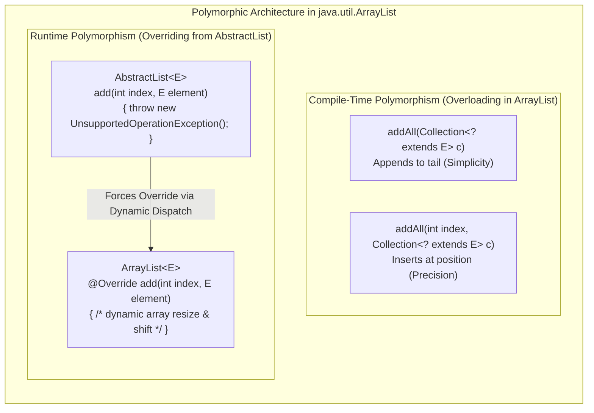

# Standard Library Polymorphism: JDK Design Patterns in `ArrayList` & `AbstractList`

---

## Key Takeaways

The Java standard library leverages both compile-time and runtime polymorphism to deliver high-performance, flexible collections. In `java.util.ArrayList`, **compile-time polymorphism** is manifested via overloaded methods such as `addAll(Collection<? extends E>)` and `addAll(int, Collection<? extends E>)`. The single-parameter variant simplifies the API by appending elements to the end of the collection, while the two-parameter variant provides fine-grained positional control. Concurrently, **runtime polymorphism** drives the architectural relationship between `ArrayList` and `java.util.AbstractList`. The base `AbstractList` defines default method skeletons that throw `UnsupportedOperationException` (e.g., in `add(int, E)`), forcing concrete subclasses to override these methods with storage-specific implementations.



- **Overloading for API Ergonomics**: Compile-time polymorphism in `ArrayList.addAll` offers convenience defaults (appending to the end) alongside precise control (inserting at a designated index), without cluttering the API with distinct method names like `addAllAtEnd` vs. `addAllAtIndex`.
- **Early Binding Performance**: Overloaded methods are bound statically at compile time into specific bytecode descriptors, eliminating runtime method-resolution overhead.
- **The `UnsupportedOperationException` Pattern**: Base skeletal classes like `AbstractList` provide partial implementations while throwing `UnsupportedOperationException` on mutating operations, forcing mutable subclasses to provide concrete overrides.
- **Architecture Selection**:
  - Use **Compile-Time Polymorphism** when offering alternative parameter pathways or configuration options for the same logical operation within one class.
  - Use **Runtime Polymorphism** when establishing extensible hierarchies where subclasses must supply custom mechanics while maintaining a uniform public interface.

---

## Main Discussion

### Idiomatic Java Code Snippets

#### 1. Compile-Time Polymorphism: Inspecting `ArrayList.addAll` Overloads

Contrasting simple tail addition against positional array shifting:

```java
package jdk_polymorphism;

import java.util.ArrayList;
import java.util.List;

public class ArrayListOverloadDemo {

    public static void main(String[] args) {
        ArrayList<String> frameworkList = new ArrayList<>();
        frameworkList.add("Spring");
        frameworkList.add("Micronaut");

        List<String> newFrameworks = List.of("Quarkus", "Helidon");

        // 1. Compile-Time Overload 1: addAll(Collection<? extends E> c)
        // Convenient default: Appends collection to the tail of the list
        frameworkList.addAll(newFrameworks);
        System.out.println("After tail addAll: " + frameworkList);
        // Output: [Spring, Micronaut, Quarkus, Helidon]

        // 2. Compile-Time Overload 2: addAll(int index, Collection<? extends E> c)
        // Specificity: Shifts existing elements and inserts items at index 1
        List<String> enterpriseTools = List.of("Jakarta EE");
        frameworkList.addAll(1, enterpriseTools);
        System.out.println("After indexed addAll: " + frameworkList);
        // Output: [Spring, Jakarta EE, Micronaut, Quarkus, Helidon]
    }
}
```

#### 2. Runtime Polymorphism: The `AbstractList` Skeletal Contract

Simulating how the JDK uses runtime overriding and `UnsupportedOperationException` to force subclasses to implement mutation logic:

```java
package jdk_polymorphism;

import java.util.Arrays;
import java.util.Objects;

// Skeletal ancestor modeling JDK's java.util.AbstractList pattern
abstract class CustomAbstractList<E> {

    // Concrete template method relying on get() and size()
    public abstract E get(int index);
    public abstract int size();

    // Default mutator implementation in skeletal class:
    // Throws UnsupportedOperationException unless overridden by mutable subclass
    public void add(int index, E element) {
        throw new UnsupportedOperationException("add(int, E) is not supported by this list");
    }

    public boolean add(E element) {
        add(size(), element);
        return true;
    }
}

// Concrete subclass: ArrayList-style dynamic backing array
class CustomArrayList<E> extends CustomAbstractList<E> {

    private Object[] elementData;
    private int size;

    public CustomArrayList() {
        this.elementData = new Object[10];
        this.size = 0;
    }

    @Override
    public int size() {
        return this.size;
    }

    @Override
    @SuppressWarnings("unchecked")
    public E get(int index) {
        Objects.checkIndex(index, size);
        return (E) elementData[index];
    }

    // Runtime Polymorphism: Overrides the throwing method with concrete memory handling
    @Override
    public void add(int index, E element) {
        if (index < 0 || index > size) {
            throw new IndexOutOfBoundsException("Index: " + index + ", Size: " + size);
        }
        ensureCapacity();
        // Shift elements to make room for insertion
        System.arraycopy(elementData, index, elementData, index + 1, size - index);
        elementData[index] = element;
        size++;
    }

    private void ensureCapacity() {
        if (size == elementData.length) {
            elementData = Arrays.copyOf(elementData, elementData.length * 2);
        }
    }
}
```

#### 3. Client Verification of Dynamic Dispatch

Demonstrating how references to the skeletal class trigger child implementations polymorphically:

```java
package jdk_polymorphism;

public class DispatchRunner {

    public static void main(String[] args) {
        // Polymorphic reference: Declared type is CustomAbstractList, runtime type is CustomArrayList
        CustomAbstractList<String> list = new CustomArrayList<>();

        // Invoking add(E): Delegates to add(int, E)
        // Dynamic dispatch routes to CustomArrayList.add(int, E) rather than CustomAbstractList.add
        list.add("Java 21");
        list.add("Java 25");

        System.out.println("Element 0: " + list.get(0)); // Java 21
        System.out.println("Element 1: " + list.get(1)); // Java 25
        System.out.println("Total Size: " + list.size()); // 2
    }
}
```

### Under the Hood / JVM Mechanics

```
   COMPILE-TIME RESOLUTION (Overloading)              RUNTIME DISPATCH (Overriding)
   Source: list.addAll(col)                           Source: abstractRef.add(0, elem)
          |                                                  |
          v                                                  v
   [javac compiler]                                   [javac compiler]
   Matches exact static signature:                    Emits generic invokevirtual:
   addAll:(Ljava/util/Collection;)Z                   add:(ILjava/lang/Object;)V
          |                                                  |
          v                                                  v
   [Bytecode Emission]                                [JVM Runtime Execution]
   Binds direct constant pool                         Inspects heap object class header;
   descriptor; no dynamic table search                traverses vtable -> executes CustomArrayList.add

```

1. **Static Signature Disambiguation in Javac:**
   When the compiler processes list.addAll(c) versus list.addAll(index, c), it resolves the parameter counts during semantic analysis. It writes distinct bytecode signatures ((Ljava/util/Collection;)Z vs (ILjava/util/Collection;)Z) into the class file's constant pool.
2. **Early Binding (invokevirtual Descriptor Directness):**
   Because the method descriptors differ, the JVM never has to determine which overloaded variant to invoke at runtime. The execution engine jumps directly to the designated method offset.
3. **Skeletal Abstract Method Stubs:**
   In AbstractList.class, methods like add(int, E) contain bytecode instructions that instantiate and throw java/lang/UnsupportedOperationException. This provides a default implementation for unmodifiable lists (e.g., List.of()) without requiring every subclass to write that boilerplate.
4. **Dynamic Vtable Overwrite:**
   When ArrayList is loaded, its Virtual Method Table (vtable) replaces the slot pointer for add(int, Object) with the address of its dynamic array shifting routine. Calls dispatched via CustomAbstractList bypass the exception stub entirely.

### Structural Comparisons

#### Compile-Time vs. Runtime Polymorphism in Library Design

| Dimension               | Compile-Time Polymorphism (`ArrayList.addAll`)   | Runtime Polymorphism (`AbstractList` → `ArrayList`)     |
| ----------------------- | ------------------------------------------------ | ------------------------------------------------------- |
| **Architectural Goal**  | Provide API convenience and parameter variations | Enforce structural contracts across class hierarchies   |
| **Location**            | Within a single class declaration                | Across superclasses, subclasses, and interfaces         |
| **Resolution Phase**    | Compile time (`javac`)                           | Runtime (JVM via `vtable` dynamic dispatch)             |
| **Dispatch Cost**       | Zero overhead; resolved statically               | Small `vtable` pointer dereference                      |
| **Flexibility**         | High convenience for consumers                   | High extensibility for library authors                  |
| **JDK Failure Pattern** | Incompatible argument compilation errors         | Throws `UnsupportedOperationException` if un-overridden |

### Common Anti-Patterns & Edge Cases

- **Skeletal Inheritance Without Overriding**:
  Subclassing `AbstractList` to build a mutable list but failing to override `add(int, E)` or `set(int, E)`. Calling `list.add("item")` will compile cleanly but fail at runtime with an `UnsupportedOperationException`.
- **Overloading with Ambiguous Nulls**:

  ```java
  public void append(String s) { ... }
  public void append(Collection<?> c) { ... }
  // Calling append(null) causes a compile error: reference to append is ambiguous
  ```

  When arguments like `null` match multiple reference types that share no subtyping relationship, `javac` cannot resolve the call. Disambiguate using explicit casting: `append((String) null)`.

- **Inventing Method Names Instead of Overloading**:
  Creating distinct identifiers like `insertAtTail(Collection c)` and `insertAtIndex(int i, Collection c)`. This clutters the public API and breaks standard conventions across the Java Collections Framework.

---

## Knowledge Check & JetBrains-Style Coding Challenges

### Theory Tips

- **JDK Pattern**: The `AbstractList` class intentionally provides default implementations of mutating methods (like `add`) that throw `UnsupportedOperationException` to force mutable subclasses (like `ArrayList`) to override them.
- **Overloading Purpose**: Overloaded methods provide flexibility by allowing callers to pass different combinations of inputs to accomplish the same conceptual operation.
- **Binding Speed**: Overloaded methods are bound at compile time, eliminating runtime table lookups.

### Question 1: Conceptual / Code Analysis

Consider the following skeletal class hierarchy:

```java
import java.util.AbstractList;

public class MinimalList<E> extends AbstractList<E> {
    private final E[] items;

    @SuppressWarnings("unchecked")
    public MinimalList(E... items) {
        this.items = items;
    }

    @Override
    public E get(int index) {
        return items[index];
    }

    @Override
    public int size() {
        return items.length;
    }
}
```

A developer executes the following statements:

```java
MinimalList<String> list = new MinimalList<>("A", "B", "C");
System.out.print(list.size() + " ");
list.add("D"); // Line 3
System.out.print(list.size());

```

What occurs when this code is executed?

- [ ] **A.** It prints `3 4`.
- [ ] **B.** It causes a compilation error at Line 3 because `MinimalList` does not declare `add(E)`.
- [ ] **C.** It prints `3 ` and then terminates with an `UnsupportedOperationException`.
- [ ] **D.** It prints `3 ` and then terminates with an `IndexOutOfBoundsException`.

<details>
<summary>Correct Answer</summary>

**Correct Answer**: **C**

**Technical Breakdown**:

- **C is correct**: `MinimalList` extends `AbstractList` and implements the mandatory query methods `get(int)` and `size()`. However, it does not override `add(int, E)` or `add(E)`. In `AbstractList`, the concrete `add(E)` method delegates directly to `add(size(), element)`, whose base implementation throws `new UnsupportedOperationException()`. Because `MinimalList` inherits this base behavior without overriding it, calling `list.add("D")` throws an `UnsupportedOperationException` at runtime.
- **A is incorrect**: `MinimalList` uses a fixed-size array and lacks array-growth logic.
- **B is incorrect**: `add(E)` is defined in `AbstractList`, so Line 3 compiles cleanly.
- **D is incorrect**: The exception thrown by `AbstractList.add(int, E)` is `UnsupportedOperationException`, not `IndexOutOfBoundsException`.

</details>

---

### Question 2: Mini Coding Problem / Implementation Challenge

**Task**: Implement a custom fixed-capacity collection named `BoundedBufferList<E>` inside package `jdk_polymorphism`:

1. Class `BoundedBufferList<E>`:
   - Extends `CustomAbstractList<E>` (from the deep dive).
   - Backed by `private final Object[] elements;` and `private int count;`.
   - Constructor `public BoundedBufferList(int capacity)`: initializes the internal array.
   - Overrides `int size()`: returns `count`.
   - Overrides `E get(int index)`: returns the element at `index`, validating bounds.
   - Overrides `void add(int index, E element)` (Runtime Polymorphism):
     - If `count == elements.length`, throws `IllegalStateException` with message `"Buffer full"`.
     - If `index < 0 || index > count`, throws `IndexOutOfBoundsException`.
     - Shifts elements, inserts `element` at `index`, and increments `count`.
   - Provides an overloaded compile-time method `public boolean addAll(E... items)` (Compile-Time Polymorphism):
   - Iterates through `items` and appends each element to the tail using `this.add(item)`.
   - Returns `true` if all elements were added successfully.

**Test Assertions**:

- `BoundedBufferList<Integer> buffer = new BoundedBufferList<>(3);`
- `buffer.addAll(10, 20);` $\rightarrow$ Returns `true`, `buffer.size()` is `2`
- `buffer.add(1, 15);` $\rightarrow$ Inserts at index 1 $\rightarrow$ `buffer.get(1)` returns `15`, `buffer.size()` is `3`
- `buffer.add(99);` $\rightarrow$ Throws `IllegalStateException: Buffer full`

<details>
<summary>Solution</summary>

```java
package jdk_polymorphism;

import java.util.Objects;

public class BoundedBufferList<E> extends CustomAbstractList<E> {

    private final Object[] elements;
    private int count;

    public BoundedBufferList(int capacity) {
        if (capacity <= 0) {
            throw new IllegalArgumentException("Capacity must be positive");
        }
        this.elements = new Object[capacity];
        this.count = 0;
    }

    @Override
    public int size() {
        return this.count;
    }

    @Override
    @SuppressWarnings("unchecked")
    public E get(int index) {
        Objects.checkIndex(index, count);
        return (E) elements[index];
    }

    // Runtime Polymorphism: Overrides throwing method from CustomAbstractList
    @Override
    public void add(int index, E element) {
        if (count >= elements.length) {
            throw new IllegalStateException("Buffer full");
        }
        if (index < 0 || index > count) {
            throw new IndexOutOfBoundsException("Index: " + index + ", Size: " + count);
        }

        // Shift elements right
        System.arraycopy(elements, index, elements, index + 1, count - index);
        elements[index] = element;
        count++;
    }

    // Compile-Time Polymorphism: Overload accepting varargs
    @SafeVarargs
    public final boolean addAll(E... items) {
        if (items == null) {
            return false;
        }
        for (E item : items) {
            this.add(item); // Delegates to inherited add(E), which dynamically dispatches to add(int, E)
        }
        return true;
    }
}
```

**Complexity Analysis**:

- **Time Complexity**:
- `get(int index)`: $\mathcal{O}(1)$ random access array lookup.
- `add(int index, E element)`: $\mathcal{O}(N)$ worst-case due to `System.arraycopy` shifting.
- `addAll(E... items)`: $\mathcal{O}(K)$ where $K$ is the number of vararg items appended.

- **Space Complexity**: $\mathcal{O}(C)$ fixed heap allocation determined by the initial `capacity` parameter $C$.

</details>

---
